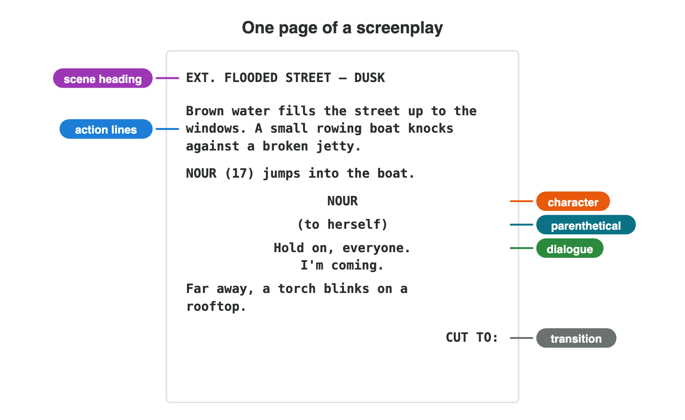
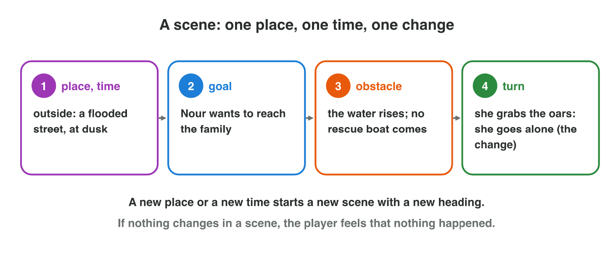
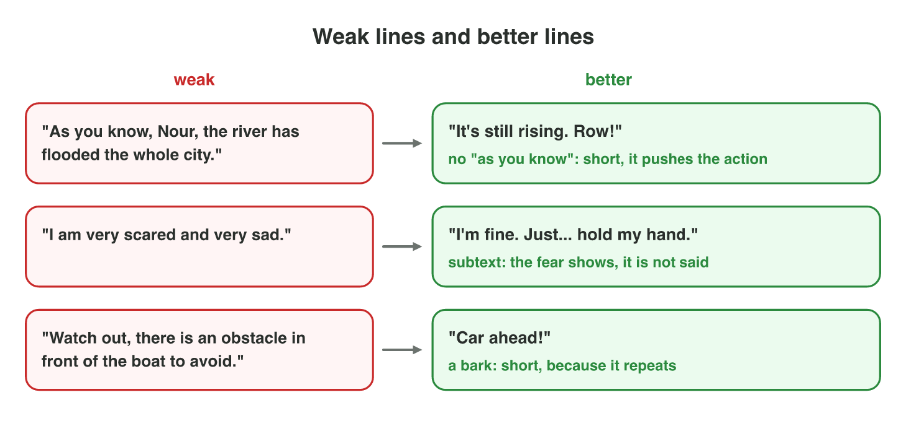
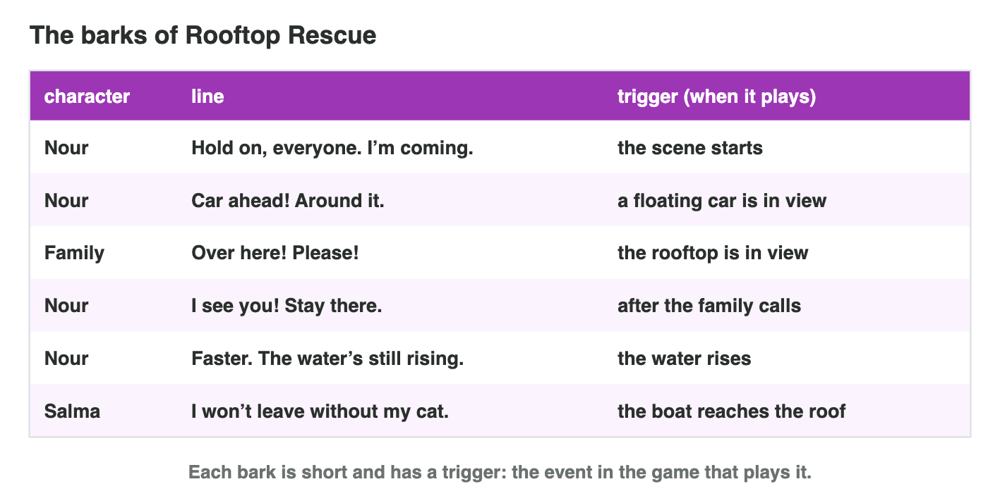

::: {.lead}
At *Night Owl Games*, the premise of *Rooftop Rescue* was approved (Seminar
3): when the river floods the old city, Nour, a young boat driver, must lead
the families on the rooftops to the hill before night falls. Now the team
needs the **script** of the first scenes. The animator asks: "Where are we,
and what do we see?" The voice actor asks: "Who speaks, and how?" The
programmer asks: "When does each line play?" One page in a fixed format
answers all three. In this lesson you learn the **screenplay format**, what
makes a **scene**, how good **dialogue** sounds, and how games add lines
that play during play: **barks** and the **line table**. Every section ends
with a short task.
:::

## Key terms



## 4.1 One page the whole team can read: the screenplay format

Every member of the team reads the script for something else. If each
writer wrote in another way, the animator would search for the place, and
the voice actor for the lines. So films, television and games use one fixed
format: the **screenplay** (@fig-page).

::: {.callout-important title="Definition 4.1 — Screenplay"}
A **screenplay** (or script) describes, scene by scene, what the audience
sees and hears, including what the characters say. It uses a fixed format,
so that every member of the team finds the same things in the same place.
:::

{#fig-page width=96%}

The parts of a screenplay page:

| Part | What it is | How it looks |
|---|---|---|
| scene heading | INT. (inside) or EXT. (outside), the place, the time | EXT. FLOODED STREET – DUSK |
| action lines | what we see and hear, in the present tense | Brown water fills the street. |
| character | the name of the speaker | NOUR, in capitals, in the middle |
| parenthetical | how a line is said, short | (to herself) |
| dialogue | the words that the character says | under the name, in a narrow column |
| transition | how we go to the next scene | CUT TO:, at the right |

: The parts of a screenplay page (@fig-page). {#tbl-parts}

::: {.callout-note title="Example 4.1 — The opening of Rooftop Rescue"}
1. The heading **EXT. FLOODED STREET – DUSK** tells the artist: outside, a
   street, in the evening light.
2. The action lines "Brown water fills the street up to the windows. A
   small rowing boat knocks against a broken jetty." give the animator the
   picture and the sound designer the knocking.
3. **NOUR**, **(to herself)** and "Hold on, everyone. I'm coming." tell the
   voice actor who speaks, how, and what.
4. **CUT TO:** ends the scene, and the next scene begins.
:::

::: {.callout-warning title="Common mistake"}
Writing thoughts and feelings in the action lines: "Nour remembers her
father and feels sad." The camera cannot film a memory. Write what we can
see or hear: "Nour touches her father's old cap. She puts it on."
:::



::: {.callout-note title="Do it · Format a scene"}
1. In the **Script Formatter** simulator above, tag the eight lines of the
   opening scene and format the page.
2. In Word (or on paper), write a scene heading and two action lines for
   the first scene of a game you know. Use the present tense and only what
   we can see or hear.

*Your result:* your score, and your heading and two action lines.

::: {.check}
In Script Formatter every line gets its part: the heading, the action lines,
the character, the parenthetical, the dialogue and the transition. A good
heading and action lines for your game: "EXT. HARBOUR – NIGHT. Rain falls on
the boats. A bell rings twice." Check: INT. or EXT., a place and a time; the
present tense; only what we can see or hear.
:::
:::

## 4.2 What makes a scene

A tester watches the first minute of *Rooftop Rescue* and says: "Nothing
happens. Nour just talks." A scene is not only a place: something must
**change** in it (@fig-scene).

::: {.callout-important title="Definition 4.2 — Scene"}
A **scene** is a part of a story in **one place** and **one continuous
time**. In a good scene, a character wants something, something stands in
the way, and at the end something has changed.
:::

{#fig-scene width=96%}

A new place or a new time starts a new scene, with a new heading. Each scene
is one step of the story: in lecture 2 you met the beats of a story;
each beat becomes one or a few scenes. Writers plan each scene first on a
short **scene card**: the place and time, the characters, the goal, the
obstacle and the turn.

Games have two kinds of scenes. In a **cutscene** the player only watches,
for example between two levels. In a **playable scene** the player plays
while the characters talk. Players often skip long cutscenes, so on a phone
a cutscene is usually short: well under a minute.

::: {.callout-note title="Example 4.2 — The jetty scene"}
1. Place and time: EXT. FLOODED STREET – DUSK.
2. Goal: Nour wants to reach the family on the rooftop.
3. Obstacle: the water is still rising, and no rescue boat is coming.
4. Turn: she jumps into the small boat and grabs the oars: she will go
   alone. The story moves on.
:::

::: {.callout-note title="Example 4.3 — Count the scenes"}
"Nour starts at the jetty. She rows down Market Street. She reaches
Salma's roof. Later that night, the boat arrives at the hill."

1. The jetty and Market Street are the same street at the same time: one
   scene, EXT. FLOODED STREET – DUSK.
2. The roof is a new place: a new scene, EXT. ROOFTOP – NIGHT.
3. "Later that night" at the hill: a new time and place, EXT. HILL – NIGHT.
:::

::: {.callout-warning title="Common mistake"}
A scene where nothing changes: two characters greet each other, talk about
the weather and leave. Cut it, or give one of them a goal and an obstacle.
:::

::: {.callout-note title="Do it · A cutscene you know"}
Think of a cutscene in a game you have played (or the opening of a film you
know).

1. Write its heading: INT. or EXT., the place, the time.
2. Write its goal, its obstacle and its turn, one line each.

*Your result:* the heading and three lines.

::: {.check}
A good answer looks like: "INT. CASTLE HALL – NIGHT. Goal: the prince wants
the key. Obstacle: the guard will not give it. Turn: the guard falls asleep,
and the prince takes the key." Check: a heading, and a turn that changes
something.
:::
:::

## 4.3 Words that sound like people: dialogue

The tester also says: "I skipped the talking. It was too long, and people
don't speak like that." Game dialogue must be short, because the player
wants to play, and it must sound like real people.

::: {.callout-important title="Definition 4.3 — Dialogue and subtext"}
**Dialogue** is the words that the characters speak. **Subtext** is what a
character means or feels, but does not say. Good dialogue often lets the
subtext show.
:::

Good dialogue in a game:

- is **short**: one or two short sentences per line;
- does a **job**: it shows the character, gives the player the goal, or
  raises the tension;
- **shows** feelings instead of naming them (subtext);
- gives each character an own **voice**: the words, the length of the
  sentences and the tone that make one character sound different from the
  others;
- never uses **"as you know"**: people do not tell each other what both
  already know.

{#fig-dialogue width=96%}

::: {.callout-note title="Example 4.4 — Fixing three lines"}
1. "As you know, Nour, the river has flooded the whole city." Both know it.
   Better: "It's still rising. Row!"
2. "I am very scared and very sad." The feeling is named. Better: "I'm
   fine. Just… hold my hand." The fear shows in the hand.
3. "Well, there are many ways, and some are better than others." It gives
   the player nothing. Better: "Go to the hill. The bridge is gone, so take
   Market Street."
:::

::: {.callout-warning title="Common mistake"}
Characters who say exactly what they feel and think, like a list. Real people hide things, joke, or change the subject. Let the
player discover the feeling.
:::



::: {.callout-note title="Do it · Dialogue Doctor"}
1. In **Dialogue Doctor**, choose the better line in the six pairs.
2. Rewrite these two lines in the same way: "As you know, the bridge is
   broken." and "I am very angry with you."

*Your result:* your stars, and your two new lines.

::: {.check}
In Dialogue Doctor the better line is the short one that shows the feeling
or gives the player a goal. Good rewrites: "As you know, the bridge is
broken." → "The bridge is gone. Take the boat." "I am very angry with you."
→ "Don't. Just… don't talk to me now."
:::
:::

## 4.4 Lines that play during the game: barks

Most lines of a game are not in cutscenes. When a floating car comes near,
Nour shouts "Car ahead!". When the player finds a family, the family calls
"Over here!". Such lines are **barks**: short lines that play when something
happens in the game.

::: {.callout-important title="Definition 4.4 — Bark"}
A **bark** is a short line that a character says during play when
something happens, such as "Watch out!" or "Low fuel!".
:::

A screenplay page cannot tell the programmer *when* a bark plays. So game
writers also keep a **table of barks** (@fig-table): the character, the
line, and its **trigger**, the event in the game that plays it.

{#fig-table width=96%}

::: {.callout-note title="Example 4.5 — Barks for the street"}
1. Nour: "Car ahead! Around it." Trigger: a floating car comes into view.
2. The family: "Over here! Please!" Trigger: the rooftop comes into view.
3. Nour: "Faster. The water's still rising." Trigger: the water rises.
4. All three are short: a bark can play many times in one level.
:::

::: {.callout-warning title="Common mistake"}
A long bark, or a bark with no trigger. "Watch out, there is an obstacle in
front of the boat that you should avoid" is too long to hear in play, and it
gets boring the third time. A line without a trigger is never played.
:::

::: {.callout-note title="Do it · Three barks"}
In Word or Excel, make a table with three columns: character, line,
trigger.

1. Choose a game you know (or invent one).
2. Write three barks for it, each with a clear trigger.

*Your result:* a table with three rows.

::: {.check}
A good table looks like: "Hero | Ammo low! | fewer than 5 shots left.
Guard | Who's there? | the player makes a noise. Shopkeeper | Back again? |
the player opens the shop." Check: each bark is short and has a clear
trigger.
:::
:::

## Case study: Rooftop Rescue

*Rooftop Rescue* is a made-up game of *Night Owl Games*. Its opening scene,
EXT. FLOODED STREET – DUSK, is the page of @fig-page: Nour jumps into the
boat and says to herself "Hold on, everyone. I'm coming." Then the player
rows down the street, and six lines play on their triggers (@fig-table):
when the scene starts, when a floating car is in view, when the rooftop is
in view, after the family calls, when the water rises, and Salma's "I won't
leave without my cat." when the boat reaches the roof. There the player chooses Nour's answer. The Game challenge
of the interactive lesson uses this scene. In the mini-game below you row
the boat yourself and watch each line play.



## Further reading

McKee, *Story*, HarperCollins, 1997, the chapters on the scene and on
dialogue. Schell, *The Art of Game Design*, 3rd ed., the chapters on
stories and on characters (the lens of the character's voice).

## Exercises

1. Who reads a game script, and what does each person look for in it? Name
   two people.
2. Write a scene heading for a scene inside a school library in the
   morning.
3. What is wrong with this action line: "Mira feels lonely and thinks of
   her family."? Rewrite it.
4. Where does a parenthetical go, and what does it say? Give an example.
5. What makes a scene? Name the three parts of a good scene.
6. "Nour rows down the street. She reaches the roof. Later, at the hill,
   she counts the families." How many scenes are there? Why?
7. What is the difference between a cutscene and a playable scene?
8. What is subtext? Rewrite "I am jealous of you." with subtext.
9. What is a bark? Why must it be short?
10. What four columns does a line table have? Why does the programmer need
    the trigger?

## Answers to the exercises

::: {.answers}
1. For example the animator (the place and what we see), the voice actor (who speaks and how), the programmer (when a line plays).
2. INT. SCHOOL LIBRARY – MORNING.
3. We cannot see a feeling or a thought. For example: "Mira looks at the photo of her family on the desk."
4. Under the character's name, before the dialogue; it says how the line is spoken, for example (whispering).
5. One place and one time; a character with a goal; an obstacle; a turn (a change) at the end.
6. Three: the street, the roof (a new place) and the hill (a new place and time).
7. In a cutscene the player only watches; in a playable scene the player plays while the characters talk.
8. What a character means or feels but does not say. For example: "Nice phone. Did your rich uncle buy it?"
9. A short line that a character says during play when something happens. It can play many times, and the player must hear it during play.
10. Character, line, trigger. The trigger tells when to play the line; without it the line never plays.
:::
