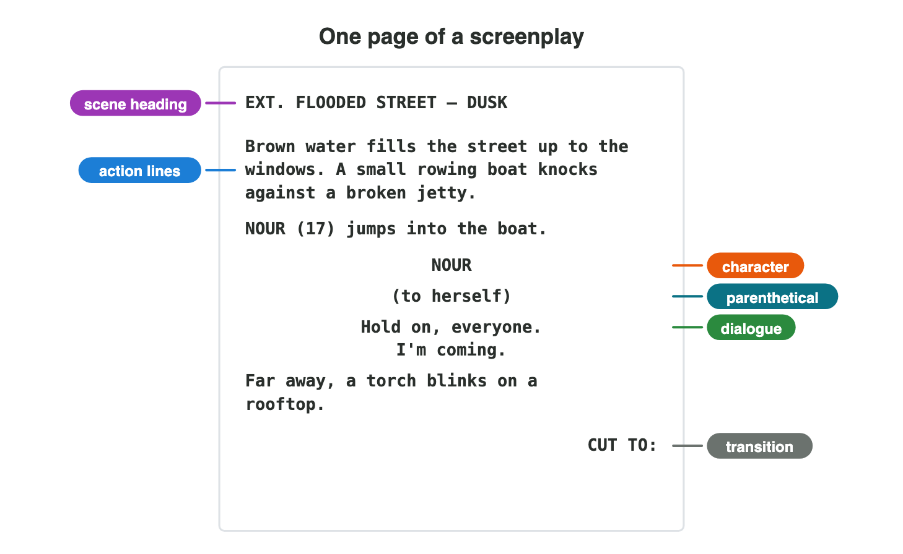
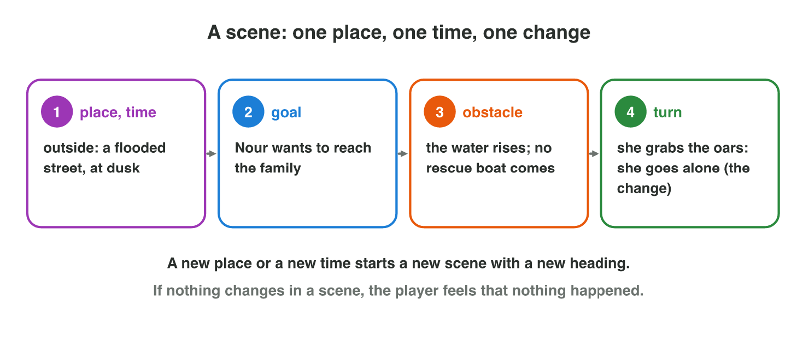
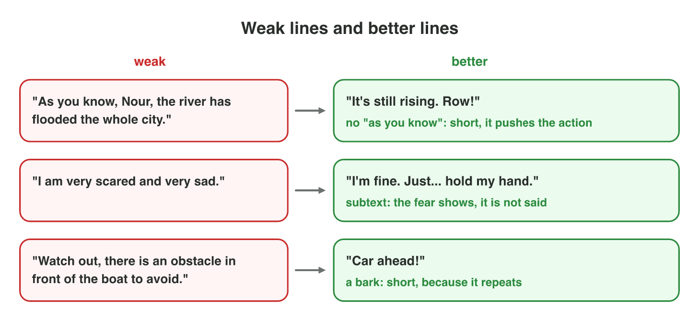
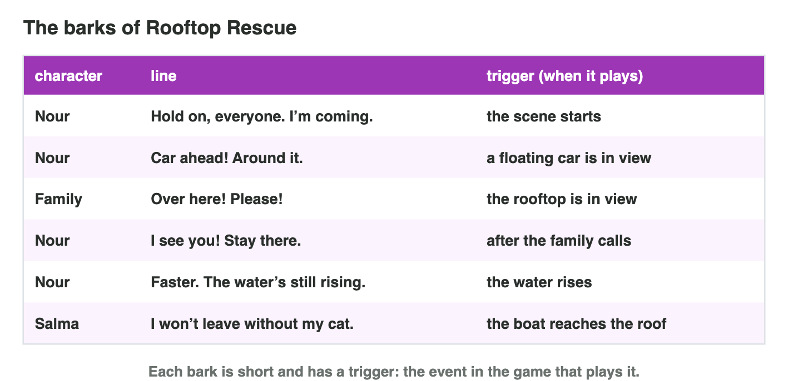

This page is the interactive version of the lesson notes (PDF). Each section
starts with a problem in a game studio. Then it explains one part of
screenwriting and what it does for the player. It ends with a **Do it** task
and one set of questions. Every question on this page has its answer: try first, then check.

## Key terms



## 4.1 One page the whole team can read: the screenplay format

- The animator, the voice actor and the programmer all read the script.
  A **screenplay** has a fixed format, so each finds what they need.
- **Scene heading:** INT. (inside) or EXT. (outside), the place, the time:
  EXT. FLOODED STREET – DUSK.
- **Action lines:** what we see and hear, in the present tense.
- **Character:** the speaker's name in capitals, in the middle.
- **Parenthetical:** how the line is said, short: (to herself).
- **Dialogue:** the words, under the name.
- **Transition:** CUT TO:, at the right.

{width=92%}

::: {.callout-warning title="Watch out!"}
Write only what we can see or hear. Not "Nour remembers her father", but
"Nour touches her father's old cap."
:::



::: {.callout-note title="Do it · Format a scene"}
In **Script Formatter**, tag the eight lines and format the page. Then look
at four first lines for a game at a harbour: a) EXT. HARBOUR – NIGHT ·
b) Night at the harbour, and Sami is sad. · c) Rain falls on the boats. A
bell rings twice. · d) Sami remembers his first boat. Which one is a correct
scene heading, and which one a correct action line?

::: {.check}
In Script Formatter every line gets its part: the heading, the action lines,
the character, the parenthetical, the dialogue and the transition. The
heading is **a**: EXT., a place and a time. The action line is **c**: the
present tense, and only what we can see or hear. Line b has no INT. or EXT.
and names a feeling; line d is a memory, which the camera cannot film.
:::
:::

::: {.callout-tip title="Try it 1 · Parts of the page"}
Choose the part of the screenplay.

::: {.match extra="the premise|the title"}
EXT. FLOODED STREET – DUSK
:   the scene heading

    Why: It says inside or outside, the place and the time.

Brown water fills the street up to the windows.
:   an action line

    Why: It says what we see, in the present tense.

(to herself)
:   a parenthetical

    Why: It says how the line is spoken.

"Hold on, everyone. I'm coming."
:   dialogue

    Why: These are the words that the character says.

CUT TO:
:   a transition

    Why: It says how we go to the next scene.
:::
:::

## 4.2 What makes a scene

- A **scene** happens in **one place** and **one continuous time**.
- A good scene has a **goal**, an **obstacle** and a **turn**: at the end,
  something has changed.
- A new place or a new time starts a new scene with a new heading.
- **Cutscene:** the player watches. **Playable scene:** the player plays
  while the characters talk. Keep cutscenes short: players skip them.
- Jetty scene: EXT. FLOODED STREET – DUSK. Goal: reach the family. Obstacle:
  the water rises, and no rescue boat comes. Turn: Nour grabs the oars and
  goes alone.

{width=92%}

::: {.callout-warning title="Watch out!"}
If nothing changes in a scene, the player feels that nothing happened.
:::

::: {.callout-note title="Do it · The parts of a cutscene"}
A cutscene: "INT. CASTLE HALL – NIGHT. a) The prince asks the guard for the
key. b) The guard says no and holds the key tight. c) The guard falls
asleep, and the prince takes the key." Write the place and the time. Then
match the goal, the obstacle and the turn to a, b and c.

::: {.check}
The place is the castle hall (inside), and the time is night. Goal **a**:
the prince wants the key. Obstacle **b**: the guard will not give it. Turn
**c**: the guard falls asleep, and the prince has the key, so the
situation changes.
:::
:::

::: {.callout-tip title="Try it 2 · Scenes"}
Choose the right answer.

::: {.match extra="the same scene|a transition"}
Nour rows from the jetty along the same street at the same time. What is it?
:   still one scene

    Why: One place and one continuous time make one scene.

The boat reaches a rooftop. What starts?
:   a new scene with a new heading

    Why: A new place starts a new scene.

What must happen near the end of a good scene?
:   a turn: something changes

    Why: Without a turn, the story does not move on.

The player only watches. What is this scene?
:   a cutscene

    Why: In a cutscene the player watches instead of playing.

Two characters greet each other, talk about the weather and leave. What is wrong?
:   nothing changes

    Why: A scene needs a goal, an obstacle and a turn.
:::
:::

## 4.3 Words that sound like people: dialogue

- Game dialogue is **short**: one or two short sentences per line.
- Each line does a **job**: it shows the character, gives the goal or raises
  the tension.
- **Subtext:** what a character means but does not say. Show feelings, do
  not name them.
- Never **"as you know"**: people do not tell each other what both know.
- Each character has a **voice**: own words, sentence length and tone.
- Weak: "I am very scared and very sad." Better: "I'm fine. Just… hold my
  hand."
- Weak: "Well, there are many ways." Better: "Go to the hill. The bridge is
  gone, so take Market Street."

{width=92%}

::: {.callout-warning title="Watch out!"}
Characters who say every feeling directly sound like a list. Real people
hide things, joke, or change the subject.
:::



::: {.callout-note title="Do it · Dialogue Doctor"}
In **Dialogue Doctor**, choose the better line in six pairs. Then choose the
better new line for each of two weak lines:

- "As you know, the bridge is broken." **A** "As you know, the old
  bridge is broken today." **B** "The bridge is gone. Take the boat."
  **C** "I am telling you that the bridge is broken."
- "I am very angry with you." **A** "I feel very, very angry." **B** "My
  feeling now is anger." **C** "Don't. Just… don't talk to me now."

::: {.check}
In Dialogue Doctor the better line is the short one that shows the feeling
or gives the player a goal. The bridge: **B**, short, with no "as you know",
and it gives the player a goal. The anger: **C**, the feeling shows in the
words, and nobody names it (subtext).
:::
:::

::: {.callout-tip title="Try it 3 · Better dialogue"}
Choose what is wrong with each line, or what it does well.

::: {.match extra="it is too short|it has a parenthetical"}
"As you know, Nour, the river has flooded the whole city."
:   "as you know": both already know it

    Why: People do not tell each other what both know.

"I am very scared and very sad."
:   it names the feeling instead of showing it

    Why: Good dialogue lets the feeling show.

"I'm fine. Just… hold my hand."
:   subtext: the fear shows

    Why: She says she is fine, but the hand shows her fear.

"Well, there are many ways, and some are better than others."
:   it gives the player no goal

    Why: A line should do a job: here, give the goal.
:::
:::

## 4.4 Lines that play during the game: barks

- A **bark** is a short line during play when something happens: "Car
  ahead!", "Over here!".
- A screenplay cannot say *when* a bark plays. So writers keep a **table of
  barks**: the character, the line, and its **trigger** (the event that plays
  it).
- Barks must be short: they can play many times in one level.

{width=92%}

::: {.callout-warning title="Watch out!"}
A long bark gets boring the third time. A line without a trigger never plays.
:::

::: {.callout-note title="Do it · Three barks"}
Four lines of a game: a) "Ammo low!" · b) "Who's there?" · c) "Back
again?" · d) "Long ago, when I was young, my father taught me how to build
boats in the old harbour." Three triggers: (1) the player makes a noise;
(2) fewer than 5 shots are left; (3) the player opens the shop. Which line is too long for a bark?
Match the other three to their triggers. Then, in Word or Excel, put them in
a table: character (hero, guard, shopkeeper), line, trigger.

::: {.check}
Line **d** is too long: the player cannot hear it during play, and it gets
boring the third time. a → (2), b → (1), c → (3). The table: "Hero | Ammo
low! | fewer than 5 shots left. Guard | Who's there? | the player makes a
noise. Shopkeeper | Back again? | the player opens the shop."
:::
:::

::: {.callout-tip title="Try it 4 · Barks"}
Use the table of barks above. Choose the right answer.

::: {.match extra="the scene ends|the voice actor"}
Which line plays when a floating car comes into view?
:   "Car ahead! Around it."

    Why: Its trigger is the floating car.

When does the family call "Over here! Please!"?
:   when the rooftop is in view

    Why: Its trigger is the rooftop in view.

Which column tells the programmer when a line plays?
:   the trigger

    Why: The trigger is the event that plays the line.

Why must a bark be short?
:   it can play many times

    Why: A long line gets boring the third time.
:::
:::

## Game challenge: Rooftop Rescue {.challenge}

Work alone. Use every section of today.

*Rooftop Rescue* is a game by *Night Owl Games*. The opening scene is EXT.
FLOODED STREET – DUSK: Nour jumps into the boat and says to herself "Hold
on, everyone. I'm coming." Then the player rows down the street, and six
lines play on their triggers (the table of barks of section 4.4). At the roof,
Salma says "I won't leave without my cat.", and the player chooses Nour's
answer.



::: {.callout-tip title="Try it 5 · The street scene"}
Rooftop Rescue, scene EXT. FLOODED STREET – DUSK. "Hold on, everyone. I'm
coming." when the scene starts; "Car ahead!" when a car is in view; "Over
here!" when the rooftop is in view; "Faster. The water's still rising." when
the water rises. Choose the right answer.

::: {.match extra="INT.|\"I see you! Stay there.\""}
Which word of the heading says that the scene is outside?
:   EXT.

    Why: EXT. means outside; INT. means inside.

Which line plays first?
:   "Hold on, everyone. I'm coming."

    Why: Its trigger is the start of the scene.

Which line plays when the water rises?
:   "Faster. The water's still rising."

    Why: Its trigger is the rising water.

"Car ahead! Around it." What kind of line is it?
:   a bark

    Why: A short line that plays during play.
:::
:::

::: {.callout-tip title="Try it 6 · The next scene (harder)"}
The next scene of Rooftop Rescue: Nour reaches Salma's roof at night. Salma
will not leave her house. Choose the right answer.

::: {.match extra="EXT. FLOODED STREET – DUSK|Salma remembers her wedding day."}
Which heading fits the next scene?
:   EXT. ROOFTOP – NIGHT

    Why: Outside, on the roof, at night.

Why does it need a new heading?
:   the place and the time change

    Why: A new place or time starts a new scene.

Which action line can the camera film?
:   Salma holds the house key tight.

    Why: The camera can film a hand, not a memory.

"SALMA (quietly)": what is "(quietly)"?
:   a parenthetical

    Why: It says how the line is spoken.
:::
:::

## Summary {.summary}

- A screenplay has a fixed format: scene heading, action lines, character, parenthetical, dialogue, transition.
- Action lines show only what we can see or hear.
- A scene is one place and one time, with a goal, an obstacle and a turn.
- Good game dialogue is short, does a job, shows feelings (subtext), gives each character a voice and never says "as you know".
- Barks play during play, each on its trigger.
