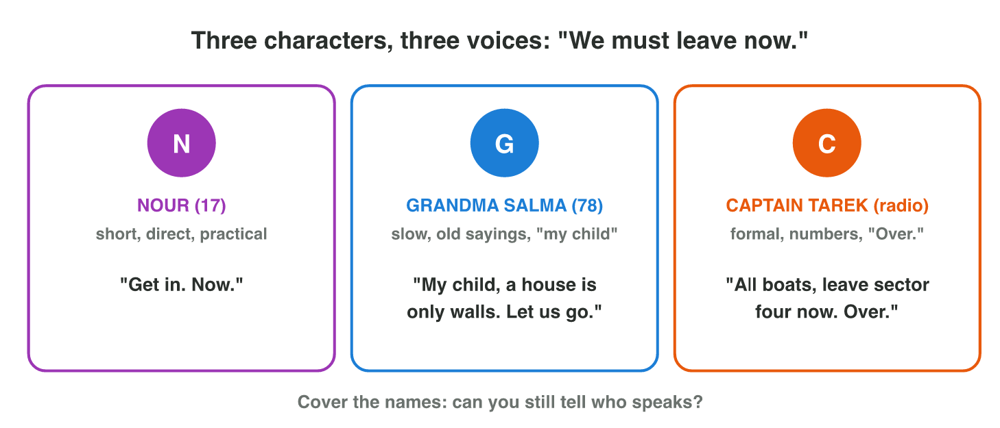

::: {.lead}
The producer of *Night Owl Games* gives each writer one scene of *Rooftop
Rescue* to write by Thursday: "Half a page, about thirty seconds, and it
must end the first stage of the game." In lecture 7 you learned the format
of a screenplay, what makes a scene, and what good dialogue does. In this
seminar you **write** a scene yourself, in three steps that writers use in
studios: plan it on a **scene card**, write it with clear action lines and
different **voices**, then read it aloud and **cut** it to its length. The
example all through the lesson is the scene "Rooftop": Nour must get
Grandma Salma into the boat. Every section ends with a short task.
:::

## Key terms



## 8.1 Plan before you write: the scene card

A writer who starts with the first line often writes three pages of talk
and no story. Writers first plan the scene on a **scene card** (@fig-card).
The card also shows where the scene sits in the game: in lecture 4 you
built the beat table of the stages; each scene does one beat.

::: {.callout-important title="Definition 8.1 — Scene card"}
A **scene card** is a short plan of one scene: the place and time, the
characters, the goal, the obstacle, the **turn**, the beat it serves and its
length. The **turn** is the moment near the end where something changes, so
that the story moves on.
:::

{#fig-card width=94%}

::: {.callout-note title="Example 8.1 — Planning \"Rooftop\""}
1. Place and time: EXT. ROOFTOP – NIGHT. Characters: Nour (17) and Grandma
   Salma (78).
2. Goal: Nour wants Salma in the boat now. Obstacle: Salma will not leave
   the house where she has lived for fifty years.
3. Turn: the water opens the door below; Salma gives Nour the house key and
   gets in.
4. Beat: the end of stage 1, the first family is safe. Length: half a page,
   about 30 seconds.
:::

::: {.callout-note title="Example 8.2 — Where does the scene go?"}
The stages of *Rooftop Rescue* (beat table): 1 the street and the first
roof; 2 the market and the bridge; 3 the hill at night.

1. "Rooftop" ends stage 1: the first family is safe, the player learns the
   rescue.
2. It must come *after* the street scene (lecture 7) and *before* the
   market: Nour cannot reach the market with Salma still on her roof.
3. So its turn (Salma gets in) opens the next stage.
:::

::: {.callout-warning title="Common mistake"}
A card without a turn: "Nour talks to Salma on the roof." Talking is not a
change. Ask: what is different at the end? If nothing, the scene is not
ready to write.
:::

::: {.callout-note title="Do it · Your scene card"}
Use your premise from lecture 6 (or the premise of a game you know).

1. Choose one scene of it. Write its card: place and time, characters,
   goal, obstacle, turn, beat, length.
2. Check: does the turn change something for the next scene?

*Your result:* a scene card with seven lines.
:::

## 8.2 Write it: action first, then voices

With the card ready, the writer writes the scene in the format of lecture 7.
Three habits make a first draft strong:

1. **Start late.** Begin when the problem is already there: Salma refuses.
   Skip the greetings.
2. **Action lines first.** Show the place, the people and the pressure: the
   rain, the rising water, the door. The player sees more than the
   characters say.
3. **One voice per character.** Each character speaks in an own way
   (@fig-voices): the words they use, the length of their sentences, their
   tone.

::: {.callout-important title="Definition 8.2 — Character voice"}
A **character voice** is the way one character speaks — the words, the
length of the sentences and the tone — that makes the character sound
different from the others.
:::

{#fig-voices width=96%}

A simple test: cover the names. If you can still tell who says each line,
the voices work.

::: {.callout-note title="Example 8.3 — The first draft of \"Rooftop\""}
EXT. ROOFTOP – NIGHT

Rain. SALMA (78) sits on a chair on the roof, the cat in her arms. The boat
bumps against the wall.

NOUR — Grandma Salma! Get in the boat, quickly!

SALMA — I am not going. Fifty years I have lived in this house.

The water reaches the door below. The door creaks open.

SALMA (quietly) — That door has never opened by itself.

Salma takes the house key from her pocket. She gives it to Nour.

SALMA — Lock it for me.

(In the real script, each name stands in capitals above its line, as in
lecture 7.)
:::

::: {.callout-note title="Example 8.4 — Three voices for one message"}
The message: everyone must leave now (@fig-voices).

1. Nour: "Get in. Now." Short orders: she acts.
2. Salma: "My child, a house is only walls. Let us go." Slow, wise, "my
   child".
3. Captain Tarek on the radio: "All boats, leave sector four now. Over."
   Formal, numbers, radio words.
:::

::: {.callout-warning title="Common mistake"}
Everyone sounds like the writer: all characters use the same words and the
same long sentences. Give each one a habit: Nour's short orders, Salma's
old sayings, Tarek's "Over."
:::



::: {.callout-note title="Do it · Write your draft"}
1. Play **Voice Match** above: find the speaker of nine lines.
2. In Word, write the first draft of the scene on your card: the heading,
   two or three action lines and six to ten lines of dialogue, in the format
   of lecture 7.

*Your result:* your stars in Voice Match, and your draft (one page at most).
:::

## 8.3 Revise: read it aloud, then cut

The first draft of "Rooftop" was 52 seconds long; the card says 30 to 35.
Writers revise in two passes: they **read the scene aloud** (the ear finds
what the eye misses), and they **cut** every line that does no job
(@fig-revise).

{#fig-revise width=96%}

The checklist of a scene:

1. Does something change (the turn)?
2. Can a line be cut without losing the goal, the obstacle or the turn?
3. No "as you know", no greetings and small talk?
4. Are feelings shown, not named?
5. Does each character have a voice? (Cover the names.)
6. Is the format right: heading, action lines, names, dialogue?
7. Does the scene fit its beat and its length?

::: {.callout-note title="Example 8.5 — Cutting \"Rooftop\" to 35 seconds"}
The long draft has 14 lines and runs 52 seconds.

1. Cut the small talk: "How is your mother?" and "She's fine…" (7 s).
2. Cut "As you know, the river has flooded the whole old city" and its
   answer (8 s).
3. Cut "I am very scared and very sad": the rain and the door already show
   the fear (3 s).
4. 52 − 18 = **34 seconds**. The goal, the obstacle and the turn are still
   there.
:::

::: {.callout-warning title="Common mistake"}
Cutting the wrong lines: the turn ("Lock it for me.") or the obstacle. A
short scene without its turn is worse than a long scene. Cut what does no
job, never what changes the story.
:::

::: {.callout-note title="Do it · Revise your draft"}
1. Read your draft aloud (quietly, or in your head, slowly).
2. Go through the checklist. Cut at least two lines, and fix one line of
   dialogue so that it shows a feeling instead of naming it.

*Your result:* your draft before and after, with the cut lines struck
through.
:::

## Case study: the Night Owl table read

At *Night Owl Games*, the writers read their scenes aloud around a table:
the **table read**. The producer listens with a stopwatch. The first draft
of "Rooftop" (scene card in @fig-card) runs 52 seconds: too long for a
cutscene that ends stage 1. It has small talk ("How is your mother?"), an
"as you know" line, and a line that names a feeling ("I am very scared and
very sad"). The producer asks for 35 seconds at most, with the goal, the
obstacle and the turn kept. The Game challenge of the interactive lesson
uses this draft. In the mini-game below you cut two scenes yourself:
"Rooftop", and a scene of *Silent Station* (lecture 5).



## Further reading

McKee, *Story*, HarperCollins, 1997, the chapters on scene design and on
the text of the scene (dialogue and its subtext). Schell, *The Art of Game
Design*, 3rd ed., on writing for games and on characters.

## Exercises

1. Name the seven lines of a scene card.
2. What is the turn of a scene? Give the turn of "Rooftop".
3. Why does "Rooftop" come after the street scene and before the market?
4. What does "start late" mean? Give an example from "Rooftop".
5. What is a character voice? Name two ways to make voices different.
6. Write "Hurry, the water is coming" in the voice of Captain Tarek.
7. What is the cover-the-names test?
8. Why do writers read a scene aloud?
9. A draft runs 50 seconds; the card says 30. Which kinds of lines do you
   cut first? Name two.
10. *Night Owl*: why must the line "Lock it for me." stay in the scene?

## Answers to the exercises

::: {.answers}
1. Place and time, characters, goal, obstacle, turn, beat, length.
2. The moment near the end where something changes. In "Rooftop": the water opens the door; Salma gives Nour the key and gets in.
3. It ends stage 1 (the first family is safe), and Nour cannot go on to the market while Salma is still on her roof.
4. Begin when the problem is already there. "Rooftop" starts when Salma refuses, without greetings.
5. The way one character speaks: words, length of the sentences, tone. For example short orders, old sayings, radio words.
6. For example: "All boats, the water is rising in sector two. Leave now. Over."
7. Cover the names: if you can still tell who speaks, the voices are different.
8. The ear finds lines that are too long, unnatural or the same for every character.
9. For example small talk and greetings, "as you know" lines, lines that name a feeling.
10. It is the turn: Salma gives up the house and gets in. Without it, nothing changes.
:::
