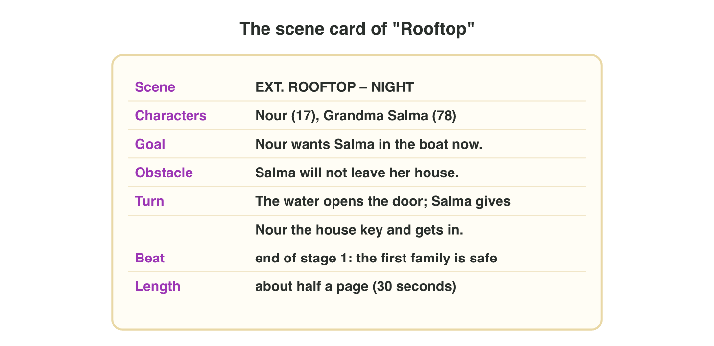

::: {.lead}
In Lecture 4 you learned the screenplay format, the parts of a scene, good
dialogue and barks. Today you use all four on one scene of *Rooftop
Rescue*. There are no new ideas: two short problems. Do each one alone. The
results of the activities are at the end of this worksheet.
:::

## Recall

The six parts of a screenplay page:

| Part | What it gives |
|---------------|-------------------------------------------------------|
| scene heading | INT. (inside) or EXT. (outside), the place and the time |
| action line | what we see and hear, in the present tense |
| character | the name of the speaker, in capitals |
| parenthetical | how the line is said, for example (quietly) |
| dialogue | the words of the character |
| transition | how we go to the next scene, for example CUT TO: |

- A **scene** is one place and one time. It has a goal, an obstacle and a
  **turn**: at the end, something changes.
- Good dialogue is short and does a job. A **bark** is a short line that
  plays on its **trigger** (the event that plays it).

::: {.callout-tip title="Try it · Recall"}
Choose the right answer.

::: {.match extra="a transition|the title"}
EXT. ROOFTOP – NIGHT. What is it?
:   the scene heading

What must happen near the end of a scene?
:   a turn: something changes

What makes a bark play?
:   its trigger
:::
:::

## Activity 1 · Plan and format the rooftop scene

*Night Owl Games* needs the next scene of *Rooftop Rescue*. Nour rows to
the roof of Grandma Salma. Before writing, the writer plans the scene on a
**scene card** (@fig-card): the place and time, the characters, the goal,
the obstacle, the turn and the length.

{#fig-card width=88%}

The writer wrote the seven lines of the scene, but they are mixed up:

| Line | Words | Part |
|:---:|----------------------------------------------------------|:-------------:|
| a | SALMA | character (example) |
| b | Salma gives Nour the house key and gets into the boat. | \_\_\_ |
| c | EXT. ROOFTOP – NIGHT | \_\_\_ |
| d | (quietly) | \_\_\_ |
| e | Rain falls. Salma sits on a chair, her cat in her arms. Brown water reaches the door below. | \_\_\_ |
| f | I am not going. Fifty years I have lived in this house. | \_\_\_ |
| g | CUT TO: | \_\_\_ |

::: {.callout-note title="Activity 1 · Format the scene · 15 min"}
1. Write the part of each line in the table: heading, action line,
   character, parenthetical, dialogue or transition. Line a is done for
   you. You can use a part more than once.
2. Put the seven lines in screenplay order: write the seven letters. Help:
   the heading comes first, and CUT TO: comes last.
3. Which line is the turn of the scene? Write its letter.

*Your product:* six parts, seven letters and one letter.

::: {.check}
- a character (example) · b action line · c scene heading · d
  parenthetical · e action line · f dialogue · g transition.
- The order is **c, e, a, d, f, b, g**: the heading, what we see, then
  the name, how she speaks and her words, then the turn, and CUT TO: at
  the end.
- The turn is **b**: Salma leaves her house, so the situation changes.
:::
:::

## Activity 2 · Cut the dialogue and match two barks

The first draft of the scene "Rooftop" lasts **52 seconds** when it plays.
The producer wants **35 seconds at most**, because players skip long
cutscenes. Some lines do no job:

- small talk (hello, the weather),
- an "as you know" line and its answer,
- a line that names a feeling.

The goal, the obstacle and the turn must stay. In the mini-game *Scene
Cutter* you tap a line to cut it, and the game adds up the seconds.



::: {.callout-note title="Activity 2 · Cut and match · 15 min"}
1. In **Scene Cutter**, cut the weak lines until "Rooftop" fits 35 seconds.
2. Which new line shows the fear of "I am very scared and very sad."?
   Choose A, B or C.

   - **A.** "I am so scared, and I feel sad."
   - **B.** "Just… hold my hand. Don't look down."
   - **C.** "As you know, I am afraid of the water."

3. Nour rows back with Salma. Match Nour's two barks to their triggers.
   One trigger is not used. The triggers: (1) the hill is in view; (2) a
   wave hits the boat; (3) Salma opens her bag.

   | Bark of Nour | Trigger |
   |---------------------|:---------:|
   | "Hold on tight!" | \_\_\_ |
   | "Almost there." | \_\_\_ |

*Your product:* the new length of the scene, one letter and two pairs.

::: {.check}
Cut the small talk (3 s + 4 s), the "as you know" line (5 s), its answer
(3 s) and the named feeling (3 s): 52 − 18 = **34 seconds**. The new line is
**B**: the fear shows in what she asks, and nobody names it. A still names
the feelings, and C is an "as you know" line. "Hold on tight!" → **(2)** a
wave hits the boat; "Almost there." → **(1)** the hill is in view.
:::
:::

## Exercises

1. Write the heading of a scene inside a school classroom in the morning.
2. "Ali feels that his father is proud of him." Which action line can the
   camera film: (A) "Ali knows that his father is proud." (B) "His father
   smiles and puts a hand on Ali's shoulder." (C) "Ali feels happy."
3. Which line must you never cut: the small talk, the "as you know" line or
   the turn?
4. A guard says "Who's there?". Which trigger fits this bark: the player
   makes a noise, the level ends, or the player opens the map?

## Answers to the exercises

::: {.answers}
1. INT. CLASSROOM – MORNING.
2. (B): the camera can film a smile and a hand, not a feeling.
3. The turn.
4. The player makes a noise.
:::
