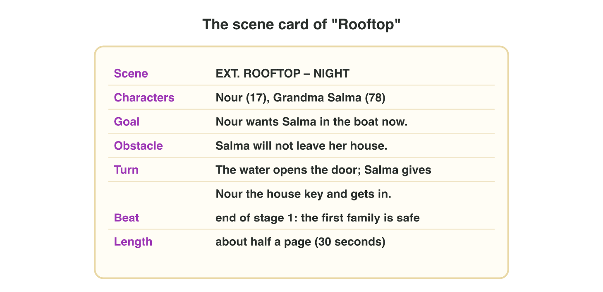
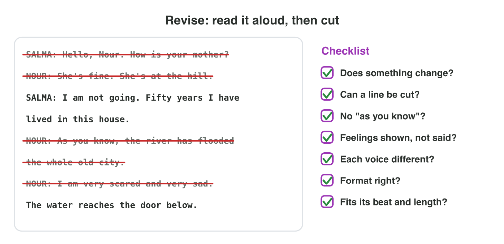

## Recall · Lecture 4

a) What does the scene heading EXT. ROOFTOP – NIGHT tell us?
b) What must happen near the end of a good scene?
c) What makes a bark play during the game?

::: {.answer}
a) outside, on a roof, at night
b) a turn: something changes
c) its trigger
:::

## Activity 1 · Format the scene · 15 min

:::: {.columns}
::: {.column width="50%"}
- Nour rows to Grandma Salma's roof, and the writer has the scene card.
- **Do it:** Write the heading, two action lines, Salma's first line with a parenthetical, and the turn.
- Your product is the scene in screenplay format, about half a page.
:::
::: {.column width="50%"}

:::
::::

## Check 1 · Format the scene

What does a good page of "Rooftop" look like?

::: {.reveal}
1. The heading is EXT. ROOFTOP – NIGHT: outside, the place and the time.
2. The action lines show only what we see: "Rain falls. Salma sits on a chair, her cat in her arms."
3. Salma's line has her name, then (quietly), then her words: "I am not going."
4. The turn changes something: "Salma gives Nour the house key and gets into the boat."
:::

## Activity 2 · Cut and add · 15 min

:::: {.columns}
::: {.column width="50%"}
- The first draft of "Rooftop" runs 52 seconds, but the producer wants 35 seconds at most.
- **Do it:** Cut the weak lines in Scene Cutter. Rewrite "I am very scared and very sad." Write two barks for Nour with their triggers.
- Your product is the new length, one line and a table of two barks.
:::
::: {.column width="50%"}

:::
::::

## Live demo · Scene Cutter



## Check 2 · Cut and add

How long is the scene after the cut, and what are good new lines?

::: {.reveal}
1. Cut the small talk, the "as you know" line, its answer and the named feeling: 52 − 18 = 34 seconds.
2. The goal, the obstacle and the turn stay, so the scene still works.
3. A good rewrite shows the fear: "Just… hold my hand. Don't look down."
4. Good barks: "Hold on tight!" when a wave hits the boat, and "Almost there." when the hill is in view.
:::

## Wrap-up

- You can plan a scene on a card and write it in screenplay format.
- You can cut lines that do no job and show a feeling instead of naming it.
- You can write barks, each with its trigger.
