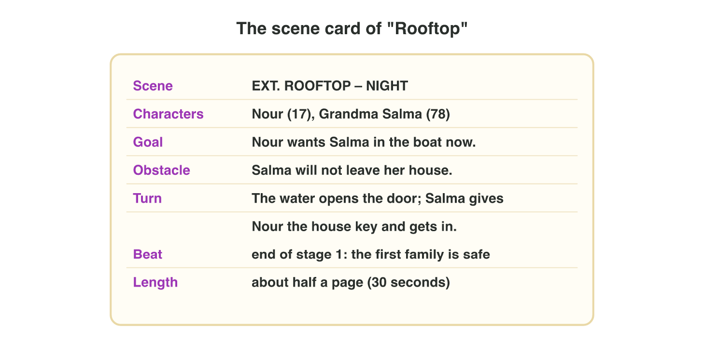
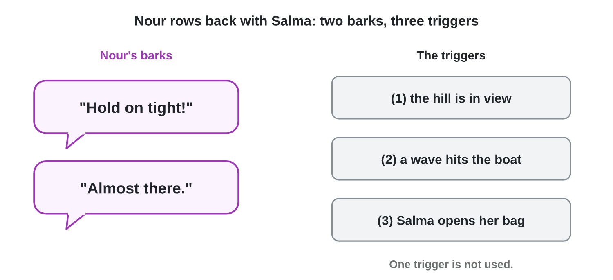

## Recall · Lecture 4

a) What does the scene heading EXT. ROOFTOP – NIGHT tell us?
b) What must happen near the end of a good scene?
c) What makes a bark play during the game?

::: {.answer}
a) outside, on a roof, at night
b) a turn: something changes
c) its trigger
:::

## The facts · the seven mixed-up lines

| Line | Words of the scene "Rooftop" |
|:-----:|-------------------------------------------------------------------|
| a | SALMA |
| b | Salma gives Nour the house key and gets into the boat. |
| c | EXT. ROOFTOP – NIGHT |
| d | (quietly) |
| e | Rain falls. Salma sits on a chair, her cat in her arms. |
| f | I am not going. Fifty years I have lived in this house. |
| g | CUT TO: |

## Activity 1 · Format the scene · 15 min

:::: {.columns}
::: {.column width="50%"}
- Nour rows to Grandma Salma's roof, and the seven lines of the scene are mixed up.
- **Do it:** Write the part of each line, and put the seven lines in screenplay order. Which line is the turn?
- Your product is six parts, seven letters and one letter.
:::
::: {.column width="50%"}

:::
::::

## Check 1 · Format the scene

What is the order of the seven lines of "Rooftop"?

::: {.reveal}
1. The order is c, e, a, d, f, b, g.
2. First the heading (c), then the action line (e): only what we see and hear.
3. Then SALMA (a), (quietly) (d) and her words (f): the character, the parenthetical and the dialogue.
4. The turn (b) is an action line: Salma gives Nour the key and leaves. CUT TO: (g) ends the scene.
:::

## Activity 2 · Cut and match · 15 min

:::: {.columns}
::: {.column width="50%"}
- The first draft of the scene "Rooftop" lasts 52 seconds, but the producer wants 35 seconds at most.
- **Do it:** Cut the weak lines in Scene Cutter. Choose the line that shows the fear, and match two barks to their triggers.
- Your product is the new length, one letter and two pairs.
:::
::: {.column width="50%"}

:::
::::

## Live demo · Scene Cutter



## Check 2 · Cut and match

How long is the scene after the cut, and what are good new lines?

::: {.reveal}
1. Cut the small talk, the "as you know" line, its answer and the named feeling: 52 − 18 = 34 seconds.
2. The goal, the obstacle and the turn stay, so the scene still works.
3. Line B shows the fear: "Just… hold my hand. Don't look down." Line A still names it.
4. "Hold on tight!" plays when a wave hits the boat; "Almost there." plays when the hill is in view.
:::

## Wrap-up

- You can tag the lines of a scene and put them in screenplay order.
- You can cut lines that do no job and choose a line that shows a feeling.
- You can match barks to their triggers.
