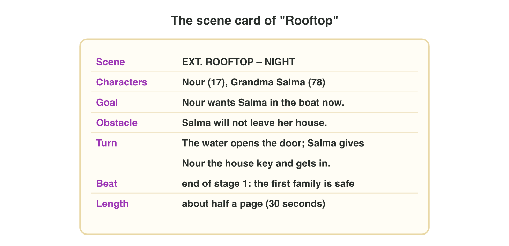

No new ideas today: two short problems on Lecture 4. Do each one alone,
then open "Check your result". Every question on this page has its answer:
try first, then check.

## Recall

- A **screenplay** has a fixed format: scene heading, action lines,
  character, parenthetical, dialogue.
- A **scene** is one place and one time. It has a goal, an obstacle and a
  **turn**: at the end, something changes.
- Good dialogue is short and does a job. A **bark** is a short line that
  plays on its **trigger**.

::: {.callout-tip title="Try it 1 · Recall"}
Choose the right answer.

::: {.match extra="a transition|the title"}
EXT. ROOFTOP – NIGHT. What is it?
:   the scene heading

    Why: It says outside, the place and the time.

What must happen near the end of a scene?
:   a turn: something changes

    Why: Without a turn, the story does not move on.

What makes a bark play?
:   its trigger

    Why: The trigger is the event that plays the line.
:::
:::

## Activity 1 · Plan and format the rooftop scene

*Night Owl Games* needs the next scene of *Rooftop Rescue*. Nour rows to
the roof of Grandma Salma. The writer plans the scene on a **scene card**
first.

{width=88%}

The writer wrote the seven lines of the scene, but they are shuffled: a) SALMA · b) Salma gives Nour the house key and gets into the boat. ·
c) EXT. ROOFTOP – NIGHT · d) (quietly) · e) Rain falls. Salma sits on a
chair, her cat in her arms. Brown water reaches the door below. · f) I am
not going. Fifty years I have lived in this house. · g) CUT TO:

::: {.callout-note title="Activity 1 · Format the scene · 15 min"}
1. Write the part of each line: heading, action line, character,
   parenthetical, dialogue or transition. You can use a part more than
   once.
2. Put the seven lines in screenplay order: write the seven letters.
3. Which line is the turn of the scene? Write its letter.

*Your product:* seven parts, seven letters and one letter.

::: {.check}
a character · b action line · c heading · d parenthetical · e action line ·
f dialogue · g transition. The order: **c, e, a, d, f, b, g**: the heading,
what we see, then the name, how she speaks and her words, then the turn,
and CUT TO: at the end. The turn is **b**: Salma leaves her house, so the
situation changes.
:::
:::

::: {.callout-tip title="Try it 2 · The card and the page"}
Use the scene card of "Rooftop". Choose the right answer.

::: {.match extra="the obstacle|the heading"}
Which part of the card is "Salma gives Nour the house key and gets in"?
:   the turn

    Why: It changes something: Salma leaves her house.

"Salma remembers her wedding day." Why is this a weak action line?
:   the camera cannot film a memory

    Why: Action lines show only what we can see or hear.

Where do you write "(quietly)"?
:   under the name, before the words

    Why: A parenthetical stands between the character and the dialogue.
:::
:::

## Activity 2 · Cut the dialogue and match two barks

The first draft of "Rooftop" runs **52 seconds**. The producer wants
**35 seconds at most**. Some lines do no job: small talk, an "as you know"
line, and a line that names a feeling. Keep the goal, the obstacle and the
turn.



::: {.callout-note title="Activity 2 · Cut and match · 15 min"}
1. In **Scene Cutter**, cut the weak lines until "Rooftop" fits 35 seconds.
2. Which new line shows the fear of "I am very scared and very sad."?
   Choose A, B or C.

   - **A.** "I am so scared, and I feel sad."
   - **B.** "Just… hold my hand. Don't look down."
   - **C.** "As you know, I am afraid of the water."

3. Nour rows back with Salma. Match Nour's two barks, "Hold on tight!" and
   "Almost there.", to their triggers: (1) the hill is in view; (2) a wave
   hits the boat; (3) Salma opens her bag. One trigger is left over.

*Your product:* the new length of the scene, one letter and two pairs.

::: {.check}
Cut the small talk (3 s + 4 s), the "as you know" line (5 s), its answer
(3 s) and the named feeling (3 s): 52 − 18 = **34 seconds**. The new line is
**B**: the fear shows in what she asks, and nobody names it. A still names
the feelings, and C is an "as you know" line. "Hold on tight!" → **(2)** a
wave hits the boat; "Almost there." → **(1)** the hill is in view.
:::
:::

::: {.callout-tip title="Try it 3 · Cut, keep or bark"}
Choose the right answer.

::: {.match extra="keep: it is the goal|Nour"}
SALMA: "Hello, Nour. How is your mother?"
:   cut: small talk

    Why: Nothing changes, so the line does no job.

SALMA: "Lock it for me."
:   keep: it is the turn

    Why: Never cut the turn of a scene.

"My child, a house is only walls." Who says it: Nour (short orders) or Salma (slow, old sayings)?
:   Salma

    Why: "My child" and an old saying are Salma's voice.

"Hold on tight!" plays when a wave hits the boat. What is "a wave hits the boat"?
:   the trigger

    Why: The trigger is the event that plays the bark.
:::
:::

## At home · Task with AI

::: {.callout-note .ai-task title="Task with AI · A screenplay scene in a table"}
An extra for the curious: let an AI assistant make the table. Copy the
prompt into an AI assistant that the university allows (for example
Microsoft Copilot with your university account), and look at the result.

::: {.prompt}
Write one short scene of a mobile game as a screenplay, with a heading,
action lines and about 8 lines of dialogue. Place and time: inside a
lighthouse, at night, during a storm. Characters: Mira, the young keeper,
and Tamer, an old fisherman who speaks on the radio. Goal: Mira wants to
keep the light on. Obstacle: the generator stops. At the end, something
must change. Then show the scene as a table with three columns: line, who
(or "action"), words.
:::

**What do you see?**

::: {.check label="What you should see"}
A heading such as INT. LIGHTHOUSE – NIGHT, action lines in the present
tense, short lines for Mira and Tamer, and a turn at the end: for example,
Tamer tells Mira how to start the generator by hand, and the light comes
back.
:::

::: {.try-change}
**Change:** ask: "Write it again, with no line that names a feeling." What do you
notice?

::: {.check}
Lines such as "Mira is afraid" become actions such as "Mira grips the
rail": the player sees the feeling instead of reading its name.
:::
:::

::: {.try-change}
**Change:** change the time to day and the obstacle to "Tamer's boat is near the
rocks", and ask again. What do you notice?

::: {.check}
The heading says DAY, and the action is about the rocks: a new obstacle
gives the scene a new goal and a new turn.
:::
:::

**Your own idea:** change one more number or word, and look again. The AI
can be wrong: compare its result with the answers.
:::

## Wrap-up {.summary}

- You can tag the lines of a scene and put them in screenplay order.
- You can cut lines that do no job, choose a line that shows a feeling, and
  match barks to their triggers.
