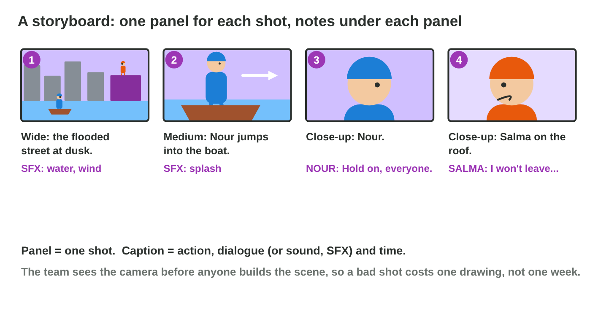
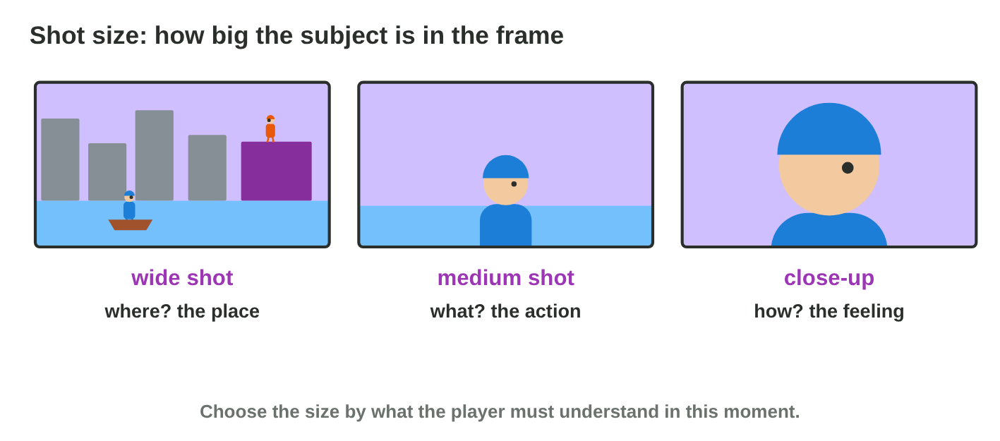
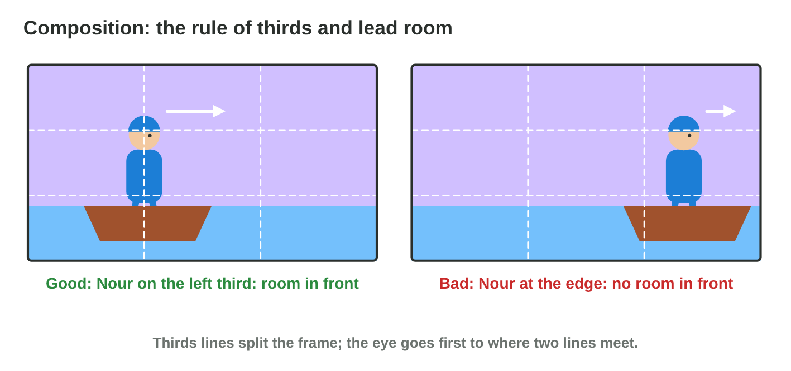
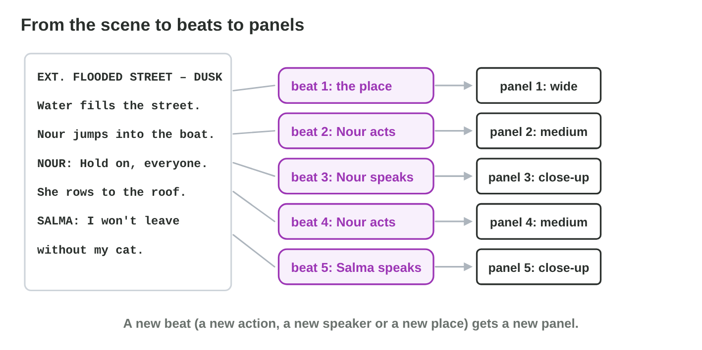

This page is the interactive version of the lesson notes (PDF). Each section
starts with a problem in a game studio. Then it explains one idea. It ends
with a **Do it** task and one set of questions. Tap, sort or type your
answer: the page checks it at once and tells you why.

## Key terms



## 5.1 See the scene before you build it: the storyboard

- A **storyboard** is a series of simple drawings, the **panels**: one for
  each shot of a scene.
- Under each panel, the **caption**: the shot size, the action or the line,
  the sound (SFX), the time.
- A panel has a number, a 16:9 frame, simple shapes and **arrows** for
  movement.
- A built 3D shot takes days; a drawing takes two minutes. So the team
  draws first, and changes cost little.
- The first three panels of *Rooftop Rescue*:

| Panel | Shot size | What we see or hear | Sound (SFX) | Time |
|:---:|:---------:|------------------------------------|:-----------:|:----:|
| 1 | wide | the flooded street | water, wind | 3 s |
| 2 | medium | Nour jumps into the boat. | splash | 2 s |
| 3 | close-up | Nour's face: "Hold on, everyone." | | 2 s |

{width=92%}

::: {.callout-warning title="Watch out!"}
A storyboard is a plan, not the final art. Use simple shapes.
:::

::: {.callout-note title="Do it · Three panels on paper"}
Fold an A4 paper twice to get four boxes. Draw the three panels of the
table above, with simple shapes. Under each panel, write its caption: the
shot size, the action or the line, the sound and the time.

::: {.choice}
Which caption of panel 2 is complete?

- [x] "2 · medium · Nour jumps into the boat · SFX: splash · 2 s"

  Why: A number, the shot size, the action, the sound and the time.

- [ ] "Nour jumps."

  Why: No number, no shot size, no sound and no time.

- [ ] "A nice picture of the boat."

  Why: A caption says what the panel plans, not how it looks.
:::

::: {.choice}
Your panels use stick figures and simple shapes. Is that right?

- [x] Yes: a storyboard is a plan, not the final art.

  Why: Simple shapes are fast and show the shot, the action and the order.

- [ ] No: a storyboard must look like the final game.

  Why: The final art comes later; the board only plans it.
:::
:::

::: {.callout-tip title="Try it 1 · Storyboards"}
Choose the right answer.

::: {.match extra="the final art of the game|the script"}
What is one panel of a storyboard?
:   one drawing of one shot

    Why: A storyboard has one panel for each shot.

What does the caption under a panel give?
:   the shot size, the action or line, the sound and the time

    Why: The team cannot guess the sound or the time from the drawing.

Why does a team draw a storyboard before it builds a cutscene?
:   a drawing is cheap to change

    Why: A drawing takes minutes; a built shot takes days.

How do you show in a panel that Nour rows to the right?
:   with an arrow

    Why: Arrows show movement in a panel.
:::
:::

## 5.2 How close is the camera? Shot sizes

| Shot size | What the player learns | Rooftop Rescue |
|---|---|---|
| **Wide** (establishing) | where the scene happens | the flooded street |
| **Medium** (waist up) | what a character does | Nour rows the boat |
| **Close-up** (a face) | what a character feels, a detail | Salma's fear |

- The first wide shot of a scene is the **establishing shot**.
- **Camera angle:** from above (high angle), a character looks small and
  weak; from below (low angle), big and strong.

{width=92%}

::: {.callout-warning title="Watch out!"}
Do not use the same size for every panel. Change the size when the purpose
changes.
:::

::: {.callout-note title="Do it · Three sizes with your phone"}
Take a wide shot, a medium shot and a close-up of one object on your desk,
for example a bottle.

::: {.sort}
What does each shot show the player? Sort the photos.

Wide shot
:   where the object is: the bottle on a desk in a classroom

    Why: A wide shot shows the place.

Medium shot
:   what happens to it: a hand opens the bottle

    Why: A medium shot shows the action.

Close-up
:   a detail: the label with the name

    Why: A close-up shows one detail, or a feeling on a face.
:::

::: {.choice}
The camera looks at a character from below (a low angle). How does the
character look?

- [x] big and strong

  Why: From below, a character looks big.

- [ ] small and weak

  Why: That is the high angle, from above.

- [ ] the same as from the front

  Why: The angle changes how the player sees the character.
:::
:::

::: {.callout-tip title="Try it 2 · Shot sizes"}
Choose the right shot. You can use an answer more than once.

::: {.match extra="a low angle"}
The scene starts: the player must see the flooded street.
:   a wide shot

    Why: A wide shot shows where the scene happens.

Nour rows hard against the water.
:   a medium shot

    Why: A medium shot shows what a character does.

Salma says "I won't leave without my cat." She is afraid.
:   a close-up

    Why: A face shows the feeling.

The cat's small, wet paw on the roof is an important detail.
:   a close-up

    Why: A close-up fills the frame with one detail.
:::
:::

## 5.3 Where does the eye go? Composition

- **Composition** is how things are placed in the frame.
- **Rule of thirds:** two lines across and two lines down split the frame;
  put the subject on a line or where two lines meet.
- **Lead room:** empty space in front of a character, where it looks or
  moves.
- Nour rows to the right, so she goes on the **left** third. Salma looks
  to the left, so she goes on the **right** third.

{width=92%}



::: {.callout-warning title="Watch out!"}
A subject in the exact centre looks still. Use a thirds line, with lead
room in front.
:::

::: {.callout-note title="Do it · Thirds on your phone"}
Turn on the camera grid (Android: camera settings › Grid lines; iPhone:
Settings › Camera › Grid), or use **Frame Lab**. Take one photo with lead
room and one with the subject looking out at the edge.

::: {.choice}
Which photo of a toy feels better?

- [x] the toy on the left thirds line, looking right into the empty space

  Why: The lead room in front of it leads the eye.

- [ ] the toy in the exact centre

  Why: A subject in the exact centre looks still.

- [ ] the toy at the edge, looking out of the frame

  Why: The picture feels cut off.
:::

::: {.choice}
Nour rows to the left. Where does she go in the frame?

- [x] on the right third, with space in front of her

  Why: She looks and moves to the left, so the lead room is on the left.

- [ ] on the left third

  Why: Then she would row out of the frame.

- [ ] in the exact centre

  Why: The centre looks still and gives no lead room.
:::
:::

::: {.callout-tip title="Try it 3 · Composition"}
Choose the right answer.

::: {.match extra="in the exact centre|at the top edge"}
Nour rows to the right. Where do you place her?
:   on the left third

    Why: Then the lead room is in front of her, on the right.

Salma looks to the left. Where do you place her?
:   on the right third

    Why: Then she looks into the empty space.

What is lead room?
:   empty space in front of the character

    Why: The player looks where the character looks or moves.

Nour rows to the right, but she is at the right edge. What is wrong?
:   she has no lead room

    Why: The boat seems to hit the border of the frame.
:::
:::

## 5.4 From the scene to the panels: beats and flow

- A new **beat** starts when something changes: a new **place**, a new
  **action**, a new **speaker** or a new **feeling**.
- Each beat gets at least one panel. Not one panel per sentence.
- Number the panels: often the place first, then the action, then the
  feeling.
- A movement keeps its **screen direction**: if Nour rows left to right in
  panel 2, she rows left to right in panel 4 too. If it flips, the player
  thinks she turned back.

{width=92%}

::: {.callout-warning title="Watch out!"}
Two sentences of the same speaker with the same feeling are one beat and
one panel.
:::

::: {.callout-note title="Do it · Beats of a short scene"}
A short scene in three lines: (1) INT. SALMA'S KITCHEN – NIGHT. Water comes
under the door. (2) Salma lifts the cat onto the table. (3) SALMA: Stay
here, Pasha.

::: {.sort}
Which shot size fits each line? Sort them.

Wide
:   1) Water comes under the door of the kitchen.

    Why: A new place: show where we are.

Medium
:   2) Salma lifts the cat onto the table.

    Why: A new action: show what happens.

Close-up
:   3) SALMA: Stay here, Pasha.

    Why: A new speaker and a feeling: show her face.
:::

::: {.choice}
How many panels does the scene need?

- [x] three

  Why: Each line is one beat, and each beat is one panel.

- [ ] one, because it is one scene

  Why: The place, the action and the speaker change: three beats.

- [ ] six

  Why: Two panels for one beat would repeat the same thing.
:::
:::

::: {.callout-tip title="Try it 4 · Beats and flow"}
Choose the right answer.

::: {.match extra="nothing changes|a new place"}
"Nour jumps into the boat." What changes?
:   a new action

    Why: Nour does something new.

"NOUR: Hold on, everyone." What changes?
:   a new speaker

    Why: Someone new speaks.

Panel 2: Nour rows left to right. Panel 4: right to left. What does the player think?
:   Nour turned back

    Why: The screen direction flipped.

Salma says two sentences with the same fear. How many panels?
:   one

    Why: The same speaker with the same feeling is one beat.
:::
:::

## Game challenge: storyboarding Rooftop Rescue {.challenge}

Work alone. Use every section of today.

*Night Owl Games* storyboards the opening of *Rooftop Rescue* in five
panels:

| Panel | What happens in the opening |
|:---:|----------------------------------------------------------|
| 1 | The flooded street at dusk. |
| 2 | Nour jumps into the boat and rows, from left to right. |
| 3 | Nour says: "Hold on, everyone. I'm coming." |
| 4 | Nour rows on, from left to right. |
| 5 | On the roof, Salma says: "I won't leave without my cat." |



::: {.callout-tip title="Try it 5 · The board"}
The five panels: 1 the street, 2 Nour rows, 3 Nour's line, 4 Nour rows on,
5 Salma's line. Nour rows from left to right. Choose the right answer.

::: {.match extra="a high angle|in the centre"}
Which shot opens the board?
:   a wide shot of the street

    Why: The first shot shows the place: the establishing shot.

Which shot shows Nour rowing?
:   a medium shot of Nour

    Why: An action is shown in a medium shot.

Which shot shows Salma's line?
:   a close-up of Salma

    Why: Her line is about fear.

Where is Nour in the frame while she rows?
:   on the left third

    Why: She rows to the right, so the lead room is on the right.
:::
:::

::: {.callout-tip title="Try it 6 · Check the board (harder)"}
A new artist draws the opening. Choose what is wrong with each idea.

::: {.match extra="nothing is wrong"}
The board starts with a close-up of Nour.
:   no establishing shot

    Why: The player does not know where the scene happens.

Panel 4 shows Nour rowing right to left.
:   the screen direction flips

    Why: In panel 2 she rows left to right.

Salma's fearful line is in a wide shot of the roof.
:   the feeling is too far away

    Why: A feeling needs a close-up.

Nour is in the exact centre of every panel.
:   no lead room

    Why: She needs space in front of her, on a thirds line.
:::
:::

## Summary {.summary}

- A storyboard is a series of simple panels, one per shot, with captions.
- A wide shot shows where, a medium shot what happens, a close-up how it
  feels.
- Place the subject on a thirds line, with lead room in front.
- A new beat (place, action, speaker, feeling) gets a new panel.
- Keep the screen direction from panel to panel, and draw arrows for
  movement.
