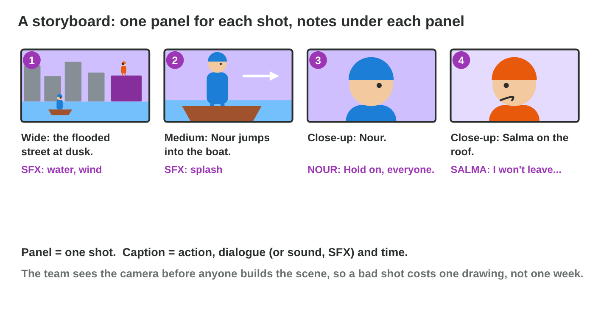
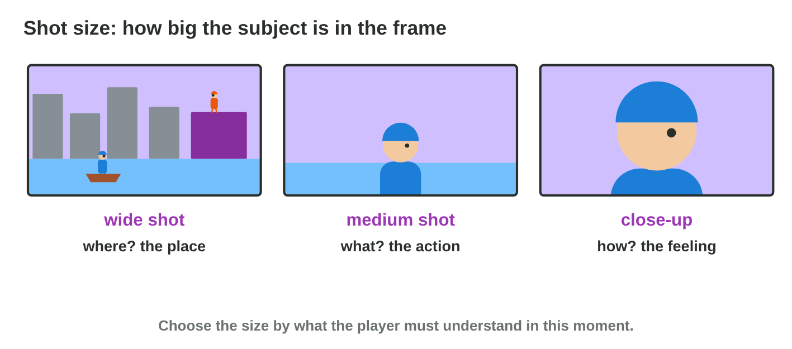
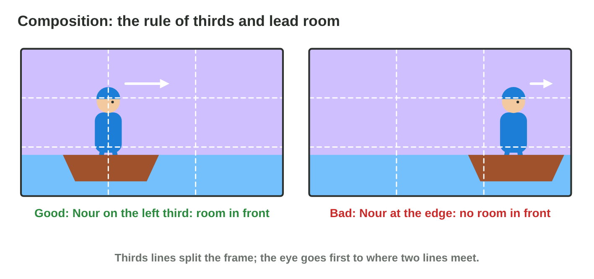
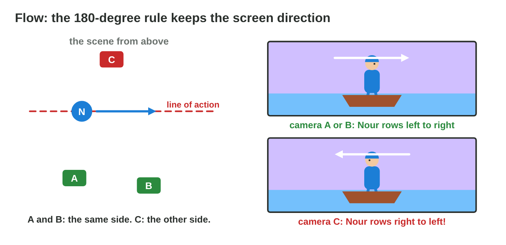

This page is the interactive version of the lesson notes (PDF). Each section
starts with a problem in a game studio. Then it explains the idea behind it.
It ends with a **Do it** task and one set of questions. The full
explanations, examples and exercises are in the notes.

## Key terms



## 9.1 See the scene before you build it: the storyboard

- A **storyboard** is a series of simple drawings, the **panels**: one for
  each shot of a scene.
- Under each panel, the **caption**: the action, the dialogue or sound
  (SFX), the time.
- A built 3D shot takes days; a drawing takes two minutes. So the team draws
  first, and changes cost little.
- Stick figures and boxes are fine: the board shows what the player sees,
  what happens, and how long.
- Rooftop Rescue: panel 1 = the flooded street (SFX: water, wind; 3 s);
  panel 2 = Nour jumps into the boat (SFX: splash; 2 s); panel 3 = Nour's
  face, "Hold on, everyone." (2 s).

{width=92%}

::: {.callout-warning title="Watch out!"}
A storyboard is a plan, not the final art. Use simple shapes.
:::

::: {.callout-note title="Do it · Three panels on paper"}
Fold an A4 paper twice to get four boxes. Draw the first three panels of the
Rooftop Rescue script above, with a caption (action or line, sound, time)
under each.
:::

::: {.callout-tip title="Try it 1 · Storyboards"}
Choose the right answer.

::: {.match extra="the final art of the game|the script"}
What is one panel of a storyboard?
:   one drawing of one shot

What does the caption under a panel give?
:   the action, the dialogue or sound, the time

Why does a team draw a storyboard before it builds a cutscene?
:   a drawing is cheap to change

How should a storyboard panel be drawn?
:   with simple shapes, fast

"SFX: splash" in a caption is …
:   a sound effect
:::
:::

## 9.2 How close is the camera? Shot sizes

| Shot size | What the player learns | Rooftop Rescue |
|---|---|---|
| **Wide** (establishing) | where the scene happens | the flooded street |
| **Medium** (waist up) | what a character does | Nour rows the boat |
| **Close-up** (a face) | what a character feels, a detail | Salma's fear |

- The first wide shot of a scene is the **establishing shot**.
- **Camera angle:** from above (high angle), a character looks small and
  weak; from below (low angle), big and strong.

{width=92%}

::: {.callout-warning title="Watch out!"}
Do not use the same size for every panel. Change the size when the purpose
changes.
:::

::: {.callout-note title="Do it · Three sizes with your phone"}
Take a wide shot, a medium shot and a close-up of one object on your desk.
Under each photo, write what the player would learn from it.
:::

::: {.callout-tip title="Try it 2 · Shot sizes"}
Choose the right shot. You can use an answer more than once.

::: {.match extra="a low angle"}
The scene starts: the player must see the flooded street.
:   a wide shot

Nour rows hard against the water.
:   a medium shot

Salma says "I won't leave without my cat." She is afraid.
:   a close-up

The cat's small, wet paw on the roof is an important detail.
:   a close-up

The player must see where the boss arena is.
:   a wide shot
:::
:::

## 9.3 Where does the eye go? Composition

- **Composition** is how things are placed in the frame.
- **Rule of thirds:** two lines across and two lines down split the frame;
  put the subject on a line or where two lines meet.
- **Lead room:** empty space in front of a character, where it looks or
  moves.
- Nour rows to the right, so she goes on the **left** third. Salma looks to
  the left, so she goes on the **right** third.

{width=92%}



::: {.callout-warning title="Watch out!"}
A subject in the exact centre looks still. Use a thirds line, with lead room
in front.
:::

::: {.callout-note title="Do it · Thirds on your phone"}
Turn on the camera grid (Android: camera settings › Grid lines; iPhone:
Settings › Camera › Grid), or use **Frame Lab**. Take one photo with lead
room and one with the subject looking out at the edge. Which feels better?
:::

::: {.callout-tip title="Try it 3 · Composition"}
Choose the right answer.

::: {.match extra="in the exact centre|at the top edge"}
Nour rows to the right. Where do you place her?
:   on the left third

Salma looks to the left. Where do you place her?
:   on the right third

What is lead room?
:   empty space in front of the character

Where does the eye go first in a frame with thirds lines?
:   where two lines meet

Nour rows to the right, but she is at the right edge. What is wrong?
:   she has no lead room
:::
:::

## 9.4 From panel to panel: flow and the 180-degree rule

- The **line of action** is an imagined line through the action (Nour's
  path).
- **180-degree rule:** keep the camera on **one side** of this line.
- Then each movement keeps its **screen direction**: Nour rows left to
  right in every panel.
- From the other side of the line, Nour suddenly rows right to left: the
  player thinks she turned back.
- Draw **arrows** for movement; number the panels: place → action → feeling.

{width=92%}

::: {.callout-warning title="Watch out!"}
Games need continuity too: a cutscene or a camera that jumps over the line
makes the player lose the way.
:::

::: {.callout-note title="Do it · Arrows and the line"}
Add an arrow for every movement in your three panels. Draw a small map from
above with the line of action and the place of your camera in each panel.
Are all cameras on one side?
:::

::: {.callout-tip title="Try it 4 · Flow"}
Choose the right answer.

::: {.match extra="the camera can stand anywhere|a close-up"}
What does the 180-degree rule say?
:   keep the camera on one side of the line of action

Panel 2: Nour rows left to right. Panel 3 is drawn from the other side. What does the player see?
:   Nour rows right to left

How do you show a movement in a panel?
:   with an arrow

What is the line of action of the opening scene?
:   Nour's path through the street
:::
:::

## Game challenge: storyboarding Rooftop Rescue {.challenge}

Work alone. Use every section of today.

*Night Owl Games* storyboards the opening of *Rooftop Rescue*: the flooded
street at dusk; Nour jumps into the boat and rows to the roof (left to
right); Nour says "Hold on, everyone. I'm coming."; Nour rows on; on the
roof, Salma says "I won't leave without my cat."



::: {.callout-tip title="Try it 5 · The board"}
The beats: the street; Nour rows; Nour's line; Salma's line. Nour rows left
to right. Choose the right answer.

::: {.match extra="a high angle|in the centre"}
Which shot opens the board?
:   a wide shot of the street

Which shot shows Nour rowing?
:   a medium shot of Nour

Which shot shows Salma's line?
:   a close-up of Salma

Where is Nour in the frame while she rows?
:   on the left third

Panel 4 must keep Nour rowing left to right. Where is the camera?
:   on the same side of her path
:::
:::

## Summary {.summary}

- A storyboard is a series of simple panels, one per shot, with captions.
- A wide shot shows where, a medium shot what happens, a close-up how it feels.
- Place the subject on a thirds line, with lead room in front.
- Keep the camera on one side of the line of action, so the screen direction stays.
- Draw arrows for movement and number the panels.
