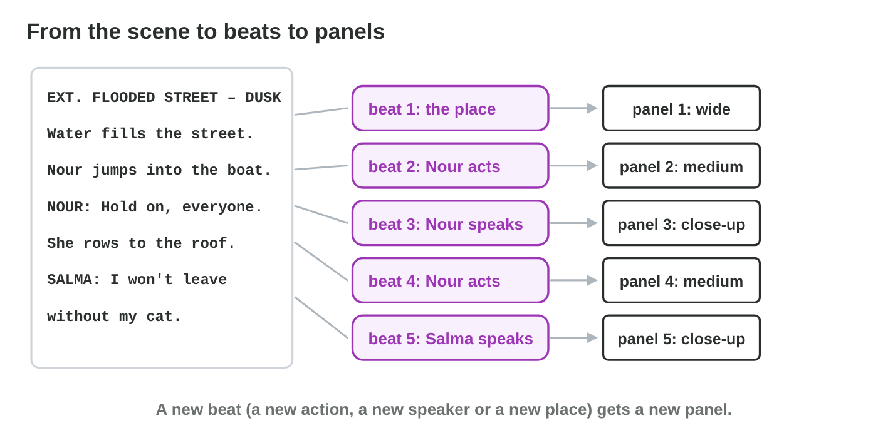
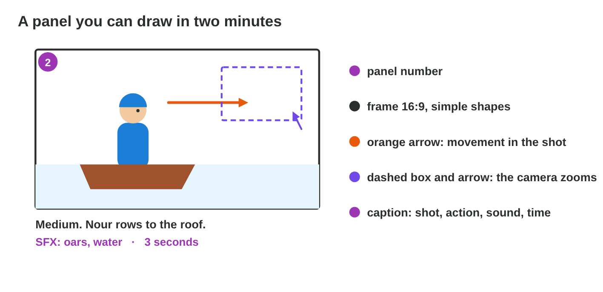
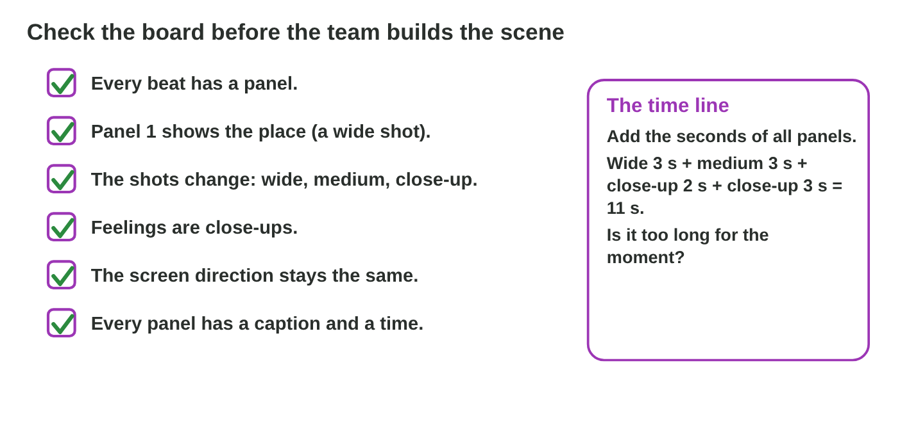

This page is the interactive version of the lesson notes (PDF). Each section
starts with a problem in a game studio. Then it shows one step of drawing a
storyboard. It ends with a **Do it** task and one set of questions. The full
explanations, examples and exercises are in the notes.

## Key terms



## 10.1 Where does a panel start? From scene to beats

- Mark a new **beat** when something changes: a new **place**, a new
  **action**, a new **speaker** or a new **feeling**.
- Each beat gets at least one **panel**.
- The opening of Rooftop Rescue has five beats: the street (place, wide);
  Nour jumps into the boat (action, medium); "Hold on, everyone." (speaker,
  close-up); she rows to the roof (action, medium); "I won't leave without
  my cat." (speaker and feeling, close-up).
- Two sentences from the same speaker with the same feeling: one beat, one
  panel.

{width=92%}



::: {.callout-warning title="Watch out!"}
Not one panel per sentence: change panels when something changes.
:::

::: {.callout-note title="Do it · Beats of a short scene"}
Mark the beats of this scene: "INT. SALMA'S KITCHEN – NIGHT. Water comes
under the door. Salma lifts the cat onto the table. SALMA: Stay here, Pasha.
A light shines through the window. NOUR (V.O.): Salma? Are you in there?"
Then build the opening board in **Board Builder**.
:::

::: {.callout-tip title="Try it 1 · Beats"}
Choose what changes. You can use an answer more than once.

::: {.match extra="nothing changes"}
"EXT. FLOODED STREET – DUSK."
:   a new place

"Nour jumps into the boat."
:   a new action

"NOUR: Hold on, everyone."
:   a new speaker

"Salma lifts the cat onto the table."
:   a new action

"INT. SALMA'S KITCHEN – NIGHT."
:   a new place
:::
:::

## 10.2 Draw it fast: thumbnails, arrows and captions

- A panel is a **thumbnail sketch**: small and fast, one or two minutes.
- Its parts: the **number**; a 16:9 **frame**; simple shapes; **arrows** for
  movement; a dashed box and an arrow for a **camera move** (zoom, pan); the
  **caption**: shot size, action or line, sound, time.
- Panel 2: frame, water line, boat, Nour on the left third, an arrow to the
  right. Caption: "2 · Medium. Nour jumps into the boat and rows. SFX:
  splash, oars. 3 s."
- A zoom to Salma: the wide shot of the roof, a dashed box around her face,
  an arrow from the corner to the box.

{width=92%}

::: {.callout-warning title="Watch out!"}
Every panel needs a number and a caption. The 3D team cannot guess the
sound or the time.
:::

::: {.callout-note title="Do it · Draw five panels"}
Draw the five beats of the opening on a storyboard sheet (or five 16:9 boxes
on A4), about two minutes each, with arrows and captions.
:::

::: {.callout-tip title="Try it 2 · The parts of a panel"}
Choose the right answer.

::: {.match extra="a colour|the name of the artist"}
How do you show that Nour rows to the right?
:   an arrow in the panel

How do you show a zoom to Salma's face?
:   a dashed box and an arrow to it

What is the shape of the frame for most games?
:   16:9, like the screen

How long should a thumbnail sketch take?
:   one or two minutes

What does a caption give besides the action and the line?
:   the shot size, the sound and the time
:::
:::

## 10.3 Is the board ready? Check and time it

- **Checklist:** every beat has a panel; panel 1 shows the place; the shot
  sizes change; feelings are close-ups; the screen direction stays; every
  panel has a caption and a time.
- **Timing:** add the seconds of all panels. 3 + 3 + 2 + 4 + 3 = 15 s:
  under the producer's 20 s.
- If time is short, cut the longest panel that carries the least story
  first.

{width=92%}

::: {.callout-warning title="Watch out!"}
A good-looking board can still break a rule. Read it with the checklist.
:::

::: {.callout-note title="Do it · Check your own board"}
Go through the six points of the checklist for your five panels, and fix
every "no". Add up the times: is the scene under 20 seconds?
:::

::: {.callout-tip title="Try it 3 · The checklist"}
Choose the right answer.

::: {.match extra="the board is ready|12 s"}
Five panels have 2 s, 3 s, 3 s, 4 s and 2 s. How long is the scene?
:   14 s

A board starts with a close-up of Nour. What is missing?
:   an establishing shot of the place

Salma's fearful line is in a wide shot. What do you change?
:   make it a close-up

Panel 2 shows Nour rowing right to left; panel 4 left to right. What is broken?
:   the screen direction

One panel has no time in its caption. Is the board ready?
:   no, every panel needs a time
:::
:::

## Game challenge: the board review at Night Owl Games {.challenge}

Work alone. Use every section of today.

Five boards of the opening of *Rooftop Rescue* lie on the table: (1) it
starts with a close-up of Nour; (2) Nour rows left to right, then right to
left; (3) Nour twice in the same medium shot; (4) Salma's fearful line in a
wide shot of the roof; (5) wide street, medium Nour, close-up of Salma.



::: {.callout-tip title="Try it 4 · The five boards"}
Boards: (1) starts with a close-up of Nour; (2) direction left to right, then
right to left; (3) two same medium shots in a row; (4) Salma's fear in a
wide shot; (5) wide, medium, close-up. Choose what is wrong. You can use an
answer more than once.

::: {.match extra="a caption is missing"}
Board 1?
:   no establishing shot

Board 2?
:   the screen direction flips

Board 3?
:   the same shot twice in a row

Board 4?
:   the feeling is too far away

Board 5?
:   nothing, it is ready
:::
:::

::: {.callout-tip title="Try it 5 · Fix and time (harder)"}
Board 5 has the panels: wide street 3 s, medium Nour 3 s, close-up Nour 2 s,
medium Nour rowing 4 s, close-up Salma 3 s. Choose the right answer.

::: {.match extra="20 s|the close-up of Salma"}
How long is the scene?
:   15 s

The producer wants 12 s. Which panel goes first?
:   the medium shot of Nour rowing (4 s)

Salma also says "He's afraid of water." How many new panels?
:   none, it goes in the same caption

The camera should come closer to Salma while she speaks. How is it drawn?
:   a dashed box and an arrow (a zoom)
:::
:::

## Summary {.summary}

- A new beat starts when the place, the action, the speaker or the feeling changes.
- Each beat gets at least one panel; not one panel per sentence.
- A panel is a fast thumbnail: number, 16:9 frame, shapes, arrows, caption.
- Check the board with the checklist before the team builds the scene.
- The sum of the panel times is the length of the scene.
