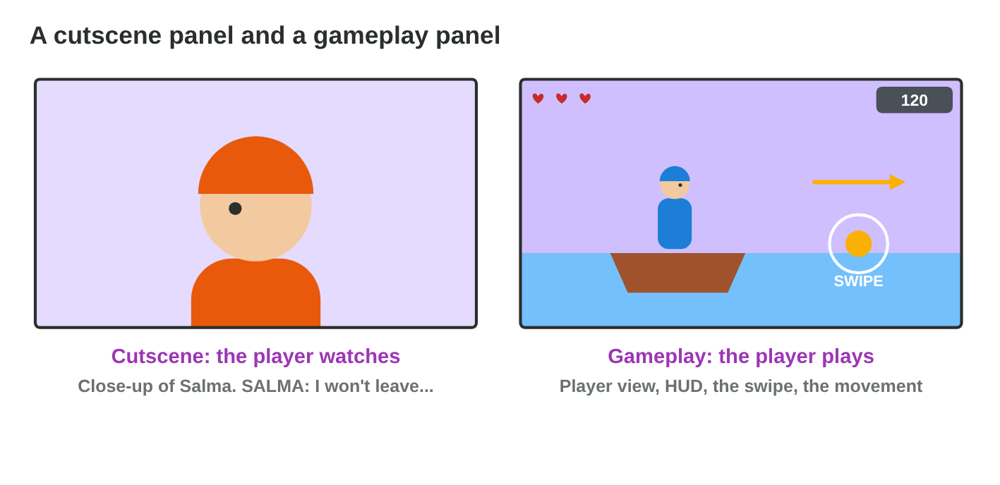
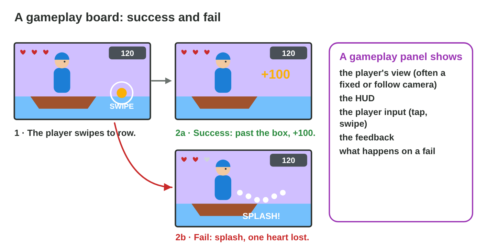
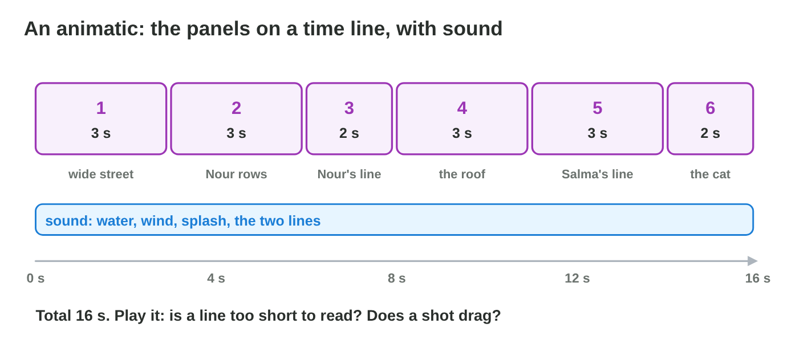
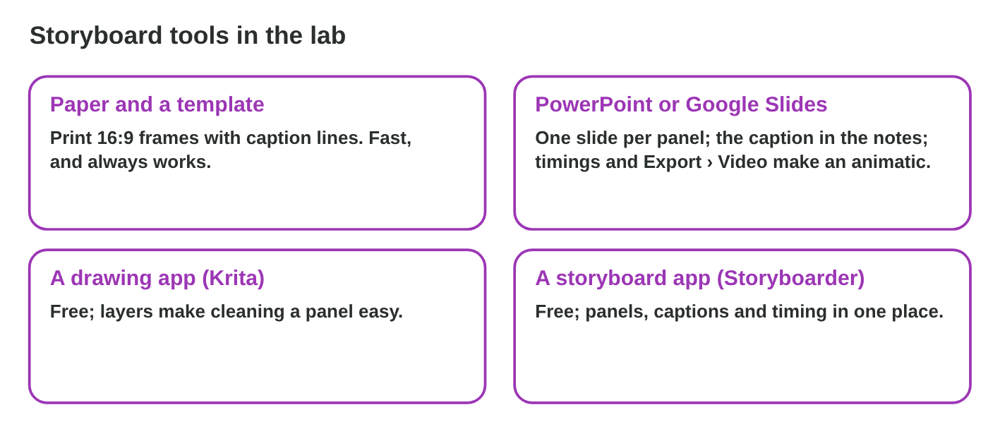

## Keywords



## 6.1 Watch or play?

:::: {.columns}
::: {.column width="50%"}
- A cutscene board plans a moment that the player only watches.
- A gameplay board plans a moment that the player plays.
- In gameplay, the camera follows rules, so the view often stays the same.
- **Do it:** Write four moments of a game you know. Which ones does the player watch, and which does the player play?
:::
::: {.column width="50%"}

:::
::::

## Try it 1 · Watch or play?

a) Salma begs on the roof, and the player only listens. Which board fits?
b) The player swipes to row between boxes. Which board fits?
c) Which board shows the HUD and an input icon?

::: {.answer}
a) a cutscene board
b) a gameplay board
c) a gameplay board
:::

## 6.2 What a gameplay panel shows

:::: {.columns}
::: {.column width="50%"}
- A gameplay panel shows the player's view and the HUD.
- An icon shows the player input, for example a swipe.
- The feedback and the fail state are planned in their own panels.
- **Do it:** Draw the action, the success and the fail of one game moment. Does each panel have the HUD?
:::
::: {.column width="50%"}

:::
::::

## Example · The rowing board

Nour rows between floating boxes, and the player swipes.
**Which panels does the gameplay board need?**

::: {.reveal}
1. Panel 1: the boat, the HUD, a swipe icon and an arrow.
2. Panel 2a: success, the boat passes the box, and "+100" pops up.
3. Panel 2b: fail, a splash, one heart grey, and "try again".
:::

## Try it 2 · A gameplay panel

a) How is the player's swipe drawn in a panel?
b) How does a board show a vibration of the phone?
c) The boat hits a box. Which panel shows this moment?

::: {.answer}
a) as an input icon
b) in the caption
c) the fail state
:::

## 6.3 The animatic

:::: {.columns}
::: {.column width="50%"}
- An animatic plays the panels with their times and simple sound.
- It shows the pacing before any 3D work.
- A line of dialogue needs enough time to be read.
- **Do it:** In Animatic Player, which panel feels too short?
:::
::: {.column width="50%"}

:::
::::

## Live demo · Animatic Player



## Try it 3 · The animatic

a) Six panels have 2, 3, 3, 2, 3 and 2 s. What is the total?
b) What does an animatic show that paper does not?
c) A line is on screen for 1 s. What is the problem?

::: {.answer}
a) 15 s
b) the pacing
c) The player cannot read it.
:::

## 6.4 Tools in the lab

:::: {.columns}
::: {.column width="50%"}
- Paper and a template are fast and work without a computer.
- PowerPoint makes an animatic with slide timings and Export › Create a Video.
- Krita and Storyboarder are free tools for clean panels.
- **Do it:** Put three photos of your panels on three slides. Can you set their times?
:::
::: {.column width="50%"}

:::
::::

## Example · An animatic in PowerPoint

The team has photos of six panels and a recording of the two lines.
**How does it make an animatic in PowerPoint?**

::: {.reveal}
1. One photo per slide, with the caption in the speaker notes.
2. Transitions › After sets each slide's time, and Insert › Audio adds the sound.
3. File › Export › Create a Video gives an **MP4 animatic**.
:::

## Game challenge · Cut or Play?



## Try it 4 · Level 1 (harder)

The facts: Salma begs on the roof, Nour rows between boxes when the player swipes, and Pasha jumps when the player must tap.

a) What must the first rowing panel show?
b) What does the board show after the boat hits a box?
c) Which lab tool makes the quick animatic?

::: {.answer}
a) the swipe icon and the HUD
b) a splash and one heart lost
c) PowerPoint, exported as a video
:::

## Summary

- A cutscene board plans watching, and a gameplay board plans playing.
- A gameplay panel shows the view, the HUD, the input and the feedback.
- The fail state is planned as well as the success.
- An animatic plays the panels with their times to check the pacing.
- Paper, PowerPoint, Krita and Storyboarder make storyboards in the lab.
