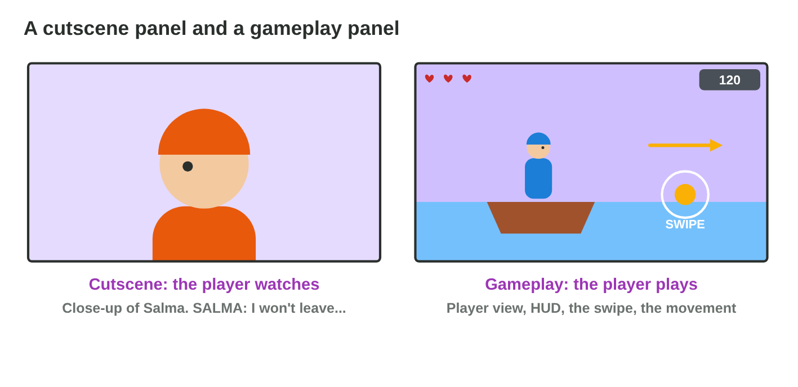
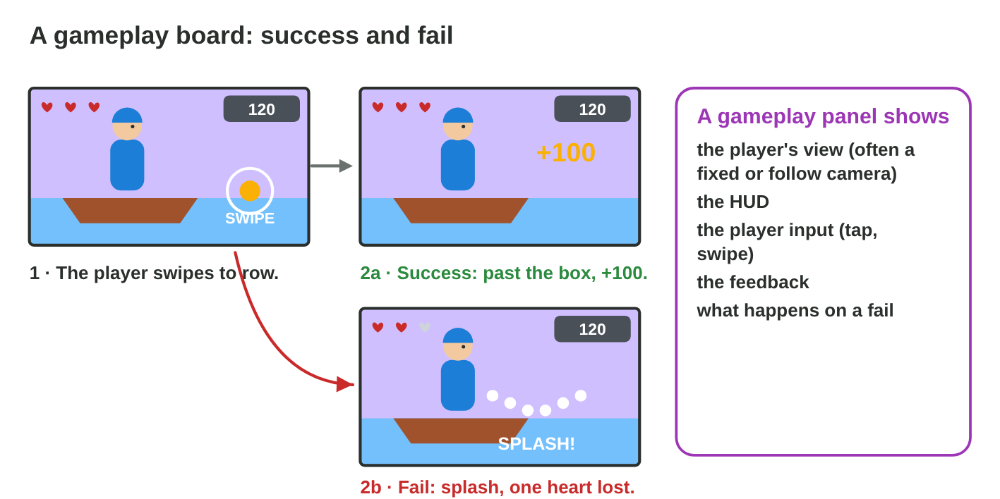
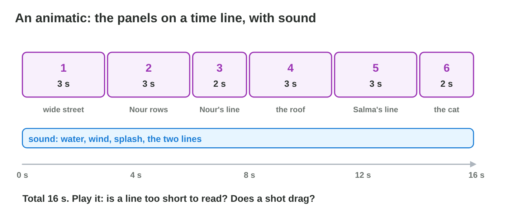
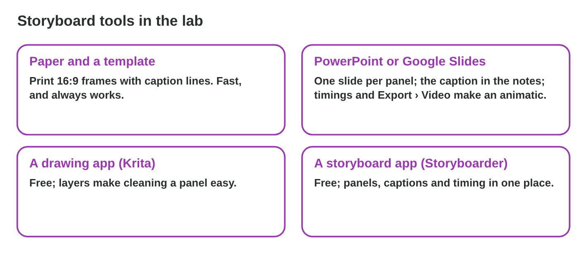

This page is the interactive version of the lesson notes (PDF). Each section
starts with a problem in a game studio. Then it explains one idea. It ends
with a **Do it** task and one set of questions. Tap, sort or type your
answer: the page checks it at once and tells you why.

## Key terms



## 6.1 Watch or play? Two kinds of boards

- A **cutscene storyboard** plans a moment the player **watches**: the team
  chooses every shot.
- A **gameplay storyboard** plans a moment the player **plays**: the player's
  view, the **HUD**, the **player input** and the **feedback**.
- Level 1 of Rooftop Rescue: Salma begs on the roof (watch); Nour rows
  between boxes by swiping (play); Pasha jumps and the player taps to catch
  (play).
- In gameplay the camera follows rules (it follows the boat), so the view
  often stays; the action, HUD and feedback change.

{width=92%}

::: {.callout-warning title="Watch out!"}
No film close-ups while the player must steer: show what the player needs to
play.
:::

::: {.callout-note title="Do it · Watch or play?"}
Four moments of *Sky Kite*, a mobile game: **1** the intro film shows the
storm; **2** the player swipes to steer the kite between trees; **3** the
player taps to grab a coin in the air; **4** after level 1, the grandfather
talks to the girl, and the player only listens.

::: {.sort}
Does the player watch or play each moment? Sort them.

Watch: a cutscene
:   1) the intro film shows the storm

    Why: The player only watches the film.

:   4) the grandfather talks, and the player listens

    Why: No input: a cutscene board.

Play: gameplay
:   2) the player swipes to steer the kite

    Why: The player acts: a gameplay board.

:   3) the player taps to grab a coin

    Why: Input and feedback: gameplay.
:::

::: {.sort}
Which things belong in the gameplay panel of moment 2? Sort them.

Belongs in the panel
:   a) hearts and coins at the top of the screen

    Why: The HUD: the player needs it while playing.

:   b) a swipe icon

    Why: The input: what the player does.

:   d) a "+10" flash when the kite takes a coin

    Why: The feedback of the action.

Does not belong
:   c) a close-up of the grandfather's face

    Why: The player needs the view of the kite and the trees to steer.
:::
:::

::: {.callout-tip title="Try it 1 · Watch or play?"}
Choose the right board. You can use an answer more than once.

::: {.match extra="no board"}
Salma begs on the roof; the player only listens.
:   a cutscene board

    Why: The player only watches, so the team chooses every shot.

The player swipes to row between boxes.
:   a gameplay board

    Why: The player plays: the board shows the input.

Pasha jumps; the player taps to catch.
:   a gameplay board

    Why: The player taps, so the moment is played.

The credits roll after the level.
:   a cutscene board

    Why: The player only watches the credits.

Which board shows the HUD and an input icon?
:   a gameplay board

    Why: Only gameplay panels show what the player sees and does.
:::
:::

## 6.2 What a gameplay panel shows

- The **player's view** (the game camera).
- The **HUD** (lives, score, map) where the game shows it.
- The **player input** as an icon: a tap, a swipe, a button.
- The **feedback**: sound, flash, points. What cannot be drawn goes in the
  caption ("The phone vibrates").
- The **fail state** in its own panel: what happens when the player does not
  succeed.
- Rowing board: (1) swipe icon, HUD, arrow; (2a) success, +100; (2b) fail,
  splash, one heart grey, try again.

{width=92%}

::: {.callout-warning title="Watch out!"}
Draw the fail state too: players fail often.
:::

::: {.callout-note title="Do it · One gameplay moment"}
Take moment 2 of *Sky Kite* above: the player swipes to steer the kite
between trees; a hit on a tree costs one of three hearts. Draw the steering,
the success and the fail state, with the HUD in every panel, the swipe icon
in the first one and a caption under each.

::: {.order}
Put the three panels of the moment in order.

1. The kite, the trees, the HUD (three hearts, the coins) and a swipe icon
2. The success: the kite passes, and "+10" flashes.
3. The fail: the kite hits a tree, one heart is grey. "SFX: crack. Try again."

Why: First the input, then what happens when the player succeeds, and what happens when the player fails.
:::

::: {.choice}
Why does the board show the fail state too?

- [x] Players fail often, so the team must plan what they see then.

  Why: The splash, the grey heart and "try again" are part of the game.

- [ ] To make the board longer.

  Why: Every panel has a job; the fail panel plans what players see often.

- [ ] It does not: a board shows only the success.

  Why: A gameplay board shows the success and the fail.
:::
:::

::: {.callout-tip title="Try it 2 · A gameplay panel"}
Choose the right answer.

::: {.match extra="a close-up of Salma|the credits"}
How is the player's swipe drawn?
:   as an input icon

    Why: An icon shows what the player does.

Where is the HUD drawn?
:   on top of the picture, where the game shows it

    Why: The HUD is drawn where the player will see it.

The boat hits a box. Which panel shows this?
:   the fail state

    Why: It shows what happens when the player does not succeed.

How do you show a vibration?
:   in the caption

    Why: A vibration cannot be drawn, so the caption says it.

What does "+100" in a panel show?
:   feedback for a success

    Why: Points pop up when the player does well.
:::
:::

## 6.3 Is the timing right? The animatic

- An **animatic** plays the panels one after the other, each for its time,
  with simple sound. It shows the **pacing**.
- The six panels of the opening:

| Panel | Shot and content | Time |
|:---:|--------------------------------------------------|:----:|
| 1 | wide: the flooded street at dusk | 3 s |
| 2 | medium: Nour jumps into the boat and rows | 3 s |
| 3 | close-up: Nour says "Hold on, everyone. I'm coming." | 2 s |
| 4 | wide: the roof, Salma and the cat | 3 s |
| 5 | close-up: Salma says "I won't leave without my cat." | 2 s |
| 6 | medium: the cat looks down at the water | 2 s |

- The total is 3 + 3 + 2 + 3 + 2 + 2 = 15 s. The producer wants 12–16 s.
- Panel 5, Salma's line, is too short to read in 2 s. It needs 3 s. The new
  total is 16 s.
- Time panels by the content: a line needs time to read, an action time to
  happen.

{width=92%}



::: {.callout-warning title="Watch out!"}
A panel's time comes from what happens in it, not from the drawing.
:::

::: {.callout-note title="Do it · Time the opening"}
In **Animatic Player**, play the six panels. Change the times until the
check passes (12–16 s in all).

::: {.choice}
Which panel feels too short?

- [x] the panel with Salma's line

  Why: A line needs time to be read: it needs 3 s.

- [ ] the wide shot of the street

  Why: The street has time enough; the line is too fast to read.

- [ ] none: the timing is right

  Why: The check fails until Salma's line has 3 s.
:::

::: {.fill answer="16" unit="s" hint="Add the six times."}
The times are 3, 3, 2, 3, 3 and 2 seconds. How long is the animatic?

Why: 3 + 3 + 2 + 3 + 3 + 2 = 16 s, inside 12–16 s.
:::
:::

::: {.callout-tip title="Try it 3 · The animatic"}
Choose the right answer.

::: {.match extra="6 s|a 3D model"}
Panels of 2, 3, 3, 2, 3 and 2 s. What is the total?
:   15 s

    Why: 2 + 3 + 3 + 2 + 3 + 2 = 15.

What does an animatic show that paper does not?
:   the pacing

    Why: It plays the panels with their times.

A line is on screen for 1 s. What is the problem?
:   the player cannot read it

    Why: A line needs time to be read.

What is played in an animatic?
:   the panels with their times and sound

    Why: An animatic is the first "video" of a scene.

When does the team make an animatic?
:   before the 3D work

    Why: It is cheap to change before anything is built.
:::
:::

## 6.4 Tools: from paper to an animatic

| Tool | Good for |
|---|---|
| Paper and a **storyboard template** | fast thumbnails, no computer |
| PowerPoint (or Google Slides) | one slide per panel, caption in the notes, timings, Export › Create a Video |
| Krita (free) | clean panels with layers |
| Storyboarder (free) | panels, captions and timing together |

- An animatic in PowerPoint: one photo of a panel per slide; Transitions ›
  After for the time; Insert › Audio; File › Export › Create a Video.

{width=92%}

::: {.callout-warning title="Watch out!"}
Start on paper. Use a tool to time, clean and share the board.
:::

::: {.callout-note title="Do it · Three slides, one animatic"}
Photograph three of your panels. In PowerPoint, one photo per slide, the
caption in the notes, the times in Transitions › After. Play it.

::: {.order}
Put the steps of the animatic in order.

1. Put one photo of a panel on each slide.
2. Write the caption of the panel in the notes.
3. Set the time of each slide in Transitions › After.
4. Play the slide show, or File › Export › Create a Video.

Why: The panels first, then their captions and times; then it plays by itself.
:::

::: {.choice}
Where do you set the time of each panel?

- [x] Transitions › After

  Why: The slide stays on the screen for that time, then the next one comes.

- [ ] Insert › Audio

  Why: That adds a sound, not a time.

- [ ] the notes

  Why: The notes hold the caption; the time is in Transitions.
:::
:::

::: {.callout-tip title="Try it 4 · Tools"}
Choose the right tool. You can use an answer more than once.

::: {.match extra="Excel"}
Fast thumbnails without a computer.
:   paper and a template

    Why: Paper needs no computer.

An animatic exported as a video.
:   PowerPoint

    Why: File › Export › Create a Video makes the animatic.

Clean panels with layers, free.
:   Krita

    Why: It is a free drawing app with layers.

Panels, captions and timing in one free app.
:   Storyboarder

    Why: It keeps panels, captions and timing in one place.
:::
:::

## Game challenge: Cut or Play? Planning level 1 {.challenge}

Work alone. Use every section of today.

*Night Owl Games* plans level 1 of *Rooftop Rescue*. It has three moments:

| Moment of level 1 | The player … | Board |
|--------------------------------------------|:-------------:|:---------:|
| Salma begs Nour on the roof. | watches | cutscene |
| Nour rows between floating boxes: swipe. | plays | gameplay |
| Pasha jumps, and the player taps to catch. | plays | gameplay |

- The gameplay boards need the swipe, the HUD and the fail state (a
  splash, one heart lost).
- The team wants a quick animatic made in the lab.



::: {.callout-tip title="Try it 5 · Level 1"}
Salma begs (watch). Rowing (swipe). Catching (tap). Choose the right answer.

::: {.match extra="a film poster|nothing more"}
Which board for Salma's begging?
:   a cutscene board

    Why: The player only watches Salma.

What must the first rowing panel show?
:   the swipe icon and the HUD

    Why: It is a gameplay panel: it shows the input and the HUD.

The boat hits a box. What does the board show next?
:   a splash and one heart lost

    Why: That is the fail state of the rowing.

Which lab tool makes the quick animatic?
:   PowerPoint, exported as a video

    Why: The lab has PowerPoint, and it can export a video.
:::
:::

## Summary {.summary}

- A cutscene board plans watching; a gameplay board plans playing.
- A gameplay panel shows the player's view, the HUD, the input and the feedback.
- Plan the fail state as well as the success.
- An animatic plays the panels with their times and sound to check the pacing.
- Paper, PowerPoint, Krita and Storyboarder are enough to storyboard in the lab.
