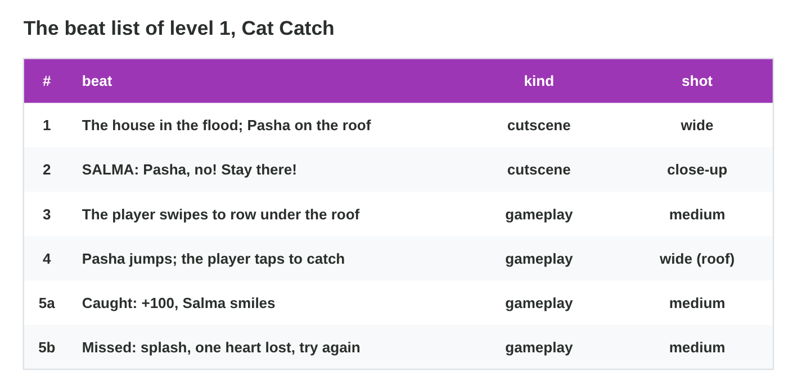
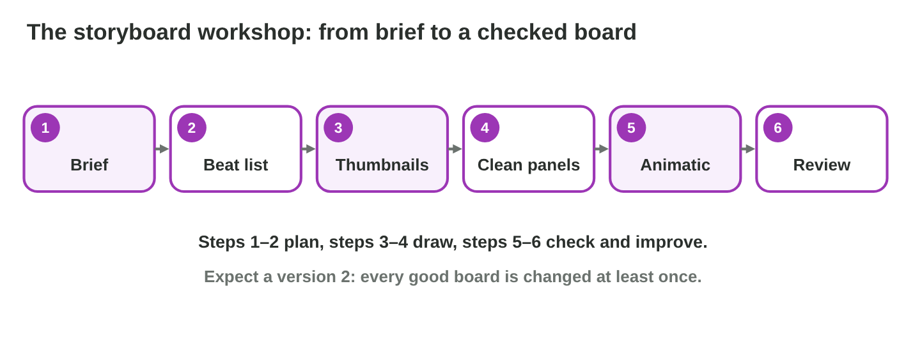
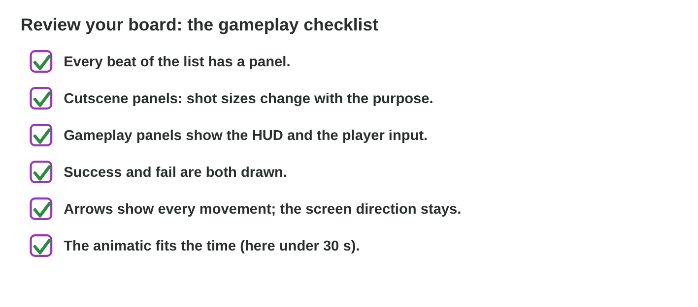

This page is the interactive version of the lesson notes (PDF). Each section
is one step of the workshop. It ends with a **Do it** task and one set of
questions. The full explanations, examples and exercises are in the notes.

## Key terms



## 12.1 Plan: the brief and the beat list

- The **brief**: what the board is for, how long, what it must show.
- The **beat list**: numbered beats, each **cutscene** or **gameplay**, with
  the shot.
- Brief of Cat Catch: at most **30 s**; the house and Pasha on the roof,
  Salma's call, the rowing (swipe), the catch (tap), the success **and** the
  fail.
- Beats: 1 house and Pasha (cutscene, wide); 2 Salma "Pasha, no! Stay
  there!" (cutscene, close-up); 3 rowing (gameplay, medium); 4 the catch
  (gameplay, wide roof); 5a caught, +100 (gameplay); 5b missed, splash, one
  heart lost (gameplay).

{width=92%}



::: {.callout-warning title="Watch out!"}
Write the beat list before you draw, or a beat of the brief gets lost.
:::

::: {.callout-note title="Do it · Play, then list"}
Play **Cat Catch** once (catch and miss at least one cat). Write your beat
list: number, beat, cutscene or gameplay, shot. Compare it with the list
above.
:::

::: {.callout-tip title="Try it 1 · Brief and beats"}
Choose the right answer.

::: {.match extra="the colours|the final art"}
What does a brief give?
:   what the board is for, its length and contents

Salma calls "Pasha, no!" Which kind of beat?
:   cutscene

The player taps to catch Pasha. Which kind of beat?
:   gameplay

The brief asks for success and fail. How many result panels?
:   two (5a and 5b)

What do you write before you draw?
:   the beat list
:::
:::

## 12.2 Draw: thumbnails, then clean panels

- **Pass 1, thumbnails:** one fast sketch per beat (about one minute) to
  choose the shot.
- **Pass 2, clean panels:** 16:9 frames, arrows, **HUD and input icons on
  gameplay panels only**, full captions (shot, action or line, sound, time).
- Panel 4 (gameplay, wide): roof and boat; HUD; tap icon near the net; arrow
  for the fall. "SFX: meow, whoosh. 3 s."
- Panel 2 (cutscene, close-up): Salma; no HUD, no icon. "SALMA: Pasha, no!
  Stay there! 3 s."

{width=92%}



::: {.callout-warning title="Watch out!"}
The HUD belongs on gameplay panels only.
:::

::: {.callout-note title="Do it · Draw the board"}
Do the three tasks of **Panel Composer**. Then, on a template or in
PowerPoint, draw thumbnails for every beat of your list, and then clean
panels with arrows, HUD and input icons where the player plays, and
captions.
:::

::: {.callout-tip title="Try it 2 · Panels"}
Choose the right answer.

::: {.match extra="the credits|a map of the world"}
What is pass 1 of drawing a board?
:   quick thumbnails of every beat

Does a cutscene panel get a HUD?
:   no

Which icon goes on the catch panel?
:   a tap icon

How is Pasha's fall shown in a panel?
:   with an arrow

What does the caption of the catch panel give?
:   shot, action, sound and time
:::
:::

## 12.3 Check: animatic, review and version 2

- Play the board as an **animatic**: is the total inside the brief?
- Read it with the **checklist**: every beat drawn; shot sizes change;
  gameplay shows HUD and input; success **and** fail; arrows and one screen
  direction; time inside the brief.
- Every "no" becomes a change in **version 2**.
- Sami's version 1: 4 + 3 + 6 + 5 + 4 + 4 = 26 s; no fail panel, no HUD on
  the rowing. Version 2 adds the fail panel (3 s) and the HUD: 29 s.

{width=92%}

::: {.callout-warning title="Watch out!"}
Do not fix an unclear panel with more text: draw it again.
:::

::: {.callout-note title="Do it · Review your board"}
Make an animatic of your board in PowerPoint and write the total time. Read
the board with the checklist, change every "no", and mark it "version 2".
:::

::: {.callout-tip title="Try it 3 · Review"}
Choose the right answer.

::: {.match extra="20 s|send it as it is"}
Panels of 4, 3, 6, 5, 4 and 4 s. What is the total?
:   26 s

The board has no fail panel. What do you do in version 2?
:   add the fail panel

The rowing panel has no HUD. Is that right?
:   no, gameplay panels show the HUD

Sami adds a fail panel of 3 s to his 26 s board. What is the new total?
:   29 s

What do you do with a panel that does not show the idea?
:   draw it again
:::
:::

## Game challenge: the Cat Catch board {.challenge}

Work alone. Use every section of today.

**Cat Catch** is level 1: Pasha jumps from the roof of Salma's house; the
player taps when he is in the ring above Nour's net. Five cats, three
hearts, +100 for each catch, a splash and one heart lost for each miss. The
brief: at most 30 s of cutscene and first play, with success and fail.



::: {.callout-tip title="Try it 4 · The level"}
Five cats, three hearts, +100 per catch, a splash and one heart lost per
miss. Choose the right answer.

::: {.match extra="a close-up of Pasha|swipe"}
Which input icon goes on the catch panel?
:   tap

What does the success panel show?
:   +100

What does the fail panel show?
:   a splash and one heart lost

How many hearts does the HUD show at the start?
:   three
:::
:::

::: {.callout-tip title="Try it 5 · Fit the brief (harder)"}
The brief allows 30 s. Sami's board: 4, 3, 6, 5, 4, 4 s, plus a fail panel
of 3 s. Choose the right answer.

::: {.match extra="25 s|cut the close-up of Salma"}
What is the total with the fail panel?
:   29 s

Is it inside the brief?
:   yes, 29 s is less than 30 s

The producer now wants 25 s. Which panel do you shorten first?
:   the longest one with the least story (6 s)

Which panel must never be cut, because the brief asks for it?
:   the fail panel
:::
:::

## Summary {.summary}

- Start from the brief and write the beat list, each beat cutscene or gameplay.
- Draw in two passes: thumbnails, then clean panels with captions.
- Gameplay panels show the HUD and the input; cutscene panels do not.
- Play the board as an animatic and read it with the checklist.
- Every "no" of the review becomes a change in version 2.
