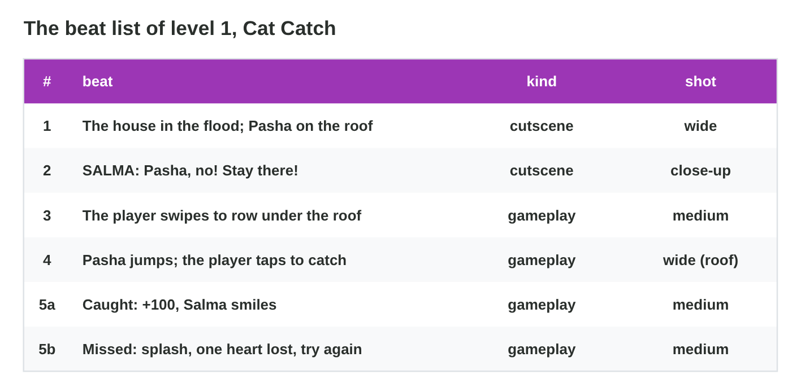
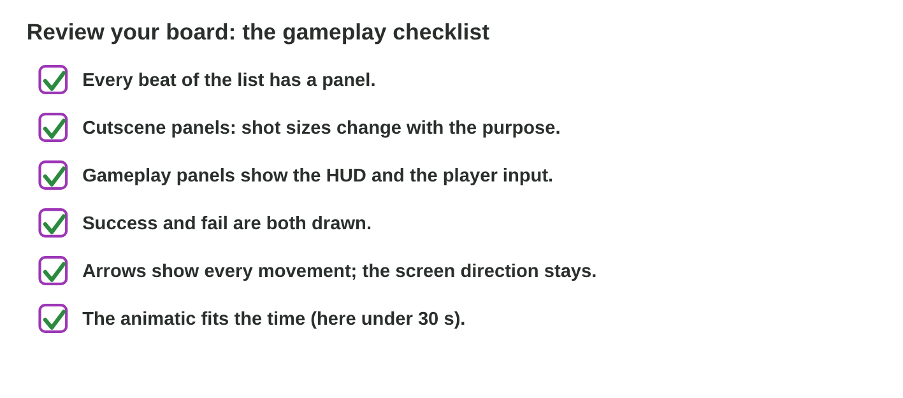

## Recall · Lecture 6

a) Which board plans a moment the player only watches?
b) What does a gameplay panel show besides the player's view?
c) What does an animatic show that paper does not?

::: {.answer}
a) a cutscene board
b) the HUD, the input and the feedback
c) the pacing
:::

## Activity 1 · Beat list and two panels · 18 min

:::: {.columns}
::: {.column width="50%"}
- In Cat Catch, Pasha jumps from the roof, and the player taps to catch him in Nour's net.
- **Do it:** Play Cat Catch once. Write the beat list with cutscene or gameplay. Draw the catch panel and the fail panel with the HUD and an input icon.
- Your product is a beat list and two panels.
:::
::: {.column width="50%"}

:::
::::

## Live demo · Cat Catch



## Check 1 · Beat list and two panels

What do the beat list and the two panels contain?

::: {.reveal}
1. The house and Salma's call are cutscene beats; the rowing and the catch are gameplay beats.
2. The result has two panels: caught with +100, and missed with a splash.
3. The catch panel shows three hearts, a tap icon near the net and an arrow for the fall.
4. The fail panel shows a splash and one grey heart, with "SFX: splash. 3 s."
:::

## The facts · version 1 of Sami's board

| Panel | What it shows | HUD? | Time |
|:-----:|------------------------------------------------|:-----:|:-----:|
| 1 | the house and Pasha on the roof | | 4 s |
| 2 | Salma calls "Pasha, no! Stay there!" | | 3 s |
| 3 | Nour rows between the boxes (swipe) | no | 6 s |
| 4 | Pasha jumps, and the player taps | yes | 5 s |
| 5 | the catch: +100 | yes | 4 s |
| 6 | Pasha is safe in the boat | | 4 s |

## Activity 2 · Version 2 · 15 min

:::: {.columns}
::: {.column width="50%"}
- Sami's board has the panels 4, 3, 6, 5, 4 and 4 s, no fail panel, and no HUD on the rowing panel.
- Sami's board has six panels and no fail panel.
- **Do it:** Add up the times. Which two checklist lines are "no", and what is the total with a fail panel of 3 s?
- Your product is two totals and two changes.
:::
::: {.column width="50%"}

:::
::::

## Check 2 · Version 2

What changes in version 2, and is it inside the brief?

::: {.reveal}
1. Version 1 lasts 4 + 3 + 6 + 5 + 4 + 4 = 26 seconds.
2. The board needs a fail panel, because the brief asks for success and fail.
3. The rowing panel needs the HUD, because it is a gameplay panel.
4. Version 2 lasts 26 + 3 = 29 seconds, still inside the brief of 30 seconds.
:::

## Wrap-up

- You can write the beat list of a level and draw its gameplay panels.
- You can time a board, review it with the checklist and plan version 2.
