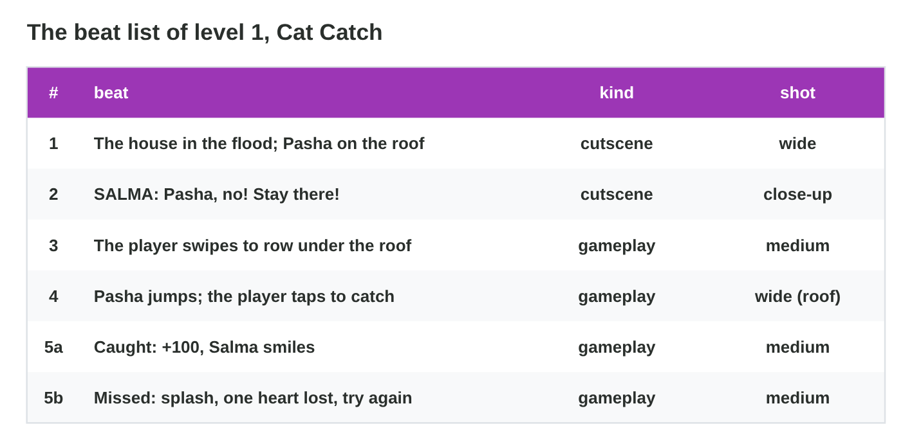
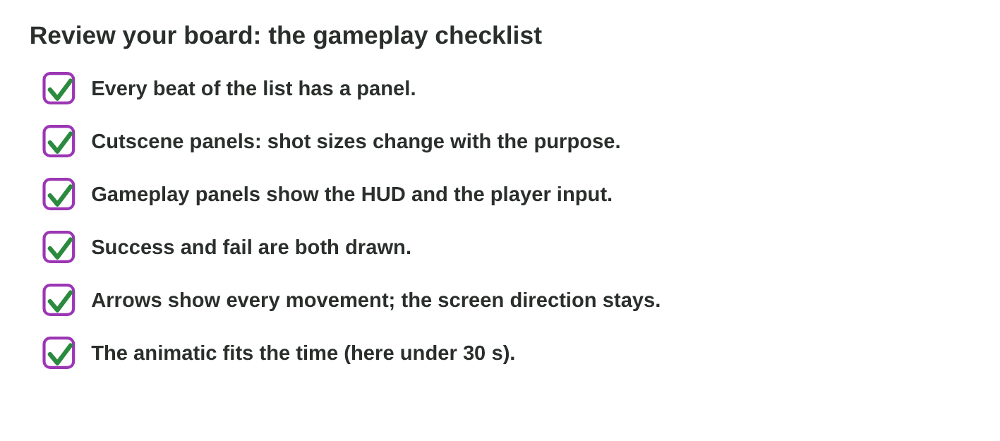

No new ideas today: two short problems on Lecture 6. Do each one alone. Tap,
sort or type your answer at every step: the page checks it at once and tells
you why.

## Recall

- A **cutscene board** plans a moment the player watches; a **gameplay
  board** a moment the player plays.
- A gameplay panel shows the player's view, the **HUD**, the **input** as
  an icon, the **feedback**, and a **fail state** in its own panel.
- An **animatic** plays the panels with their times: it shows the pacing.

::: {.callout-tip title="Try it 1 · Recall"}
Choose the right answer.

::: {.match extra="the colours|a 3D model"}
Which board plans a moment the player only watches?
:   a cutscene board

    Why: The team chooses every shot, and the player plays nothing.

What does a gameplay panel show besides the player's view?
:   the HUD, the input and the feedback

    Why: The player must see what to do and how the game answers.

What does an animatic show that paper does not?
:   the pacing

    Why: It plays the panels with their times.
:::
:::

## Activity 1 · Play, list and draw

**Cat Catch** is level 1 of *Rooftop Rescue*:

- Pasha the cat jumps from the roof of Salma's house.
- The player taps when Pasha is in the ring above Nour's net.
- The player has three hearts. Each catch gives +100. Each miss gives a
  splash, and one heart is lost.
- The **brief** (what the producer asks for): at most **30 s**, with the
  house, Salma's call "Pasha, no! Stay there!", the rowing (swipe), the
  catch (tap), the success **and** the fail.

{width=92%}



::: {.callout-note title="Activity 1 · Beat list and two panels · 18 min"}
1. Play **Cat Catch** once. Catch and miss at least one cat.
2. Write the beat list: number, beat, cutscene or gameplay.
3. Draw the catch panel and the fail panel, with the HUD, the input icon,
   an arrow and a caption.

*Your product:* a beat list and two panels.

::: {.check}
Beats: 1 the house and Pasha (cutscene, wide); 2 Salma's call (cutscene,
close-up); 3 the rowing (gameplay, swipe); 4 the catch (gameplay, tap);
5a caught, +100 (gameplay); 5b missed, splash, one heart lost (gameplay).
The catch panel: the roof and the boat, three hearts at the top, a tap icon
near the net, an arrow for the fall; "SFX: meow, whoosh. 3 s". The fail
panel: a splash, one heart grey; "SFX: splash. 3 s".
:::
:::

::: {.callout-tip title="Try it 2 · Beats and panels"}
Choose the right answer.

::: {.match extra="a swipe icon|a close-up of Pasha"}
Salma calls "Pasha, no!" Which kind of beat is it?
:   cutscene

    Why: The player only watches and listens.

The player taps to catch Pasha. Which kind of beat is it?
:   gameplay

    Why: The player acts, so the board shows the input.

Does the panel of Salma's call get a HUD?
:   no

    Why: The HUD belongs on gameplay panels only.

Which icon goes on the catch panel?
:   a tap icon

    Why: The player taps to catch.
:::
:::

## Activity 2 · Time and review a board

Sami drew version 1 of the board:

| Panel | What it shows | HUD? | Time |
|:---:|----------------------------------------------|:----:|:----:|
| 1 | the house and Pasha on the roof | | 4 s |
| 2 | Salma calls "Pasha, no! Stay there!" | | 3 s |
| 3 | Nour rows between the boxes (swipe) | no | 6 s |
| 4 | Pasha jumps, and the player taps | yes | 5 s |
| 5 | the catch: +100 | yes | 4 s |
| 6 | Pasha is safe in the boat | | 4 s |

: Version 1 of Sami's board. It has no fail panel.

The team reads every board with a checklist (below). Every "no" becomes a
change in **version 2**.

{width=92%}

::: {.callout-note title="Activity 2 · Version 2 · 15 min"}
1. Add up the six times of version 1. Is the total inside the brief of
   30 s?
2. Read Sami's board with the checklist. Which two lines are "no"? Write
   the change for each one.
3. Version 2 adds a fail panel of 3 s. What is the new total? Is it still
   inside the brief?

*Your product:* two totals and two changes.

::: {.check}
- Version 1: 4 + 3 + 6 + 5 + 4 + 4 = **26 s**, inside 30 s.
- "Success and fail are both drawn" is **no**: add a fail panel (a splash,
  one heart grey). "Gameplay panels show the HUD" is **no**: draw the
  hearts and the score on panel 3.
- Version 2: 26 + 3 = **29 s**, still inside the brief.
:::
:::

::: {.callout-tip title="Try it 3 · Review"}
Choose the right answer.

::: {.match extra="20 s|send it as it is"}
Panels of 4, 3, 6, 5, 4 and 4 s. What is the total?
:   26 s

    Why: 4 + 3 + 6 + 5 + 4 + 4 = 26.

The board has no fail panel. What do you do in version 2?
:   add the fail panel

    Why: The brief asks for success and fail.

The producer now wants 25 s. Which panel do you shorten first?
:   the longest one with the least story (6 s)

    Why: Cut time where the least story is lost.

A panel does not show its idea. What do you do?
:   draw it again

    Why: More text does not fix an unclear picture.
:::
:::

## Wrap-up {.summary}

- You can write the beat list of a level and draw its gameplay panels with
  the HUD, the input and a fail state.
- You can time a board, review it with the checklist and plan version 2.
