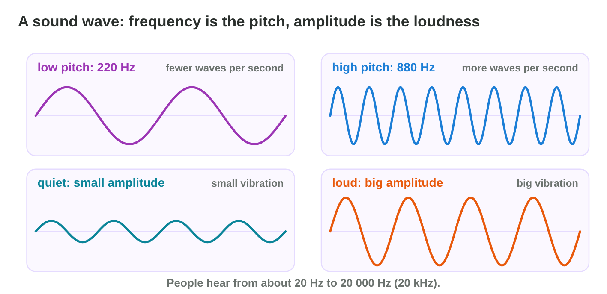
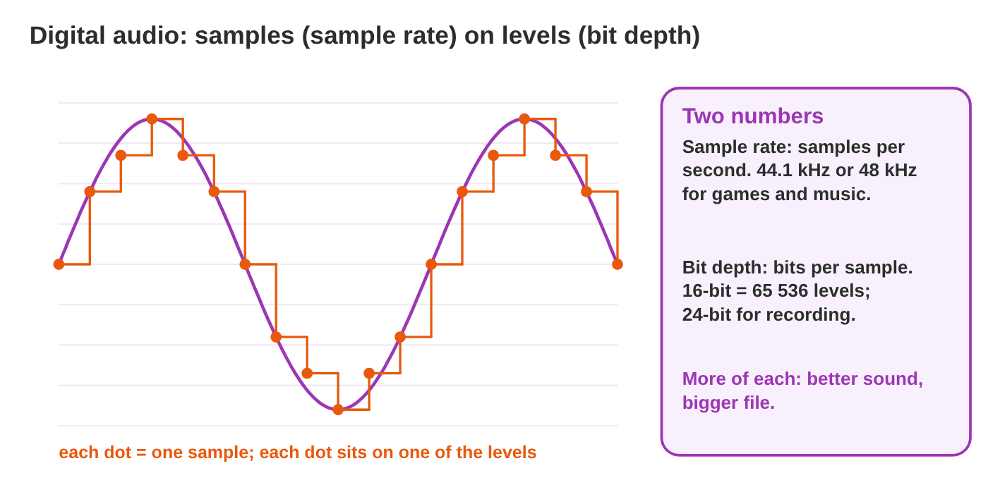
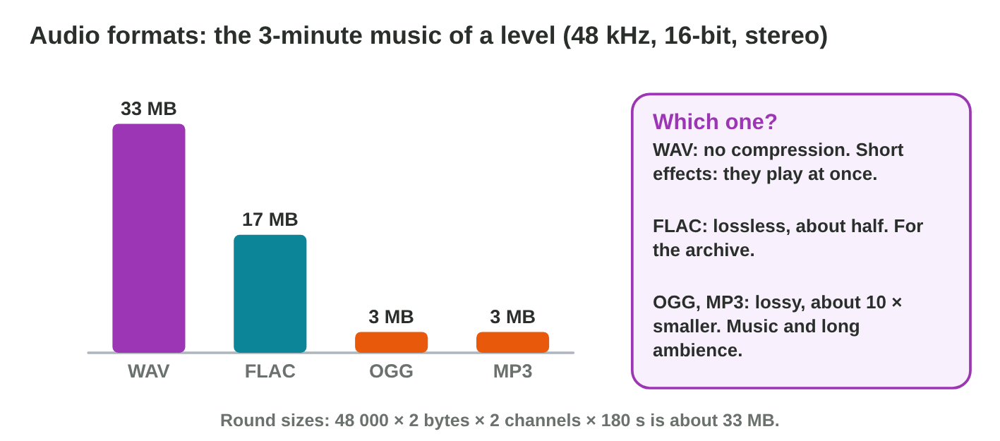
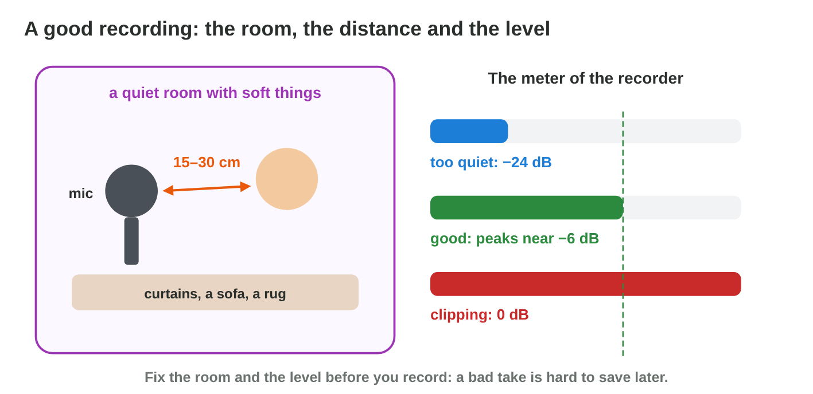

This page is the interactive version of the lesson notes (PDF). Each section
starts with a problem in a game studio. Then it explains one idea. It ends
with a **Do it** task and one set of questions. Tap, sort or type your
answer: the page checks it at once and tells you why.

## Key terms



## 7.1 What a sound is: a wave

- A **sound wave** is a vibration of the air.
- **Frequency** (Hz): vibrations per second, the **pitch**. People hear
  about 20 Hz to 20 000 Hz.
- **Amplitude**: the size of the vibration, the **loudness**, in **dB**
  (decibels).
- In an audio program, **0 dB is the top**: the loudest level a file can
  hold. Quieter levels are negative numbers: −6 dB is quieter than 0 dB,
  and −20 dB is much quieter.
- Pasha's meow: 500–800 Hz. Thunder: below 100 Hz. A bell: above 2000 Hz.

{width=90%}



::: {.callout-warning title="Watch out!"}
High is not loud: pitch and loudness change separately.
:::

::: {.callout-note title="Do it · Hear the two numbers"}
In **Wave Lab**, play 220 Hz and 880 Hz. Then set the amplitude to 0.4 and
0.8 and read the loudness in dB: about −8 dB and −2 dB.

::: {.choice}
Which tone sounds higher?

- [x] 880 Hz

  Why: The frequency gives the pitch: more waves per second, a higher sound.

- [ ] 220 Hz

  Why: 220 Hz has fewer waves per second: a lower sound.

- [ ] Both sound the same.

  Why: A different frequency gives a different pitch.
:::

::: {.sort}
Does each change move the pitch or the loudness? Sort them.

The pitch
:   220 Hz → 880 Hz

    Why: The frequency changes.

:   thunder (below 100 Hz) → a bell (above 2000 Hz)

    Why: Low and high sounds: different frequencies.

The loudness
:   the amplitude 0.4 → 0.8

    Why: A bigger wave is louder.

:   −8 dB → −2 dB

    Why: Closer to 0 dB is louder.
:::
:::

::: {.callout-tip title="Try it 1 · The wave"}
Choose the right answer.

::: {.match extra="the colour|the length of the file"}
What does the frequency of a sound give?
:   the pitch

    Why: More vibrations per second sound higher.

What does the amplitude of a sound give?
:   the loudness

    Why: A bigger vibration sounds louder.

Which is the loudest level a sound file can hold?
:   0 dB

    Why: In an audio program, 0 dB is the top; quieter levels are negative.

Which sound has the lowest frequency?
:   thunder

    Why: Thunder is below 100 Hz, the lowest of the three.
:::
:::

## 7.2 From a wave to numbers: sampling

- A **sample** is one measure of the wave.
- **Sample rate**: samples per second. 1 kHz = 1000 per second, so 48 kHz
  = 48 000 samples every second. Games use 44.1 kHz or 48 kHz.
- **Bit depth**: bits per sample. More bits give less hiss: 16-bit in
  games, 24-bit in the studio.
- **Mono**: one channel. **Stereo**: two channels, so the file is twice the
  size.

{width=90%}

::: {.callout-warning title="Watch out!"}
One source (a cat, a step, a voice) is recorded in mono.
:::

::: {.callout-note title="Do it · Hear the samples"}
In **Wave Lab**, compare 8 kHz 4-bit with 48 kHz 16-bit.

::: {.choice}
What changes from 8 kHz 4-bit to 48 kHz 16-bit?

- [x] The sound gets clear.

  Why: More samples on more levels: at 8 kHz and 4-bit it is dull, with a hiss.

- [ ] The sound gets louder.

  Why: The loudness comes from the amplitude, not from the samples.

- [ ] Nothing changes.

  Why: Few samples on few levels lose details of the wave.
:::

::: {.choice}
Which settings fit a recording of one voice for a game?

- [x] 48 kHz, 16-bit, mono

  Why: One source is recorded in mono; 48 kHz and 16-bit are the game standard.

- [ ] 48 kHz, 16-bit, stereo

  Why: Stereo doubles the file, and one voice needs only one channel.

- [ ] 8 kHz, 4-bit, mono

  Why: Too few samples and levels: the voice sounds dull.
:::
:::

::: {.callout-tip title="Try it 2 · Samples"}
Choose the right answer.

::: {.match extra="8 kHz|4-bit"}
Which sample rate do games use?
:   48 kHz

    Why: Games use 44.1 or 48 kHz.

Which bit depth do games use?
:   16-bit

    Why: Studios record with 24-bit; games use 16-bit.

Which needs twice the size: mono or stereo?
:   stereo

    Why: Stereo has two channels, so the file is twice as big.

Pasha is one sound source. How do you record him?
:   in mono

    Why: One source is one channel; the engine places it left or right.
:::
:::

## 7.3 Audio formats for games

| Format | What it keeps | Size | Use in a game |
|------------|----------------------------------------|----------------|--------------------------------|
| WAV | every sample (uncompressed) | big | short effects; raw takes (24-bit) in the archive |
| FLAC | every sample (lossless) | about half of WAV | the archive |
| OGG, MP3 | not every detail (**lossy compression**) | about 10 times smaller | music and long loops |

{width=90%}

::: {.callout-warning title="Watch out!"}
Edit the WAV; make the MP3 or OGG only at the end.
:::

::: {.callout-note title="Do it · Look at real files"}
Compare the size per minute of one WAV and one MP3 file. A typical WAV is
about 10 MB per minute, and an MP3 about 1 MB per minute.

::: {.fill answer="20" unit="MB" hint="10 MB for each minute."}
About how big is a 2-minute menu music as a WAV?

Why: 2 × 10 = 20 MB; as an MP3 it is about 2 MB.
:::

::: {.choice}
Which format fits a 2-minute menu music in the game?

- [x] OGG or MP3

  Why: Lossy compression: about 10 times smaller, good for music and long loops.

- [ ] WAV

  Why: WAV keeps every sample: big, for short effects and raw takes.

- [ ] FLAC

  Why: FLAC is for the archive: about half of WAV, still big.
:::
:::

::: {.callout-tip title="Try it 3 · Formats"}
Choose the right format. You can use an answer more than once.

::: {.match extra="a video file|TXT"}
Nour's footsteps, short and played often?
:   WAV

    Why: A short effect plays often and must start at once.

The 3-minute music of the flood level?
:   OGG

    Why: Long music is about 10 times smaller as OGG.

The rain over the city, a long loop?
:   OGG

    Why: A long loop is music-like and long: OGG keeps it small.

The raw takes, kept in the archive?
:   WAV

    Why: The archive keeps every sample for later edits.
:::
:::

## 7.4 Recording a clean take

- **Room:** quiet, with soft things that stop echoes.
- **Distance:** 15–30 cm from the microphone.
- **Input level:** peaks near **−6 dB**; at 0 dB the wave is cut flat:
  **clipping**.
- Record **three takes** and keep the best.
- Then clean the best take in four steps:
  1. **Trim** the silence at the start and the end.
  2. Add a short **fade-out**, so the end has no click.
  3. **Normalize** to −1 dB: the loudest peak becomes −1 dB.
  4. Export a WAV with a clear name: `sfx_pasha_meow_01.wav`.

{width=90%}

::: {.callout-warning title="Watch out!"}
"We fix it later" does not work for clipping, echo and loud noise.
:::

::: {.callout-note title="Do it · Three takes"}
Record one short sound three times: too far, too close and loud, and well
placed. Then clean the best take.

::: {.sort}
Which take is best? Sort them.

The best take
:   well placed: peaks near −6 dB, a quiet background

    Why: Loud enough, never clipped, with little noise.

Not good
:   too far: quiet, with room noise

    Why: The sound is weak, and the room is loud.

:   too close and loud: the peaks touch 0 dB

    Why: The take clips: "we fix it later" does not work.
:::

::: {.order}
Put the four steps of the clean-up in order.

1. Trim the silence at the start and the end.
2. Add a short fade-out, so the end has no click.
3. Normalize to −1 dB.
4. Export a WAV with a clear name: `sfx_pasha_meow_01.wav`.

Why: Clean the take first, then make it loud enough, then export it.
:::
:::

::: {.callout-tip title="Try it 4 · The take"}
Choose the right answer.

::: {.match extra="0 dB|−40 dB"}
Where should the peaks of a good take be?
:   near −6 dB

    Why: Then the loud parts still have room before 0 dB.

The tops of the wave are flat. What is it?
:   clipping

    Why: At 0 dB the wave is cut flat.

How far from the microphone should the sound be?
:   15–30 cm

    Why: Closer is too loud; farther brings the room in.

How many takes does a sound designer record?
:   about three, then keeps the best

    Why: Yara chooses the best of three takes.
:::
:::

## Game challenge: Sound Booth {.challenge}

Work alone. Use every section of today.

Yara records the sounds of **Rooftop Rescue**: **Pasha's meow**, **Nour's
footsteps** and the **3-minute music** of the flood level. Help her choose
the settings, fix two bad takes, and choose the formats.



::: {.callout-tip title="Try it 5 · Yara's settings"}
Choose the right answer.

::: {.match extra="8 kHz, 4-bit|5.1 surround"}
Which settings for the meow?
:   48 kHz, 16-bit, mono

    Why: Games use 48 kHz and 16-bit, and the meow is one source.

The meter hits 0 dB. What does Yara do?
:   lower the input level and record again

    Why: A clipped take is lost: record again more quietly.

Take 2 is quiet with a hum. What does Yara do?
:   move closer and turn off the fridge

    Why: Closer gives a louder sound; the hum must go away.

Which format for the footsteps?
:   WAV

    Why: Footsteps are short and played often.
:::
:::

::: {.callout-tip title="Try it 6 · Clean it (harder)"}
Yara keeps take 3 of the meow and cleans it. Choose the right edit.

::: {.match extra="Amplify +20 dB|Recording 3.wav"}
The take starts with a long silence.
:   trim

    Why: Trim deletes the silence before and after the sound.

There is a click at the very end.
:   a short fade-out

    Why: A fade-out lowers the very end softly, so the click goes.

The loudest peak is at −14 dB.
:   normalize to −1 dB

    Why: Normalize brings the loudest peak to −1 dB without clipping.

Which name fits the exported meow?
:   sfx_pasha_meow_01.wav

    Why: The name says the type, what it is and the version, with no spaces.
:::
:::

## Summary {.summary}

- Frequency gives the pitch, amplitude the loudness (dB; 0 dB is the top).
- A computer keeps samples: 48 kHz, 16-bit; mono for one source.
- WAV for short effects, OGG or MP3 for music; edit the WAV.
- A clean take: a quiet room, 15–30 cm, peaks near −6 dB, three takes.
- Clean it in order: trim, fade-out, normalize to −1 dB, export with a
  clear name.
