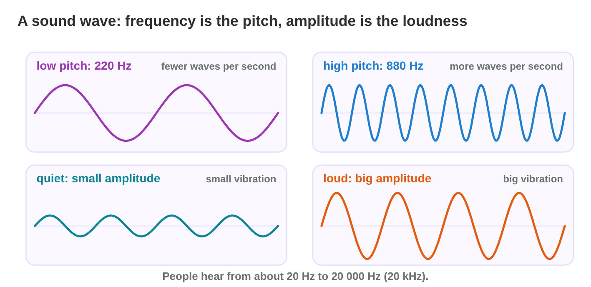
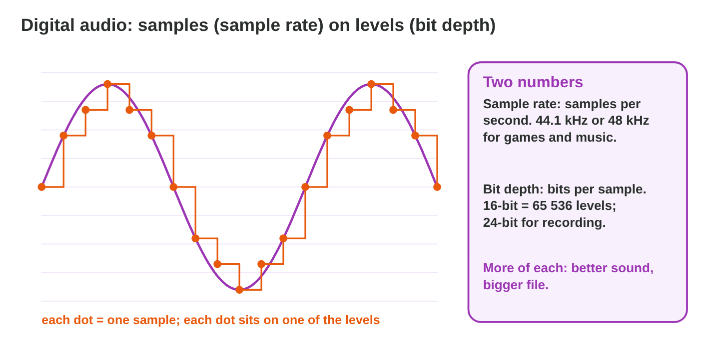
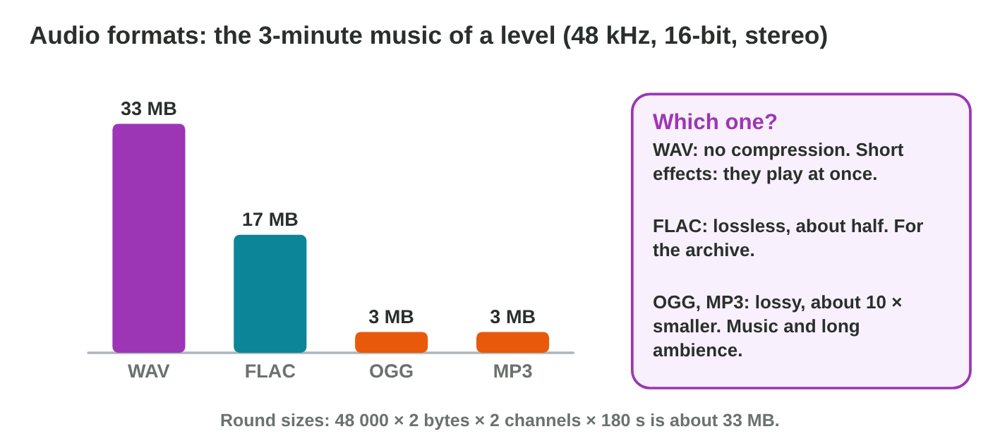
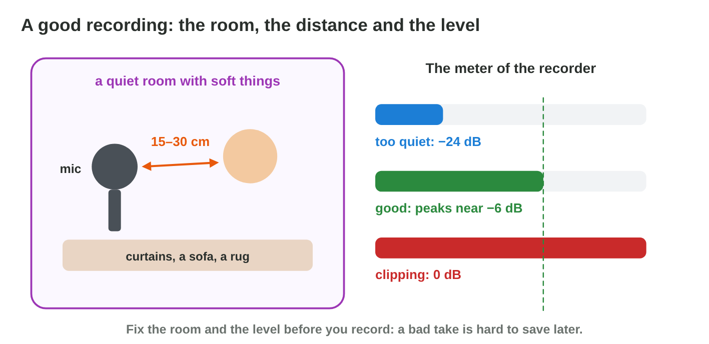

::: {.lead}
*Night Owl Games* needs the sounds of *Rooftop Rescue*: Pasha the cat
meowing on the roof, Nour's steps on wet tiles, the rain over the flooded
city and the music of the flood level. Yara, the sound designer, will
record some of them herself. Before she presses Record, she must know what
a sound is, how a computer keeps it, which file format the game needs, and
how to get a clean recording. In lecture 1 you met sound as one of the
media of a game; in this lesson you look inside it. Every section ends with
a short task, and at the end you know the settings of a good game sound.
:::

## Key terms



## 13.1 What a sound is: a wave

When Pasha meows, his throat vibrates and pushes the air. The air carries
the vibration to your ear as a **sound wave**. Two numbers describe it
(@fig-wave).

::: {.callout-important title="Definition 13.1 — Frequency and amplitude"}
- The **frequency** is the number of vibrations per second, in hertz (Hz).
  A high frequency sounds **high** (a bird), a low frequency sounds **low**
  (thunder). People hear from about 20 Hz to 20 000 Hz.
- The **amplitude** is the size of the vibration. A big amplitude sounds
  **loud**. Loudness levels are measured in **decibels (dB)**; in an audio
  program, 0 dB is the loudest level a file can hold, and quieter levels
  are negative (−6 dB, −20 dB).
:::

{#fig-wave width=94%}

::: {.callout-note title="Example 13.1 — The sounds of the level"}
1. Pasha's meow: about 500–800 Hz, a middle pitch; medium amplitude.
2. The thunder over the flood: below 100 Hz, low; big amplitude.
3. The bell of the rescue boat: above 2000 Hz, high and clear.
:::



::: {.callout-warning title="Common mistake"}
Mixing up pitch and loudness. A whistle is high but can be quiet; a drum is
low but can be very loud. Frequency and amplitude change separately.
:::

::: {.callout-note title="Do it · Hear the two numbers"}
1. In **Wave Lab**, tap Play at 220 Hz and at 880 Hz. Which one is higher?
2. Set the amplitude to 0.4 and then to 0.8. Read the loudness in dB each
   time.

*Your result:* one answer and two dB values.
:::

## 13.2 From a wave to numbers: sampling

A computer cannot keep a smooth wave. It measures the wave many times per
second and keeps each measure as a number. Each measure is a **sample**
(@fig-sample).

::: {.callout-important title="Definition 13.2 — Sample rate, bit depth and channels"}
- **Sample rate:** how many samples per second. Games and music use
  **44.1 kHz** or **48 kHz** (44 100 or 48 000 samples per second).
- **Bit depth:** how many bits keep each sample, so how many levels it can
  have. **16-bit** has 65 536 levels; recording studios use 24-bit.
- **Channels:** **mono** has one channel; **stereo** has two (left and
  right) and twice the size.
:::

{#fig-sample width=94%}

::: {.callout-note title="Example 13.2 — How big is one minute?"}
48 kHz, 16-bit (2 bytes), stereo (2 channels):

1. One second: 48 000 × 2 × 2 = **192 000 bytes**.
2. One minute: 192 000 × 60 = 11 520 000 bytes, about **11 MB**
   (11 520 000 ÷ 1024 ÷ 1024).
3. In mono, half: about 5.5 MB per minute.
:::

::: {.callout-note title="Example 13.3 — Too few samples"}
Old phones used 8 kHz and 8-bit. With only 8000 samples per second, the
high parts of a sound are lost, and with 256 levels you hear a hiss. That is
why a call sounds "small". For a game, use 44.1 or 48 kHz and 16-bit.
:::

::: {.callout-warning title="Common mistake"}
Recording everything in stereo "for better sound". One cat, one step, one
voice is one source: record it in mono. The game engine places it left or
right, and the file is half the size.
:::

::: {.callout-note title="Do it · Count the size"}
1. In **Wave Lab**, choose 8 kHz and 4-bit, then 48 kHz and 16-bit. Look at
   the orange samples. What changes?
2. Compute the size of 10 seconds of Pasha's meow at 48 kHz, 16-bit, mono.

*Your result:* one sentence and one size in KB.
:::

## 13.3 Audio formats for games

The samples are saved in a file. Some formats keep every sample; others
remove details people hardly hear, to make the file smaller (@fig-formats).

::: {.callout-important title="Definition 13.3 — Uncompressed and compressed audio"}
- **Uncompressed audio** (**WAV**) keeps every sample. It is big, but it
  plays at once with no decoding.
- **Lossless compression** (FLAC) makes the file about half the size and
  keeps every sample.
- **Lossy compression** (**OGG**, **MP3**) removes details people hardly
  hear, so the file is about **10 times smaller**.
:::

{#fig-formats width=94%}

::: {.callout-note title="Example 13.4 — The sound folder of Rooftop Rescue"}
1. Pasha's meow and Nour's steps: short, played often → **WAV**.
2. The rain over the city: a long loop → **OGG**.
3. The music of the flood level, 3 minutes: about 33 MB as WAV, about 3 MB
   as **OGG**.
4. The raw recordings stay as 24-bit WAV in the archive, for later edits.
:::

::: {.callout-warning title="Common mistake"}
Editing an MP3 and saving it as MP3 again and again. Each save removes more
details. Edit the WAV, and make the compressed file only at the end.
:::

::: {.callout-note title="Do it · Look at real files"}
1. On the lab computer, find one WAV and one MP3 file (or record two with
   your phone). Right-click › Properties: compare the sizes per minute.
2. Which format would you use for a 2-minute menu music?

*Your result:* two sizes and one format.
:::

## 13.4 Recording a clean take

A **take** is one recording. A good take starts before Record: in the room,
with the distance and with the level (@fig-rec).

::: {.callout-important title="Definition 13.4 — Room, distance and input level"}
- **Room:** quiet (no fridge, no fan, windows closed), with soft things
  (curtains, a sofa) that stop echoes.
- **Distance:** about 15–30 cm from the microphone, always the same.
- **Input level:** how loud the signal comes in. Good peaks are near
  **−6 dB**. At **0 dB** the wave is cut flat: **clipping**, a broken sound
  that no edit can repair.
- Record **three takes** and keep the best.
:::

{#fig-rec width=94%}

::: {.callout-note title="Example 13.5 — Yara's three takes"}
1. Take 1: the meter hits 0 dB, the top of the wave is flat: clipping.
   Yara lowers the input level.
2. Take 2: the peaks are at −24 dB, with the hum of the fridge. She turns
   off the fridge and moves closer.
3. Take 3: peaks near −6 dB, a quiet background. She keeps take 3.
:::

::: {.callout-warning title="Common mistake"}
"We fix it later." Noise, echo and clipping in a take are hard or
impossible to remove. A minute spent on the room saves an hour of editing.
:::

::: {.callout-note title="Do it · Three takes"}
1. Record one short sound (a cup on a table, a door, your voice saying
   "meow") three times with your phone or the lab computer: too far, too
   close and loud, and well placed.
2. Listen. Which take is best, and why?

*Your result:* three takes and one sentence.
:::

## Case study: Sound Booth

Yara records the sounds of *Rooftop Rescue* at Night Owl Games: Pasha's
meow, Nour's footsteps on the roof and the 3-minute music of the flood
level. She must choose the sample rate and the bit depth, mono or stereo,
fix a clipped take and a quiet take with a hum, and choose the formats of
the footsteps and of the music. The Game challenge of the interactive
lesson uses this story. In the mini-game below you choose the settings with
her.



## Further reading

Collins, *Game Sound* (2008), Chapter 4. Audacity Manual, "Recording your
voice and microphone" and "Sample rates". Schell, *The Art of Game Design*,
3rd ed., Chapter 13 (the aesthetics of sound).

## Exercises

1. What does the frequency of a sound tell you? And the amplitude?
2. Which range of frequencies can people hear?
3. What is a sample? What is the sample rate?
4. How many levels does 16-bit audio have?
5. How many bytes does one second of 48 kHz, 16-bit, mono audio take?
6. Why record one cat in mono?
7. Which format fits a short sound effect, and which a long music track?
8. What is clipping, and how do you avoid it?
9. Where should the peaks of a good take be on the meter?
10. Give two things that make a room good for recording.

## Answers to the exercises

::: {.answers}
1. Frequency: the pitch (high or low). Amplitude: the loudness.
2. About 20 Hz to 20 000 Hz.
3. One measure of the wave; the number of samples per second.
4. 65 536.
5. 48 000 × 2 = 96 000 bytes.
6. It is one source; the engine places it, and the file is half the size.
7. Short effect: WAV. Long music: OGG or MP3.
8. Distortion above 0 dB, when the tops of the wave are cut flat; lower the
   input level.
9. Near −6 dB.
10. Quiet (no fridge or fan) and soft things that stop echoes.
:::
