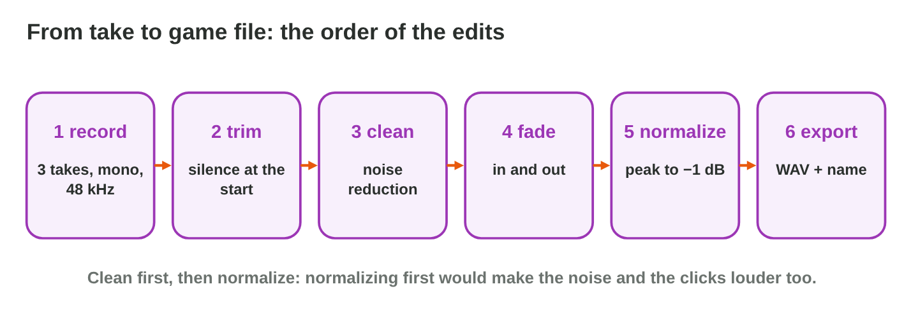
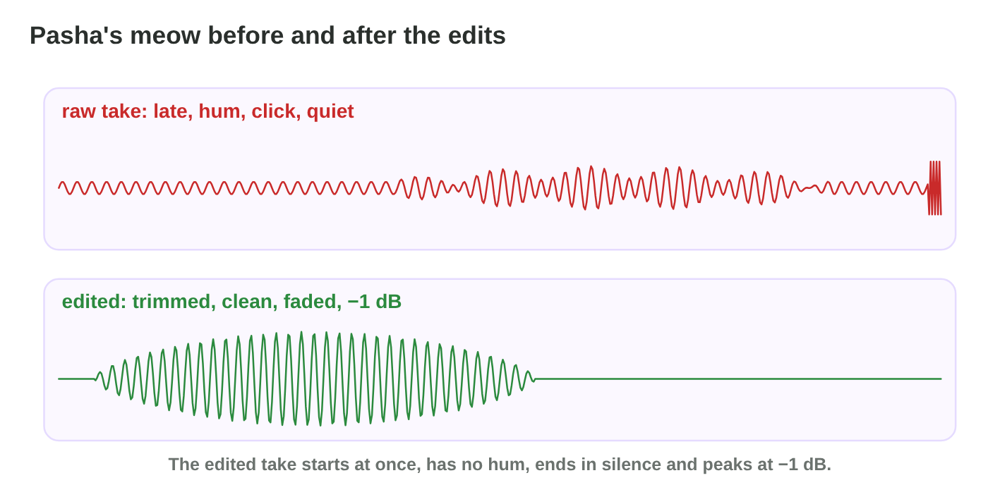
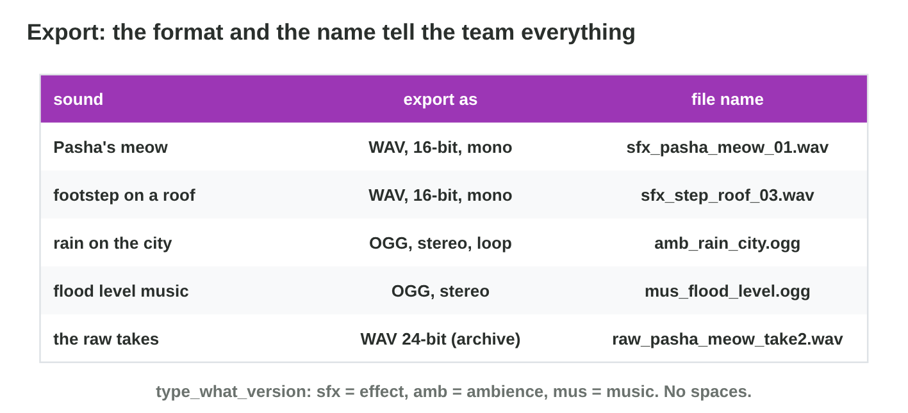

This page is the interactive version of the lesson notes (PDF). Each section
is one step of the workshop. It ends with a **Do it** task and one set of
questions. The full explanations, examples and exercises are in the notes.

## Key terms



## 14.1 Record a sample in Audacity

- Project rate **48000 Hz**; recording channels **1 (mono)**; choose the
  microphone.
- Watch the meter: peaks near **−6 dB**.
- Record **2 seconds of room tone** first, then **three takes**.
- Save the project (`.aup3`) and keep the raw takes.

{width=90%}

::: {.callout-warning title="Watch out!"}
Check the meter before you press Record: a clipped take is lost.
:::

::: {.callout-note title="Do it · Record three takes"}
In Audacity (or a free recorder app), set 48000 Hz and mono. Record 2
seconds of silence and three takes of one short sound. Save the project.
:::

::: {.callout-tip title="Try it 1 · Settings"}
Choose the right answer.

::: {.match extra="8000 Hz|0 dB"}
Which project rate do you set?
:   48000 Hz

How many recording channels for one sound source?
:   1 (mono)

What do you record before the takes?
:   2 seconds of room tone

Where should the peaks be while you record?
:   near −6 dB
:::
:::

## 14.2 Clean it: trim, noise reduction and fades

- **Trim:** delete the silence before and after the best take; keep a few
  milliseconds.
- **Noise Reduction:** select room tone › Get Noise Profile; select the take
  › Noise Reduction › OK.
- **Fade Out** the last 0.1–0.2 s (and Fade In a hard start): the clicks
  disappear.

{width=90%}



::: {.callout-warning title="Watch out!"}
Too much Noise Reduction makes the sound watery: use a little, and listen.
:::

::: {.callout-note title="Do it · Clean your best take"}
In **Wave Editor**, do the four tasks in a good order. Then clean your own
take in Audacity: trim, Noise Reduction, fade-out.
:::

::: {.callout-tip title="Try it 2 · Cleaning"}
Choose the right edit.

::: {.match extra="Normalize|record in stereo"}
The meow starts almost a second late?
:   trim the silence at the start

A low hum under the whole take?
:   Noise Reduction with a noise profile

A click at the very end?
:   a short fade-out

Where does Noise Reduction get its noise profile?
:   from the room tone
:::
:::

## 14.3 Normalize and export for the game

- **Normalize** the clean take: the loudest peak goes to **−1 dB**. Do it
  after the cleaning.
- **Export** (File › Export Audio): WAV, 16-bit, mono for effects; OGG for
  music.
- **Name:** type_what_version, no spaces: `sfx_pasha_meow_01.wav`.
- One second of 48 kHz, 16-bit mono WAV: about 94 KB.

{width=90%}

::: {.callout-warning title="Watch out!"}
Amplify +20 dB makes the sound 10 times louder and clips it. Use Normalize.
:::

::: {.callout-note title="Do it · Export your sample"}
Normalize your take to −1 dB and export it as a WAV, 16-bit, mono, with a
good name. Play the file: does it start at once and end without a click?
:::

::: {.callout-tip title="Try it 3 · Ready for the game"}
Choose the right answer.

::: {.match extra="Recording 3.wav|0 dB"}
To which level do you normalize?
:   −1 dB

When do you normalize?
:   after the cleaning

Which settings for a short effect?
:   WAV, 16-bit, mono

Which name fits the meow?
:   sfx_pasha_meow_01.wav
:::
:::

## Game challenge: Clean Take {.challenge}

Work alone. Use every section of today.

Yara edits the takes of **Rooftop Rescue**: a late start, a **click**, a
**hum**, a take that is **too quiet**, a **clipped** take, and a file name
at the end.



::: {.callout-tip title="Try it 4 · The right edit"}
Choose the right edit.

::: {.match extra="Amplify +20 dB|Fade in"}
The loudest peak is about −14 dB?
:   Normalize to −1 dB

The tops are flat (clipped)?
:   record it again at a lower level

A hum under the whole take?
:   Noise Reduction

The take starts with a long silence?
:   trim
:::
:::

::: {.callout-tip title="Try it 5 · Order and size (harder)"}
Choose the right answer.

::: {.match extra="Normalize|94 MB"}
What comes first: Noise Reduction or Normalize?
:   Noise Reduction

Why can no edit repair a clipped take?
:   the flat tops are lost

How big is 2 seconds of 48 kHz, 16-bit, mono WAV?
:   about 188 KB

Which name fits the second version of a splash sound?
:   sfx_splash_02.wav
:::
:::

## Summary {.summary}

- Record at 48000 Hz, mono, with peaks near −6 dB: room tone first, then
  three takes.
- Clean in order: trim, Noise Reduction, fades.
- Normalize to −1 dB after the cleaning; never amplify into clipping.
- Export a WAV, 16-bit, mono for an effect, with a name like
  sfx_what_01.wav.
