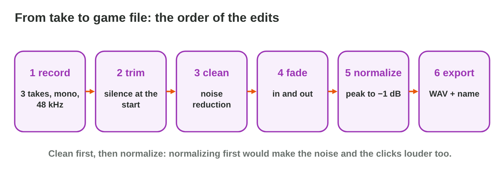
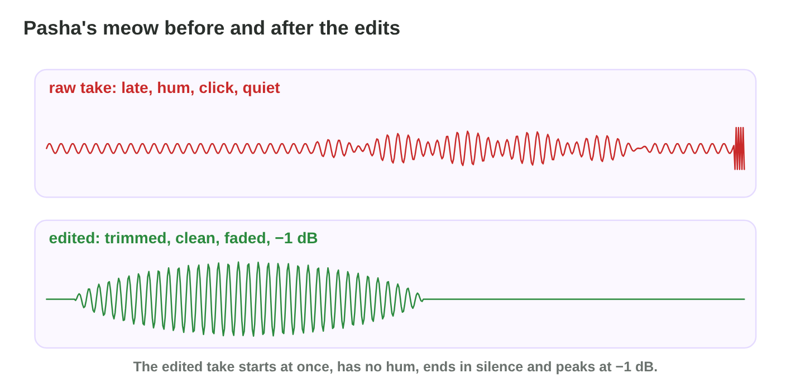

No new ideas today: two short problems on Lecture 7, on the lab computer
(Audacity, free) or with a free recorder app on your phone. Do each one
alone. Tap, sort or type your answer at every step: the page checks it at
once and tells you why.

## Recall

- Games keep sound at **48 kHz**, **16-bit**, in **mono** for one source.
- A clean take: a quiet room, 15–30 cm from the microphone, peaks near
  **−6 dB**; at 0 dB the wave clips. Record three takes.
- Clean in order: trim, fade-out, normalize to −1 dB, export a **WAV** with
  a clear name.

::: {.callout-tip title="Try it 1 · Recall"}
Choose the right answer.

::: {.match extra="8 kHz, stereo|0 dB"}
Which settings fit one cat's meow?
:   48 kHz, mono

    Why: Games use 48 kHz, and one source is recorded in mono.

Where should the peaks of a good take be?
:   near −6 dB

    Why: Then the loud parts still have room before 0 dB.

Which format fits a short sound effect?
:   WAV

    Why: It plays at once, with no decoding.
:::
:::

## Activity 1 · Record a sample

Yara records a sound for *Rooftop Rescue*. In Audacity she sets the
project rate to **48000 Hz** and the recording channels to **1 (mono)**,
and chooses the microphone. Before the takes she records **2 seconds of
room tone**: the quiet sound of the room, used later to remove noise.

| Setting | Value |
|------------------|---------------------------------------------|
| project rate | 48000 Hz |
| recording channels | 1 (mono) |
| room tone | 2 seconds, recorded before the takes |
| takes | three takes of the same sound |
| peaks | near −6 dB, never 0 dB |

: The settings of Activity 1.

{width=90%}

::: {.callout-warning title="Watch out!"}
Check the meter before you press Record: a clipped take is lost.
:::

::: {.callout-note title="Activity 1 · Three takes · 18 min"}
Choose one short sound: a cup on a table, a door, a coin, your voice
saying "meow".

1. Set 48000 Hz and mono. Record 2 seconds of room tone.
2. Record three takes of the sound. Watch the meter.
3. Save the project and write the peak level of your best take.

*Your product:* a saved project with three takes, and one peak level.

::: {.choice}
Step 1: which project settings and first recording are right?

- [x] 48000 Hz, mono, and 2 seconds of room tone before the takes

  Why: One source in mono; the room tone helps the noise reduction later.

- [ ] 44100 Hz, stereo, and no room tone

  Why: One source needs mono, and Noise Reduction needs the room tone.

- [ ] 8000 Hz, mono, and room tone after the takes

  Why: 8000 Hz is too low for a clean sound.
:::

::: {.choice}
Step 3: which best take is good?

- [x] peaks near −6 dB, for example −7 dB, never 0 dB

  Why: Loud enough, and the meter never reaches 0 dB.

- [ ] peaks at 0 dB

  Why: The take is clipped, and a clipped take is lost.

- [ ] peaks near −30 dB

  Why: Too quiet: the noise is loud next to the sound.
:::
:::

::: {.callout-tip title="Try it 2 · Recording"}
Choose the right answer.

::: {.match extra="8000 Hz|2 (stereo)"}
Which project rate do you set?
:   48000 Hz

    Why: Games use 48 kHz.

How many recording channels for one sound source?
:   1 (mono)

    Why: One source is one channel.

What do you record before the takes?
:   2 seconds of room tone

    Why: Noise Reduction learns the noise from it later.
:::
:::

## Activity 2 · Clean and export

The best take is cleaned in a fixed order. **Trim** the silence before and
after. **Noise Reduction**: select the room tone › Get Noise Profile, then
select the take › Noise Reduction › OK. A short **fade-out** (0.1–0.2 s)
removes a click. **Normalize** brings the loudest peak to −1 dB. Then
**export** (File › Export Audio) a WAV, 16-bit, mono, with a name like
`sfx_cup_01.wav`.

{width=90%}



::: {.callout-note title="Activity 2 · Your clean sample · 15 min"}
1. In **Wave Editor**, do the four tasks in a good order.
2. Clean your best take in Audacity the same way: trim, Noise Reduction,
   fade-out, normalize to −1 dB.
3. Export it as a WAV, 16-bit, mono, with a good name. Play the file.

*Your product:* one WAV file with a good name.

::: {.order}
Step 1: put the four tasks in a good order.

1. Trim the start.
2. Noise Reduction with the room tone.
3. A short fade-out at the end.
4. Normalize: the loudest peak to −1 dB.

Why: Remove the noise before Normalize, or the hum gets louder too.
:::

::: {.choice}
Step 3: which file name is good?

- [x] `sfx_cup_01.wav`

  Why: The type (sfx), the sound, a number, and WAV for an effect.

- [ ] `New Recording 3.wav`

  Why: The name does not say which sound it is.

- [ ] `cup.mp3`

  Why: An effect is exported as a WAV, with its type and number.
:::
:::

::: {.callout-tip title="Try it 3 · Cleaning"}
Choose the right answer.

::: {.match extra="Amplify +20 dB|record in stereo"}
There is a low hum under the whole take. What do you use?
:   Noise Reduction with a noise profile

    Why: The profile from the room tone tells it what to remove.

When do you normalize?
:   after the cleaning

    Why: Normalize the clean sound, not the noise.

Why can no edit repair a clipped take?
:   the flat tops are lost

    Why: The samples above 0 dB were never kept.

Which name fits the second version of a splash sound?
:   sfx_splash_02.wav

    Why: Type, what it is and the version, with no spaces.
:::
:::

## Wrap-up {.summary}

- You can record a sound sample with the right settings, room tone and
  three takes.
- You can clean it, normalize it and export it as a WAV with a clear name.
