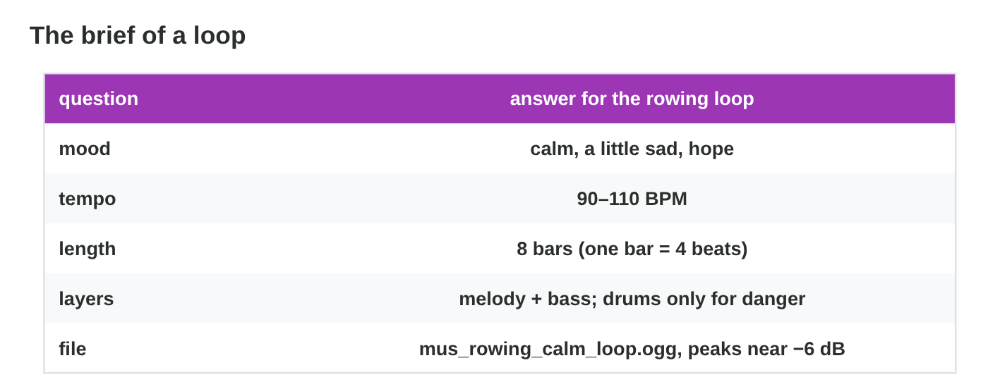
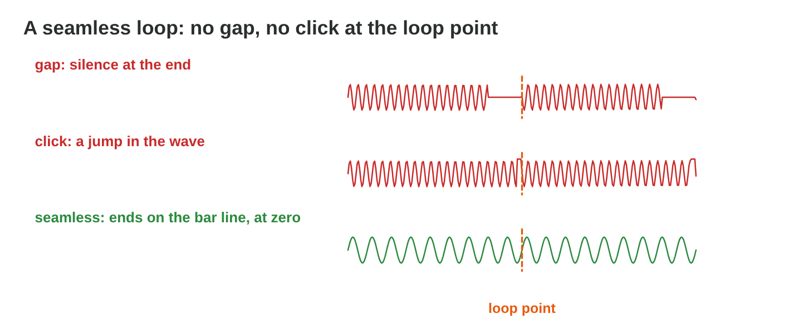

This page is the interactive version of the lesson notes (PDF). Each section
is one step of the workshop. It ends with a **Do it** task and one set of
questions. The full explanations, examples and exercises are in the notes.

## Key terms



## 16.1 Plan: the brief

- Five lines before the first note: **mood**, **tempo**, **length** (whole
  bars), **layers**, **file**.
- Rowing: calm with hope · 100 BPM · 8 bars (19.2 s) · melody + bass, drums
  for danger · `mus_rowing_calm_loop.ogg`.

{width=90%}

::: {.callout-warning title="Watch out!"}
Without a brief, the loop has no clear mood and no planned length.
:::

::: {.callout-note title="Do it · Write your brief"}
Choose one game moment (a menu, a calm level, a chase) and write the five
lines of its brief.
:::

::: {.callout-tip title="Try it 1 · The brief"}
Choose the right answer.

::: {.match extra="the colour of the menu|10 seconds"}
Which line of the brief says how the player should feel?
:   mood

How long is an 8-bar loop at 100 BPM?
:   19.2 s

How long is a 4-bar loop at 120 BPM?
:   8 s

Which layers play in the calm state of the rowing loop?
:   melody and bass
:::
:::

## 16.2 Build the loop in a step sequencer

- One row per sound, 16 steps per bar.
- Build **layer by layer**: rhythm (kick 1 and 3, snare 2 and 4), bass (a
  few long notes), melody (a short phrase).
- Keep calm layers simple; leave space.



::: {.callout-warning title="Watch out!"}
A full grid sounds busy. Silence is part of the music.
:::

::: {.callout-note title="Do it · Build your loop"}
Press Clear in **Loop Builder** and build your loop from your brief:
rhythm, bass, melody. Switch between calm and chase.
:::

::: {.callout-tip title="Try it 2 · Building"}
Choose the right answer.

::: {.match extra="on every step|the melody first"}
Where does the snare usually play in a 4-beat bar?
:   on beats 2 and 4

Where does the kick usually play?
:   on beats 1 and 3

Which layer do you build first?
:   the rhythm

How many steps does one bar have in Loop Builder?
:   16
:::
:::

## 16.3 Make it seamless and export it

- A whole number of bars; at the **loop point** no gap and no jump.
- A tail that rings over the end goes into the start.
- Peaks near −6 dB; WAV for work, OGG for the game; the tempo in the name.
- Check with loop play in Audacity, at least 10 repeats.

{width=90%}

::: {.callout-warning title="Watch out!"}
Most loop problems are heard only at the second and third repeat.
:::

::: {.callout-note title="Do it · Export and check"}
Download your loop (or record it in Audacity), loop-play it 10 times, and
export it with a good name.
:::

::: {.callout-tip title="Try it 3 · A ready loop"}
Choose the right fix.

::: {.match extra="make it louder|add more layers"}
A click at the loop point?
:   a very short fade, or a cut at zero

Silence at the end?
:   cut it on the bar line

A reverb tail rings over the end?
:   mix it into the start

The loop peaks at 0 dB?
:   lower it to about −6 dB
:::
:::

## Game challenge: Loop Doctor {.challenge}

Work alone. Use every section of today.

Students sent loops for **Rooftop Rescue**. Each loop has one problem: a
click, a wrong length, a tail with silence, a busy calm loop, a loud loop,
and a missing file name.



::: {.callout-tip title="Try it 4 · The loops"}
Choose the right fix.

::: {.match extra="speed it up|export it as MP3"}
The loop is 7.5 bars at 100 BPM.
:   cut it to exactly 8 bars

The calm loop has drums and a fast melody.
:   fewer layers and a slower tempo

The loop is good. Which name?
:   mus_rowing_calm_loop_120bpm.ogg

The effects are lost under the music.
:   lower the music, peaks near −6 dB
:::
:::

::: {.callout-tip title="Try it 5 · Check yourself (harder)"}
Choose the right answer.

::: {.match extra="7 s|3 bars"}
How long is 1 bar at 100 BPM?
:   2.4 s

How many bars are 19.2 s at 100 BPM?
:   8 bars

Loop Builder downloads 4 repeats of 1 bar at 100 BPM. How long is the file?
:   9.6 s

Why loop-play 10 times?
:   problems often appear only at the repeats
:::
:::

## Summary {.summary}

- Write a brief first: mood, tempo, length, layers, file.
- Build in layers: rhythm, bass, melody; leave space.
- A seamless loop: whole bars, no gap, no click, the tail at the start.
- Export with the tempo in the name and check it with loop play.
