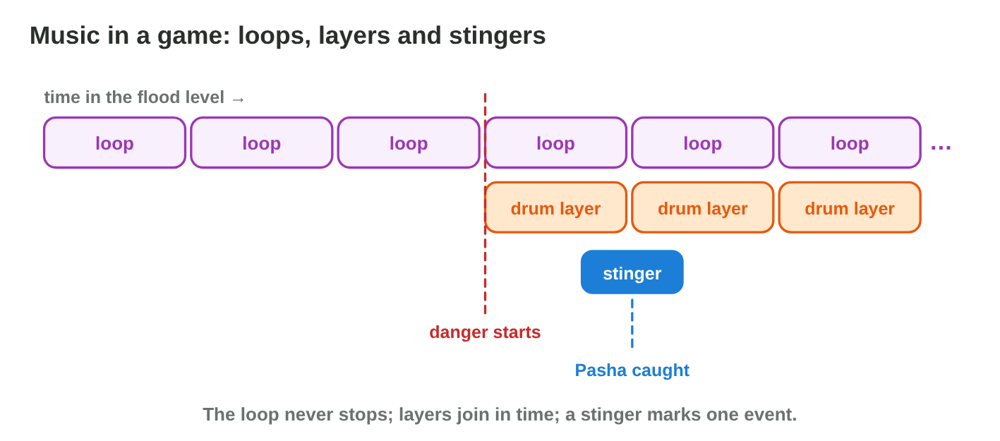
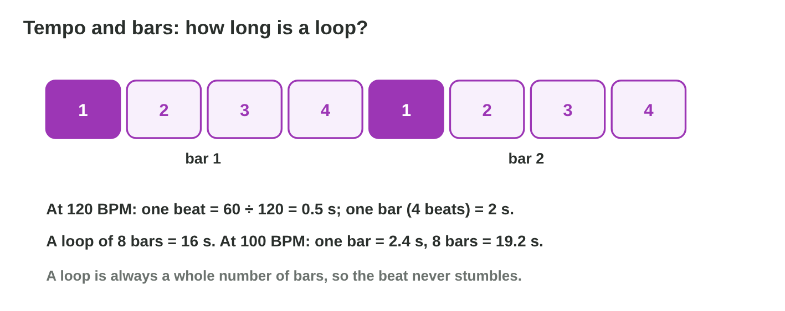
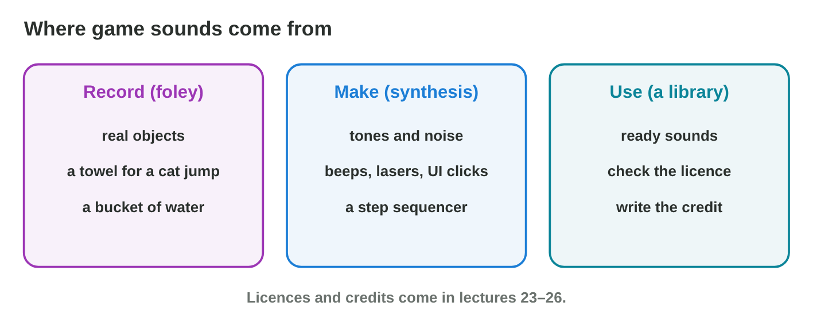

::: {.lead}
In the flood level of *Rooftop Rescue*, Nour rows through quiet streets for
as long as the player likes. Then a wave comes, and the danger rises; at
last the player catches Pasha the cat with the net. A film knows how long
each scene lasts; a game does not. So game music is built differently: from
**loops** that repeat without a gap, **layers** that come and go with the
game, and short **stingers** for events. Sound effects must sound fresh
the hundredth time too. In Lecture 7 you recorded and cleaned one sound. In this lesson you see how a studio produces the music and the
effects of a whole level. Every section ends with a short task.
:::

## Key terms



## 8.1 What music does in a game

Music tells the player how to feel: calm, danger, success. In a game it
must follow the player, not a clock (@fig-music).

::: {.callout-important title="Definition 8.1 — Loops, layers and stingers"}
- A **seamless loop** is music that repeats with no gap and no click. It
  plays as long as the player stays.
- **Adaptive music** changes with the game state: **layers** (stems) such
  as drums or strings fade in and out, always in time with the loop.
- A **stinger** is a short phrase (1–3 s) that marks one event: a success,
  a danger, a secret found.
:::

{#fig-music width=94%}

::: {.callout-note title="Example 8.1 — The music plan of the flood level"}
1. Rowing (calm): an 8-bar loop with melody and bass.
2. A wave comes (danger): the drum layer fades in on the next bar.
3. Pasha caught: a 2-second stinger over the loop, in the same key.
4. Back to calm: the drum layer fades out; the loop never stopped.
:::



::: {.callout-warning title="Common mistake"}
Using a normal song of 3 minutes. When it ends, the player hears silence,
or the song starts again from its intro. Game music needs loops.
:::

::: {.callout-note title="Do it · Calm and chase"}
1. In **Loop Builder**, play the example loop. Switch the game state
   between calm and chase while it plays.
2. What changes, and what stays the same?

*Your result:* two sentences.

::: {.check}
In chase, the drum layers join in; the loop, its melody and its tempo stay
the same. The music changes with the game state, but it never stops: that
is adaptive music.
:::
:::

## 8.2 Tempo, bars and the loop point

A loop must end exactly where a bar ends; otherwise the beat stumbles at
every repeat. So a sound designer counts in beats and bars (@fig-tempo).

::: {.callout-important title="Definition 8.2 — Tempo and bars"}
The **tempo** is the number of beats per minute (**BPM**). A **bar** has
(usually) 4 beats. A loop is a whole number of bars, so the beat goes on
without a jump at the **loop point**, where the loop starts again.
:::

{#fig-tempo width=94%}

A slow tempo (about 80 BPM) feels calm; a fast tempo (about 150 BPM) feels
like a chase. Loop Builder shows the length of one bar for every tempo, so
the designer does not need to compute it.

::: {.callout-note title="Example 8.2 — Two loops of the level"}
1. The rowing loop is calm: about 100 BPM, 8 bars.
2. The chase loop is fast: about 140 BPM, 8 bars.
3. A loop of 7.5 bars would stumble: half a bar is missing at each repeat.
:::

::: {.callout-warning title="Common mistake"}
Cutting a loop "by ear" at a round time, such as 15 seconds. The cut falls
in the middle of a bar, and the beat jumps at the loop point.
:::

::: {.callout-note title="Do it · Slow and fast"}
1. In **Loop Builder**, play the loop at 80 BPM, then at 150 BPM.
2. Which tempo fits a calm level, and which a chase? Read the length of one
   bar at each tempo.

*Your result:* two tempos with their moments, and two bar lengths.

::: {.check}
80 BPM fits a calm level, 150 BPM a chase. Loop Builder shows one bar of
3 s at 80 BPM and 1.6 s at 150 BPM: the faster the tempo, the shorter the
bar.
:::
:::

## 8.3 Where sound effects come from

A level needs dozens of effects: steps, splashes, swishes, button clicks.
A studio gets them in three ways (@fig-sources).

::: {.callout-important title="Definition 8.3 — Three sources of effects"}
- **Record (foley):** perform the action with real objects in front of a
  microphone: a towel shaken for a cat's jump, a hand in a bucket for a
  splash.
- **Make (synthesis):** build the sound from tones and noise, for beeps,
  lasers and interface clicks.
- **Use a library:** take a ready sound from a sound library, and check its
  licence (Lectures 12–13).
:::

{#fig-sources width=94%}

::: {.callout-note title="Example 8.3 — Yara's list"}
1. Pasha's meow: recorded (Lecture 7).
2. Nour's steps on wet tiles: foley, wet shoes on a tiled floor.
3. The coin and menu sounds: synthesis, short tones.
4. Thunder: a library sound with a free licence, credited in the game.
:::

::: {.callout-warning title="Common mistake"}
Downloading a sound from any website "because it is free to listen to".
Listening for free is not permission to use it in a game: check the licence.
:::

::: {.callout-note title="Do it · Foley at home"}
Choose one effect of a game you know (a step, a door, a jump). Which object
in your home could make it? Record one take with your phone.

*Your result:* one sentence and one take.

::: {.check}
A good answer looks like: "A step: my shoe on a tiled floor. A door: a
cupboard door. A jump: a towel shaken in the air." The take is short, with
peaks near −6 dB.
:::
:::

## 8.4 Layering and variation

One recording of a splash often sounds thin, and one sound repeated 200
times sounds like a machine. Two tricks solve both problems (@fig-layer).

::: {.callout-important title="Definition 8.4 — Layering and variation"}
**Sound layering** builds one effect from several sounds played together:
an **attack** (a short low thump), a **body** (the main sound) and a
**tail** (small drops, an echo). **Sound variation** makes an effect a
little different each time: several takes chosen at random, and a small
random change of pitch and volume (for example ±5 %).
:::

{#fig-layer width=94%}

::: {.callout-note title="Example 8.4 — The net swish"}
1. Yara records 3 takes of a stick swung through the air.
2. In the game, each swish picks one take at random.
3. The game changes its pitch by a random −5 % to +5 %. The player hears
   no repetition, although only 3 files exist.
:::

::: {.callout-warning title="Common mistake"}
Layering sounds that all start at a different time. The attack of every
layer must start together, or the effect sounds like two events.
:::

::: {.callout-note title="Do it · Three takes, one effect"}
Record three takes of your foley sound from 15.3. Play them one after the
other: do they sound like one effect with variation?

*Your result:* three takes and one sentence.

::: {.check}
A good result: three takes that sound like the same action, but each a
little different. Played one after the other, they do not sound like a
machine.
:::
:::

## Case study: Score the Scene

Yara plans the audio of the flood level of *Rooftop Rescue*: the quiet
rowing that can last minutes, the wave that brings danger, the moment the
player catches Pasha, the net swish that plays every few seconds, the thin
splash when Pasha falls into the water, and a loop that must end on a bar. The Game challenge of the interactive lesson uses these moments.
In the mini-game below you choose the audio decision for each one.



## Further reading

Collins, *Game Sound* (2008), Chapter 8 (dynamic and adaptive audio).
Schell, *The Art of Game Design*, 3rd ed., Chapter 13 (the aesthetics of
sound). Audacity Manual, "Looping".

## Exercises

1. Why does a game use loops instead of normal songs?
2. What is adaptive music? Give an example.
3. What is a stinger?
4. What is BPM, and how many beats does a bar usually have?
5. Which tempo fits a chase better: 80 BPM or 150 BPM?
6. Why must a loop be a whole number of bars?
7. Name the three sources of sound effects.
8. What is foley? Give an example.
9. Which three parts does a layered effect have?
10. How does a game make one swish sound different each time?

## Answers to the exercises

::: {.answers}
1. The player decides how long a moment lasts; a loop plays as long as
   needed.
2. Music that changes with the game state, such as a drum layer for danger.
3. A short musical phrase (1–3 s) for one event.
4. Beats per minute; 4 beats.
5. 150 BPM: a fast tempo feels like a chase.
6. Otherwise the beat stumbles at every repeat.
7. Recording (foley), synthesis, a library.
8. Sounds performed with real objects, such as a towel for a cat's jump.
9. Attack, body, tail.
10. A random take and a small random pitch change.
:::
