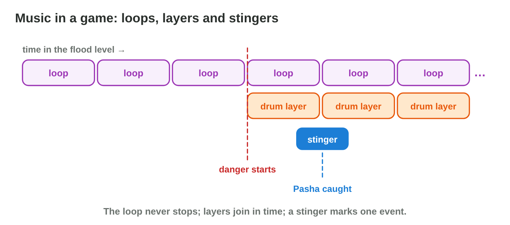
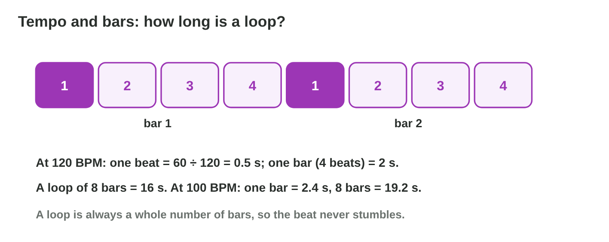
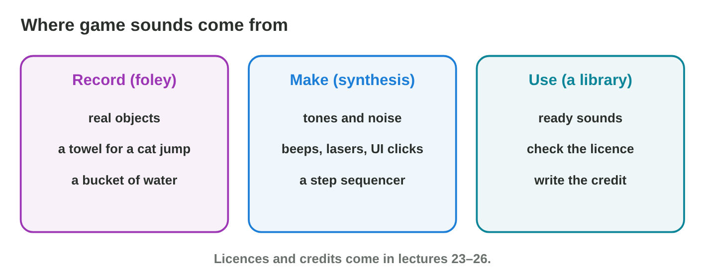
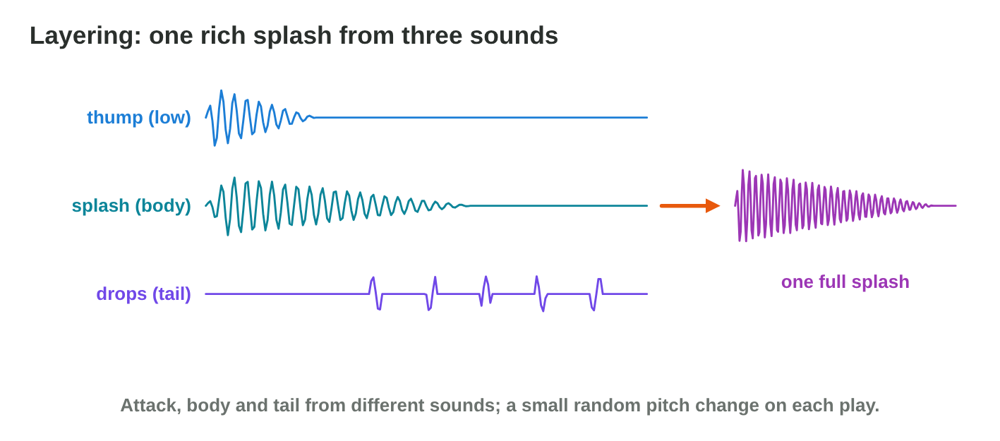

Each section: a problem in a game studio, the idea, a **Do it** task and a short **Try it**.
The page checks every answer at once and tells you why. More examples
and exercises are in the lesson notes (PDF).

## Key terms



## 8.1 What music does in a game

- A game does not know how long a moment lasts: its music is a **seamless
  loop**.
- **Adaptive music** changes with the game. Its **layers** (stems) are
  separate parts of the music, for example the drums. They fade in and out
  with the game state, in time with the loop.
- A **stinger** is a very short piece of music (1–3 s) for one event.
- The music of the flood level:

| Moment in the game | Music |
|--------------------------------|------------------------------------|
| Nour rows, all is calm | the calm loop |
| A big wave comes | a drum layer fades in |
| The player catches Pasha | a short stinger |

{width=90%}



::: {.callout-warning title="Watch out!"}
A 3-minute song ends with silence; a loop never does.
:::

::: {.callout-note title="Do it · Calm and chase"}
Play the example loop in **Loop Builder** and switch between calm and chase.

::: {.sort}
What changes in chase, and what stays the same? Sort them.

Changes in chase
:   the drum layers join in

    Why: More layers make the music tense.

Stays the same
:   the melody

    Why: The same tune keeps the music one piece.

:   the tempo

    Why: The beat keeps its speed.

:   the loop itself

    Why: It never stops: it only gets layers.
:::
:::

::: {.callout-tip title="Try it 1 · Game music"}
Choose the right answer.

::: {.match extra="a 3-minute song|silence"}
The player rows for as long as they like. Which music?
:   a seamless loop

    Why: A loop plays as long as the player stays, with no gap.

The player catches Pasha. What plays?
:   a short stinger

    Why: A stinger is a short phrase for one event.
:::
:::

## 8.2 Tempo, bars and the loop point

- **Tempo**: beats per minute (**BPM**). A **bar** = 4 beats.
- A loop is always a whole number of bars, so the beat goes on at the
  **loop point**.
- About 80 BPM feels calm; about 150 BPM feels like a chase.
- Loop Builder shows the length of one bar for every tempo.

{width=90%}

::: {.callout-warning title="Watch out!"}
A loop cut at a round time "by ear" ends in the middle of a bar: the beat
jumps at the loop point.
:::

::: {.callout-note title="Do it · Slow and fast"}
In **Loop Builder**, play the loop at 80 BPM, then at 150 BPM, and read the
length of one bar at each tempo (a bar is 4 beats).

::: {.fill answer="3" unit="s" hint="One beat at 80 BPM is 60 ÷ 80 = 0.75 s; a bar has 4 beats."}
How long is one bar at 80 BPM?

Why: 4 × 0.75 = 3 s; at 150 BPM a bar is 4 × 0.4 = 1.6 s: the faster the tempo, the shorter the bar.
:::
:::

::: {.callout-tip title="Try it 2 · Tempo"}
Choose the right answer.

::: {.match extra="8 beats|nothing happens"}
What does BPM count?
:   beats per minute

    Why: BPM is the tempo: beats per minute.

Which tempo fits a chase: 80 BPM or 150 BPM?
:   150 BPM

    Why: A fast tempo feels like a chase.

A loop ends in the middle of a bar. What happens when it repeats?
:   the beat jumps at the loop point

    Why: A loop must be a whole number of bars.
:::
:::

## 8.3 Where sound effects come from

- **Record (foley):** real objects: a towel for a cat's jump, a bucket for
  a splash.
- **Make (synthesis):** tones and noise for beeps, lasers, interface
  clicks.
- **Use a library:** ready sounds; check the licence (Lecture 12).

{width=90%}

::: {.callout-warning title="Watch out!"}
Free to listen is not free to use in a game.
:::

::: {.callout-note title="Do it · Foley at home"}
Match each game sound to the object at home that can make it: (a) a towel
shaken in the air; (b) a cupboard door; (c) a small bag of salt or flour
squeezed in your hand. Then record one take of one of them with your phone.

::: {.sort}
Which game sound does each object make? Sort them.

A step on snow
:   c) a small bag of salt squeezed in your hand

    Why: It crunches like snow.

The door of a wooden house
:   b) a cupboard door

    Why: It creaks like a wooden door.

A bird that flaps its wings
:   a) a towel shaken in the air

    Why: It sounds like wings.
:::
:::

::: {.callout-tip title="Try it 3 · Sources"}
Record, make or use?

::: {.match extra="buy a new microphone|draw it"}
Nour's steps on wet tiles?
:   record (foley)

    Why: Foley records real objects: wet shoes on tiles.

Thunder from a sound library?
:   use, and check the licence

    Why: Free to listen is not free to use in a game.
:::
:::

## 8.4 Layering and variation

- **Layering:** attack (a low thump) + body (the main sound) + tail (drops,
  echo), all starting together.
- **Variation:** several takes at random, and a small random pitch change
  (±5 %).

{width=90%}

::: {.callout-warning title="Watch out!"}
Layers that start at different times sound like two events.
:::

::: {.callout-note title="Do it · Three takes, one effect"}
Record three takes of your foley sound and play them one after the other.

::: {.choice}
Why does a game play several takes at random, with a small pitch change
(±5 %)?

- [x] So that a sound that plays often does not sound like a machine.

  Why: Variation: each time a little different, but the same action.

- [ ] To make the sound louder.

  Why: Variation changes the take, not the loudness.

- [ ] To make the sound longer.

  Why: Each take keeps its length.
:::
:::

::: {.callout-tip title="Try it 4 · Layers and variation"}
Choose the right answer.

::: {.match extra="make it louder|one take only"}
The splash sounds thin. What helps?
:   layer a thump, the splash and drops

    Why: Attack, body and tail together make a full splash.

The swish sounds the same every time. What helps?
:   several takes and a random pitch

    Why: Variation keeps a repeated sound fresh.

Which part of a layered sound comes first?
:   the attack

    Why: The attack is the short thump at the start.
:::
:::

## Game challenge: Score the Scene {.challenge}

Work alone. Use every section of today.

Yara plans the audio of the **flood level**: the quiet rowing, the wave,
Pasha caught, the net swish, the big splash, and a chase loop that must
end on a bar.



::: {.callout-tip title="Try it 5 · The flood level"}
Choose the right decision.

::: {.match extra="stop the music|a new song"}
The quiet rowing?
:   a calm 8-bar seamless loop

    Why: The player can stay for minutes, so the music loops.

The wave comes?
:   drum layers fade in

    Why: Danger adds a layer without a hard cut.
:::
:::

::: {.callout-tip title="Try it 6 · Plan the sounds (harder)"}
The flood level: calm rowing, a wave, Pasha caught, a net swish, a big
splash. Choose the right answer.

::: {.match extra="a 3-minute song|record it in stereo"}
The chase loop is 7.5 bars long. What do you change?
:   make it exactly 8 bars

    Why: A loop must be a whole number of bars.
:::
:::

## Summary {.summary}

- Game music is made of seamless loops, adaptive layers and stingers.
- A loop is a whole number of 4-beat bars; the tempo (BPM) sets the mood.
- Effects are recorded (foley), made (synthesis) or taken from a library
  with a licence.
- Layering (attack, body, tail) makes effects full; variation keeps them
  fresh.
