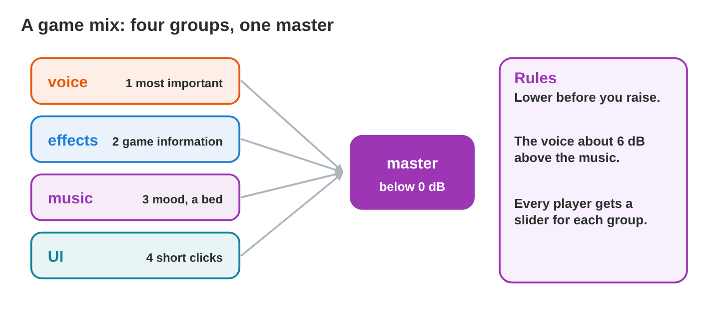
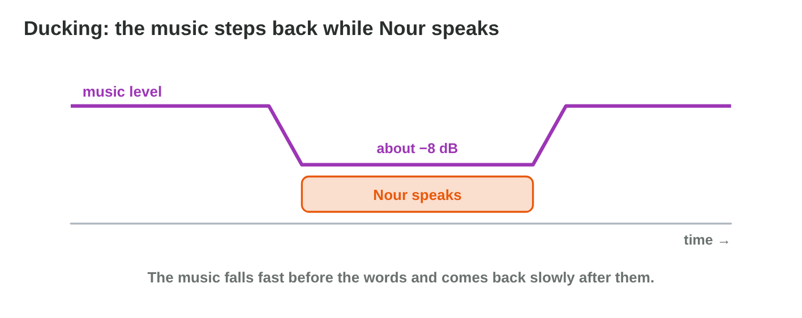
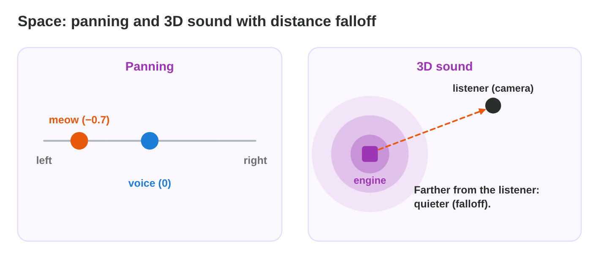
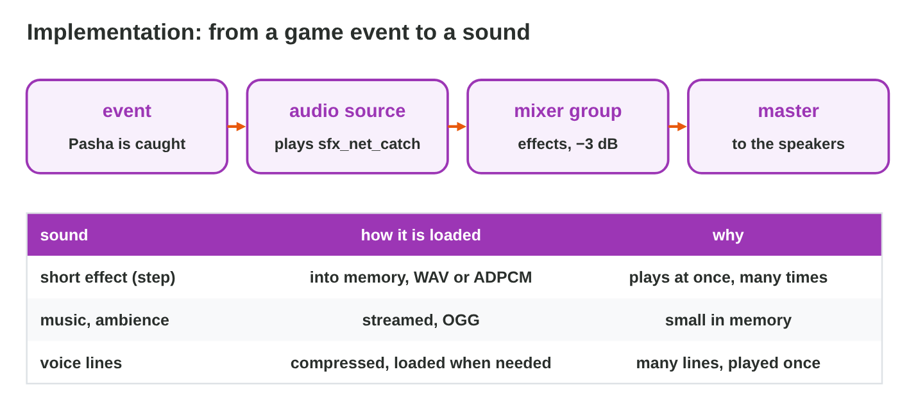

This page is the interactive version of the lesson notes (PDF). Each section
starts with a problem in a game studio. Then it explains the idea behind it.
It ends with a **Do it** task and one set of questions. The full
explanations, examples and exercises are in the notes.

## Key terms



## 17.1 Mixing: levels, groups and priorities

- **Groups:** voice, effects, music, interface → the **master** (below
  0 dB).
- Priority: voice first, then the effects with game information, then the
  music.
- **Ducking:** the music goes down (about 8 dB) while a voice plays.
- Lower what is too loud before you raise anything.

{width=90%}

{width=90%}



::: {.callout-warning title="Watch out!"}
Raising every quiet group makes the master clip.
:::

::: {.callout-note title="Do it · Mix the level"}
Make all four lines green in **Mix Desk**. Which change helped most?
:::

::: {.callout-tip title="Try it 1 · The mix"}
Choose the right answer.

::: {.match extra="the interface|raise the master"}
Which group usually has the top priority?
:   the voice

The master goes above 0 dB. What happens?
:   the sound clips

The music covers the voice. What helps?
:   ducking

How far above the music should the voice be?
:   about 6 dB
:::
:::

## 17.2 Space: panning and 3D sound

- **Panning:** left (−1) to right (+1).
- **3D sound:** the engine pans and changes the level from the positions of
  the **source** and the **listener** (camera).
- **Distance falloff:** farther = quieter.
- Music and interface stay 2D.

{width=90%}

::: {.callout-warning title="Watch out!"}
Music should not be 3D.
:::

::: {.callout-note title="Do it · 2D or 3D?"}
List four sounds of a game you know and say 2D or 3D for each, with a
reason.
:::

::: {.callout-tip title="Try it 2 · Space"}
2D or 3D? You can use an answer more than once.

::: {.match extra="4D|no sound"}
The rowing music.
:   2D

Pasha's meow on a roof.
:   3D

A menu click.
:   2D

The engine of a boat that moves away.
:   3D
:::
:::

## 17.3 Implementation: from an event to a sound

- **Event** → **audio source** → **mixer group** → master.
- Short effects: **into memory**. Music and ambience: **streamed**. Voice
  lines: compressed, loaded when needed.
- A 3-minute WAV loaded at start slowed the game by 4 s; streaming OGG
  fixed it.

{width=90%}

::: {.callout-warning title="Watch out!"}
Sounds sent straight to the master cannot be mixed by group.
:::

::: {.callout-note title="Do it · Load types"}
Write the load type of the meow, steps, rain, rowing music, Nour's lines and
menu click.
:::

::: {.callout-tip title="Try it 3 · Loading"}
Choose the way to load. You can use an answer more than once.

::: {.match extra="print it|delete it"}
A short step sound.
:   into memory

The 3-minute rowing music.
:   streamed

The rain ambience loop.
:   streamed

A menu click.
:   into memory
:::
:::

## 17.4 Evaluating the audio of a level

- Seven criteria: **clarity, balance, consistency, repetition, technical,
  accessibility, performance**.
- Score 1–3 with one note of evidence each.
- Test on phone speakers, and with the sound off.

{width=90%}

::: {.callout-warning title="Watch out!"}
Quiet room and good headphones are not how most players play.
:::

::: {.callout-note title="Do it · Score a level"}
Play one level of a mobile game for five minutes and score it with the
seven criteria.
:::

::: {.callout-tip title="Try it 4 · Criteria"}
Which criterion?

::: {.match extra="speed|colour"}
The net swish sounds the same every time.
:   repetition

The wave warning is only a sound.
:   accessibility

A click at the loop point.
:   technical

The game starts 4 seconds slower.
:   performance
:::
:::

## Game challenge: Sound Check {.challenge}

Work alone. Use every section of today.

The testers of **Rooftop Rescue** report six problems: the voice, a red
master, the meow, the engine, a slow start and a player without sound.



::: {.callout-tip title="Try it 5 · The reports"}
Choose the fix.

::: {.match extra="make everything louder|delete the sound"}
“I cannot understand Nour.”
:   duck the music

“The meow comes from the middle.”
:   pan it, or a 3D source

“The engine sounds the same far away.”
:   3D sound with falloff

“The game starts slowly.”
:   stream the long music
:::
:::

::: {.callout-tip title="Try it 6 · Numbers (harder)"}
Choose the right answer.

::: {.match extra="+8 dB|12 dB"}
The music is at −8 dB; ducking lowers it by 8 dB. Where is it then?
:   −16 dB

The voice is at −10 dB, the ducked music at −16 dB. How far above?
:   6 dB

The voice is 4 dB below the music. How much ducking makes it 6 dB above?
:   10 dB

A sound is panned to −1. Where do you hear it?
:   only on the left
:::
:::

## Summary {.summary}

- Mix by groups; the voice first; the master below 0 dB; ducking for
  voices.
- Panning and 3D sound with falloff place sounds in space; music stays 2D.
- Events play sources through groups; short sounds in memory, long ones
  streamed.
- Evaluate with seven criteria and evidence; test on phones and with the
  sound off.
