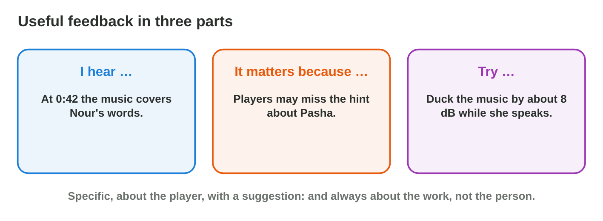
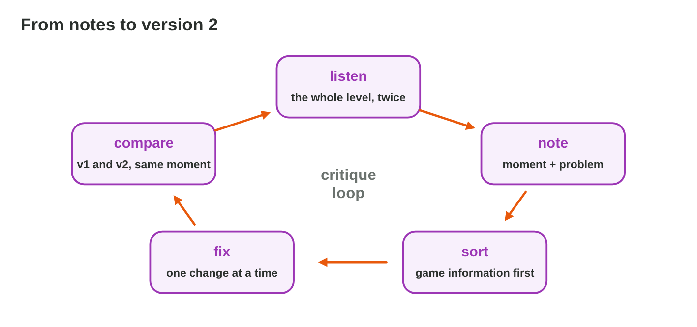

::: {.lead}
At *Night Owl Games*, every Friday is critique day. Yara plays the mix of
the flood level, and the team listens: Salma the producer, the level
designer and a tester. "It sounds bad" helps nobody; "At 0:42 the music
covers Nour's words, so players miss the hint; try ducking" helps at once.
In lecture 17 you learned to mix and to evaluate with criteria. In this
seminar you **critique**: you listen to a mix with the seven criteria, you
write feedback in three parts, and you turn feedback into a second version.
You can do all of it alone, with your own mix from Mix Desk or Loop
Builder. Every section ends with a task.
:::

## Key terms



## 18.1 Listen with criteria

Before you give feedback, you must listen carefully, and in the same way
every time (@fig-rubric).

::: {.callout-important title="Definition 18.1 — Critical listening"}
Listen to the whole piece **twice**: once as a player, once as a critic.
Note each problem with its **moment** (the time, such as 0:42, or the game
event) and its **criterion** (clarity, balance, consistency, repetition,
technical, accessibility, performance). Listen on a phone speaker and on
headphones.
:::

{#fig-rubric width=94%}

::: {.callout-note title="Example 18.1 — Salma's notes"}
1. 0:12 — the rain covers the steps (balance).
2. 0:42 — Nour's line "Hold on, Pasha!" is lost under the music (clarity).
3. 1:05 — the wave warning is only a sound (accessibility).
4. All the time — the net swish never changes (repetition).
:::

::: {.callout-warning title="Common mistake"}
Writing notes without a moment: "the music is too loud". The mixer cannot
find the problem. Always write when you hear it.
:::

::: {.callout-note title="Do it · Listen and note"}
1. Play your mix from Mix Desk (or your loop from lecture 16) twice.
2. Write at least four notes, each with a moment and a criterion.

*Your result:* four notes.
:::

## 18.2 Give useful feedback

A note becomes useful feedback when it says what you hear, why it matters,
and what to try (@fig-parts).

::: {.callout-important title="Definition 18.2 — Feedback in three parts"}
**I hear** … (the moment and the sound) · **It matters because** … (the
effect on the player) · **Try** … (one concrete suggestion). The feedback
is about the **work**, not the person, and it is honest and kind.
:::

{#fig-parts width=94%}

::: {.callout-note title="Example 18.2 — From a note to feedback"}
Note: "0:42 voice lost (clarity)."

Feedback: "At 0:42, when Nour says 'Hold on, Pasha!', the music covers her
words. Players may miss the hint about where Pasha is. Try ducking the
music by about 8 dB while she speaks."
:::



::: {.callout-warning title="Common mistake"}
Feedback about the person ("you are bad at mixing") or only taste ("I do
not like it"). The mixer cannot act on it, and the team stops listening.
:::

::: {.callout-note title="Do it · Build and write"}
1. In **Critique Builder**, build feedback that passes all four checks.
2. Turn two of your own notes from 18.1 into feedback in three parts.

*Your result:* two pieces of feedback.
:::

## 18.3 Receive feedback and revise

After the session, the mixer has a list of notes. A good second version
comes from a clear order of work (@fig-loop).

::: {.callout-important title="Definition 18.3 — Revising after a critique"}
1. **Ask** about unclear notes: "Which moment? What did you miss?"
2. **Sort** the notes: first what hides game information (voice, warnings,
   cues), then clipping and clicks, then taste.
3. **Fix** one thing at a time, and save version 2.
4. **Compare** v1 and v2 at the same moments.
:::

{#fig-loop width=94%}

::: {.callout-note title="Example 18.3 — Yara's version 2"}
1. First: ducking for Nour's lines (clarity), a red arrow and the subtitle
   "Wave!" (accessibility).
2. Then: rain −4 dB (balance), three takes of the swish (repetition).
3. She plays 0:42 in v1 and v2 for the team: everyone hears Nour now.
:::

::: {.callout-warning title="Common mistake"}
Changing ten things at once. If v2 sounds worse, nobody knows which change
caused it. One change, then listen.
:::

::: {.callout-note title="Do it · Version 2"}
1. Sort your notes and fix the two most important ones in Mix Desk (or in
   your loop).
2. Compare v1 and v2 at the same moment, and write one sentence about the
   difference.

*Your result:* the two fixes and one sentence.
:::

## Case study: Critic's Choice

In the critique session of Night Owl Games, the team listens to three
levels: the rain of the flood level covers Nour's steps; the coin sound of
*Lantern Keeper* is the same every time; the boss music of *Ember Trail*
starts with a hard cut. A teammate says "Your mix is terrible", and at the
end Yara has ten notes. The Game challenge of the interactive lesson uses
this session. In the mini-game below you choose the most useful feedback.



## Further reading

Schell, *The Art of Game Design*, 3rd ed., Chapter 27 (the team, and how to
give feedback). Collins, *Game Sound* (2008), Chapter 5.

## Exercises

1. Why listen to a mix twice?
2. What must every note have?
3. Name the three parts of useful feedback.
4. Rewrite "the sound is bad" as useful feedback for a level you know.
5. Why is "you are bad at mixing" not feedback?
6. A teammate says "Your mix is terrible." What do you ask?
7. In which order do you fix notes?
8. Why change one thing at a time?
9. How do you compare v1 and v2?
10. Which criterion does each note belong to: "a click at 1:20", "the coin
    sound gets annoying"?

## Answers to the exercises

::: {.answers}
1. Once as a player, once as a critic.
2. A moment and a criterion.
3. I hear …, it matters because …, try ….
4. For example: "At the start, the music covers the steps; players cannot
   hear the enemy; try lowering the music by 4 dB."
5. It is about the person, not the work, and gives nothing to act on.
6. "Which moment? What did you miss?"
7. Game information first, then technical problems, then taste.
8. So that you know which change made the difference.
9. Play the same moment in both versions.
10. Technical; repetition.
:::
