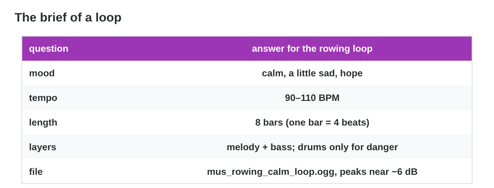
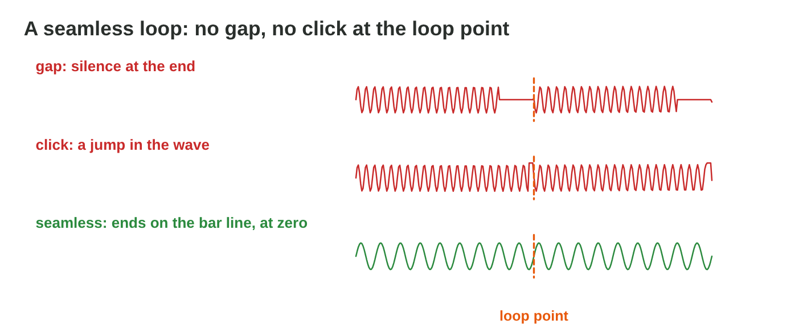

::: {.lead}
In Lecture 8 you learned how a game uses music (loops, layers, stingers),
tempo and bars, where sound effects come from, and layering and variation.
Today you produce a short loop and plan the effects of a level. There are
no new ideas: two short problems. Do each one alone. The results of the
activities are at the end of this worksheet.
:::

## Recall

- Game music is a **seamless loop**, with **layers** that fade in and out
  with the game state and short **stingers** for events.
- A loop is a whole number of 4-beat **bars**, so the beat goes on at the
  **loop point**; the tempo (BPM) sets the mood.
- Effects are recorded (foley), made (synthesis) or taken from a library
  with a licence; layering and variation make them full and fresh.

::: {.callout-tip title="Try it 1 · Recall"}
Choose the right answer.

::: {.match extra="a 3-minute song|8 beats"}
The player rows for as long as they like. Which music fits?
:   a seamless loop

How many beats does a bar usually have?
:   4

The player catches the cat. What plays at once?
:   a short stinger
:::
:::

## Activity 1 · Choose a brief and build a loop

Before the first note, a sound designer writes a **brief** of five lines:
**mood**, **tempo**, **length** (whole bars), **layers**, **file**. For
the rowing of *Rooftop Rescue*: calm with hope · 100 BPM · 8 bars · melody
and bass, drums for danger · `mus_rowing_calm_loop.ogg`. Then the loop is
built **layer by layer** in a step sequencer: rhythm (kick on beats 1 and
3, snare on 2 and 4), bass (a few long notes), melody (a short phrase).

{width=90%}



A chase in *Rooftop Rescue*: a big wave follows the boat for 2 minutes,
and the player rows as fast as possible. Three students wrote a brief for
its loop:

| Line of the brief | Brief A | Brief B | Brief C |
|------------|-----------------|-----------------------|-----------------------|
| mood | calm and sleepy | tense and fast | tense and fast |
| tempo | 70 BPM | 150 BPM | 150 BPM |
| length | 8 bars | 8 bars | 7.5 bars |
| layers | soft piano | drums, bass, a short melody | drums, bass, a short melody |
| file | `mus_chase_loop.ogg` | `mus_chase_loop.ogg` | `music new final.mp3` |

: Three briefs for the chase loop. BPM = beats per minute; a bar = 4 beats.

::: {.callout-note title="Activity 1 · Brief and loop · 18 min"}
1. Which brief fits the chase? For each of the other two briefs, write the
   lines that are wrong.
2. Press Clear in **Loop Builder** and build the loop of the right brief:
   rhythm, bass, melody. Switch between calm and chase.

*Your product:* one letter, the wrong lines of two briefs, and a loop.

::: {.check}
Brief **B** fits. A: the **mood** and the **tempo** are wrong: a chase
needs tension and a fast tempo. C: the **length** (7.5 bars is not a whole
number of bars, so the beat jumps at the loop point) and the **file** (no
clear name, with spaces). A good loop has a simple rhythm (kick on 1 and
3, snare on 2 and 4), a few bass notes and a short melody, with empty
steps; in chase the drums join in, and the loop and its tempo stay the
same.
:::
:::

::: {.callout-tip title="Try it 2 · The brief and the build"}
Choose the right answer.

::: {.match extra="on every step|the melody first"}
Which line of the brief says how the player should feel?
:   mood

Where does the snare usually play in a 4-beat bar?
:   on beats 2 and 4

Which layer do you build first?
:   the rhythm
:::
:::

## Activity 2 · Fix the loops, plan the effects

Students sent loops for *Rooftop Rescue*. Each one has one problem: a
click at the loop point, a wrong length, a tail with silence, a busy calm
loop, a loud loop, and a missing file name. A seamless loop has whole
bars, no gap and no click; its peaks are near −6 dB, so the effects stay
clear.

{width=90%}



::: {.callout-note title="Activity 2 · Loop Doctor and two effects · 15 min"}
1. In **Loop Doctor**, fix the six loops.
2. The level also needs the net swish, which plays every few seconds, and
   a big splash. Choose the way for each sound:

   - **A.** One take, a little louder every time.
   - **B.** Three takes chosen at random, with a small random pitch change.
   - **C.** Three layers that start together: a low thump, the splash and
     small drops.

*Your product:* your score and two letters.

::: {.check}
Loop Doctor: the click → a very short fade, or a cut at zero; 7.5 bars →
exactly 8 bars; the tail and silence → cut on the bar line and mix the
tail into the start; the busy calm loop → fewer layers and a slower tempo;
the loud loop → lower it to about −6 dB; the good loop →
`mus_rowing_calm_loop_120bpm.ogg`. The swish: **B** (variation hides the
repetition, about ±5 % pitch). The splash: **C** (attack, body and tail
make one full effect). A only makes the sound louder.
:::
:::

::: {.callout-tip title="Try it 3 · Fixes"}
Choose the right fix.

::: {.match extra="make it louder|add more layers"}
A click at the loop point?
:   a very short fade, or a cut at zero

The loop peaks at 0 dB, and the effects are lost under it?
:   lower it to about −6 dB

The splash sounds thin?
:   layer a thump, the splash and drops

The swish sounds the same every time?
:   several takes and a random pitch
:::
:::

## Exercises

1. Name the five lines of the brief of a loop.
2. A loop is cut at 15 seconds "by ear", and the beat jumps when it repeats. Why?
3. Where do the kick and the snare usually play in a 4-beat bar?
4. A coin sound plays 100 times in a level. How do you keep it fresh?

## Answers to the exercises

::: {.answers}
1. Mood, tempo, length, layers, file.
2. The cut is in the middle of a bar; a loop must be a whole number of bars.
3. The kick on beats 1 and 3, the snare on 2 and 4.
4. Several takes at random and a small random pitch change.
:::
