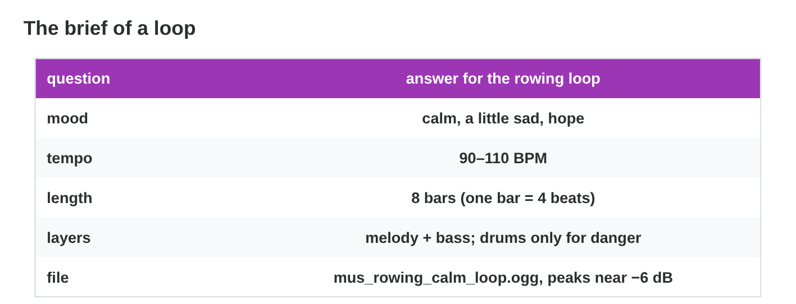
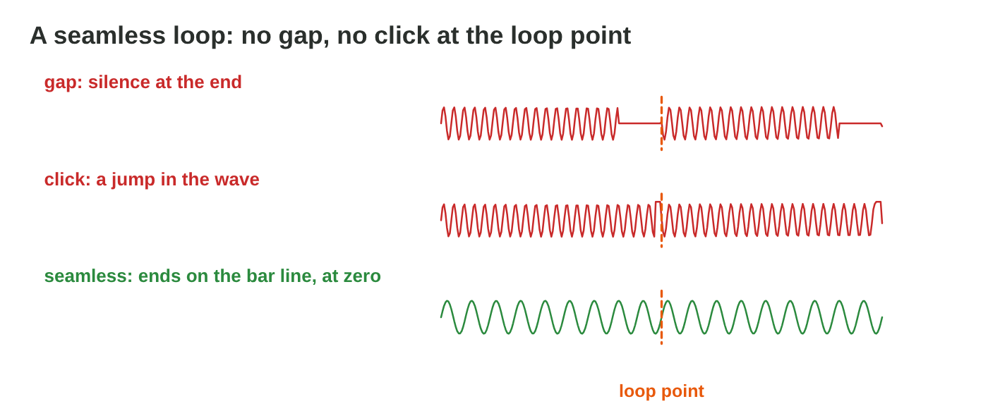

## Recall · Lecture 8

a) The player rows for as long as they like. Which music fits?
b) How many beats does a bar usually have?
c) The player catches the cat. What plays at once?

::: {.answer}
a) a seamless loop
b) 4
c) a short stinger
:::

## The facts · three briefs for the chase loop

| Line of the brief | Brief A | Brief B | Brief C |
|------------|-----------------|-----------------------|-----------------------|
| mood | calm and sleepy | tense and fast | tense and fast |
| tempo | 70 BPM | 150 BPM | 150 BPM |
| length | 8 bars | 8 bars | 7.5 bars |
| layers | soft piano | drums, bass, a short melody | drums, bass, a short melody |
| file | mus_chase_loop.ogg | mus_chase_loop.ogg | music new final.mp3 |

## Activity 1 · Brief and loop · 18 min

:::: {.columns}
::: {.column width="50%"}
- A brief has five lines: mood, tempo, length in whole bars, layers and file.
- **Do it:** Choose the brief that fits the chase, A, B or C, and find the wrong lines of the other two. Build its loop in Loop Builder.
- Your product is one letter, the wrong lines of two briefs and a loop.
:::
::: {.column width="50%"}

:::
::::

## Live demo · Loop Builder



## Check 1 · Brief and loop

Which brief fits the chase, and what does a good loop look like?

::: {.reveal}
1. Brief B fits: tense and fast, 150 BPM, 8 bars, drums, bass and melody.
2. In A the mood and the tempo are wrong; in C the length (7.5 bars) and the file name are wrong.
3. The loop has a simple rhythm, a few bass notes, a short melody and empty steps.
4. In chase the drums join in, but the loop and its tempo stay the same.
:::

## Activity 2 · Loops and effects · 15 min

:::: {.columns}
::: {.column width="50%"}
- A seamless loop has whole bars, no gap, no click, and peaks near −6 dB.
- **Do it:** Fix the six loops in Loop Doctor. Then choose the way to make the net swish fresh and the big splash full.
- Your product is your score and two letters.
:::
::: {.column width="50%"}

:::
::::

## Check 2 · Loops and effects

How are the loops and the effects fixed?

::: {.reveal}
1. A click needs a very short fade, and 7.5 bars become exactly 8 bars.
2. A busy calm loop gets fewer layers, and a loud loop is lowered to about −6 dB.
3. The swish is B: three takes at random and a small random pitch change.
4. The splash is C: three layers that start together, a thump, the splash and drops.
:::

## Wrap-up

- You can check the brief of a game-music loop and build it layer by layer.
- You can make a loop seamless and plan layered effects with variation.
