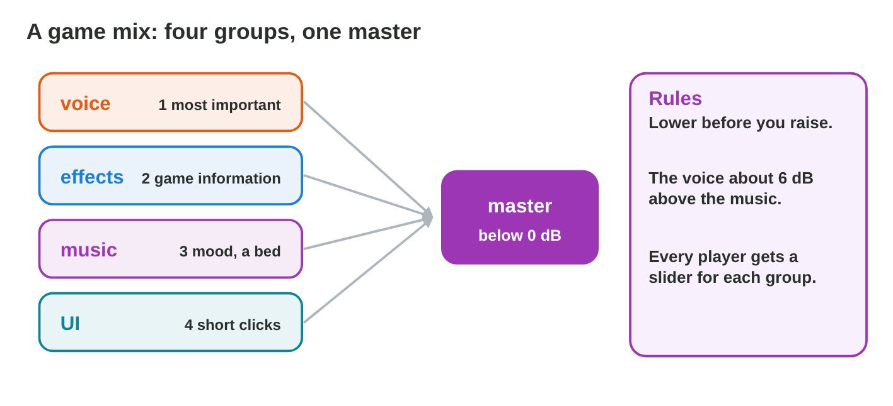
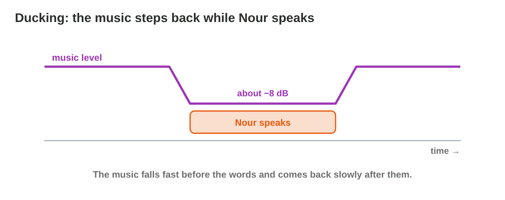
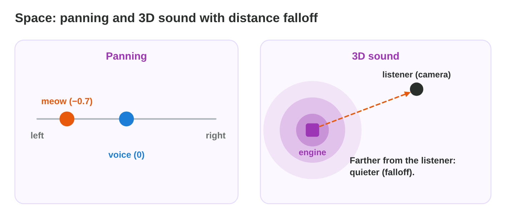
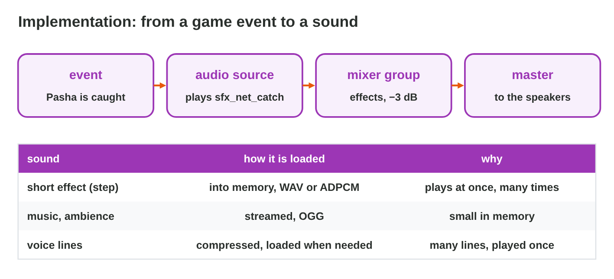
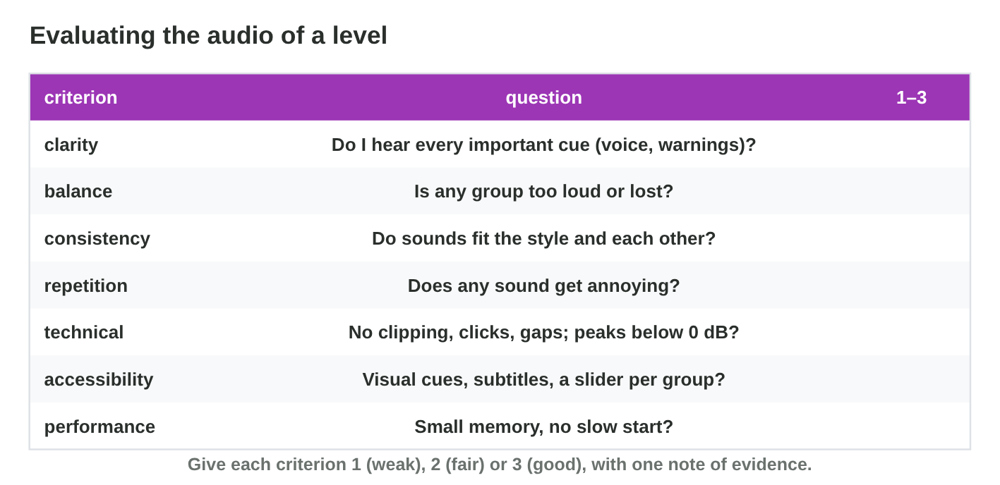

::: {.lead}
All the sounds of the flood level of *Rooftop Rescue* are ready: the
rowing loop, the rain, Pasha's meow, the net swish, Nour's voice lines and
the menu clicks. But when they all play together, the first test is a
mess: the music covers Nour's words, the master meter turns red in the big
wave, and the boat engine sounds the same near and far. Good sounds are
not enough; they must be **mixed**, placed in **space**, and
**implemented** in the game, and the result must be **evaluated**. In
Lectures 7 and 8 you made sounds and loops. In this lesson you put them
together. Every section ends with a short task.
:::

## Key terms



## 9.1 Mixing: levels, groups and priorities

A game plays many sounds at once. Mixing decides how loud each one is, so
that the player hears what matters most (@fig-groups).

::: {.callout-important title="Definition 9.1 — Mix, groups, master and ducking"}
A **mix** is the balance of all sounds that play at once. Sounds are sent
to **mixer groups**: voice, effects, music, interface. All groups meet in
the **master**, which must stay **below 0 dB** (or the sound clips,
Lecture 7). The most important group comes first: usually the voice, then
the effects that carry game information, then the music. **Ducking**
lowers the music while a voice plays.
:::

{#fig-groups width=94%}

{#fig-duck width=94%}

::: {.callout-note title="Example 9.1 — Mixing the flood level"}
1. Nour's voice is 4 dB **below** the music: her words are lost.
2. Yara turns on ducking (−8 dB) and raises the voice by 2 dB: now the
   voice is 6 dB above the music.
3. The menu clicks are louder than the voice: she lowers the interface
   group by 4 dB. The master peaks near −2 dB: no clipping.
:::



::: {.callout-warning title="Common mistake"}
Raising everything that is too quiet. The master soon clips. Lower what is
too loud first; raise only when nothing else helps.
:::

::: {.callout-note title="Do it · Mix the level"}
1. In **Mix Desk**, make all four lines green.
2. Write your fader values and say which change helped most.

*Your result:* four values and one sentence.

::: {.check}
A typical way: duck the music under the voice, lower the music group, and
lower the master below 0 dB. Ducking helps most: Nour's lines become clear
without making anything louder.
:::
:::

## 9.2 Space: panning and 3D sound

Players use their ears to find things: a cat on the left, an engine far
away. The mix places sounds in space (@fig-space).

::: {.callout-important title="Definition 9.2 — Panning, 3D sound and falloff"}
**Panning** places a sound between the left (−1) and the right (+1)
speaker. With **3D sound** (spatial audio), the game engine does this by
itself from the positions of the sound **source** and the **listener**
(usually the camera). **Distance falloff** makes a sound quieter as the
distance grows.
:::

{#fig-space width=94%}

::: {.callout-note title="Example 9.2 — The engine and the meow"}
1. Pasha meows on a roof on the left: his source is on the left of the
   camera, so the meow comes from the left speaker.
2. The rescue boat moves away: with falloff, its engine gets quieter; at 30
   metres it is almost silent.
3. Music and interface sounds stay 2D: they do not belong to a place.
:::

::: {.callout-warning title="Common mistake"}
Making music 3D. Music that gets quieter when the camera turns feels
broken. Only sounds of objects in the world are 3D.
:::

::: {.callout-note title="Do it · 2D or 3D?"}
Four sounds of *Market Day*, a city game:

| Sound | What it is | 2D or 3D? |
|:---:|-------------------------------------------------------|:---------:|
| 1 | the background music | \_\_\_ |
| 2 | the click of the pause button | \_\_\_ |
| 3 | a dog that barks behind a wall, to the left of the player | \_\_\_ |
| 4 | a bus that drives past the player | \_\_\_ |

1. Write 2D or 3D for each sound.
2. Which sound does the game pan to the left?

*Your result:* four answers and one number.

::: {.check}
1 **2D** (music is not in the world) · 2 **2D** (the interface is not in
the world) · 3 **3D** (it comes from one place) · 4 **3D** (it moves). The
game pans sound **3** to the left: the dog is on the player's left.
:::
:::

## 9.3 Implementation: from an event to a sound

**Implementation** is putting the sounds into the game: when to play
them, through which group, and how to load them (@fig-impl).

::: {.callout-important title="Definition 9.3 — Implementation"}
A game **event** (Pasha is caught) starts a sound on an **audio source**;
the source sends it to its **mixer group**, then to the master. Each sound
is loaded in the right way: short effects **into memory** (they play at
once), long music and ambience **streamed** (read while they play), voice
lines compressed and loaded when needed.
:::

{#fig-impl width=94%}

::: {.callout-note title="Example 9.3 — A slow start"}
The game needed 4 seconds more to start after the music was added: the
3-minute music was loaded into memory as WAV. Yara sets it to **streaming**
as OGG. The start time is normal again, and the memory use drops.
:::

::: {.callout-warning title="Common mistake"}
Playing every sound on the master directly. Then the player cannot turn
down the music only, and the mix cannot be changed by group.
:::

::: {.callout-note title="Do it · Load types"}
For the sounds of Rooftop Rescue (meow, steps, rain, rowing music, Nour's
lines, menu click), write the load type of each one.

*Your result:* six sounds with a load type.

::: {.check}
Meow, steps and menu click: into memory (short, play at once). Rain and
rowing music: streamed (long). Nour's lines: compressed, loaded when
needed.
:::
:::

## 9.4 Evaluating the audio of a level

When is the audio good enough? A team needs the same criteria, so that
evaluation is not only taste (@fig-rubric).

::: {.callout-important title="Definition 9.4 — Audio evaluation criteria"}
Evaluate a level with seven criteria: **clarity** (important cues are
heard), **balance**, **consistency** (one style), **repetition**,
**technical** quality (no clipping, clicks or gaps), **accessibility**
(visual cues, subtitles, a slider per group) and **performance** (memory,
start time). Give each a score (1–3) with one note of evidence.
:::

{#fig-rubric width=94%}

An evaluation ends with **feedback** for the sound designer, in three
parts: **I hear …** (what and when), **it matters because …** (the
criterion, the player), **try …** (one change). "I hear that Nour's line is
lost under the music in the wave; it matters because the player misses the
warning; try ducking the music by 8 dB." 

::: {.callout-note title="Example 9.4 — Scoring the flood level"}
1. Clarity 3: the voice is clear after ducking.
2. Repetition 1: the net swish sounds the same every time (add variation,
   Lecture 8).
3. Accessibility 1: the wave warning is only a sound. Fix: a red arrow on
   the screen and a subtitle "Wave!".
:::

::: {.callout-warning title="Common mistake"}
Testing the mix only with good headphones in a quiet room. Players use
phone speakers on a bus: test there too, and with the sound off.
:::

::: {.callout-note title="Do it · Score a level"}
A tester played level 2 of *Snow Post* and wrote seven notes:

| Note | What the tester wrote | Criterion | Score |
|:---:|-------------------------------------------------|:---------:|:-----:|
| a | The captain's voice is clear over the wind. | \_\_\_ | \_\_\_ |
| b | The music is much louder than the steps and the waves. | \_\_\_ | \_\_\_ |
| c | The menu has rock music, but the level has soft piano. | \_\_\_ | \_\_\_ |
| d | The snowball sound is the same every time. | \_\_\_ | \_\_\_ |
| e | There is a click at the end of the music loop. | \_\_\_ | \_\_\_ |
| f | Every warning also shows an icon. | \_\_\_ | \_\_\_ |
| g | The level starts in 1 second on an old phone. | \_\_\_ | \_\_\_ |

1. Write the criterion of each note.
2. Score each criterion: 1 (a problem) or 3 (good).

*Your result:* seven criteria, each with a score.

::: {.check}
a clarity **3** · b balance **1** · c consistency **1** · d repetition **1** ·
e technical **1** · f accessibility **3** · g performance **3**. Each score
rests on one note of evidence.
:::
:::

## Case study: Sound Check

Night Owl Games puts all the sounds of *Rooftop Rescue* into the game, and
the testers report six problems: they cannot understand Nour over the
music; the master meter turns red in the big wave; Pasha's meow comes from
the middle although he is on the left; the boat engine sounds the same
near and far; the game starts 4 seconds slower since the music was added;
and a player without sound misses the wave warning. The Game challenge of
the interactive lesson uses these reports. In the mini-game below you
choose the fixes.



## Further reading

Collins, *Game Sound* (2008), Chapter 5 (implementation). Schell, *The Art
of Game Design*, 3rd ed., Chapter 13 (the aesthetics of sound).

## Exercises

1. Name the four common mixer groups of a game.
2. Which group has the highest priority, usually?
3. Why must the master stay below 0 dB?
4. What is ducking? Give an example.
5. What does panning do?
6. What is distance falloff?
7. Which sounds should be 2D, and which 3D?
8. How do you load a short step sound, and how a 3-minute music?
9. Name the seven evaluation criteria.
10. Why should important sounds have a visual cue?

## Answers to the exercises

::: {.answers}
1. Voice, effects, music, interface.
2. The voice.
3. Above 0 dB the sound clips.
4. Lowering the music while a voice plays, then raising it again.
5. It places a sound between the left and the right speaker.
6. The drop of volume as the distance to the listener grows.
7. 2D: music, interface; 3D: sounds of objects in the world.
8. Step: into memory; music: streamed.
9. Clarity, balance, consistency, repetition, technical, accessibility,
   performance.
10. So that players who cannot hear (or play without sound) get the
    information.
:::
