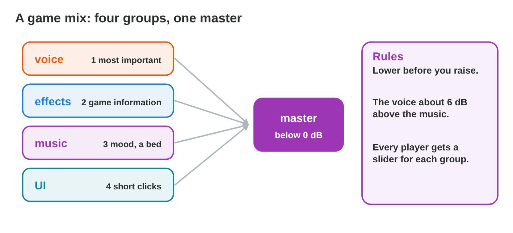
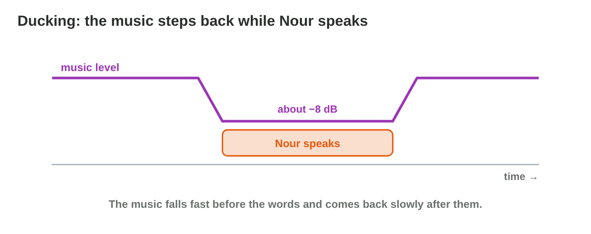
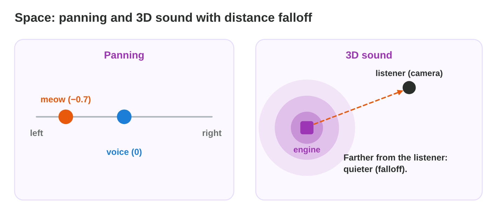
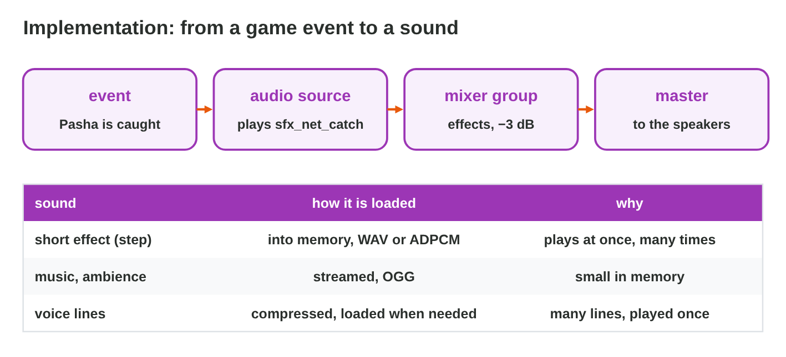
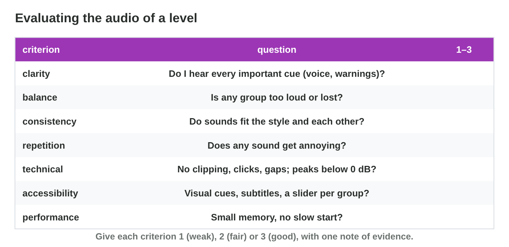

This page is the interactive version of the lesson notes (PDF). Each section
starts with a problem in a game studio. Then it explains one idea. It ends
with a **Do it** task and one set of questions. Tap, sort or type your
answer: the page checks it at once and tells you why.

## Key terms



## 9.1 Mixing: levels, groups and priorities

- A game mixes its sounds in four **groups**: the voice, the effects, the
  music and the interface. Each group has one fader.
- All the groups go to the **master**, the final mix. The master must stay
  below 0 dB.
- The **priority**: 1 the voice, 2 the effects with game information,
  3 the music.
- **Ducking:** the music goes down (about 8 dB) while a voice plays, then
  comes back.
- Lower what is too loud before you raise anything.

{width=90%}

{width=90%}



::: {.callout-warning title="Watch out!"}
Raising every quiet group makes the master clip.
:::

::: {.callout-note title="Do it · Mix the level"}
Make all four lines green in **Mix Desk**. Which change helped most?

::: {.check}
A typical way: duck the music under the voice, lower the music group, and
lower the master below 0 dB. Ducking helps most: Nour's lines become clear
without making anything louder.
:::
:::

::: {.callout-tip title="Try it 1 · The mix"}
Choose the right answer.

::: {.match extra="the interface|raise the master"}
Which group usually has the top priority?
:   the voice

    Why: The player must understand the voice first.

The master goes above 0 dB. What happens?
:   the sound clips

    Why: Above 0 dB the tops of the wave are cut flat.

The music covers the voice. What helps?
:   ducking

    Why: Ducking lowers the music while a voice plays.

How far above the music should the voice be?
:   about 6 dB

    Why: About 6 dB above is clear but not too loud.
:::
:::

## 9.2 Space: panning and 3D sound

- **Panning:** left (−1) to right (+1).
- **3D sound:** the engine pans and changes the level from the positions of
  the **source** and the **listener** (camera).
- **Distance falloff:** farther = quieter.
- Music and interface stay 2D.

{width=90%}

::: {.callout-warning title="Watch out!"}
Music should not be 3D.
:::

::: {.callout-note title="Do it · 2D or 3D?"}
Four sounds of *Market Day*, a city game. Write 2D or 3D for each sound.
Which sound does the game pan to the left?

| Sound | What it is | 2D or 3D? |
|:---:|-------------------------------------------------------|:---------:|
| 1 | the background music | \_\_\_ |
| 2 | the click of the pause button | \_\_\_ |
| 3 | a dog that barks behind a wall, to the left of the player | \_\_\_ |
| 4 | a bus that drives past the player | \_\_\_ |

::: {.check}
1 **2D** (music is not in the world) · 2 **2D** (the interface is not in
the world) · 3 **3D** (it comes from one place) · 4 **3D** (it moves). The
game pans sound **3** to the left: the dog is on the player's left.
:::
:::

::: {.callout-tip title="Try it 2 · Space"}
2D or 3D? You can use an answer more than once.

::: {.match extra="4D|no sound"}
The rowing music.
:   2D

    Why: Music is not in the world, so it does not move.

Pasha's meow on a roof.
:   3D

    Why: The meow comes from a place on the roof.

A menu click.
:   2D

    Why: The interface is not in the world.

The engine of a boat that moves away.
:   3D

    Why: Its sound gets quieter and moves as the boat goes away.
:::
:::

## 9.3 Implementation: from an event to a sound

- **Event** → **audio source** → **mixer group** → master.
- Short effects: **into memory**. Music and ambience: **streamed**. Voice
  lines: compressed, loaded when needed.
- A 3-minute WAV loaded at start slowed the game by 4 s; streaming OGG
  fixed it.

{width=90%}

::: {.callout-warning title="Watch out!"}
Sounds sent straight to the master cannot be mixed by group.
:::

::: {.callout-note title="Do it · Load types"}
Write the load type of the meow, steps, rain, rowing music, Nour's lines and
menu click.

::: {.check}
Meow, steps and menu click: into memory (short, play at once). Rain and
rowing music: streamed (long). Nour's lines: compressed, loaded when
needed.
:::
:::

::: {.callout-tip title="Try it 3 · Loading"}
Choose the way to load. You can use an answer more than once.

::: {.match extra="print it|delete it"}
A short step sound.
:   into memory

    Why: Short effects play at once from memory.

The 3-minute rowing music.
:   streamed

    Why: Long music is read while it plays.

The rain ambience loop.
:   streamed

    Why: A long loop is streamed, like music.

A menu click.
:   into memory

    Why: A short click plays at once.
:::
:::

## 9.4 Evaluating the audio of a level

- Seven criteria: **clarity, balance, consistency, repetition, technical,
  accessibility, performance**.
- Score 1–3 with one note of evidence each.
- Test on phone speakers, and with the sound off.
- Feedback in three parts: **I hear …**, **it matters because …**,
  **try …**.

{width=90%}

::: {.callout-warning title="Watch out!"}
Quiet room and good headphones are not how most players play.
:::

::: {.callout-note title="Do it · Score a level"}
A tester played level 2 of *Snow Post* and wrote seven notes. Write the
criterion of each note. Then score it: 1 (a problem) or 3 (good).

| Note | What the tester wrote | Criterion | Score |
|:---:|-------------------------------------------------|:---------:|:-----:|
| a | The captain's voice is clear over the wind. | \_\_\_ | \_\_\_ |
| b | The music is much louder than the steps and the waves. | \_\_\_ | \_\_\_ |
| c | The menu has rock music, but the level has soft piano. | \_\_\_ | \_\_\_ |
| d | The snowball sound is the same every time. | \_\_\_ | \_\_\_ |
| e | There is a click at the end of the music loop. | \_\_\_ | \_\_\_ |
| f | Every warning also shows an icon. | \_\_\_ | \_\_\_ |
| g | The level starts in 1 second on an old phone. | \_\_\_ | \_\_\_ |

::: {.check}
a clarity **3** · b balance **1** · c consistency **1** · d repetition **1** ·
e technical **1** · f accessibility **3** · g performance **3**. Each score
rests on one note of evidence.
:::
:::

::: {.callout-tip title="Try it 4 · Criteria"}
Which criterion?

::: {.match extra="speed|colour"}
The net swish sounds the same every time.
:   repetition

    Why: The same sound again and again is a repetition problem.

The wave warning is only a sound.
:   accessibility

    Why: A player without sound needs a visual cue.

A click at the loop point.
:   technical

    Why: Clicks, clipping and gaps are technical problems.

The game starts 4 seconds slower.
:   performance

    Why: Memory and start time are performance.
:::
:::

## Game challenge: Sound Check {.challenge}

Work alone. Use every section of today.

The testers of **Rooftop Rescue** report six problems: the voice, a red
master, the meow, the engine, a slow start and a player without sound.



::: {.callout-tip title="Try it 5 · The reports"}
Choose the fix.

::: {.match extra="make everything louder|delete the sound"}
“I cannot understand Nour.”
:   duck the music

    Why: Ducking keeps the voice above the music.

“The meow comes from the middle.”
:   pan it, or a 3D source

    Why: Panning puts the meow on the left, where Pasha is.

“The engine sounds the same far away.”
:   3D sound with falloff

    Why: Falloff makes far sounds quieter.

“The game starts slowly.”
:   stream the long music

    Why: Streaming does not load the whole file at the start.
:::
:::

::: {.callout-tip title="Try it 6 · Levels and feedback (harder)"}
Choose the right answer.

::: {.match extra="+8 dB|the sound is bad, fix it"}
The music is at −8 dB; ducking lowers it by 8 dB. Where is it then?
:   −16 dB

    Why: −8 dB − 8 dB = −16 dB.

The voice is at −10 dB, the ducked music at −16 dB. How far above is the voice?
:   6 dB

    Why: −10 dB is 6 dB above −16 dB.

A sound is panned to −1. Where do you hear it?
:   only on the left

    Why: −1 is fully left, +1 fully right.

Which feedback is useful?
:   I hear the swish repeat; it gets boring; try three takes

    Why: It says what, why it matters, and one change to try.
:::
:::

## Summary {.summary}

- Mix by groups; the voice first; the master below 0 dB; ducking for
  voices.
- Panning and 3D sound with falloff place sounds in space; music stays 2D.
- Events play sources through groups; short sounds in memory, long ones
  streamed.
- Evaluate with seven criteria and evidence; test on phones and with the
  sound off; give feedback in three parts.
