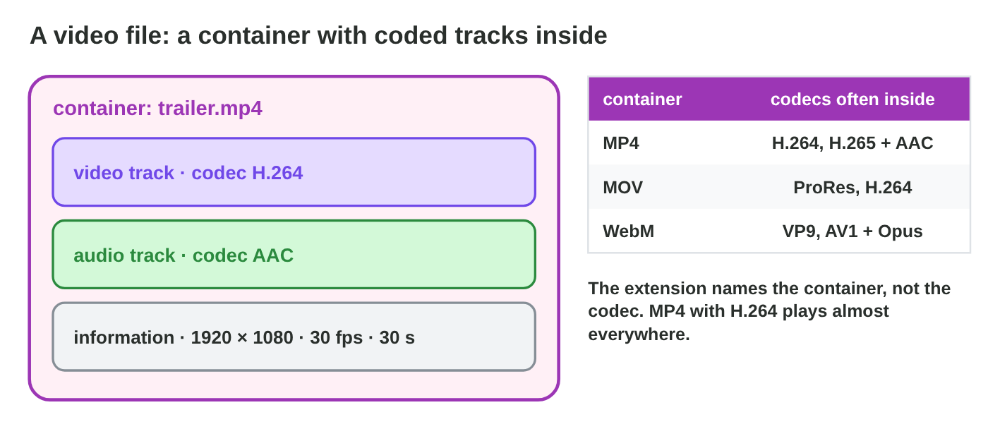

::: {.lead}
*Rooftop Rescue* will launch soon, and Night Owl Games needs videos: a
trailer for the store page, a short tall clip for social media, and a copy
of the best gameplay for later editing. Tariq, the video editor, has two
minutes of gameplay captured at 1920 × 1080 and 60 frames per second: a
file of almost 2 GB. The first export for the store is 900 MB and looks
fine; the second one is small but full of blocks in the boat chase. To
choose well, you must understand what a video file is made of. In this
lesson you learn about frames and the frame rate, resolution and aspect
ratio, containers and codecs, compression and bitrate, and how to choose
the settings for each target. Every section ends with a short task.
:::

## Key terms



## 19.1 Frames and the frame rate

A video is a series of still pictures shown so fast that the eye sees
motion (@fig-frames).

::: {.callout-important title="Definition 19.1 — Frames and frame rate"}
**Digital video** is a series of **frames** (still pictures), usually with
an audio track. The **frame rate** is the number of frames per second
(fps): **24 fps** gives a cinema look, **30 fps** is common for trailers
and web video, **60 fps** shows fast game action smoothly. One second at
30 fps has 30 frames.
:::

{#fig-frames width=94%}

::: {.callout-note title="Example 19.1 — Gameplay at 60 fps"}
1. Tariq's capture has 60 fps: 2 minutes = 120 s × 60 = **7200 frames**.
2. Exported at 30 fps, every second frame is dropped: 3600 frames. The boat
   chase is still smooth enough for a trailer.
3. At 15 fps the chase would look jerky, like a slow phone.
:::

::: {.callout-warning title="Common mistake"}
Mixing frame rates in one project, such as a 24 fps cinematic clip in a
60 fps timeline, without checking. Motion stutters. Choose the project's
frame rate first, and check the clips.
:::

::: {.callout-note title="Do it · Count the frames"}
How many frames do these have: (a) a 30-second trailer at 30 fps; (b) a
10-second clip at 60 fps; (c) a 2-minute film at 24 fps?

*Your result:* three numbers.
:::

## 19.2 Resolution and aspect ratio

Each frame is a raster image (lecture 2) with a size in pixels, and a shape
(@fig-res).

::: {.callout-important title="Definition 19.2 — Resolution and aspect ratio"}
The **resolution** is the size of each frame in pixels, width × height:
**1280 × 720** (720p, HD), **1920 × 1080** (1080p, Full HD), **3840 ×
2160** (4K). The **aspect ratio** is the shape: **16:9** is wide (TV,
monitors, trailers), **9:16** is tall (phones held upright), **1:1** is
square.
:::

{#fig-res width=94%}

::: {.callout-note title="Example 19.2 — Two shapes for one game"}
1. The store trailer: **1920 × 1080**, 16:9, like the capture.
2. The social clip: **1080 × 1920**, 9:16. Tariq does not stretch the wide
   picture, but cuts a tall part out of it, around Nour's boat.
3. A 4K file would have four times the pixels of 1080p, and a bigger file,
   but a phone screen would not show more detail.
:::

::: {.callout-warning title="Common mistake"}
Stretching a 16:9 video into a 9:16 frame. Nour and Pasha become thin and
tall. Crop (cut a part) or add bars, never stretch.
:::

::: {.callout-note title="Do it · Shapes"}
Find one video on your phone and one in a store page. Write the resolution
(the file details or the player settings show it) and the aspect ratio of
each.

*Your result:* two resolutions and two aspect ratios.
:::

## 19.3 Containers, codecs and bitrate

Raw video is huge: 1920 × 1080 pixels × 3 bytes × 60 fps is about 370 MB
per second. Video files are therefore **compressed** (@fig-cc,
@fig-comp).

::: {.callout-important title="Definition 19.3 — Container, codec, bitrate"}
- The **container** is the file format that holds the tracks and the
  information: **MP4**, **MOV**, **WebM**. The file extension names the
  container.
- The **codec** compresses each track: video **H.264** (plays almost
  everywhere), **H.265/HEVC** (smaller files), **VP9** and **AV1** (web),
  **ProRes** (for editing, very big); audio **AAC**.
- Codecs for players use **lossy compression**: a **key frame** is stored
  as a whole picture; the frames between store only what changes.
- The **bitrate** is the data per second. File size (MB) ≈ bitrate
  (Mbit/s) × seconds ÷ 8.
:::

{#fig-cc width=94%}

{#fig-comp width=94%}

::: {.callout-note title="Example 19.3 — The 900 MB trailer and the blocky one"}
1. The first export: 30 s at 240 Mbit/s → 240 × 30 ÷ 8 = **900 MB**. Too big
   for a store page.
2. The second: 30 s at 2 Mbit/s → **7.5 MB**, but the boat chase changes a
   lot from frame to frame: too few bits, so the picture turns into blocks.
3. The final: H.264 at **10 Mbit/s** → **37.5 MB**, clean even in the chase.
:::



::: {.callout-warning title="Common mistake"}
Renaming a `.mov` file to `.mp4` to "convert" it. The codec inside does not
change, and many players still cannot open it. Export it again with the
right container and codec.
:::

::: {.callout-note title="Do it · Bitrate and size"}
1. Compute the size of a 45 s clip at 8 Mbit/s and of a 15 s clip at
   20 Mbit/s.
2. In **Video Settings Lab**, lower the bitrate of the store trailer until
   it gets blocky. At which bitrate does it start?

*Your result:* two sizes and one bitrate.
:::

## 19.4 Settings for each target

There is no single best export. The place where the video plays decides
the settings (@fig-targets).

::: {.callout-important title="Definition 19.4 — Export targets"}
- **Store trailer:** 16:9 (or the shape the store asks for), 1920 × 1080,
  30 fps, H.264 in MP4, short.
- **Social clip:** 9:16, 1080 × 1920, 30 fps, H.264 in MP4, 15–30 s.
- **Edit master:** the resolution and frame rate of the recording, with
  ProRes or a very high bitrate, to keep the detail for later edits.

Stores and platforms change their rules: check their help pages before
each export.
:::

{#fig-targets width=94%}

::: {.callout-note title="Example 19.4 — Three files from one capture"}
1. `rooftop-trailer-v1.mp4`: 1920 × 1080, 30 fps, H.264, 10 Mbit/s, 30 s,
   37.5 MB.
2. `rooftop-social-v1.mp4`: 1080 × 1920, 30 fps, H.264, 8 Mbit/s, 20 s,
   20 MB.
3. `rooftop-master.mov`: 1920 × 1080, 60 fps, ProRes: several gigabytes,
   kept on the studio drive.
:::

::: {.callout-warning title="Common mistake"}
Making the social clip from the store trailer file. Each new lossy export
loses detail again. Export each target from the project or the master.
:::

::: {.callout-note title="Do it · Three targets"}
In **Video Settings Lab**, make the store trailer, the social clip and the
edit master pass all their checks. Write the settings and the file size of
each.

*Your result:* three sets of settings.
:::

## Case study: Export Desk

Salma, the producer of Night Owl Games, sends Tariq six requests: a wide
Full HD trailer for the store; the size of a 30 s trailer at 10 Mbit/s; a
file that plays on every phone and browser; a boat chase that looks like
blocks at 3 Mbit/s; a short clip for phones held upright; and a copy of
the capture for later editing. The Game challenge of the interactive
lesson uses these requests. In the mini-game below you choose the right
setting for each one.



## Further reading

Jago, *Adobe Premiere Pro Classroom in a Book* (any recent edition),
the chapters on video basics and export. Blackmagic Design, *The Beginner's
Guide to DaVinci Resolve* (free PDF), the chapters on project settings and
the Deliver page.

## Exercises

1. What is a frame? What is the frame rate?
2. How many frames has a 20 s clip at 30 fps?
3. Which frame rate shows fast game action best?
4. Write the resolution of 720p, 1080p and 4K.
5. Which aspect ratio fits a phone held upright?
6. What is the difference between a container and a codec?
7. Which video codec plays almost everywhere?
8. What does a key frame store, and what do the other frames store?
9. Compute the size of a 60 s video at 6 Mbit/s.
10. Why do we keep an edit master in ProRes?

## Answers to the exercises

::: {.answers}
1. One still picture of the video; the number of frames per second.
2. 600.
3. 60 fps.
4. 1280 × 720, 1920 × 1080, 3840 × 2160.
5. 9:16.
6. The container is the file that holds the tracks (MP4); the codec
   compresses each track (H.264).
7. H.264.
8. A key frame stores the whole picture; the others store only what
   changed.
9. 6 × 60 ÷ 8 = 45 MB.
10. It keeps almost all the detail, so later exports lose less.
:::
