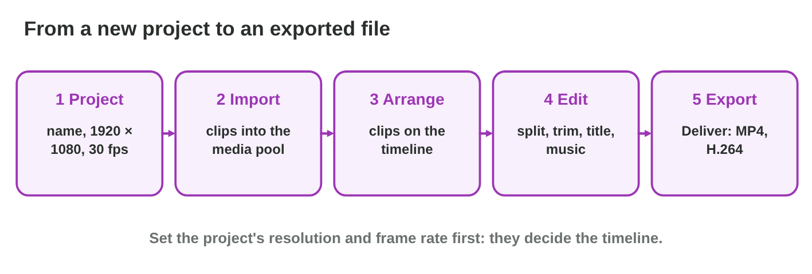
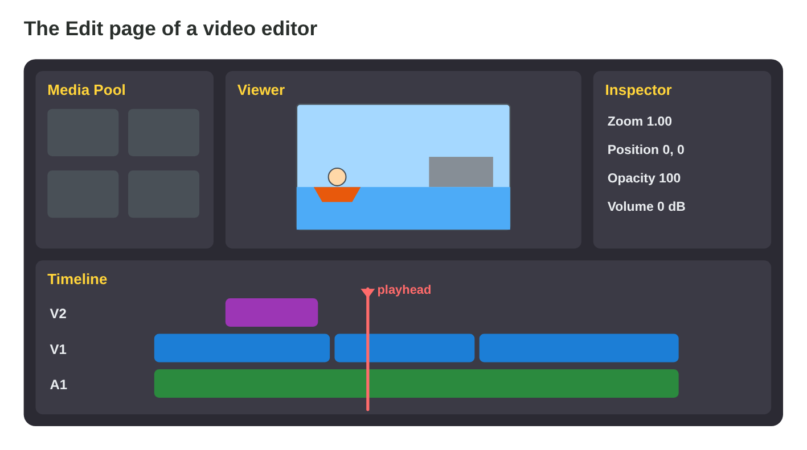
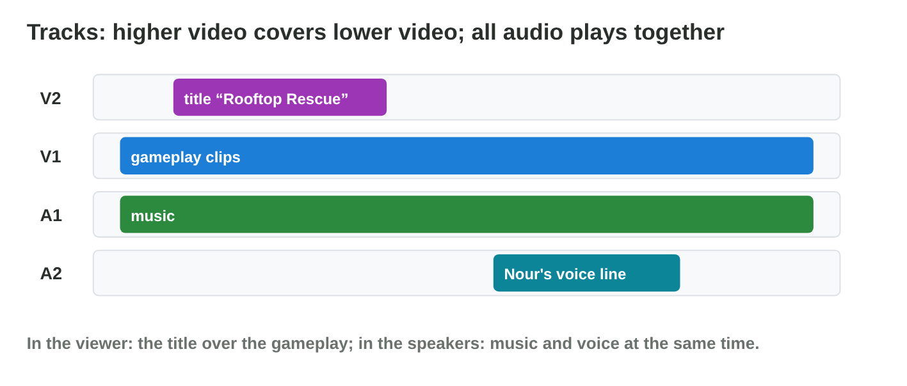
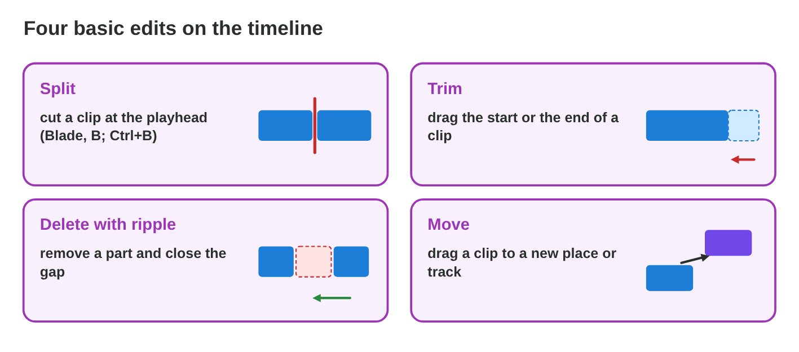
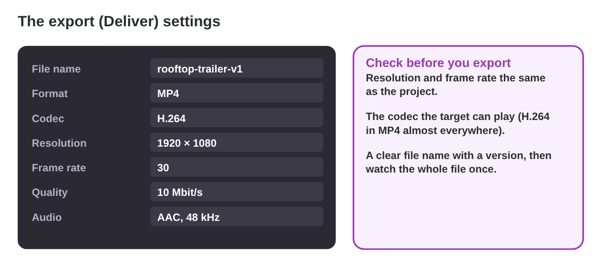

::: {.lead}
A new trainee joins the video room of Night Owl Games. Tariq has one hour
to show the editor before the trainee cuts a first teaser of *Rooftop
Rescue*: where the clips go after the import, how the timeline works,
how to cut out a boring part, how to put a title over the gameplay, and how
to get an MP4 out at the end. In lecture 19 you learned what a video file
is. In this seminar you **use** a video editor. We use DaVinci Resolve (the
free version, on Windows, macOS and Linux), but every editor has the same
parts with similar names. Every section ends with a task, and at the end
you have a first cut of your own.
:::

## Key terms



## 20.1 A new project and the media pool

A video editor never changes the original files. It keeps a **project**:
a list of clips and of edits (@fig-flow).

::: {.callout-important title="Definition 20.1 — Project, settings, media pool"}
A **video editor** (non-linear editor, NLE) arranges clips on a timeline
without changing the source files. In a new **project**, first set the
**timeline resolution** and the **frame rate** (in DaVinci Resolve: File ›
Project Settings): for a trailer, 1920 × 1080 and 30 fps. Then **import**
the clips (File › Import › Media, or drag them in): they appear in the
**media pool**.
:::

{#fig-flow width=94%}

::: {.callout-note title="Example 20.1 — The teaser project"}
1. Tariq makes the project `rooftop-teaser` and sets 1920 × 1080, 30 fps.
2. Tariq imports `rooftop.mp4`, `boat-chase.mp4`, `pasha.mp4` and `music.wav`
   into the media pool.
3. Nothing is on the timeline yet; the files on the disk stay unchanged.
:::

::: {.callout-warning title="Common mistake"}
Moving or renaming the source files after the import. The editor then
shows "media offline" (red frames). Keep the files of a project in one
folder, and do not move them.
:::

::: {.callout-note title="Do it · Your project"}
1. Open a video editor (DaVinci Resolve, or another free editor of the lab).
2. Make a project with 1920 × 1080 and 30 fps, and import three short clips
   (your own phone clips or recordings of a game you play).

*Your result:* a project with three clips in the media pool.
:::

## 20.2 The edit page: viewer, inspector and timeline

The **Edit** page has four main panels (@fig-editor). The timeline is
where the video is built (@fig-tracks).

::: {.callout-important title="Definition 20.2 — The panels and the tracks"}
- **Media pool:** the imported clips. **Viewer:** the frame at the
  playhead. **Inspector:** the settings of the selected clip (zoom,
  position, opacity, volume).
- **Timeline:** time runs from left to right; the **playhead** marks the
  frame in the viewer.
- **Tracks:** a video track higher up (**V2**) covers a lower one (**V1**);
  all audio tracks (**A1**, **A2**) play together.
:::

{#fig-editor width=94%}

{#fig-tracks width=94%}

::: {.callout-note title="Example 20.2 — The title over the gameplay"}
1. Tariq drags the three clips onto **V1**, one after the other.
2. Tariq adds a text title ("Rooftop Rescue") on **V2**, above the first clip:
   in the viewer, the title is over the gameplay.
3. In the **inspector**, Tariq makes the title smaller (zoom 0.8) and moves it
   up.
:::



::: {.callout-warning title="Common mistake"}
Putting the title on V1 after the clips. Then it plays alone on a black
background. A title over the picture belongs on a higher track.
:::

::: {.callout-note title="Do it · Build the order"}
Drag your three clips onto V1 in a good order, add a title on V2 at the
start, and move the playhead to check it in the viewer.

*Your result:* a timeline with three clips and a title.
:::

## 20.3 The four basic edits

Most of editing is four simple actions (@fig-edits).

::: {.callout-important title="Definition 20.3 — Split, trim, ripple delete, move"}
- **Split:** cut a clip in two at the playhead (Blade tool **B**, or
  Timeline › Razor, **Ctrl+B**).
- **Trim:** drag the start or the end of a clip to make it shorter or
  longer.
- **Ripple delete:** delete a part and close the gap, so the later clips
  move left (Shift+Delete in DaVinci Resolve).
- **Move:** drag a clip to another time or another track.

Undo with **Ctrl+Z**: the source files never change.
:::

{#fig-edits width=94%}

::: {.callout-note title="Example 20.3 — The boring middle"}
1. The boat chase is 9 s, but seconds 4–8 are boring.
2. Tariq puts the playhead at 4 s of the clip and splits, then at 8 s and
   splits again.
3. Tariq selects the middle part and ripple deletes it: the teaser is 4 s
   shorter, with no black gap.
4. The music on A1 is now too long, so Tariq trims its end to the end of the
   video.
:::

::: {.callout-warning title="Common mistake"}
Deleting without ripple, which leaves a black gap. If a gap appears,
select it and delete it, or use ripple delete from the start.
:::

::: {.callout-note title="Do it · Cut and tighten"}
1. Split one of your clips twice and ripple delete the middle part.
2. Add music on A1 and trim it to the end of the video.
3. Do the same in **Timeline Lab** if you have no editor.

*Your result:* a shorter timeline with music.
:::

## 20.4 A first export

The project is not a video file. Only an **export** makes a file for
players (@fig-export).

::: {.callout-important title="Definition 20.4 — The export"}
In DaVinci Resolve, the **Deliver** page exports (other editors: File ›
Export). Choose an **export preset** or set: format **MP4**, codec
**H.264**, the resolution and frame rate of the project, a quality
(bitrate), a clear file name and a folder. Add it to the render queue and
start the render. Then watch the whole file once.
:::

{#fig-export width=94%}

::: {.callout-note title="Example 20.4 — rooftop-teaser-v1.mp4"}
1. Deliver page › preset H.264 MP4 › 1920 × 1080, 30 fps, about 10 Mbit/s.
2. File name `rooftop-teaser-v1`, folder `exports`.
3. Render: a 15 s teaser of about 19 MB. A check of the whole file shows a
   wrong first frame; after the fix, v2 is exported.
:::

::: {.callout-warning title="Common mistake"}
Sending the project file instead of the video. Others cannot open it
without the editor and all the source files. Send the exported MP4.
:::

::: {.callout-note title="Do it · Export"}
Export your first cut as `yourname-teaser-v1.mp4` with H.264, 1920 × 1080,
30 fps. Write its length and its file size, and check one number with the
formula of lecture 19.

*Your result:* an MP4 file and two numbers.
:::

## Case study: Editor Tour

It is the first day of the new trainee. The trainee asks seven questions:
where the imported clips are; how to put the clips in order; how to cut
the boat clip at 0:12; how to keep the title visible over the gameplay;
where to change the size of the title; how to remove a boring middle
without a black gap; and how to make an MP4 for the store page. The Game
challenge of the interactive lesson uses these questions. In the mini-game
below you show the right panel or tool for each one.



## Further reading

Blackmagic Design, *The Beginner's Guide to DaVinci Resolve* (free PDF),
the chapters on the Edit page and the Deliver page. Murch, *In the Blink of
an Eye*, 2nd ed. (2001), for why and where editors cut.

## Exercises

1. Which two settings do you choose first in a new project?
2. Where are the clips after the import?
3. What does the viewer show?
4. Which track covers the other: V1 or V2?
5. What does the playhead mark?
6. How do you cut a clip in two?
7. What is the difference between delete and ripple delete?
8. Where do you change the size of a title?
9. Which page or menu makes the video file?
10. Why do you not send the project file to the store?

## Answers to the exercises

::: {.answers}
1. The timeline resolution and the frame rate.
2. In the media pool.
3. The frame at the playhead.
4. V2 covers V1.
5. The frame (time) that the viewer shows.
6. Move the playhead and split (Blade, or Ctrl+B).
7. Ripple delete also closes the gap.
8. In the inspector.
9. The Deliver page (File › Export in other editors).
10. It is not a video: it needs the editor and the source files.
:::
