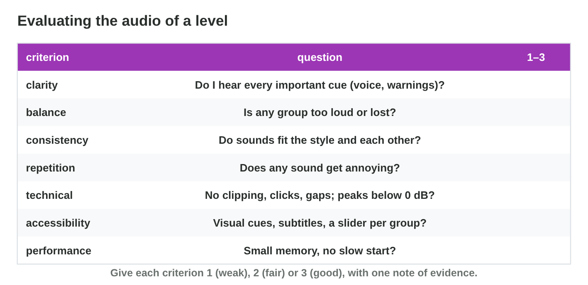
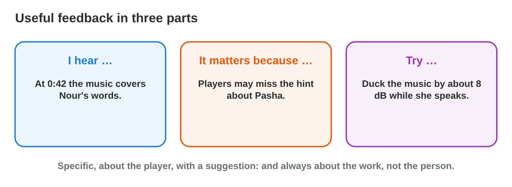

::: {.lead}
In Lecture 9 you learned to mix a game by groups, to place sounds in space,
to load them in the right way, and to evaluate the audio with criteria and
feedback. Today you run a small critique session. There are no new ideas:
two short problems. Do each one alone. The results of the activities are at
the end of this worksheet.
:::

## Recall

- Mix by **groups**: the voice first, the **master** below 0 dB, and
  **ducking** lowers the music while a voice plays.
- Evaluate with **seven criteria** (clarity, balance, consistency,
  repetition, technical, accessibility, performance), each with evidence.
- Feedback in three parts: **I hear …**, **it matters because …**,
  **try …**.

::: {.callout-tip title="Try it 1 · Recall"}
Choose the right answer.

::: {.match extra="the interface|the music"}
Which group usually has the top priority?
:   the voice

The master goes above 0 dB. What happens?
:   the sound clips

Which part of feedback says what the player loses?
:   it matters because …
:::
:::

## Activity 1 · Listen and choose the true notes

At *Night Owl Games* the team listens to the first mix of the flood level.
A good note has a **moment** (0:42, or the event) and a **criterion**.
Listen **twice**: once as a player, once as a critic, on a phone speaker
too.

{width=90%}



::: {.callout-note title="Activity 1 · True notes · 15 min"}
A tester wrote six notes about the first mix: a) while Nour speaks, her
voice is lost under the music · b) the master clips: it goes above 0 dB ·
c) the effects are lost under the music · d) Nour's voice is much louder
than the music · e) the interface clicks are as loud as Nour's voice ·
f) the music stops in the middle of the level.

1. Open **Mix Desk** and play the level as it is, before you change
   anything. Play it twice, and read the lines under the faders.
2. Which three notes are true? Write their letters.
3. Write the criterion of each true note: clarity, balance or technical.

*Your product:* three letters, each with its criterion.

::: {.check}
The true notes are **a** (clarity: an important line is not heard),
**c** (balance: one group covers another) and **e** (balance: the clicks
are too loud for the voice). Note b is false: the loudest moment is about
−1 dB, so the master line is green. Note d says the opposite of a, and
the music never stops (f).
:::
:::

::: {.callout-tip title="Try it 2 · Which criterion?"}
Choose the criterion.

::: {.match extra="colour|speed"}
0:12 — the rain covers the steps.
:   balance

0:42 — Nour's line is lost.
:   clarity

1:05 — the wave warning is only a sound.
:   accessibility

The net swish never changes.
:   repetition
:::
:::

## Activity 2 · Feedback and version 2

Useful feedback is about the **work**, not the person, and has three
parts. Then the sound designer sorts the notes: game information first
(a lost voice line, a missing warning), then clipping and clicks, then
taste. She fixes **one thing at a time** and compares version 1 and
version 2 at the same moment.

{width=90%}



::: {.callout-note title="Activity 2 · Feedback and a fix · 18 min"}
1. In **Critique Builder**, build feedback that passes all checks.
2. Which feedback for note a is useful? Choose A, B or C.

   - **A.** "The sound is bad. Please fix it."
   - **B.** "I hear that Nour's voice is lost under the music while she
     speaks; it matters because the player misses what she says; try
     ducking the music by about 8 dB."
   - **C.** "You are not good at mixing: the voice is lost."

3. In **Mix Desk**, fix note a only: turn on ducking, then lower the music
   fader until the voice line turns green. Compare v1 and v2 at the same
   moment, and write the music fader value.

*Your product:* one letter and one fader value.

::: {.check}
Step 2: **B**. It has the three parts: what and when, why it matters for
the player, and one change. A has no moment and no suggestion; C is about
the person, not the work. Step 3: with ducking on, the voice line turns
green when the music fader is **−2 dB or lower**: at −2 dB the voice is
6 dB above the music while Nour speaks.
:::
:::

::: {.callout-tip title="Try it 3 · Feedback and fixes"}
Choose the right answer.

::: {.match extra="useful, it is short|the newest note"}
"The sound is bad." Is it useful feedback?
:   not useful: no moment, no suggestion

"At 0:42 the music covers Nour; try ducking it by 8 dB." Is it useful?
:   useful

There are ten notes after the session. Which comes first?
:   a voice line that is lost

The 3-minute music is loaded into memory, and the game starts slowly. What helps?
:   stream the music
:::
:::

## Exercises

1. What makes a note about a mix easy to find and use?
2. Put the three parts of this feedback in order: (1) "try three takes and
   a small pitch change"; (2) "I hear the coin sound the same way every
   time"; (3) "it matters because it gets boring".
3. Why does a designer change one thing at a time?
4. The menu music plays from the left only. Should music be panned or 3D?

## Answers to the exercises

::: {.answers}
1. A moment and a criterion.
2. (2), (3), (1): I hear, it matters because, try.
3. Then she knows which change helped.
4. No: music stays 2D.
:::
