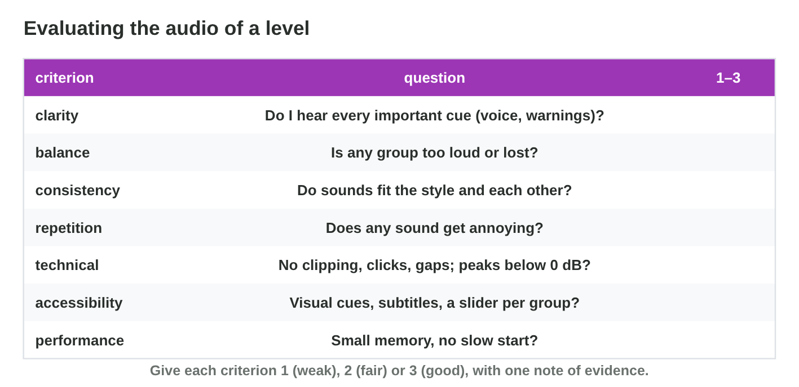
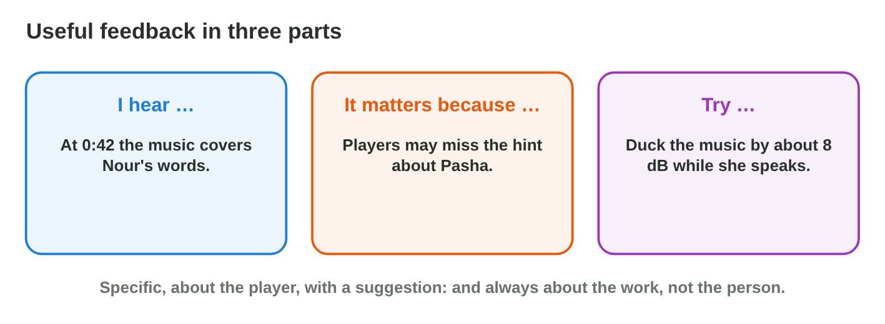

## Recall · Lecture 9

a) Which group of a game mix usually has the top priority?
b) What happens when the master goes above 0 dB?
c) Which part of feedback says what the player loses?

::: {.answer}
a) the voice
b) The sound clips.
c) it matters because …
:::

## Activity 1 · True notes · 15 min

:::: {.columns}
::: {.column width="50%"}
- A good note about a mix has a moment and a criterion.
- **Do it:** Play the first mix in Mix Desk twice, before you change anything. Which three of the six notes are true, and which criterion does each break?
- Your product is three letters with their criteria.
:::
::: {.column width="50%"}

:::
::::

## Live demo · Mix Desk



## Check 1 · True notes

Which notes about the first mix are true?

::: {.reveal}
1. Note a is true: Nour's voice is lost under the music, a clarity problem.
2. Note c is true: the effects are lost under the music, a balance problem.
3. Note e is true: the clicks are as loud as the voice, a balance problem.
4. Note b is false: the loudest moment is about −1 dB, so the master does not clip.
:::

## Activity 2 · Feedback and a fix · 18 min

:::: {.columns}
::: {.column width="50%"}
- Useful feedback is about the work and has three parts: I hear, it matters because, and try.
- **Do it:** Build feedback in Critique Builder, and choose the useful feedback for note a. Then fix note a in Mix Desk with ducking and the music fader.
- Your product is one letter and one fader value.
:::
::: {.column width="50%"}

:::
::::

## Check 2 · Feedback and a fix

Which feedback is useful, and how is note a fixed?

::: {.reveal}
1. Feedback B is useful: "I hear" gives what and when, "it matters because" gives the player.
2. Its "try" gives one change: duck the music by about 8 dB.
3. A has no moment and no change, and C is about the person, not the work.
4. With ducking on, the voice line turns green at a music fader of −2 dB or lower.
:::

## Wrap-up

- You can listen to a mix, find the true notes and name their criteria.
- You can choose useful feedback and fix a mix one step at a time.
