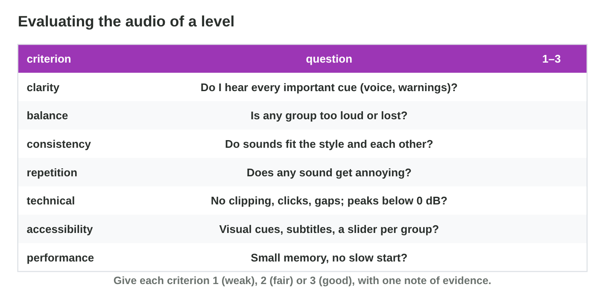

No new ideas today: two short problems on Lecture 9. Do each one alone,
then open "Check your result". Every question on this page has its answer:
try first, then check.

## Recall

- Mix by **groups**: the voice first, the **master** below 0 dB, and
  **ducking** lowers the music while a voice plays.
- Evaluate with **seven criteria** (clarity, balance, consistency,
  repetition, technical, accessibility, performance), each with evidence.
- Feedback in three parts: **I hear …**, **it matters because …**,
  **try …**.

::: {.callout-tip title="Try it 1 · Recall"}
Choose the right answer.

::: {.match extra="the interface|the music"}
Which group usually has the top priority?
:   the voice

    Why: The player must understand the voice first.

The master goes above 0 dB. What happens?
:   the sound clips

    Why: Above 0 dB the tops of the wave are cut flat.

Which part of feedback says what the player loses?
:   it matters because …

    Why: It ties the problem to the player and a criterion.
:::
:::

## Activity 1 · Listen and note

At *Night Owl Games* the team listens to the first mix of the flood level.
A good note has a **moment** (0:42, or the event) and a **criterion**.
Listen **twice**: once as a player, once as a critic, on a phone speaker
too.

{width=90%}



::: {.callout-note title="Activity 1 · Four notes · 15 min"}
1. Open **Mix Desk** and play the level as it is, before you change
   anything. Play it twice.
2. Write four notes, each with a moment and a criterion.

*Your product:* four notes.

::: {.check}
Good notes look like: "In the wave, Nour's line is lost under the music
(clarity)." "The master meter turns red in the wave (technical)." "The rain
covers the steps (balance)." "The wave warning is only a sound
(accessibility)." Each note says when and which criterion.
:::
:::

::: {.callout-tip title="Try it 2 · Which criterion?"}
Choose the criterion.

::: {.match extra="colour|speed"}
0:12 — the rain covers the steps.
:   balance

    Why: One group is too loud for another.

0:42 — Nour's line is lost.
:   clarity

    Why: An important cue is not heard.

1:05 — the wave warning is only a sound.
:   accessibility

    Why: A player without sound needs a visual cue.

The net swish never changes.
:   repetition

    Why: The same sound again and again gets boring.
:::
:::

## Activity 2 · Feedback and version 2

Useful feedback is about the **work**, not the person, and has three
parts. Then the sound designer sorts the notes: game information first
(a lost voice line, a missing warning), then clipping and clicks, then
taste. She fixes **one thing at a time** and compares version 1 and
version 2 at the same moment.

{width=90%}



::: {.callout-note title="Activity 2 · Feedback and a fix · 18 min"}
1. In **Critique Builder**, build feedback that passes all checks.
2. Turn two of your notes from Activity 1 into feedback in three parts.
3. In **Mix Desk**, fix your most important note. Compare v1 and v2 at the
   same moment.

*Your product:* two pieces of feedback and one fix.

::: {.check}
Good feedback: "I hear that Nour's line is lost under the music in the
wave; it matters because the player misses the warning; try ducking the
music by about 8 dB." A good fix: duck the music under the voice; the
voice line becomes clear, and the master stays below 0 dB.
:::
:::

::: {.callout-tip title="Try it 3 · Feedback and fixes"}
Choose the right answer.

::: {.match extra="useful, it is short|the newest note"}
"The sound is bad." Is it useful feedback?
:   not useful: no moment, no suggestion

    Why: The designer does not know what to change.

"At 0:42 the music covers Nour; try ducking it by 8 dB." Is it useful?
:   useful

    Why: It has a moment, the problem and one change.

There are ten notes after the session. Which comes first?
:   a voice line that is lost

    Why: Game information comes before taste.

The 3-minute music is loaded into memory, and the game starts slowly. What helps?
:   stream the music

    Why: Long sounds are read while they play.
:::
:::

## Wrap-up {.summary}

- You can listen to a mix and write notes with a moment and a criterion.
- You can give feedback in three parts and fix a mix one step at a time.
