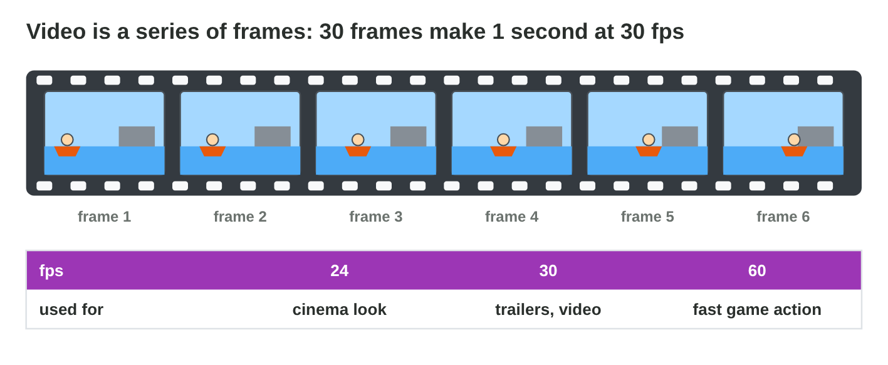
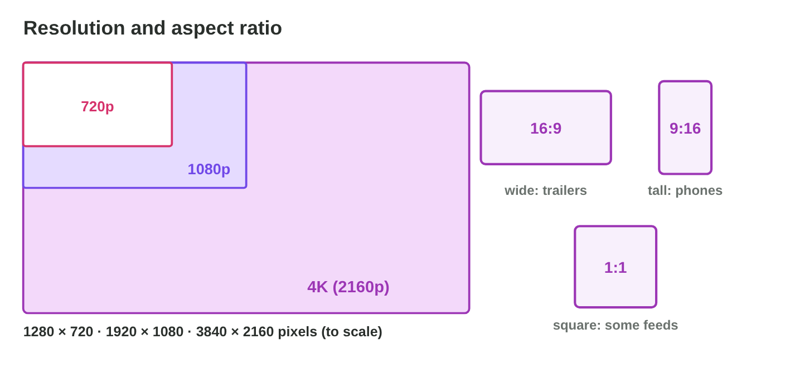
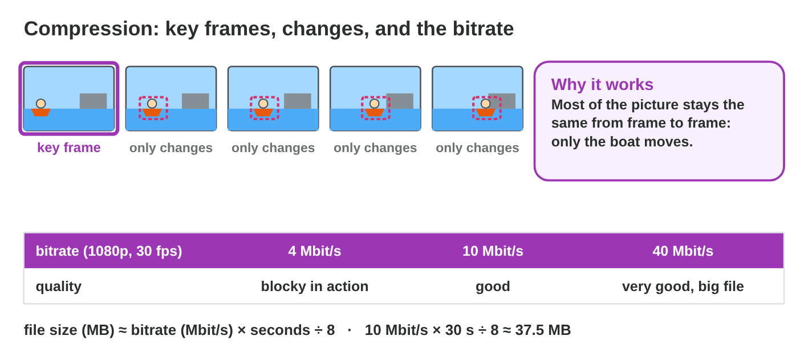
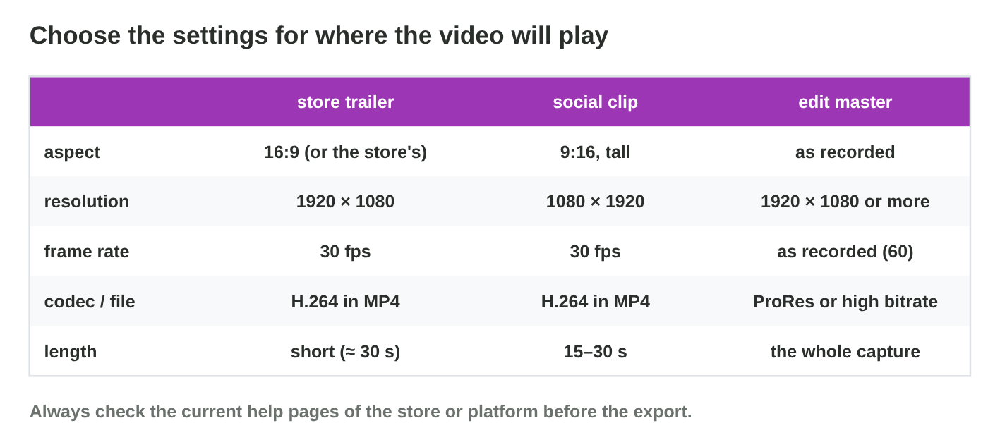

This page is the interactive version of the lesson notes (PDF). Each section
starts with a problem in a game studio. Then it explains one idea. It ends
with a **Do it** task and one set of questions. Every question on this page
has its answer: try first, then check.

## Key terms



## 10.1 Frames and the frame rate

- Video = a series of **frames** (still pictures), usually with audio.
- **Frame rate:** frames per second. 24 fps: cinema look. 30 fps:
  trailers. 60 fps: fast game action.
- 2 minutes at 60 fps = 7200 frames.

{width=94%}

::: {.callout-warning title="Watch out!"}
Choose the project's frame rate first; mixed frame rates stutter.
:::

::: {.callout-note title="Do it · Count the frames"}
Count the frames of a 30 s trailer at 30 fps, a 10 s clip at 60 fps, and a
2-minute film at 24 fps.

::: {.check}
(a) 30 × 30 = 900 frames; (b) 10 × 60 = 600 frames; (c) 120 × 24 = 2880
frames. Frames = seconds × frames per second.
:::
:::

::: {.callout-tip title="Try it 1 · Frames"}
Choose the right answer.

::: {.match extra="1 fps|1000"}
frames in 1 s at 30 fps
:   30

    Why: 30 fps means 30 frames in each second.

frames in 10 s at 60 fps
:   600

    Why: 10 × 60 = 600.

the frame rate for a cinema look
:   24 fps

    Why: Cinema films use 24 frames per second.

the frame rate for fast game action
:   60 fps

    Why: More frames make fast motion smooth.
:::
:::

## 10.2 Resolution and aspect ratio

- **Resolution:** 1280 × 720 (720p), 1920 × 1080 (1080p), 3840 × 2160
  (4K).
- **Aspect ratio:** 16:9 wide, 9:16 tall, 1:1 square.
- From wide to tall: **crop** a part, never stretch.

{width=94%}

::: {.callout-warning title="Watch out!"}
A stretched picture makes Nour thin and tall.
:::

::: {.callout-note title="Do it · Shapes"}
Write the resolution and aspect ratio of one video on your phone and one on
a store page.

::: {.check}
A typical answer: a phone video 1080 × 1920 (9:16, tall) and a store
trailer 1920 × 1080 (16:9, wide). The shape tells where the video plays.
:::
:::

::: {.callout-tip title="Try it 2 · Sizes and shapes"}
Choose the right answer.

::: {.match extra="640 × 480|2:1"}
Full HD
:   1920 × 1080

    Why: Full HD is 1080p: 1920 × 1080.

a phone held upright
:   9:16

    Why: A phone held upright is tall.

a trailer for a monitor
:   16:9

    Why: A monitor is wide.

4K
:   3840 × 2160

    Why: 4K is about 4000 pixels wide.
:::
:::

## 10.3 Containers, codecs and bitrate

- **Container:** MP4, MOV, WebM; it holds the tracks.
- **Codec:** H.264 (plays everywhere), H.265, VP9, AV1; ProRes for editing;
  AAC for audio.
- **Key frame:** a whole picture; the frames between store only changes.
- **Bitrate:** data per second (Mbit/s). Higher: a better picture and a
  bigger file.
- Too low a bitrate for fast action: **blocks**.

{width=94%}

{width=94%}



::: {.callout-warning title="Watch out!"}
Renaming .mov to .mp4 converts nothing.
:::

::: {.callout-note title="Do it · Bitrate and blocks"}
In **Video Settings Lab**, lower the bitrate of the store trailer until it
gets blocky. At which bitrate does it start? Raise it again: what happens
to the file size?

::: {.check}
At 1920 × 1080 and 30 fps, the trailer is clean from about 7 Mbit/s. At
6 Mbit/s and below it gets a little blocky in fast action, and at 3 Mbit/s
it is blocky. With a higher bitrate the picture is clean again, and the
file gets bigger.
:::
:::

::: {.callout-tip title="Try it 3 · Files"}
Use Video Settings Lab. Choose the right answer.

::: {.match extra="the file name|GIF"}
The boat chase looks like blocks. What is too low?
:   the bitrate

    Why: Too few bits for fast motion make blocks.

the container of trailer.mp4
:   MP4

    Why: The file extension names the container.

plays on almost every phone
:   H.264

    Why: H.264 plays almost everywhere.

the codec for an edit master
:   ProRes

    Why: ProRes keeps almost all the detail for editing.
:::
:::

## 10.4 Settings for each target

- **Store trailer:** 1920 × 1080, 30 fps, H.264 in MP4, short.
- **Social clip:** 1080 × 1920 (9:16), 30 fps, H.264, 15–30 s.
- **Edit master:** as recorded (60 fps), ProRes.
- Check the platform's help pages before each export.

{width=94%}

::: {.callout-warning title="Watch out!"}
Every new lossy export loses detail: export each target from the project.
:::

::: {.callout-note title="Do it · Three targets"}
In **Video Settings Lab**, make all three targets pass. Write their
settings and file sizes.

::: {.check}
Store trailer: 1920 × 1080, 30 fps, H.264 in MP4, about 10 Mbit/s, 30 s.
Social clip: 1080 × 1920, 30 fps, H.264 in MP4, 15–30 s. Edit master:
1920 × 1080, 60 fps, ProRes in MOV: a very big file, kept on the studio
drive.
:::
:::

::: {.callout-tip title="Try it 4 · Targets"}
Choose the right settings.

::: {.match extra="720 × 1280 at 10 fps|a GIF of 2 minutes"}
store trailer
:   1920 × 1080, 30 fps, H.264

    Why: Wide Full HD at 30 fps, and H.264 plays everywhere.

social clip
:   1080 × 1920, 30 fps, H.264

    Why: Tall for phones, 30 fps, and it plays everywhere.

edit master
:   1920 × 1080, 60 fps, ProRes

    Why: As recorded, with almost no loss of detail.
:::
:::

## Game challenge: Export Desk {.challenge}

Work alone. Use every section of today.

Salma sends six requests: a **wide Full HD** trailer, a **bitrate** that
keeps it small and clean, a file for **every phone**, a **blocky** boat chase, a
**tall** clip, and a copy **for later editing**.



::: {.callout-tip title="Try it 5 · Salma's requests"}
Choose the right answer.

::: {.match extra="change the container to MOV|add a title"}
The boat chase is blocky at 3 Mbit/s.
:   raise the bitrate to about 10 Mbit/s

    Why: More bits keep the fast chase clean.

It must play on every phone.
:   H.264 in MP4

    Why: H.264 in MP4 plays on almost every phone.

A short clip for phones held upright.
:   1080 × 1920

    Why: Tall (9:16) for phones held upright.

Keep the capture for more editing.
:   ProRes, as recorded

    Why: It keeps the detail for later edits.
:::
:::

::: {.callout-tip title="Try it 6 · Check the files (harder)"}
Choose the right answer.

::: {.match extra="half as many|it becomes an MP4"}
How many frames has a 2-minute capture at 60 fps?
:   7200

    Why: 2 minutes = 120 s, and 120 × 60 = 7200.

How many pixels has 4K compared with 1080p?
:   4 times as many

    Why: 4K is twice as wide and twice as high.

Tariq renames `trailer.mov` to `trailer.mp4`. What changes?
:   nothing: the codec inside stays the same

    Why: Renaming converts nothing.

Why export the social clip from the project, not from the trailer file?
:   every new lossy export loses detail

    Why: Export each target from the project or the master.
:::
:::

## Summary {.summary}

- Video is a series of frames; the frame rate is frames per second.
- Resolution is the size in pixels; the aspect ratio is the shape.
- The container holds the tracks; the codec compresses them.
- A higher bitrate gives a better picture and a bigger file; too little gives blocks.
- The target decides the settings; keep an edit master.
