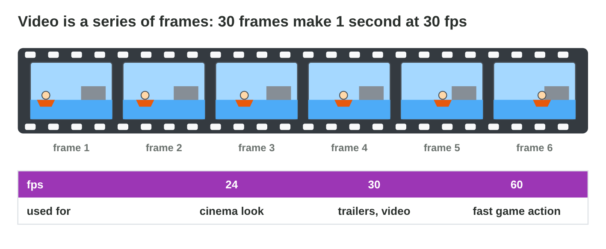
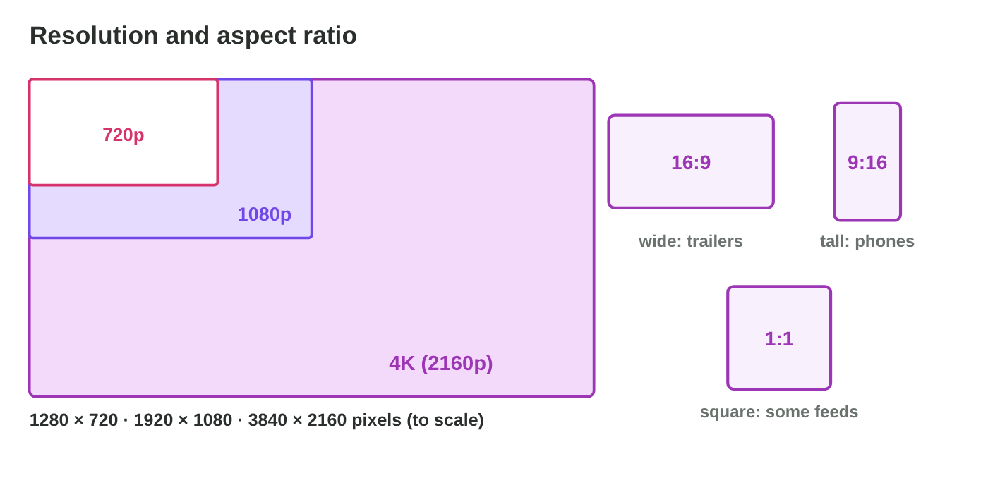
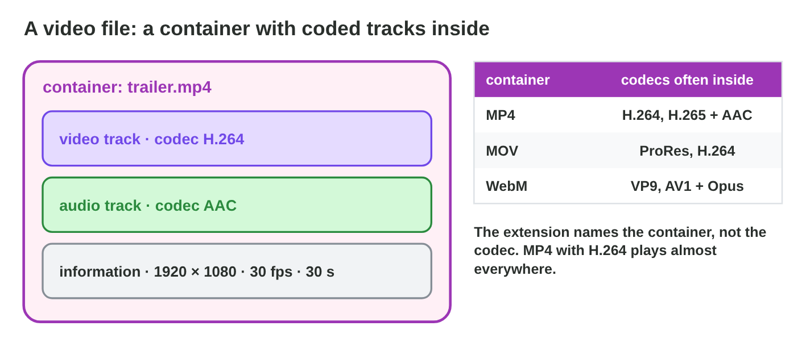
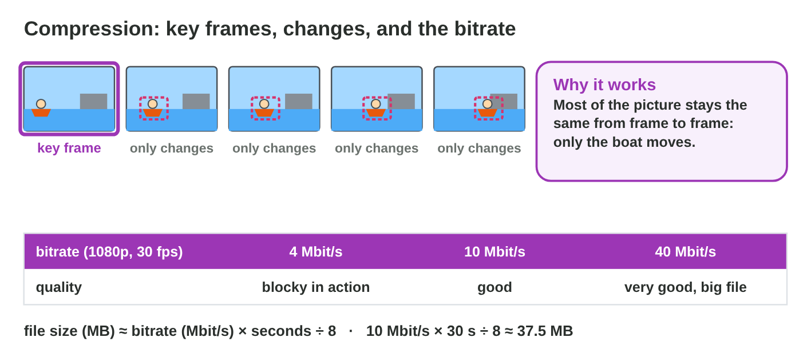
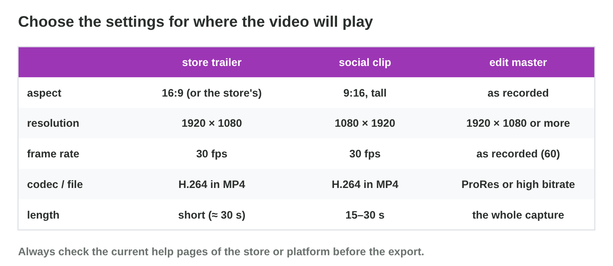

This page is the interactive version of the lesson notes (PDF). Each section
starts with a problem in a game studio. Then it explains one idea. It ends
with a **Do it** task and one set of questions. Tap, sort or type your
answer: the page checks it at once and tells you why.

## Key terms



## 10.1 Frames and the frame rate

- Video = a series of **frames** (still pictures), usually with audio.
- **Frame rate:** frames per second (fps).

| Frame rate | Use |
|:----------:|------------------------------------|
| 24 fps | a cinema look |
| 30 fps | trailers |
| 60 fps | fast game action |

- The number of frames = seconds × fps. For example, 2 minutes = 120 s,
  and 120 × 60 = 7200 frames at 60 fps.

{width=94%}

::: {.callout-warning title="Watch out!"}
Choose the project's frame rate first; mixed frame rates stutter.
:::

::: {.callout-note title="Do it · Count the frames"}
Count the frames of three videos: frames = seconds × fps. (a) a store
trailer: 30 s at 30 fps; (b) a game clip: 10 s at 60 fps; (c) a 2-minute
film: 120 s at 24 fps.

::: {.fill answer="900" unit="frames" hint="30 seconds × 30 frames per second."}
How many frames has the store trailer?

Why: 30 × 30 = 900 frames; the game clip has 10 × 60 = 600.
:::

::: {.fill answer="2880" unit="frames" hint="120 seconds × 24 frames per second."}
How many frames has the 2-minute film?

Why: 120 × 24 = 2880 frames.
:::
:::

::: {.callout-tip title="Try it 1 · Frames"}
Choose the right answer.

::: {.match extra="1 fps|1000"}
frames in 1 s at 30 fps
:   30

    Why: 30 fps means 30 frames in each second.

frames in 10 s at 60 fps
:   600

    Why: 10 × 60 = 600.

the frame rate for a cinema look
:   24 fps

    Why: Cinema films use 24 frames per second.

the frame rate for fast game action
:   60 fps

    Why: More frames make fast motion smooth.
:::
:::

## 10.2 Resolution and aspect ratio

- **Resolution:** the number of pixels, across × down.

| Name | Resolution |
|:-------------:|:-----------------:|
| 720p | 1280 × 720 |
| 1080p (Full HD) | 1920 × 1080 |
| 4K | 3840 × 2160 |

- **Aspect ratio:** the shape. 16:9 is wide, 9:16 is tall, 1:1 is square.
- From wide to tall: **crop** a part, never stretch.

{width=94%}

::: {.callout-warning title="Watch out!"}
A stretched picture makes Nour thin and tall.
:::

::: {.callout-note title="Do it · Shapes"}
Find the resolution and the aspect ratio of one video on your phone and one
on a store page.

::: {.sort}
Which shape is each video? Sort them.

16:9, wide
:   1920 × 1080, a store trailer

    Why: Wider than tall: 16 to 9.

:   3840 × 2160, a 4K video

    Why: Four times the pixels, the same wide shape.

9:16, tall
:   1080 × 1920, a phone video

    Why: Taller than wide: for a phone held upright.

1:1, square
:   1080 × 1080, a social post

    Why: As wide as tall.
:::

::: {.choice}
A wide video must become tall for a social clip. What do you do?

- [x] Crop a part of it.

  Why: Cropping keeps the shapes right; the picture loses only its sides.

- [ ] Stretch it to fill the tall frame.

  Why: A stretched picture makes Nour thin and tall.

- [ ] Rename the file.

  Why: The name does not change the shape of the picture.
:::
:::

::: {.callout-tip title="Try it 2 · Sizes and shapes"}
Choose the right answer.

::: {.match extra="640 × 480|2:1"}
Full HD
:   1920 × 1080

    Why: Full HD is 1080p: 1920 × 1080.

a phone held upright
:   9:16

    Why: A phone held upright is tall.

a trailer for a monitor
:   16:9

    Why: A monitor is wide.

4K
:   3840 × 2160

    Why: 4K is about 4000 pixels wide.
:::
:::

## 10.3 Containers, codecs and bitrate

- **Container:** the file type, like a box that holds the tracks (the
  picture and the sound): MP4, MOV, WebM.
- **Codec:** the way the picture or the sound is packed inside the box:
  H.264 (plays everywhere), H.265, VP9, AV1; ProRes for editing; AAC for
  audio.
- **Key frame:** a whole picture. The frames between key frames store only
  what changes.
- **Bitrate:** data per second, in Mbit/s (million bits per second). A
  higher bitrate gives a better picture and a bigger file.
- Too low a bitrate for fast action: **blocks**.

{width=94%}

{width=94%}



::: {.callout-warning title="Watch out!"}
Renaming .mov to .mp4 converts nothing.
:::

::: {.callout-note title="Do it · Bitrate and blocks"}
In **Video Settings Lab**, lower the bitrate of the store trailer (1920 ×
1080, 30 fps) until it gets blocky. Then raise it again.

::: {.choice}
From which bitrate does the trailer start to get blocky?

- [x] about 6 Mbit/s and below

  Why: It is clean from about 7 Mbit/s; at 3 Mbit/s it is blocky.

- [ ] about 30 Mbit/s

  Why: At 30 Mbit/s the picture is clean, with a big file.

- [ ] never: the bitrate does not change the picture

  Why: Too low a bitrate for fast action makes blocks.
:::

::: {.choice}
You raise the bitrate again. What happens to the file?

- [x] The picture is clean again, and the file gets bigger.

  Why: A higher bitrate keeps more detail and needs more bits.

- [ ] The file gets smaller.

  Why: More bits per second make a bigger file.

- [ ] Nothing changes.

  Why: The bitrate decides the picture and the size.
:::
:::

::: {.callout-tip title="Try it 3 · Files"}
Use Video Settings Lab. Choose the right answer.

::: {.match extra="the file name|GIF"}
The boat chase looks like blocks. What is too low?
:   the bitrate

    Why: Too few bits for fast motion make blocks.

the container of trailer.mp4
:   MP4

    Why: The file extension names the container.

plays on almost every phone
:   H.264

    Why: H.264 plays almost everywhere.

the codec for an edit master
:   ProRes

    Why: ProRes keeps almost all the detail for editing.
:::
:::

## 10.4 Settings for each target

- **Store trailer:** 1920 × 1080, 30 fps, H.264 in MP4, short.
- **Social clip:** 1080 × 1920 (9:16), 30 fps, H.264, 15–30 s.
- **Edit master:** as recorded (60 fps), ProRes.
- Check the platform's help pages before each export.

{width=94%}

::: {.callout-warning title="Watch out!"}
Every new lossy export loses detail: export each target from the project.
:::

::: {.callout-note title="Do it · Three targets"}
In **Video Settings Lab**, make all three targets pass, and look at their
settings and file sizes.

::: {.sort}
Which settings fit each target? Sort them.

Store trailer
:   1920 × 1080, 30 fps, H.264 in MP4, about 10 Mbit/s, 30 s

    Why: Wide, light enough to stream, and clean.

Social clip
:   1080 × 1920, 30 fps, H.264 in MP4, 15–30 s

    Why: Tall for the phone, and short.

Edit master
:   1920 × 1080, 60 fps, ProRes in MOV

    Why: As recorded, for editing; it stays on the studio drive.
:::

::: {.choice}
Which file is the biggest?

- [x] the edit master

  Why: ProRes keeps almost every detail at 60 fps: a very big file.

- [ ] the store trailer

  Why: H.264 makes the trailer much smaller than the master.

- [ ] the social clip

  Why: Short and in H.264: the smallest file.
:::
:::

::: {.callout-tip title="Try it 4 · Targets"}
Choose the right settings.

::: {.match extra="720 × 1280 at 10 fps|a GIF of 2 minutes"}
store trailer
:   1920 × 1080, 30 fps, H.264

    Why: Wide Full HD at 30 fps, and H.264 plays everywhere.

social clip
:   1080 × 1920, 30 fps, H.264

    Why: Tall for phones, 30 fps, and it plays everywhere.

edit master
:   1920 × 1080, 60 fps, ProRes

    Why: As recorded, with almost no loss of detail.
:::
:::

## Game challenge: Export Desk {.challenge}

Work alone. Use every section of today.

Salma sends six requests: a **wide Full HD** trailer, a **bitrate** that
keeps it small and clean, a file for **every phone**, a **blocky** boat chase, a
**tall** clip, and a copy **for later editing**.



::: {.callout-tip title="Try it 5 · Salma's requests"}
Choose the right answer.

::: {.match extra="change the container to MOV|add a title"}
The boat chase is blocky at 3 Mbit/s.
:   raise the bitrate to about 10 Mbit/s

    Why: More bits keep the fast chase clean.

It must play on every phone.
:   H.264 in MP4

    Why: H.264 in MP4 plays on almost every phone.

A short clip for phones held upright.
:   1080 × 1920

    Why: Tall (9:16) for phones held upright.

Keep the capture for more editing.
:   ProRes, as recorded

    Why: It keeps the detail for later edits.
:::
:::

::: {.callout-tip title="Try it 6 · Check the files (harder)"}
Choose the right answer.

::: {.match extra="half as many|it becomes an MP4"}
How many frames has a 2-minute capture at 60 fps?
:   7200

    Why: 2 minutes = 120 s, and 120 × 60 = 7200.

How many pixels has 4K compared with 1080p?
:   4 times as many

    Why: 4K is twice as wide and twice as high.

Tariq renames `trailer.mov` to `trailer.mp4`. What changes?
:   nothing: the codec inside stays the same

    Why: Renaming converts nothing.

Why export the social clip from the project, not from the trailer file?
:   every new lossy export loses detail

    Why: Export each target from the project or the master.
:::
:::

## Summary {.summary}

- Video is a series of frames; the frame rate is frames per second.
- Resolution is the size in pixels; the aspect ratio is the shape.
- The container holds the tracks; the codec compresses them.
- A higher bitrate gives a better picture and a bigger file; too little gives blocks.
- The target decides the settings; keep an edit master.
