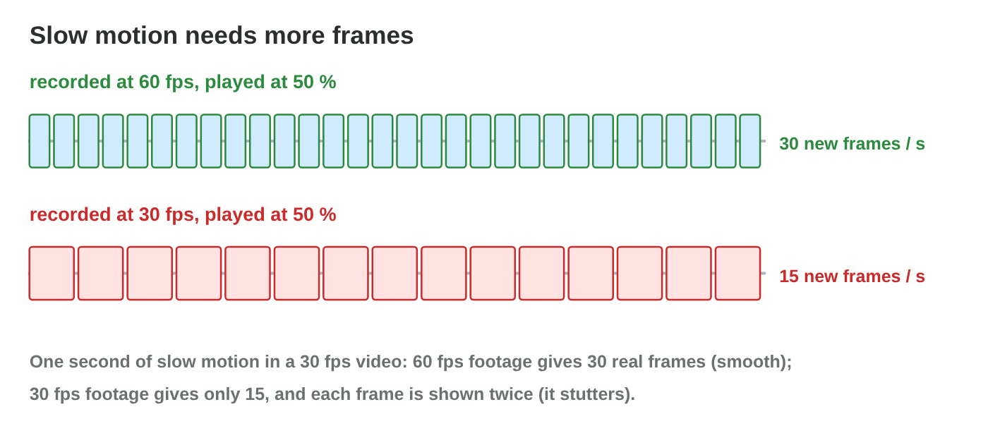
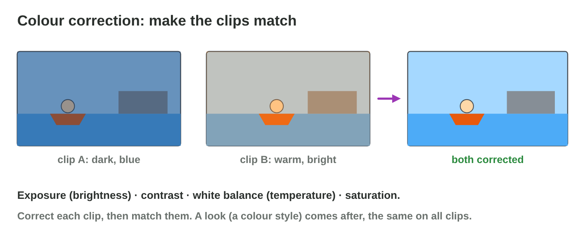
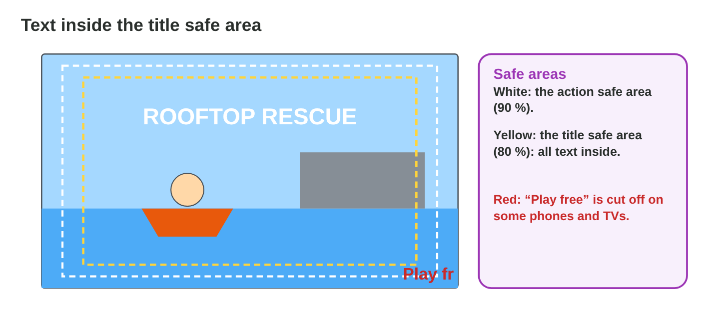
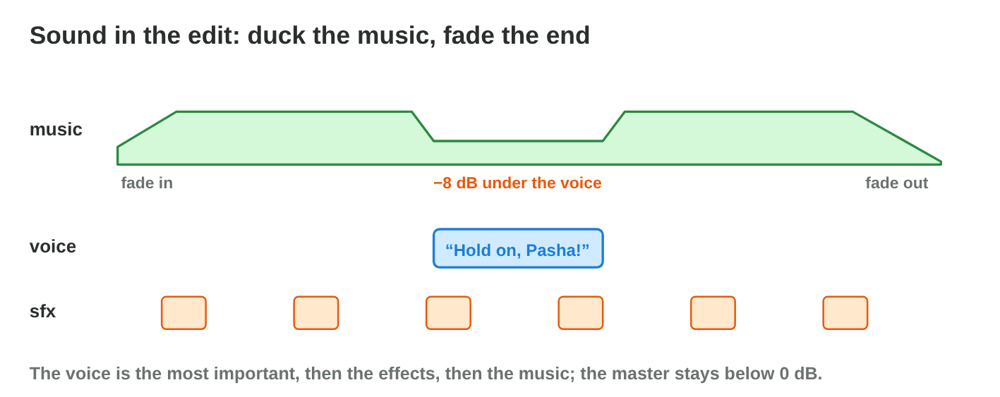

::: {.lead}
The first cut of the *Rooftop Rescue* trailer has all the right shots, but
Salma, the producer, is not happy: "The action stops at 0:08. Nour jumps at
0:12. The slow motion stutters, the night shot is blue and the next one is
orange, I cannot hear Nour, and on my phone the last words are cut off." In
lecture 20 you learned the tools of a video editor. In this lesson you learn
the **craft**: where to cut, which transition to use, how to use slow
motion, colour and titles, and how to finish the sound and the export.
Every section ends with a short task.
:::

## Key terms



## 21.1 Cutting with rhythm

Most of a good edit is **cuts**: where one shot ends and the next starts
(@fig-cuts).

::: {.callout-important title="Definition 21.1 — Kinds of cuts"}
- A **hard cut** changes the shot at once, with no effect. It is the most
  common edit.
- A **cut on action** happens in the middle of a movement: the movement goes
  on in the next shot, and the viewer hardly sees the cut.
- A **jump cut** joins two very similar shots of the same subject: the
  picture jumps. In a trailer it is usually a mistake.

**Pacing:** short shots (1–3 s) feel fast and exciting; long shots feel
calm. Fast trailers often cut on the beats of the music.
:::

{#fig-cuts width=94%}

::: {.callout-note title="Example 21.1 — The boat and the net"}
1. Shot A: Nour throws the net. Shot B: the net lands on Pasha.
2. Tariq cuts in the middle of the throw: the net leaves the hand in A and
   lands in B. The movement carries the eye over the cut.
3. The cut lands on a drum beat of the music.
:::

::: {.callout-warning title="Common mistake"}
Every shot the same length, for example 5 s each. The rhythm becomes
boring. Short shots for action, a longer shot for a big moment.
:::

::: {.callout-note title="Do it · Find the cuts"}
Watch a game trailer of about 30 s. Count the cuts, and write the shortest
and the longest shot length you notice.

*Your result:* a number and two lengths.
:::

## 21.2 Transitions

A **transition** is an effect between two clips. Most of the time the best
transition is none: a cut (@fig-trans).

::: {.callout-important title="Definition 21.2 — Transitions"}
- **Cut:** fast and invisible; use it almost always.
- **Cross dissolve:** clip A fades out while clip B fades in; it says "time
  passes" or "a calm change". 0.5–1 s.
- **Dip to black (or white):** to black and back; it ends a part, for example
  before the logo.
- **Wipe** and other shapes: they draw attention to the edit; use them
  rarely, for a playful style.

A transition needs **handles**: some extra seconds of video before the end
and after the start of the clips.
:::

{#fig-trans width=94%}

::: {.callout-note title="Example 21.2 — Three edits in the trailer"}
1. Boat → net: a **cut on action**.
2. Evening → next morning: a **cross dissolve** of 1 s.
3. Last shot → the logo: a **dip to black** of 0.75 s.
:::



::: {.callout-warning title="Common mistake"}
A different fancy transition between every two shots. The trailer looks
like a slide show, and the action stops at every edit.
:::

::: {.callout-note title="Do it · Choose the edit"}
In **Cut Lab**, find the right edit for the three places. Write one sentence
for each: why this edit?

*Your result:* three edits with reasons.
:::

## 21.3 Speed, colour and titles

Three effects appear in almost every game trailer (@fig-slow, @fig-colour,
@fig-safe).

::: {.callout-important title="Definition 21.3 — Speed, colour, titles"}
- **Speed change:** slow motion needs more recorded frames. In a 30 fps
  video, 50 % speed needs a 60 fps recording; 25 % needs 120 fps.
- **Colour correction:** set exposure, contrast, white balance (temperature)
  and saturation, so that each clip looks right and matches the others.
  A "look" (a colour style) comes after the correction.
- **Titles:** all text inside the **title safe area** (the inner 80 % of the
  frame), large enough, on screen for at least 2 s. **Keyframes** animate a
  title or a zoom: the editor moves smoothly between two values.
:::

{#fig-slow width=94%}

{#fig-colour width=94%}

{#fig-safe width=94%}

::: {.callout-note title="Example 21.3 — The jump in slow motion"}
1. Nour's jump was captured at 30 fps; at 50 % it shows only 15 new frames
   per second: it stutters.
2. Tariq captures the jump again at 60 fps: at 50 % there are 30 new frames
   per second, smooth.
3. The night shot is warmed up (temperature +30) and brightened (exposure
   +40) until it matches the shot before.
:::



::: {.callout-warning title="Common mistake"}
Putting text at the very edge of the frame "to keep the picture free". On
some phones and TVs the edges are cut off: the call to action disappears.
:::

::: {.callout-note title="Do it · Polish one shot"}
In **Effects Lab**, make the slow motion smooth, match the colours, and
move the title into the safe area. Write the settings you chose.

*Your result:* three settings.
:::

## 21.4 Sound and export

A trailer is half sound. The mix and the export finish the edit
(@fig-audio).

::: {.callout-important title="Definition 21.4 — Finishing the edit"}
- **Sound:** the voice first, then the effects, then the music (lecture 17).
  **Duck** the music under the voice; fade the music in and out; the
  master stays below 0 dB.
- **Export:** the settings of the target (lecture 19), for example H.264 in
  MP4, 1920 × 1080, 30 fps; a clear file name with a version; then watch
  the whole file once, also on a phone.
:::

{#fig-audio width=94%}

::: {.callout-note title="Example 21.4 — The last fixes"}
1. At 0:21 the music is ducked by 8 dB under "Hold on, Pasha!".
2. The music fades out with the dip to black before the logo.
3. Export `rooftop-trailer-v2.mp4`; on a phone, "Play free now" is now fully
   visible.
:::

::: {.callout-warning title="Common mistake"}
Ending the trailer by cutting the music in the middle of a bar. End on a
musical phrase, or fade the music out with the picture.
:::

::: {.callout-note title="Do it · Finish your cut"}
Take your first cut from lecture 20. Add one cross dissolve or dip to black
where it fits, duck the music under a voice or a loud effect, fade the end,
and export v2.

*Your result:* `yourname-cut-v2.mp4`.
:::

## Case study: Edit Doctor

Salma's notes on the first cut: a slow wipe that stops the action at 0:08, a
jump cut at 0:12, slow motion that stutters at 0:15, a blue night shot next to
an orange shot at 0:18, Nour's line lost under the music at 0:21, and the
call to action cut off on a phone at 0:27. The Game challenge of the
interactive lesson uses these notes. In the mini-game below you choose the
fix for each one.



## Further reading

Murch, *In the Blink of an Eye*, 2nd ed. (2001), on where and why to cut.
Blackmagic Design, *The Beginner's Guide to DaVinci Resolve* (free PDF),
the chapters on transitions, colour and the Fairlight page.

## Exercises

1. What is a cut on action?
2. Why is a jump cut usually a mistake in a trailer?
3. Which shot lengths feel fast?
4. When do you use a cross dissolve?
5. Where does a dip to black fit in a trailer?
6. What are handles?
7. A clip recorded at 30 fps plays at 50 %. How many new frames per
   second does a 30 fps video show?
8. Name three settings of colour correction.
9. What is the title safe area?
10. Name two sound fixes before the export.

## Answers to the exercises

::: {.answers}
1. A cut in the middle of a movement that goes on in the next shot.
2. The picture jumps between two almost identical shots.
3. Short shots, about 1–3 s.
4. When time passes, or for a calm change.
5. At the end of a part, for example before the logo.
6. Extra seconds of video before the end and after the start of a clip.
7. 15.
8. For example exposure, contrast, white balance, saturation.
9. The inner 80 % of the frame, where text is never cut off.
10. Duck the music under the voice; fade the music at the end (and keep the
    master below 0 dB).
:::
