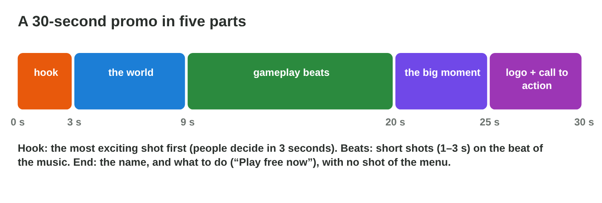
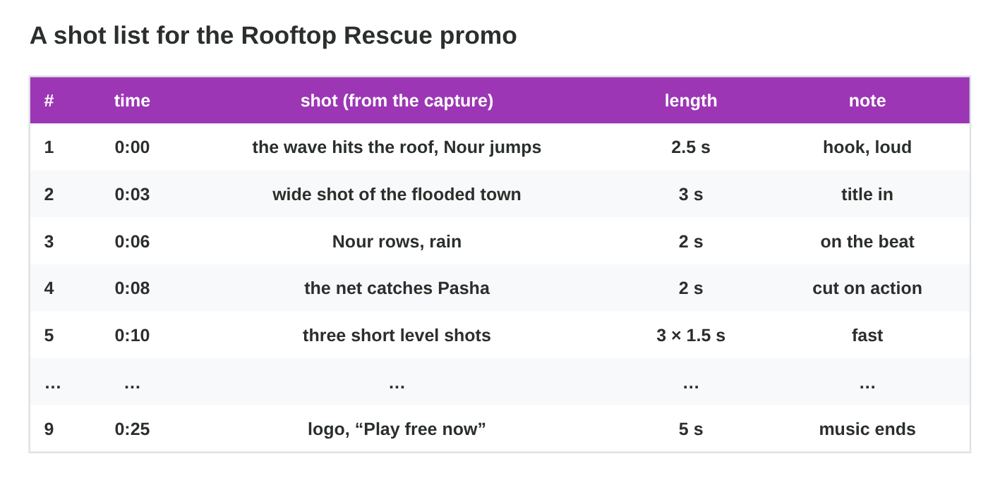
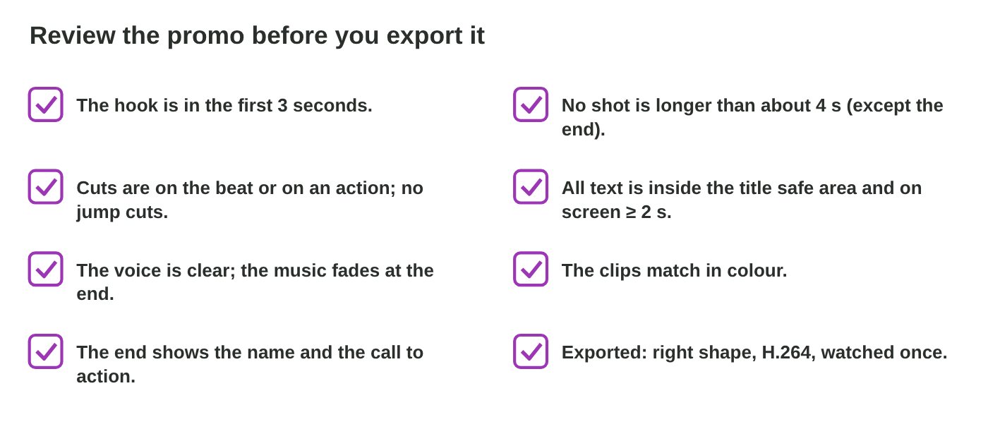

This page is the interactive version of the lesson notes (PDF). Each section
is one step of the seminar. It ends with a **Do it** task and one set of
questions. The full explanations, examples and exercises are in the notes.

## Key terms



## 22.1 The parts of a promo

- **Hook** (0–3 s) · **the world** · **gameplay beats** (1–3 s shots) ·
  **the big moment** · **logo + call to action** (last ≈ 5 s).
- No menus, no loading screens.

{width=94%}

::: {.callout-warning title="Watch out!"}
A 5-second logo at the start loses many viewers.
:::

::: {.callout-note title="Do it · Choose your game"}
Choose a game you can record, and write one line for each of the five parts.
:::

::: {.callout-tip title="Try it 1 · The parts"}
Choose the part of the promo.

::: {.match extra="the credits|the menu"}
the wave hits the roof, Nour jumps (0–3 s)
:   the hook

three short level shots on the beat
:   gameplay beats

Pasha safe on the roof, Nour smiles
:   the big moment

“Play free now” with the logo
:   the call to action
:::
:::

## 22.2 From the capture to a shot list

- Mark the best moments of the capture first.
- **Shot list:** number, start time, content, length, note.
- Shots that serve no part stay out.

{width=94%}



::: {.callout-warning title="Watch out!"}
"It took long to record" is no reason to keep a shot.
:::

::: {.callout-note title="Do it · Your shot list"}
Make all checks green in **Promo Builder**; then write the shot list of your
own promo.
:::

::: {.callout-tip title="Try it 2 · Promo Builder"}
Use Promo Builder. Choose the right answer.

::: {.match extra="the loading screen|the menu"}
the first shot
:   the wave hits the roof

the last shot
:   logo + “Play free now”

the length of the whole promo
:   25–30 seconds

shots that stay out
:   menu and loading screens
:::
:::

## 22.3 Cutting the promo

- Music on A1 first; **cut on the beats**.
- Cuts and cuts on action; one dip to black before the logo.
- **Honest titles** with real features, in the safe area, ≥ 2 s.
- Only music, pictures and fonts you may use.

::: {.callout-warning title="Watch out!"}
Never promise features that the game does not have.
:::

::: {.callout-note title="Do it · Cut it"}
Cut your promo: music first, shots on the beats, one title, the logo and the
call to action.
:::

::: {.callout-tip title="Try it 3 · Cutting"}
Choose the right answer.

::: {.match extra="“The best game ever!!!”|after the logo"}
what goes on the timeline first
:   the music

where the cuts go
:   on the beats

an honest title
:   “Rescue cats in 30 levels”

the one transition before the logo
:   a dip to black
:::
:::

## 22.4 Review and export

- Watch three times: as a player, with the checklist, on a phone.
- Fix, then export for the target with a versioned file name.

{width=94%}

::: {.callout-warning title="Watch out!"}
Many viewers watch on a phone without sound.
:::

::: {.callout-note title="Do it · Review and export"}
Review your promo, fix two things, and export `yourname-promo-v2.mp4`.
:::

::: {.callout-tip title="Try it 4 · The review"}
Choose the fix.

::: {.match extra="add a wipe|make it 60 s"}
the call to action is cut off on a phone
:   move it into the safe area

a 6-second shot in the middle
:   cut it to about 3 s

the music stops in the middle of a bar
:   end on the last chord or fade it

viewers without sound do not understand it
:   short titles that work alone
:::
:::

## Game challenge: Promo Judge {.challenge}

Work alone. Use every section of today.

Six promos: a **logo** first, **55 seconds** for a feed, "The **best game
ever**!!!", **no name** at the end, a **famous song** from the Internet,
and cuts **between the beats**.



::: {.callout-tip title="Try it 5 · Your advice"}
Choose the best advice.

::: {.match extra="a bigger logo|more exclamation marks"}
the logo comes first for 5 s
:   start with the hook

55 seconds for a social feed
:   cut it to 15–30 s

ends without the name
:   end with the logo and a call to action

a famous song found online
:   use music you are allowed to use
:::
:::

## Summary {.summary}

- A promo has five parts: hook, world, beats, big moment, call to action.
- A shot list keeps only the shots that serve these parts.
- Cut on the beats, with honest titles in the safe area.
- Review as a player, with a checklist and on a phone; then export.
