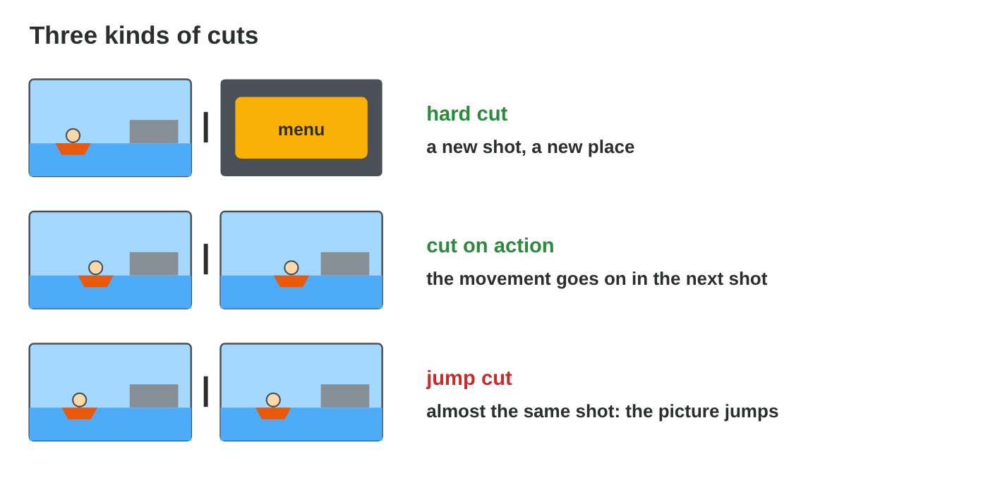
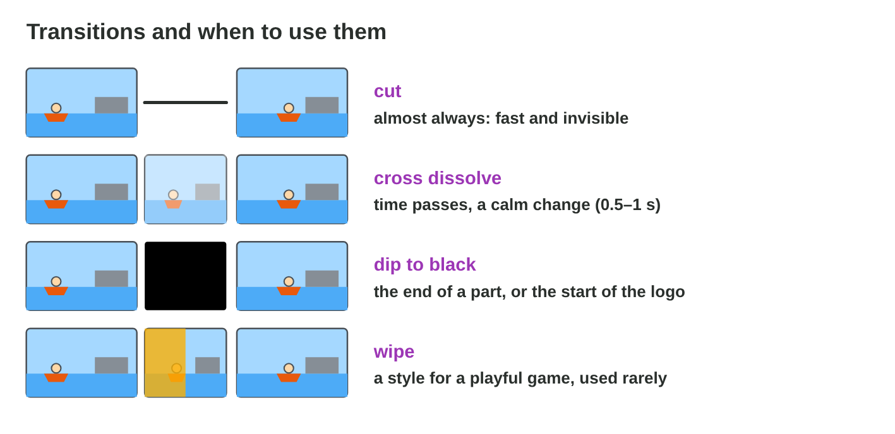

## Keywords



## 11.1 Cutting with rhythm

:::: {.columns}
::: {.column width="50%"}
- On the timeline, a clip on V2 covers the clip on V1.
- Split cuts a clip at the playhead, and ripple delete closes the gap.
- A cut on action hides the cut inside a movement.
- **Do it:** In Timeline Lab, split the boat clip on the action and ripple delete the boring middle.
:::
::: {.column width="50%"}

:::
::::

## Live demo · Timeline Lab



## Example · The boat and the net

Nour throws the net in shot A, and the net lands on Pasha in shot B.
**Where does Tariq cut?**

::: {.reveal}
1. Tariq cuts **in the middle of the throw**.
2. The movement goes on in shot B, so the eye **does not see** the cut.
3. The cut lands **on a drum beat** of the music.
:::

## Try it 1 · Cuts

a) Which cut hides the edit inside a movement?
b) Which cut makes the picture jump between two similar shots?
c) Which shot lengths feel fast?

::: {.answer}
a) a cut on action
b) a jump cut
c) about 1–3 seconds
:::

## 11.2 Transitions

:::: {.columns}
::: {.column width="50%"}
- Most edits are simple cuts.
- A cross dissolve says that time passes.
- A dip to black ends a part, for example before the logo.
- **Do it:** Choose the edit for evening → morning in Cut Lab. Which is it?
:::
::: {.column width="50%"}

:::
::::

## Live demo · Cut Lab



## Try it 2 · Transitions

a) Which edit fits the boat → the net?
b) Which edit fits the last shot → the logo?
c) How long is a good cross dissolve?

::: {.answer}
a) a cut
b) a dip to black
c) 0.5–1 s
:::

## 11.3 Speed, colour and titles

:::: {.columns}
::: {.column width="50%"}
- Slow motion at 50 % needs footage recorded at 60 fps.
- Colour correction makes the clips look right and match.
- All text stays inside the title safe area.
- **Do it:** Match the colours in Effects Lab. Which settings did you change?
:::
::: {.column width="50%"}

:::
::::

## Live demo · Effects Lab



## Example · The jump in slow motion

Nour's jump was captured at 30 fps and plays at 50 % speed.
**Why does it stutter, and how does Tariq fix it?**

::: {.reveal}
1. 30 fps at 50 % gives only **15 new frames** per second.
2. Each frame is **shown twice**, so the motion stutters.
3. Tariq captures the jump at **60 fps**, which gives 30 new frames per second.
:::

## Try it 3 · Effects

a) Which footage gives smooth 25 % slow motion?
b) Which setting makes a blue clip warmer?
c) How much of the frame is the title safe area?

::: {.answer}
a) 120 fps
b) the temperature
c) the inner 80 %
:::

## 11.4 Sound and export

:::: {.columns}
::: {.column width="50%"}
- The voice comes first, then the effects, then the music.
- We duck the music under the voice and fade the end.
- We export for the target and watch the file on a phone.
- **Do it:** Duck the music in your first cut. How many dB did you lower it?
:::
::: {.column width="50%"}

:::
::::

## Game challenge · Edit Doctor



## Try it 4 · Salma's notes (harder)

a) What fixes a slow wipe in the middle of the action?
b) What fixes a blue shot next to an orange shot?
c) What fixes "Play free now" being cut off on a phone?

::: {.answer}
a) a cut on the action
b) colour correction of both shots
c) moving the text into the title safe area
:::

## Summary

- We cut on action and with rhythm, and avoid jump cuts.
- Cuts are the normal edit, dissolves show time and a dip to black ends a part.
- Slow motion needs more frames, and the clips must match in colour.
- All text stays inside the title safe area.
- We duck the music under the voice, fade the end and watch the export.
