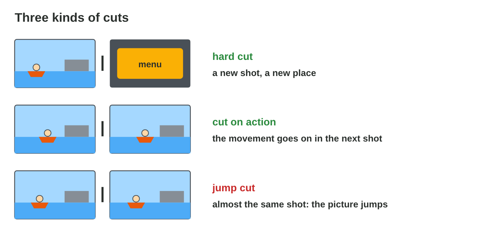
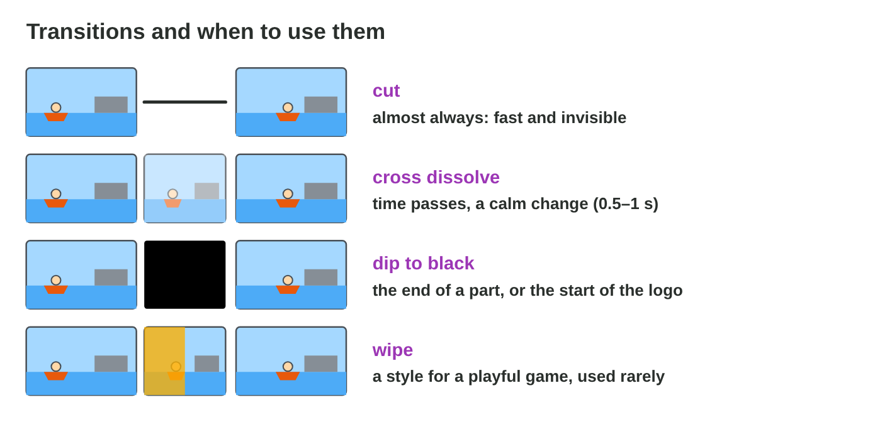
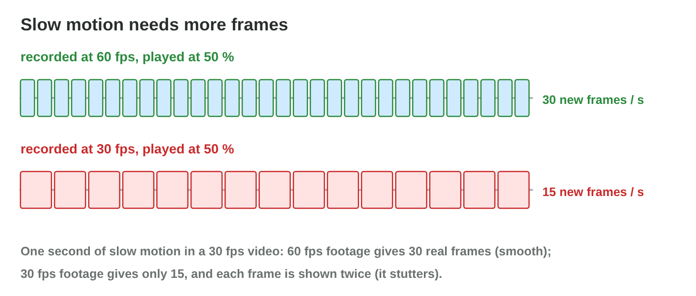
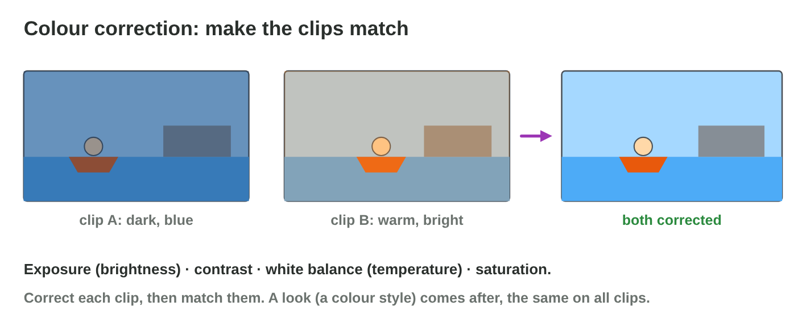
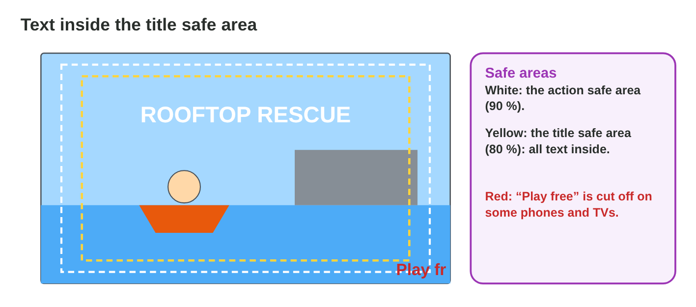
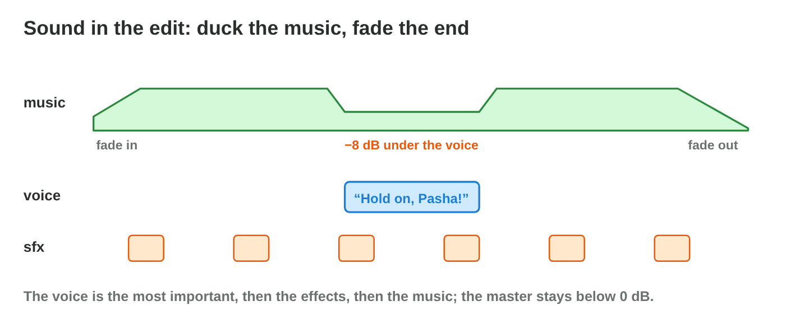

Each section: a problem in a game studio, the idea, a **Do it** task and a short **Try it**.
The page checks every answer at once and tells you why. More examples
and exercises are in the lesson notes (PDF).

## Key terms



## 11.1 Cutting with rhythm

- In a video editor, the **timeline** shows the clips on **tracks**: V2
  covers V1, so a title on V2 shows over the gameplay.
- Three tools of the timeline:

| Tool | What it does |
|----------------|------------------------------------------------------|
| split | cuts a clip in two at the playhead (Ctrl+B) |
| trim | drags the start or the end of a clip |
| ripple delete | removes a part and closes the gap |

- Three kinds of cut:

| Kind of cut | What it is |
|----------------|------------------------------------------------------|
| hard cut | one shot ends, the next starts: the most common edit |
| cut on action | the cut is in the middle of a movement, so nobody sees it |
| jump cut | two almost identical shots, so the picture jumps (a mistake) |

- **Pacing:** short shots (1–3 s) feel fast. Cut on the beat of the music.

{width=94%}

::: {.callout-warning title="Watch out!"}
Shots of the same length make a boring rhythm.
:::



::: {.callout-note title="Do it · A first cut"}
In **Timeline Lab** (or a free video editor with three clips of your own),
put the clips on V1 and a title on V2. Split the boat clip on the action
and ripple delete the boring middle.

::: {.order}
Put the steps of the first cut in order.

1. Put the clips on V1 in the order of the story.
2. Put the title on V2, over the first clip.
3. Split the boat clip where the net leaves the hand.
4. Ripple delete the boring middle.

Why: First the order of the story, then the title above it, then the cut on the action.
:::
:::

::: {.callout-tip title="Try it 1 · Cuts"}
Choose the kind of cut.

::: {.match extra="a fade|a title"}
the net leaves the hand, then lands on Pasha
:   cut on action

    Why: The movement carries the eye over the cut.

the picture jumps between two similar shots
:   jump cut

    Why: Two very similar shots make the picture jump.
:::
:::

## 11.2 Transitions

| Transition | When to use it | Length |
|----------------|-----------------------------------------|:----------:|
| cut | almost always | 0 s |
| cross dissolve | time passes | 0.5–1 s |
| dip to black | a part ends, for example before the logo | about 1 s |
| wipe | rarely, for a playful style | short |

- A transition needs **handles**: extra frames before and after the part of
  the clip that you use.

{width=94%}



::: {.callout-warning title="Watch out!"}
A fancy transition at every edit turns a trailer into a slide show.
:::

::: {.callout-note title="Do it · Choose the edit"}
In **Cut Lab**, find the right edit for the three places.

::: {.sort}
Which edit fits each place? Sort them.

A plain cut
:   the boat → the net

    Why: One action: the cut keeps it going.

A cross dissolve
:   evening → the next morning

    Why: Time passes.

A dip to black
:   the last shot → the logo

    Why: A part ends.
:::
:::

::: {.callout-tip title="Try it 2 · Transitions"}
Use Cut Lab. Choose the edit.

::: {.match extra="a 3-second wipe|a jump cut"}
evening → next morning
:   a cross dissolve

    Why: A cross dissolve says that time passes.

a good length for a dissolve
:   0.5–1 s

    Why: Longer dissolves feel slow in a trailer.
:::
:::

## 11.3 Speed, colour and titles

- **Slow motion:** at 50 % speed, a clip plays two times slower. A 30 fps
  video then needs footage of 60 fps (2 × 30). At 25 %, it needs 120 fps.
  With fewer frames, the slow motion stutters.
- **Colour correction:** change the exposure, the contrast, the white
  balance and the saturation, so that the clips match.
- **Titles:** keep them inside the **title safe area** (not near the edges
  of the screen), for at least 2 s. **Keyframes** (points in time with a
  setting) animate them.

{width=94%}

{width=94%}

{width=94%}



::: {.callout-warning title="Watch out!"}
Text at the very edge is cut off on some screens.
:::

::: {.callout-note title="Do it · Polish one shot"}
In **Effects Lab**, make the slow motion smooth, match the colours and move
the title.

::: {.sort}
Which fix solves each problem? Sort them.

Use 60 fps footage
:   The 50 % slow motion stutters.

    Why: At half speed, 60 fps still gives 30 new frames each second.

Make the temperature warmer
:   The blue night shot does not match the orange one.

    Why: A warmer temperature brings the colours together.

Move it into the safe area
:   The title is at the very edge.

    Why: Text at the edge is cut off on some screens.
:::
:::

::: {.callout-tip title="Try it 3 · Effects"}
Use Effects Lab. Choose the right answer.

::: {.match extra="24 fps|the bitrate"}
footage for smooth 50 % slow motion
:   60 fps

    Why: 50 % speed needs twice the frames: 60 fps.

where all text belongs
:   the title safe area

    Why: Text inside the safe area is never cut off.
:::
:::

## 11.4 Sound and export

- Voice first, then effects, then music. **Duck** the music under the voice.
- Fade the music in and out; the master below 0 dB.
- Export for the target; a clear name with a version; watch it on a phone.

{width=94%}

::: {.callout-warning title="Watch out!"}
Do not cut the music in the middle of a bar: fade it or end on a phrase.
:::

::: {.callout-note title="Do it · Finish your cut"}
Add one fitting transition, duck the music, fade the end and export v2 of
your cut, for example `rooftop-cut-v2.mp4`.

::: {.order}
Set the levels of the sound in order: what comes first?

1. the voice
2. the effects
3. the music

Why: Voice first, then effects, then music, ducked under the voice.
:::
:::

::: {.callout-tip title="Try it 4 · Finishing"}
Choose the right answer.

::: {.match extra="raise everything|cut it in the middle"}
the music under Nour's line
:   duck it by about 8 dB

    Why: The voice must stay clear above the music.

after the export
:   watch the whole file on a phone

    Why: Phones show problems a big screen hides.
:::
:::

## Game challenge: Edit Doctor {.challenge}

Work alone. Use every section of today.

Salma's notes: a slow **wipe** in the action, a **jump cut**, stuttering
**slow motion**, a **colour** jump, a **lost voice**, and the call to action
**cut off** on a phone.



::: {.callout-tip title="Try it 5 · Salma's notes"}
Choose the fix.

::: {.match extra="a longer wipe|make it louder"}
the slow motion stutters (30 fps footage)
:   use 60 fps footage

    Why: Slow motion needs more frames than 30 fps gives.

“Play free now” is cut off
:   move it into the safe area

    Why: The safe area keeps text away from the edges.
:::
:::

::: {.callout-tip title="Try it 6 · Numbers (harder)"}
Choose the right answer.

::: {.match extra="60|8"}
new frames per second: 30 fps footage at 50 %
:   15

    Why: 30 × 50 % = 15 new frames per second: it stutters.
:::
:::

## Summary {.summary}

- Cut on action and with rhythm; avoid jump cuts.
- Use cuts almost always; dissolves for time, a dip to black for the end.
- Slow motion needs more frames; correct and match colours; text in the safe
  area.
- Duck the music under the voice, fade the end, export and watch.
