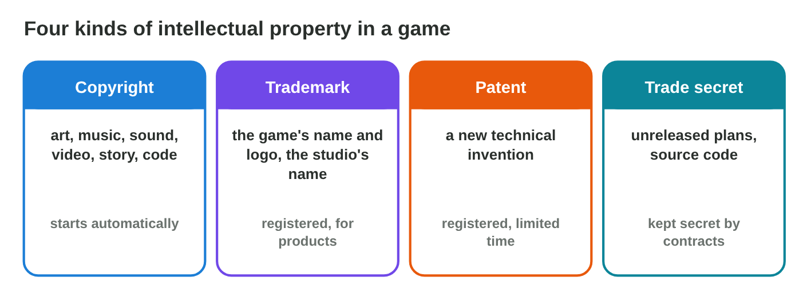
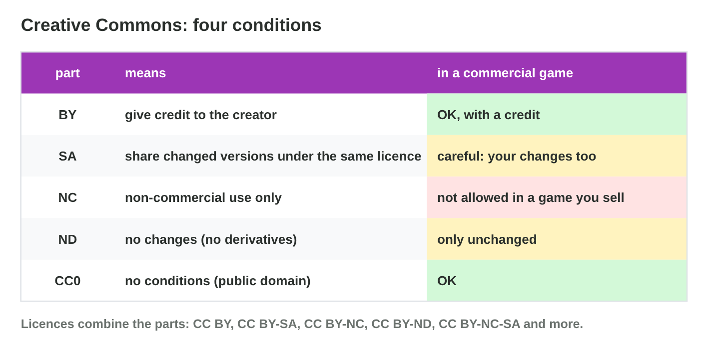
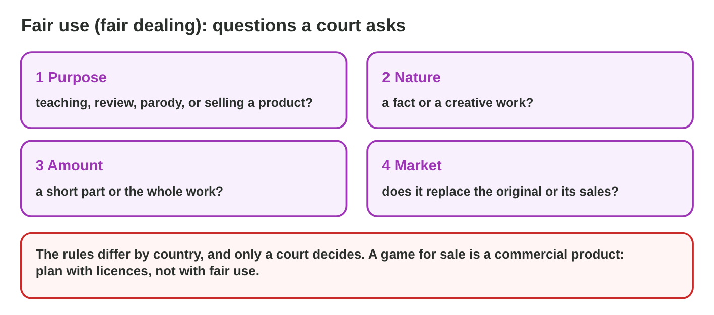

## Keywords



## 23.1 What is intellectual property?

:::: {.columns}
::: {.column width="50%"}
- The law protects creations of the mind as intellectual property.
- Copyright protects art, music, sound, video and code.
- Trademarks protect names and logos.
- **Do it:** Find one copyright and one trademark in a game you know. What are they?
:::
::: {.column width="50%"}

:::
::::

## Try it 1 · Kinds of IP

a) Which kind of IP protects the drawings of Pasha the cat?
b) Which kind protects the name Rooftop Rescue?
c) Which kind protects a new technical invention?

::: {.answer}
a) copyright
b) a trademark
c) a patent
:::

## 23.2 Copyright

:::: {.columns}
::: {.column width="50%"}
- Copyright starts automatically when a work is made.
- It protects the expression, not the idea.
- After the life of the creator plus 50 or 70 years, a work is in the public domain.
- **Do it:** Check a composer who died in 1950 in Public Domain Clock. Is the music free?
:::
::: {.column width="50%"}

:::
::::

## Live demo · Public Domain Clock



## Example · Old piano music

Yara wants a piano piece by a composer who died in 1900.
**May Night Owl use it?**

::: {.reveal}
1. With life + 70, the copyright ended in 1970, so the piece is in the **public domain**.
2. A famous pianist's recording has **its own copyright**.
3. Yara **records the piece herself**, so the recording belongs to Night Owl.
:::

## 23.3 Licences and Creative Commons

:::: {.columns}
::: {.column width="50%"}
- A licence gives permission with conditions.
- Creative Commons has the parts BY, SA, NC and ND.
- A credit names the creator, the title, the source and the licence.
- **Do it:** Build CC BY-NC in Licence Lab. May Night Owl use the drawing?
:::
::: {.column width="50%"}

:::
::::

## Live demo · Licence Lab



## Example · Three assets in the folder

Salma checks three assets for Rooftop Rescue, a game that is sold.
**What may Night Owl do with each?**

::: {.reveal}
1. The **rain sound** is CC BY, so the team uses it with a credit.
2. The **cat drawing** is CC BY-NC, so Salma asks the artist for a paid licence.
3. The **font** is free for personal use only, so Night Owl buys a licence.
:::

## Try it 2 · Licences

a) What does NC mean?
b) What must a credit contain?
c) Is a royalty-free sound free of copyright?

::: {.answer}
a) non-commercial use only
b) the creator, the title, the source and the licence
c) No, it is only paid once.
:::

## 23.4 Fair use and its limits

:::: {.columns}
::: {.column width="50%"}
- Fair use allows limited use for review, teaching or parody.
- A court weighs the purpose, the amount and the market effect.
- No number of seconds is always fine.
- **Do it:** Decide if a famous song in a trailer is fair use. Why or why not?
:::
::: {.column width="50%"}

:::
::::

## Game challenge · Can We Use It?



## Try it 3 · The folder (harder)

a) May Night Owl use a pop song with "no copyright intended"?
b) Is 8 seconds of a film in a promo clip fair use?
c) From which year is music free if the composer died in 1940 (life + 70)?

::: {.answer}
a) No, ask for permission or replace it.
b) Not safely, because a promo sells a product.
c) 2011
:::

## Summary

- Intellectual property covers copyright, trademarks, patents and secrets.
- Copyright starts automatically and lasts a long time.
- Without a licence, a work is all rights reserved.
- We read every part of a licence and write the credit.
- Fair use is narrow, so a game for sale needs licences.
