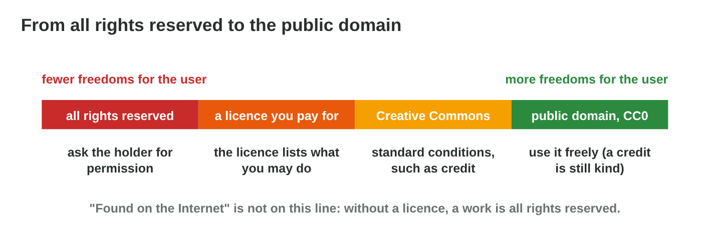

This page is the interactive version of the lesson notes (PDF). Each section
has a short summary, a picture, a **Do it** task and one set of questions.
The full explanations, examples and exercises are in the notes. This lesson
explains the basics; it is not legal advice.

## Key terms



## 23.1 What is intellectual property?

- **Intellectual property:** protection of creations of the mind.
- **Copyright** (art, music, code), **trademark** (names, logos),
  **patent** (inventions), **trade secret**.

{width=94%}

::: {.callout-warning title="Watch out!"}
Small creators are protected like big studios.
:::

::: {.callout-note title="Do it · Find the IP"}
In a game you know, find one example of copyright and one of a trademark.
:::

::: {.callout-tip title="Try it 1 · Kinds of IP"}
Choose the kind of IP.

::: {.match extra="a licence fee|a backup"}
the drawings of Pasha the cat
:   copyright

the name and logo of Rooftop Rescue
:   trademark

a new technical invention
:   patent

the secret plan for the next game
:   trade secret
:::
:::

## 23.2 Copyright: what, how long, who

- The holder decides who may **copy, share, change, show**.
- Starts **automatically**; protects the **expression**, not the idea.
- Often **life + 50 or 70 years**, then **public domain**.
- An employee's work usually belongs to the company (**work for hire**).

{width=94%}



::: {.callout-warning title="Watch out!"}
No © sign does not mean free: without a licence, all rights are reserved.
:::

::: {.callout-note title="Do it · When is it free?"}
In **Public Domain Clock**, check composers who died in 1950 and 1960 under
both rules.
:::

::: {.callout-tip title="Try it 2 · Copyright"}
Use Public Domain Clock. Choose the right answer.

::: {.match extra="never|1990"}
died 1950, life + 70: free from
:   2021

died 1960, life + 50: free from
:   2011

died 1960, life + 70: free from
:   2031

latest death year free in 2026 (life + 70)
:   1955
:::
:::

## 23.3 Licences and Creative Commons

- A **licence:** permission with conditions.
- **Royalty-free:** paid once, still copyright.
- CC parts: **BY** credit, **SA** share alike, **NC** non-commercial, **ND**
  no changes; **CC0** public domain.
- **Attribution:** creator, title, source, licence.

{width=94%}

{width=94%}



::: {.callout-warning title="Watch out!"}
Read every part: CC BY and CC BY-NC are very different for a game that is
sold.
:::

::: {.callout-note title="Do it · Read the licence"}
In **Licence Lab**, build CC BY, CC BY-NC, CC BY-ND and CC BY-SA; write what
Night Owl may do with each.
:::

::: {.callout-tip title="Try it 3 · Licences"}
Use Licence Lab. Choose the licence.

::: {.match extra="all rights reserved|a trademark"}
commercial use and changes, with a credit
:   CC BY

no use in a game that is sold
:   CC BY-NC

only unchanged copies
:   CC BY-ND

no conditions at all
:   CC0
:::
:::

## 23.4 Fair use and its limits

- **Fair use / fair dealing:** limited use without permission, for
  criticism, review, teaching, news, parody.
- A court weighs purpose, kind of work, amount, market effect.
- No fixed number of seconds; rules differ by country.

{width=94%}

::: {.callout-warning title="Watch out!"}
For a game that is sold, plan with licences, not with fair use.
:::

::: {.callout-note title="Do it · Fair or not?"}
A teacher's clip in class; a famous song in a trailer; short clips in a
critical review: decide with a reason.
:::

::: {.callout-tip title="Try it 4 · Fair use"}
Choose the best answer.

::: {.match extra="always fine|a trademark"}
a famous song in a game trailer
:   needs a licence

"under 10 seconds is fair use"
:   a myth

who finally decides about fair use
:   a court

"no copyright intended" in a description
:   changes nothing
:::
:::

## Game challenge: Can We Use It? {.challenge}

Work alone. Use every section of today.

Six assets: a **rain sound** (CC BY), a **cat drawing** (CC BY-NC), **piano
music** from 1900, a **pop song** with "no copyright intended", a font
**"free for personal use"**, and **8 seconds of a film**.



::: {.callout-tip title="Try it 5 · The folder"}
Choose what Night Owl may do.

::: {.match extra="sell it as our own|short parts are fine"}
the rain sound under CC BY
:   use it with a credit

the cat drawing under CC BY-NC
:   ask for permission or replace it

piano music from 1900, recorded by Yara
:   use it freely

a font "free for personal use"
:   buy a commercial licence
:::
:::

## Summary {.summary}

- IP: copyright, trademarks, patents and trade secrets.
- Copyright starts automatically and protects the expression for a long
  time; then the public domain.
- Without a licence, a work is all rights reserved.
- Read every part of a licence: BY, SA, NC, ND; CC0 is free.
- Fair use is narrow and decided case by case: plan with licences.
