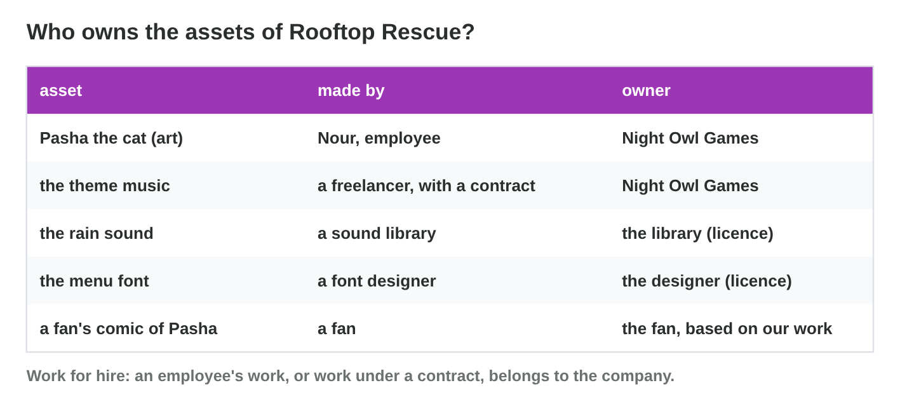
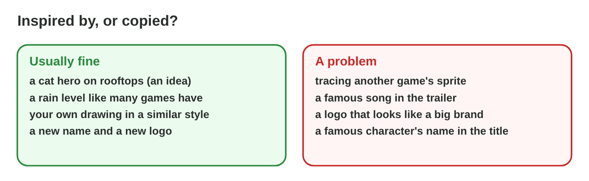

## Keywords



## 24.1 Who owns the assets?

:::: {.columns}
::: {.column width="50%"}
- An employee's work for the studio belongs to the studio.
- A freelancer keeps the copyright unless a contract says otherwise.
- Libraries give a licence, and fan art is a derivative work.
- **Do it:** Write who owns five assets of a game. Which one is unclear?
:::
::: {.column width="50%"}

:::
::::

## Example · The theme music

A freelancer wrote the theme music, and Night Owl paid without a contract.
**Who owns the music, and what does Salma do?**

::: {.reveal}
1. Without a contract, the **composer** still owns the copyright.
2. Salma sends a **short written contract** for the game and its trailers.
3. Both **sign** before the release, and the composer gets a credit.
:::

## 24.2 A rights check

:::: {.columns}
::: {.column width="50%"}
- We ask five questions for every asset.
- At the first "no", we ask, replace or remove.
- A rights register keeps one line per asset.
- **Do it:** Check the six assets in Rights Check. Where does the font stop?
:::
::: {.column width="50%"}

:::
::::

## Live demo · Rights Check



## Try it 1 · The check

a) Where does the check of the theme music stop?
b) What is missing for the rain sound?
c) What are the three actions after a "no"?

::: {.answer}
a) at question 2, who owns it
b) the credit line
c) ask, replace or remove
:::

## 24.3 Inspired by, or copied?

:::: {.columns}
::: {.column width="50%"}
- Ideas, genres and mechanics are free to use.
- Drawings, music, text and code are protected.
- Lookalike names and logos are trademark problems.
- **Do it:** Decide if a traced sprite with new colours is copied. Why?
:::
::: {.column width="50%"}

:::
::::

## 24.4 When something goes wrong

:::: {.columns}
::: {.column width="50%"}
- After a takedown notice, we remove the asset and check the register.
- A fan content policy tells fans what they may do.
- For AI-made assets, we record the tool, the prompt and the terms.
- **Do it:** Make a rights register with six assets. Which one needs a fix?
:::
::: {.column width="50%"}

:::
::::

## Example · The takedown notice

A store says the loading-screen photo belongs to a photographer.
**What does Night Owl do?**

::: {.reveal}
1. Tariq **replaces** the photo with Nour's drawing the same day.
2. Salma finds the cause in the **register**: the source was unknown.
3. She adds a **rule**, answers the store and apologizes to the photographer.
:::

## Game challenge · IP Desk



## Try it 2 · The desk (harder)

a) Is "we paid, so we own it" right for a freelancer?
b) Is there a "30 % changed" rule?
c) What does the register say about an AI-made image?

::: {.answer}
a) No, the contract decides.
b) No, a recognizable copy needs permission.
c) the tool, the prompt and the tool's terms
:::

## Summary

- The owner decides, and freelancers need contracts.
- Every asset passes five questions before the release.
- Ideas are free, but expression and trademarks are protected.
- We react fast to takedown notices.
- A rights register keeps the game safe.
