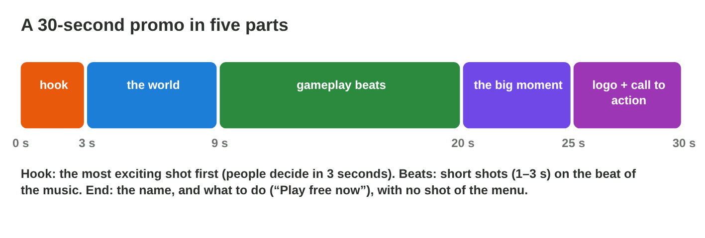
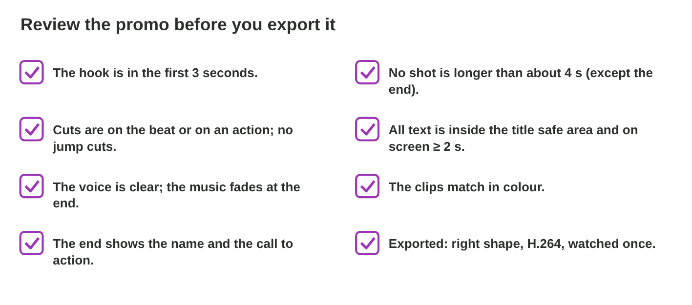

## Recall · Lecture 11

a) Which cut hides the edit inside a movement?
b) Which transition says that time passes?
c) Where does all text of a video belong?

::: {.answer}
a) a cut on action
b) a cross dissolve
c) inside the title safe area
:::

## The facts · nine shot cards for the promo

| Card | Shot | Length |
|:-----:|--------------------------------------------------------|:------:|
| a | the logo and "Play free now" | 5 s |
| b | the main menu | 4 s |
| c | the wave hits the roof, and Nour jumps | 3 s |
| d | the flooded city from the air | 5 s |
| e | Nour rows between boxes | 3 s |
| f | the net catches Pasha | 3 s |
| g | a loading screen | 3 s |
| h | the boat jumps over a car | 3 s |
| i | Pasha is safe on the roof | 5 s |

## Activity 1 · The shot list · 15 min

:::: {.columns}
::: {.column width="50%"}
- A 30-second promo has a hook, the world, gameplay beats, the big moment, and the logo with a call to action.
- **Do it:** Make all the checks green in Promo Builder. Then choose the two of nine shot cards that stay out, and put the other seven in order.
- Your product is a shot list of seven letters and its length.
:::
::: {.column width="50%"}

:::
::::

## Live demo · Promo Builder



## Check 1 · The shot list

Which cards stay out, and what is the order of the others?

::: {.reveal}
1. The menu (b) and the loading screen (g) stay out: they show no game.
2. The list starts with the hook (c), the wave on the roof, then the flooded city (d).
3. Three short level shots follow (e, f, h), then the big moment: Pasha safe on the roof (i).
4. It ends with the logo and "Play free now" (a): 27 seconds in all.
:::

## Activity 2 · The promo · 20 min

:::: {.columns}
::: {.column width="50%"}
- The music goes on the timeline first, and the cuts go on its beats.
- **Do it:** Cut your promo from the shot list with one honest title. Watch it on a phone, fix one thing, and export yourname-promo-v1.mp4.
- Your product is one promo of 25 to 30 seconds.
:::
::: {.column width="50%"}

:::
::::

## Check 2 · The promo

What does a good promo show?

::: {.reveal}
1. It starts with the hook and cuts on the beats of the music.
2. Its title is honest, such as "Rescue cats in 30 levels", inside the safe area.
3. A dip to black comes before the logo and the call to action.
4. On a phone, a title at the edge is moved in, and a long shot is cut to about 3 seconds.
:::

## Wrap-up

- You can plan a promo in five parts with a shot list.
- You can cut a promo on the beats, review it on a phone and export it.
