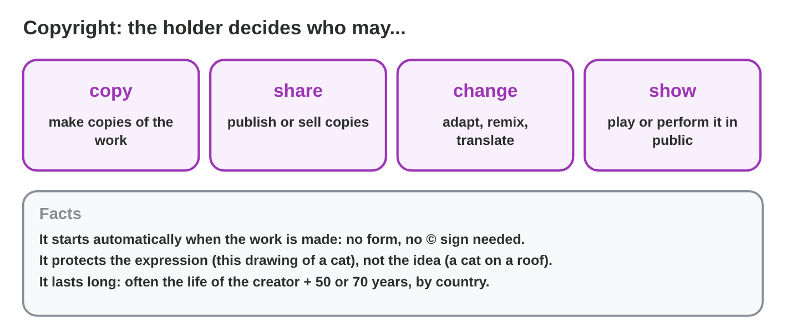

::: {.lead}
Two weeks before the release of *Rooftop Rescue*, Salma, the producer,
finds a folder called "found stuff": a rain sound from a website, a cute
drawing of a cat, a famous pop song for the trailer, a font "free for
personal use", and old piano music. "Can we use all this?" asks Tariq. "It
was all free on the Internet!" In this lesson you learn who **owns** such
media and when you may use it: **intellectual property**, **copyright**,
**licences** and the limits of **fair use**. This lesson explains the
basics; it is not legal advice, and the laws differ from country to
country. Every section ends with a short task.
:::

## Key terms



## 12.1 What is protected, and what is free?

A game is full of creations of the mind: art, music, code, a name and a
logo. The law protects them as **intellectual property**. Games also learn
from each other, so a team must know where inspiration ends and copying
begins (@fig-inspired).

::: {.callout-important title="Definition 12.1 — Intellectual property (IP)"}
**Intellectual property** is the protection of creations of the mind, so
that their owners control how they are used. In game media, two kinds
matter most:

- **Copyright:** art, music, sound, video, stories and code.
- **Trademark:** names, logos and signs that show who made a product.

**Ideas, genres and mechanics** (a cat hero, a rain level, a jump) are free
to use. The **expression** is protected: the actual drawings, sprites,
music, text and code.
:::

{#fig-inspired width=94%}

::: {.callout-note title="Example 12.1 — Two close calls"}
1. Nour traced a sprite from another game "to save time" and changed the
   colours: this is copying. Nour draws a new sprite.
2. The new logo looks like the logo of a big drink brand: a trademark
   problem. Salma asks for a new design with a different shape and colours.
3. The rain level looks like rain levels in many games: an idea, so it
   stays.
:::

::: {.callout-warning title="Common mistake"}
"I changed 30 % of it, so it is mine." There is no percentage rule. If the
original can still be recognized, you need permission.
:::

::: {.callout-note title="Do it · Inspired or copied?"}
Decide for each, with a reason: (a) a puzzle game with falling blocks;
(b) a game that uses the exact music of a famous film; (c) a hero in a
blue cap drawn in your own style; (d) a title with the name of a famous
character of another company.

*Your result:* four decisions with reasons.

::: {.check}
(a) Inspired: a genre and a mechanic are free. (b) Copied: the music is
the expression, so it needs a licence. (c) Inspired: your own drawing of
an idea. (d) A trademark problem: the name belongs to the other company.
:::
:::

## 12.2 Copyright: who owns it, and for how long?

Copyright is the kind of IP that media makers meet every day
(@fig-copyright).

::: {.callout-important title="Definition 12.2 — Copyright and its owner"}
**Copyright** gives the **copyright holder** the right to decide who may
**copy**, **share**, **change** and **show** a work.

- It starts **automatically** when the work is made: no form, no © sign.
- It lasts a long time: in many countries until 70 years after the
  creator's death. Then the work is in the **public domain**: anyone may
  use it.
- **Employees:** their work for the studio usually belongs to the studio
  (**work for hire**). **Freelancers** keep the copyright, unless a
  **written contract** gives it to the studio. A **library** keeps it and
  gives the studio a licence. **Fan art** uses the studio's characters, so
  the studio decides what fans may do with it.
:::

{#fig-copyright width=94%}

{#fig-owner width=94%}

::: {.callout-note title="Example 12.2 — The theme and the piano piece"}
1. A freelance composer wrote the theme music. Night Owl paid, but there
   is **no written contract**, so the composer still owns it. Salma sends a
   short contract, and both sign before the release.
2. The old piano piece is by a composer who died in 1900: it has been in
   the **public domain** for a long time.
3. A recording by a famous pianist has its own copyright. So Yara records
   the piece on the studio piano, and the recording belongs to Night Owl.
:::

::: {.callout-warning title="Common mistake"}
"There is no © sign, so it is free." Copyright needs no sign. Without a
licence, every work is **all rights reserved**. And "we paid for it" does
not move the copyright: the contract decides.
:::

::: {.callout-note title="Do it · Find the owners"}
Choose five assets of a game you know or imagine (art, music, sound, font,
video). For each, write who made it and who owns it.

*Your result:* a table with five rows.

::: {.check}
A good table looks like: "the hero, drawn by an employee: the studio; the
theme, by a freelancer with a contract: the studio; a rain sound from a
library: its creator (the studio has a licence); an old folk song: the
public domain; a fan's drawing of the hero: the fan, but the studio
decides what may be done with its character."
:::
:::

## 12.3 Licences and Creative Commons

To use a work that someone else owns, you need a **licence**
(@fig-spectrum).

::: {.callout-important title="Definition 12.3 — Licences"}
A **licence** is permission from the copyright holder, with conditions.

- **All rights reserved:** ask the holder for permission.
- **A paid licence:** for example from a music or sound library. A
  **royalty-free** licence is paid once and does not mean free of
  copyright.
- **Creative Commons** licences are standard licences with parts: **BY**
  (give credit), **SA** (share changes alike), **NC** (non-commercial
  only), **ND** (no changes). **CC0** gives the work to the public domain.
- **Attribution (credit):** the creator, the title, the source and the
  licence.
:::

{#fig-spectrum width=94%}

{#fig-cc width=94%}

::: {.callout-note title="Example 12.3 — Three assets in the folder"}
1. The **rain sound** is CC BY: Night Owl may use it in the game it sells,
   with a credit.
2. The **cat drawing** is CC BY-NC: not for a game that is sold. Salma
   writes to the artist and asks for a paid licence.
3. The **font** is "free for personal use": a game for sale is commercial
   use, so Night Owl buys a commercial licence.
:::



::: {.callout-warning title="Common mistake"}
Reading only "Creative Commons" and not the parts. CC BY and CC BY-NC look
similar, but one allows a game for sale and the other does not.
:::

::: {.callout-note title="Do it · Read the licence"}
1. In **Licence Lab**, build CC BY, CC BY-NC, CC BY-ND and CC BY-SA.
2. For each, write in one line what Night Owl may do in *Rooftop Rescue*.

*Your result:* four lines.

::: {.check}
CC BY: use and change it in the game for sale, with a credit. CC BY-NC: not
in a game that is sold (ask for a paid licence). CC BY-ND: use it only
unchanged, with a credit. CC BY-SA: use and change it, with a credit, but
share the changed work under the same licence.
:::
:::

## 12.4 Fair use, and when something goes wrong

Some laws allow limited use without permission: **fair use** or **fair
dealing** (@fig-fair). It is narrow, so a studio plans with licences, and
it knows what to do when a problem comes.

::: {.callout-important title="Definition 12.4 — Fair use and takedown notices"}
- **Fair use** (in some countries **fair dealing**) allows limited use of
  a work without permission, for example for **criticism, review,
  teaching, news or parody**. A court looks at the purpose, the kind of
  work, the amount used, and the effect on the market. There is **no fixed
  number** of seconds that is always fine.
- A **takedown notice** asks a store or a website to remove content that
  uses a work without permission. React fast: remove or replace the asset,
  and answer.
- **Images and sounds made with an AI tool:** the terms of the tool and the
  law decide the use, and they change. Record the tool and the prompt, and
  say honestly how the asset was made.
:::

{#fig-fair width=94%}

::: {.callout-note title="Example 12.4 — Eight seconds of a famous film"}
1. Tariq wants 8 seconds of a famous film in the promo clip: "It is short,
   so it is fair use."
2. But the purpose is to **sell** a game, and the film is a creative work.
3. Salma decides: no film clip. Tariq uses gameplay shots of *Rooftop
   Rescue* instead.
:::

::: {.callout-warning title="Common mistake"}
"Under 10 seconds is always fair use", "I wrote 'no copyright intended'",
or ignoring a takedown notice. None of these protects the studio. For a
game that is sold, plan with **licences**.
:::

::: {.callout-note title="Do it · Fair or not?"}
Decide for each and give one reason: (a) a teacher shows a 20-second clip
of a game in class to discuss its camera; (b) a studio puts a famous song
in its trailer; (c) a reviewer shows short gameplay clips in a video that
criticizes the game.

*Your result:* three decisions with reasons.

::: {.check}
(a) Likely fair use: teaching, a short part, no market harm. (b) Not fair
use: the trailer sells a game, so the song needs a licence. (c) Likely fair
use: criticism and review with short clips.
:::
:::

## Case study: Can We Use It?

Salma checks the "found stuff" folder: a rain sound under CC BY, a cat
drawing under CC BY-NC, piano music by a composer who died in 1900 and
recorded by Yara, a famous pop song with "no copyright intended" in its
description, a font "free for personal use", and 8 seconds of a famous
film for the promo. The Game challenge of the interactive lesson uses
these assets. In the mini-game below you decide what Night Owl Games may do
with each one.



## Further reading

Creative Commons, "About CC Licenses" (creativecommons.org/about/cclicenses).
World Intellectual Property Organization (WIPO), *Understanding Copyright
and Related Rights* (free PDF, wipo.int). The copyright office of your
country explains its local rules.

## Exercises

1. What is intellectual property? Name the two kinds that matter most for
   game media.
2. Which kind protects the logo of a game?
3. Does copyright protect the idea "a cat on a roof"? Explain.
4. When does copyright start?
5. Who owns a drawing that an employee made for the studio? And music by a
   freelancer without a contract?
6. What does "all rights reserved" mean for a user?
7. Explain BY, SA, NC and ND in one line each.
8. Is a royalty-free sound free of copyright? Explain.
9. Why is fair use a poor plan for a game's trailer?
10. A store sends a takedown notice for a photo in your game. What do you
    do first?

## Answers to the exercises

::: {.answers}
1. The protection of creations of the mind; copyright and trademark.
2. Trademark.
3. No: copyright protects the expression (a concrete drawing), not the
   idea.
4. Automatically, when the work is made.
5. The studio (work for hire); the freelancer keeps it.
6. You need the permission of the copyright holder to copy, share, change
   or show it.
7. BY: give credit; SA: share changes under the same licence; NC: no
   commercial use; ND: no changes.
8. No: it is paid once, but the copyright stays with the creator.
9. Fair use is narrow and decided case by case; a trailer sells a game, so
   it needs licences.
10. Remove or replace the photo, then answer the store.
:::
