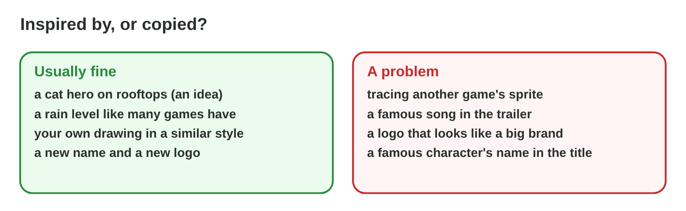
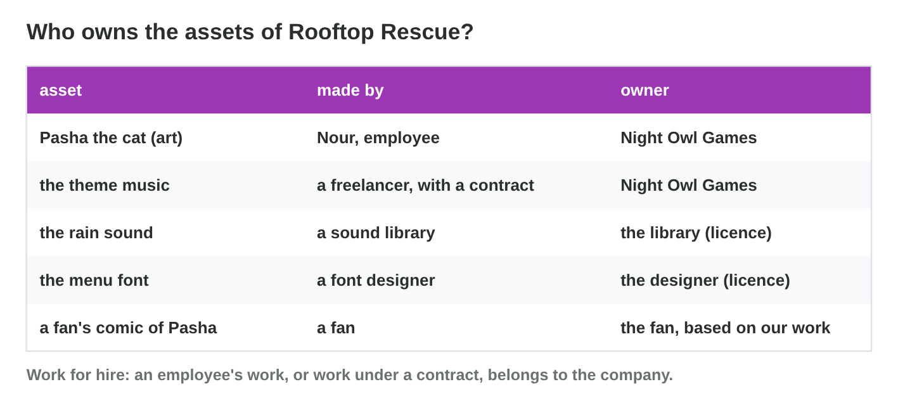
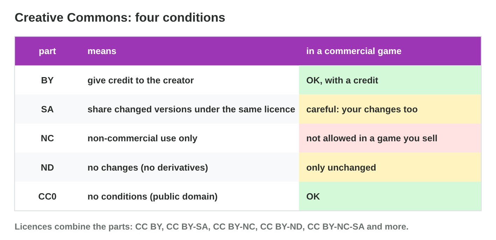
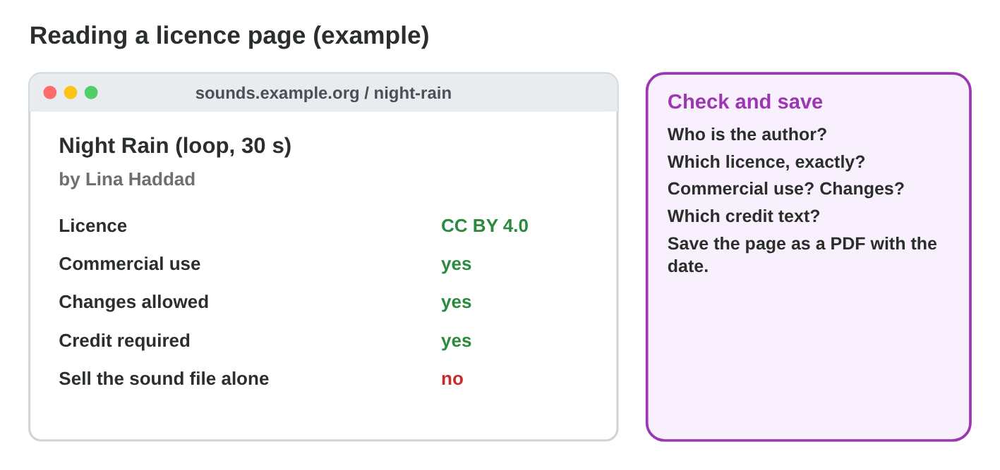
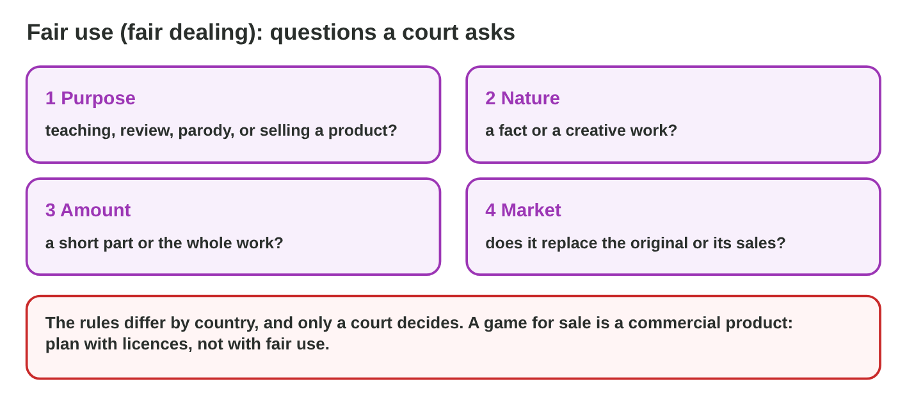
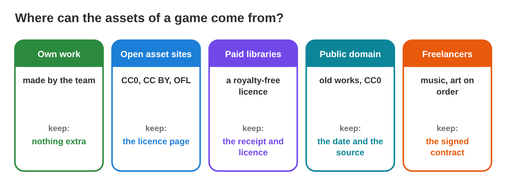
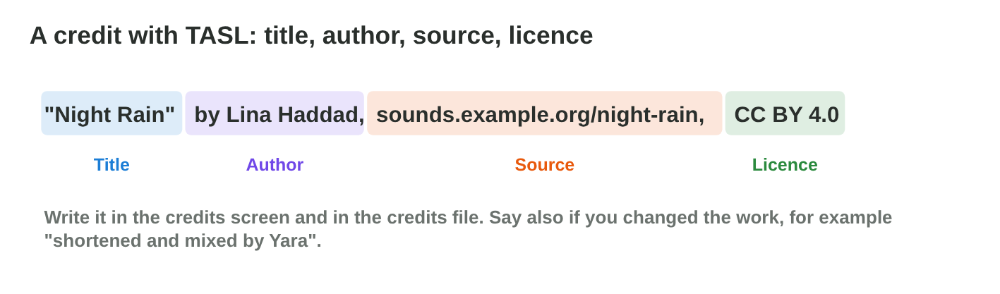
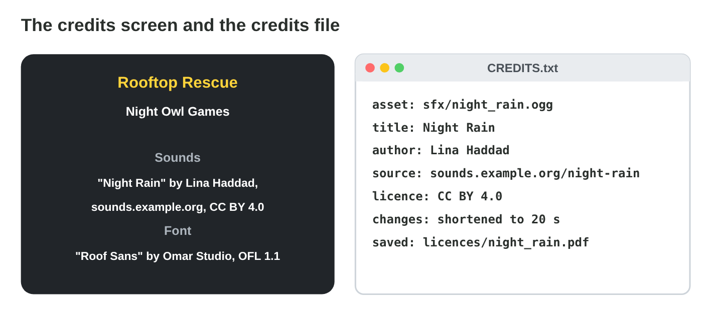
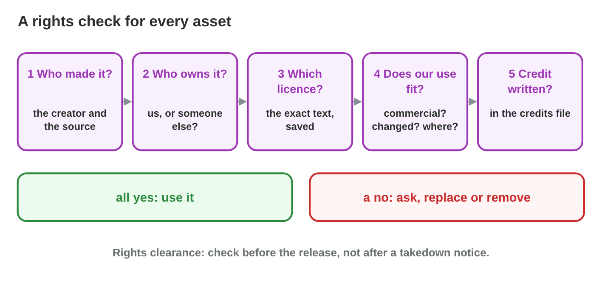

Each section: a problem in a game studio, the idea, a **Do it** task and a short **Try it**.
The page checks every answer at once and tells you why. More examples
and exercises are in the lesson notes (PDF).

## Key terms



## 12.1 What is protected, and who owns it?

- **Intellectual property:** the protection of creations of the mind.
- **Copyright** protects art, music, sound, video, stories and code.
  **Trademark** protects names and logos.
- **Ideas, genres and mechanics** are free: a cat hero, a rain level, a
  jump. The **expression** is protected: the actual drawings, music, text
  and code.

{width=94%}

::: {.callout-warning title="Watch out!"}
There is no "30 % changed" rule: if the original can be recognized, you
need permission.
:::

### Who owns it, and for how long?

- Copyright starts **automatically**, with no form and no © sign.
- It lasts long: in many countries until 70 years after the creator's
  death. Then the work is in the **public domain**.
- **Employees:** the studio owns their work (**work for hire**).
  **Freelancers:** they keep it, unless a **written contract** says
  otherwise. **Libraries:** the creator keeps it; the studio gets a
  licence.

{width=94%}

::: {.callout-warning title="Watch out!"}
No © sign does not mean free: without a licence, all rights are reserved.
:::

::: {.callout-note title="Do it · Inspired or copied?"}
Four ideas for a new game, in the cards below.

::: {.sort}
Inspired, copied or a trademark problem? Sort the ideas.

Inspired
:   a) a puzzle game with falling blocks

    Why: A genre and a mechanic are free.

:   c) a hero in a blue cap, drawn in your own style

    Why: Your own drawing of an idea.

Copied
:   b) the exact music of a famous film

    Why: The music is the expression: it needs a licence.

A trademark problem
:   d) the name of a famous character of another company

    Why: The name belongs to the other company.
:::
:::

::: {.callout-tip title="Try it 1 · Protected or free?"}
Choose the right answer.

::: {.match extra="a licence fee|a backup"}
The drawings of Pasha the cat.
:   copyright

    Why: Drawings are art: copyright protects them.

Pasha the cat, drawn by Nour, an employee of Night Owl.
:   Night Owl Games

    Why: Work made by an employee belongs to the studio.
:::
:::
## 12.2 Licences: Creative Commons, and a licence to keep

- A **licence:** permission from the holder, with conditions.
- The parts of a Creative Commons licence:

| Part | It means |
|:------:|--------------------------------------------------------|
| BY | give a credit to the creator |
| SA | share alike: share your changed work under the same licence |
| NC | non-commercial: not in a product that is sold |
| ND | no derivatives: use it only without changes |
| CC0 | public domain: no conditions |

{width=94%}



::: {.callout-warning title="Watch out!"}
Read every part: CC BY and CC BY-NC are very different for a game that is
sold.
:::

### Read and save the licence

- Read the exact licence before you use an asset: commercial use, changes,
  the credit. Save its page as a PDF with the date.

{width=94%}

::: {.callout-note title="Do it · Read the licence"}
In **Licence Lab**, build CC BY, CC BY-NC, CC BY-ND and CC BY-SA, and read
what Night Owl may do with each.

::: {.sort}
Which licence gives each rule? Sort the rules.

CC BY
:   use it and change it in a game for sale, with a credit

    Why: BY asks only for the credit.

CC BY-NC
:   not in a game that is sold

    Why: NC means non-commercial.

CC BY-ND
:   use it only unchanged, with a credit

    Why: ND means no derivatives: no changes.

CC BY-SA
:   share the changed work under the same licence

    Why: SA means share alike.
:::
:::

::: {.callout-tip title="Try it 2 · Licences"}
Use Licence Lab. Choose the licence.

::: {.match extra="all rights reserved|a trademark"}
No use in a game that is sold.
:   CC BY-NC

    Why: NC means non-commercial only.

No conditions at all.
:   CC0

    Why: CC0 gives the work to the public domain.
:::
:::

## 12.3 Fair use, and when something goes wrong

- **Fair use / fair dealing:** limited use without permission, for
  criticism, review, teaching, news, parody.
- A court decides; there is no fixed number of seconds.
- A **takedown notice** asks a store to remove content: remove or replace
  the asset at once, and answer.
- **AI-made images and sounds:** the tool's terms and the law decide; record
  the tool and the prompt.

{width=94%}

::: {.callout-warning title="Watch out!"}
For a game that is sold, plan with licences, not with fair use.
:::

::: {.callout-note title="Do it · Fair or not?"}
Three uses of other people's work, in the cards below.

::: {.sort}
Likely fair use, or not? Sort the uses.

Likely fair use
:   a) a 20-second clip in class, to discuss its camera

    Why: Teaching, a short part, and no harm to the market.

:   c) short gameplay clips in a review that criticizes the game

    Why: Criticism and review with short clips.

Not fair use
:   b) a famous song in the trailer of a game

    Why: The trailer sells a game: the song needs a licence.
:::
:::

::: {.callout-tip title="Try it 3 · Fair use and problems"}
Choose the best answer.

::: {.match extra="always fine|a trademark"}
"Under 10 seconds is fair use."
:   a myth

    Why: There is no fixed number of seconds.

A poster made with an AI image tool.
:   check the terms and record the tool

    Why: The terms and the law decide; record how it was made.
:::
:::

## 12.4 Using assets: sources, credits and the check

- **Own work**, **open asset sites**, **paid libraries**, **public
  domain**, **freelancers**.
- Keep the proof: the licence page, the receipt, the contract.

{width=94%}

### Credits with TASL

- **T**itle, **A**uthor, **S**ource, **L**icence (+ the changes).
- In the **credits screen** and the **credits file**.

{width=94%}

{width=94%}



### Check every asset before the release

- Five questions for each asset:

| Question | Ask |
|:------:|------------------------------------|
| 1 | Who made it? |
| 2 | Who owns it? |
| 3 | Which licence does it have? |
| 4 | Does our use fit the licence? |
| 5 | Is the credit written? |

- A status for each asset: **cleared** (all yes), **to fix** (a credit or
  a contract is missing), **replace** (unknown source, or the licence does
  not allow our use).

{width=94%}

::: {.callout-warning title="Watch out!"}
An image search is not a source: an asset with an unknown source is
replaced.
:::

::: {.callout-note title="Do it · Your credits file"}
In **Credit Builder**, build the three credits. One more asset: the sound
"Soft Wind" by Rami Saleh, from sounds.example.org/soft-wind, CC BY 4.0,
shortened to 10 s by Nour.

::: {.order}
Put the parts of the TASL line of Soft Wind in order.

1. Title: "Soft Wind"
2. Author: Rami Saleh
3. Source: sounds.example.org/soft-wind
4. Licence: CC BY 4.0
5. The change: shortened to 10 s by Nour

Why: TASL: title, author, source, licence, and then the change.
:::
:::

::: {.callout-tip title="Try it 4 · TASL"}
Use Credit Builder. Choose the part of the credit.

::: {.match extra="the file size|the price"}
Lina Haddad
:   the author

    Why: A is the author.

A thunder sound, CC BY, with its credit written.
:   cleared

    Why: All five answers are yes.
:::
:::
## Game challenge: Can We Use It? {.challenge}

Work alone. Use every section of today.

Six assets in the "found stuff" folder: a **rain sound** (CC BY), a **cat
drawing** (CC BY-NC), **piano music** by a composer who died in 1900, a
**pop song** with "no copyright intended", a font **"free for personal
use"**, and **8 seconds of a film**. *Rooftop Rescue* is sold in the
stores.



::: {.callout-tip title="Try it 5 · The folder"}
Choose what Night Owl may do.

::: {.match extra="sell it as our own|short parts are fine"}
The cat drawing under CC BY-NC.
:   ask for permission or replace it

    Why: NC does not allow a game that is sold.

A font "free for personal use".
:   buy a commercial licence

    Why: "Personal use" does not cover a game for sale.
:::
:::

::: {.callout-tip title="Try it 6 · Check the folder (harder)"}
The same folder. Choose the right answer.

::: {.match extra="a © sign makes it free|it is under 10 seconds"}
The pop song says "no copyright intended". May Night Owl use it?
:   no: the words change nothing

    Why: Without a licence, a work is all rights reserved.
:::
:::

## Summary {.summary}

- Copyright protects the expression, not the idea; it starts when the work is made.
- The creator owns the work, or the studio for work for hire; a freelancer needs a contract.
- A licence says what you may do: CC BY, SA, NC, ND. Read the licence and save the page.
- Fair use is narrow: a game for sale needs licences.
- Every asset needs a source and a TASL credit, and the rights check gives it a status.
