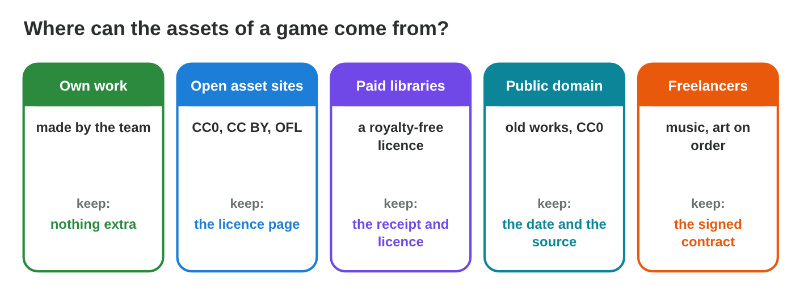
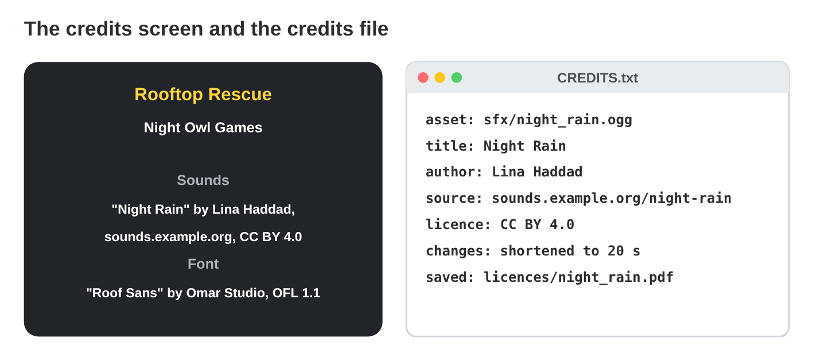
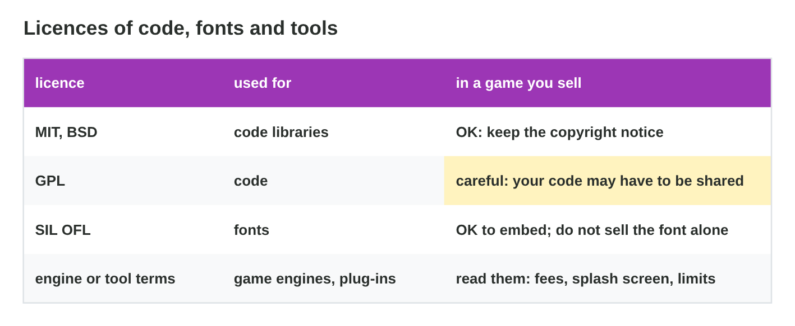

::: {.lead}
*Rooftop Rescue* needs more sounds, a pack of roof tiles, a pixel font and a
small physics library, and the release is in three weeks. Nour cannot draw
everything, and Yara cannot record every sound. Open and licensed assets
save weeks of work, but only if the team chooses them well and gives
correct credit. In lectures 23 and 24 you learned copyright, licences and
the rights check. In this lesson you learn to **use** licensed and open
assets: where to find them, how to read and keep their licences, how to
write credits with **TASL**, and what the licences of code and fonts ask
for. Every section ends with a short task, and you start your own
**credits file**.
:::

## Key terms



## 25.1 Where can assets come from?

A game's assets come from five kinds of sources, and each needs a different
proof (@fig-sources).

::: {.callout-important title="Definition 25.1 — Sources of assets"}
- **Own work:** made by the team (employees: work for hire).
- **Open asset sites:** **open assets** under CC0, CC BY, CC BY-SA or the
  OFL.
- **Paid asset libraries** and stores: usually a **royalty-free** licence;
  keep the receipt and the licence text.
- **Public domain** archives: old works whose copyright has ended, and CC0.
- **Freelancers:** work made on order, with a signed contract.

"Found with an image search" is not a source: it does not tell you who owns
the work or under which licence.
:::

{#fig-sources width=94%}

::: {.callout-note title="Example 25.1 — Four new assets"}
1. A thunder sound from an open sound site, CC BY 4.0.
2. A roof-tile pack from an art site, CC BY-SA 4.0.
3. A pixel font from a font site, SIL Open Font License.
4. A physics code library, MIT licence.

For each, Salma saves the licence page in the project folder `licences/`.
:::

::: {.callout-warning title="Common mistake"}
Trusting a re-upload. An asset that someone copied to another site under a
"free" label may not be theirs to share. Download from the creator's own
page or a known library.
:::

::: {.callout-note title="Do it · Find two assets"}
Find two assets for a small game on open asset sites (for example a sound
and an image) that you may use in a game for sale. Write the site and the
licence of each.

*Your result:* two assets with their licences.
:::

## 25.2 Read and save the licence

Before you download, read the licence page (@fig-page).

::: {.callout-important title="Definition 25.2 — Reading a licence page"}
Check five things:

1. **The author** (a person or a studio, not the website).
2. **The exact licence** and its version, for example CC BY 4.0.
3. **Commercial use** and **changes**: allowed or not?
4. **The credit** the author asks for.
5. Other limits, such as "do not sell the file alone".

Then **save** the page (as a PDF with the date) or the licence file in the
project. Licences on a website can change later; your saved copy shows what
you agreed to.
:::

{#fig-page width=94%}

::: {.callout-note title="Example 25.2 — Night Rain"}
1. Author: Lina Haddad. Licence: CC BY 4.0.
2. Commercial use: yes. Changes: yes. Credit: yes.
3. Yara shortens the loop to 20 s and saves the page as
   `licences/night_rain.pdf`.
:::

::: {.callout-warning title="Common mistake"}
Reading only the word "free". "Free" can mean free of cost but not free to
use in a game for sale. The licence decides.
:::

::: {.callout-note title="Do it · Read a licence page"}
For one of your two assets, answer the five questions of Definition 25.2
and save the licence page.

*Your result:* five answers and a saved file.
:::

## 25.3 Credits with TASL

A correct credit has four parts: **TASL** (@fig-tasl).

::: {.callout-important title="Definition 25.3 — TASL credits"}
- **T**itle: the name of the work.
- **A**uthor: the creator.
- **S**ource: where it can be found (a link).
- **L**icence: the licence, with a link if possible.

Add the **changes** you made, for example "shortened by Yara". Write each
credit in the **credits screen** of the game and in the **credits file** of
the project (@fig-credits).
:::

{#fig-tasl width=94%}

{#fig-credits width=94%}

::: {.callout-note title="Example 25.3 — Three credits"}
1. "Night Rain" by Lina Haddad, sounds.example.org/night-rain, CC BY 4.0,
   shortened to 20 s.
2. "Roof Tiles Pack" by Karim Art, art.example.net/roof-tiles, CC BY-SA
   4.0, recoloured by Nour (the recoloured tiles are also CC BY-SA 4.0).
3. "Roof Sans" by Omar Studio, fonts.example.com/roof-sans, SIL OFL 1.1.
:::



::: {.callout-warning title="Common mistake"}
"Sounds from the Internet" as a credit. It names no title, no author and no
licence. Every asset gets its own TASL line.
:::

::: {.callout-note title="Do it · Your credits file"}
1. In **Credit Builder**, build the three credits.
2. Start a credits file for your two assets: asset file, title, author,
   source, licence, changes, saved licence file.

*Your result:* a credits file with two entries.
:::

## 25.4 Code, fonts and tools

Games use code libraries, fonts and engines too, and they have licences
(@fig-code).

::: {.callout-important title="Definition 25.4 — Licences of code, fonts and tools"}
- **Permissive licences** (MIT, BSD): use the code in any product, but
  keep the **copyright notice**.
- **Copyleft** (GPL; for media CC BY-SA): changed versions must be shared
  under the same licence; for GPL code in a game this can mean sharing
  your source code. Ask before you use it.
- **SIL Open Font License (OFL):** embed the font in a game for free; do
  not sell the font file by itself.
- **Engine and tool terms:** read them for fees, splash screens and
  limits.
:::

{#fig-code width=94%}

::: {.callout-note title="Example 25.4 — The physics library"}
1. The library has the MIT licence: Night Owl may use it in the game it
   sells.
2. The condition: the copyright and licence notice must stay with the
   code. Salma adds it to the licence screen of the game.
3. A second library is GPL: the developers choose another one, so that the
   game's code can stay closed.
:::

::: {.callout-warning title="Common mistake"}
Thinking that code and fonts "do not count". A font or a library is a work
with an author and a licence, like a picture.
:::

::: {.callout-note title="Do it · Code and fonts"}
Find one open font and one open-source code library (for example on a
font site and a code site). Write their licences and what each one asks
for.

*Your result:* two licences and two conditions.
:::

## Case study: Asset Shopping

Yara and Nour found six assets for *Rooftop Rescue*: a thunder sound under
CC BY, cloud sprites under CC0, a cat sprite "free for non-commercial
projects", roof tiles under CC BY-SA that Nour wants to recolour, a pixel
font under the OFL, and a physics library under MIT. The Game challenge of
the interactive lesson uses these assets. In the mini-game below you choose
what Night Owl Games must do with each one.



## Further reading

Creative Commons, "Recommended practices for attribution"
(wiki.creativecommons.org). SIL International, "SIL Open Font License"
(openfontlicense.org). Open Source Initiative, "Licenses" (opensource.org).

## Exercises

1. Name the five kinds of sources of game assets.
2. Why is "found with an image search" not a source?
3. Name the five things to check on a licence page.
4. Why should you save the licence page?
5. What do the letters TASL stand for?
6. Write a TASL credit for a photo "Old Roofs" by Sara Nader,
   photos.example.org/old-roofs, CC BY 4.0.
7. Where do the credits of a game go?
8. What does the MIT licence ask for?
9. What does copyleft mean?
10. What may you do with an OFL font, and what not?

## Answers to the exercises

::: {.answers}
1. Own work, open asset sites, paid libraries, public domain, freelancers.
2. It does not say who owns the work or under which licence.
3. The author, the exact licence, commercial use and changes, the credit,
   other limits.
4. Licences on websites can change; the saved copy shows what you agreed
   to.
5. Title, author, source, licence.
6. "Old Roofs" by Sara Nader, photos.example.org/old-roofs, CC BY 4.0.
7. In the credits screen of the game and in the credits file of the
   project.
8. To keep the copyright and licence notice with the code.
9. Changed versions must be shared under the same licence.
10. Embed and use it in the game for free; not sell the font file by
    itself.
:::
