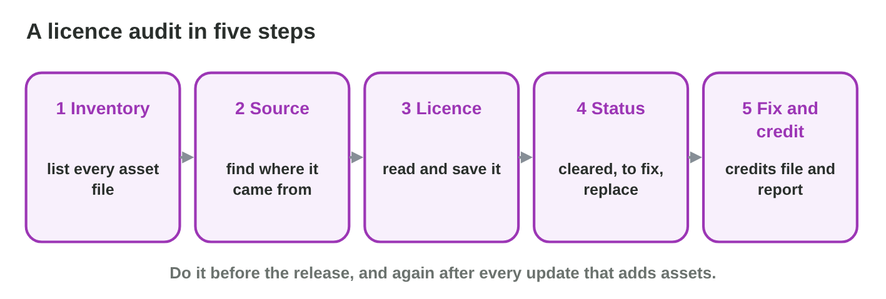

::: {.lead}
The publisher of *Rooftop Rescue* sends one last request before the
release: "Please send us a licence audit of all assets." The project has
214 files in many folders, made over two years by employees, a freelancer,
open asset sites and a few unknown sources. In lecture 25 you learned to
read licences and to write TASL credits. In this seminar you **audit** a
whole game: you list every asset, find its source and licence, decide its
status, fix the problems, and write the credits file and a short audit
report. You work alone. Each section is one step of the seminar and ends
with a task.
:::

## Key terms



## 26.1 Step 1: the asset inventory

An audit starts with a complete list (@fig-steps).

::: {.callout-important title="Definition 26.1 — Asset inventory"}
An **asset inventory** is a table with one row per asset file: the **file
name and folder**, the **type** (art, sound, music, font, video, code), and
**where it came from**. Go through every folder of the project, including
the store page, the trailer and the marketing images, because they are
public too.
:::

{#fig-steps width=94%}

::: {.callout-note title="Example 26.1 — The folders of Rooftop Rescue"}
1. `art/`: 120 files; `audio/`: 60; `fonts/`: 2; `video/`: 4; `plugins/`:
   3 code libraries.
2. Outside the project: the store page images and the trailer.
3. Salma lists them in a spreadsheet: 214 rows plus 9 marketing files.
:::

::: {.callout-warning title="Common mistake"}
Auditing only the game files and forgetting the store page, the trailer and
the social media images. They use assets in public too.
:::

::: {.callout-note title="Do it · Your inventory"}
Take a small game project (your own, or the eight assets of **Audit Board**)
and make an inventory: file, type, where it came from.

*Your result:* an inventory table.
:::

## 26.2 Step 2–3: source and licence

For each row, find the source and the licence, and save the proof.

::: {.callout-important title="Definition 26.2 — Source and licence"}
For each asset, add three columns to the inventory: the **source** (the
creator or the page), the **licence** (exact name and version) and the
**proof** (the saved licence page, the receipt or the contract). If the
source is not known, try a reverse image search or ask the team; if it
stays unknown, the asset must be replaced.
:::

::: {.callout-note title="Example 26.2 — Three rows"}
1. `night_rain.ogg`: sounds.example.org, CC BY 4.0, proof
   `licences/night_rain.pdf`.
2. `theme.ogg`: the freelance composer, contract signed in March, proof
   `contracts/theme.pdf`.
3. `poster_bg.jpg`: "from an image search"; nobody remembers the page; no
   proof.
:::

::: {.callout-warning title="Common mistake"}
Writing "free" or "internet" in the licence column. Write the exact licence,
or "unknown".
:::

::: {.callout-note title="Do it · Find the licences"}
Add source, licence and proof to your inventory.

*Your result:* an inventory with three more columns.
:::

## 26.3 Step 4: the status of each asset

Now judge every row (@fig-audit).

::: {.callout-important title="Definition 26.3 — Three statuses"}
- **Cleared** (green): the use is allowed, and the credit or notice is
  written.
- **To fix** (yellow): the use is allowed, but something is missing, for
  example a credit, a notice or a signed contract.
- **Replace** (red): the use is not allowed (for example NC in a game for
  sale) or the source or licence is unknown.
:::

{#fig-audit width=94%}



::: {.callout-note title="Example 26.3 — Eight statuses"}
1. Cleared: Pasha (employee), the font (OFL, credit written), the theme
   (contract), the roof tiles (CC BY-SA, credit written).
2. To fix: the rain sound (credit missing), the physics library (MIT notice
   missing).
3. Replace: the cat sticker (CC BY-NC) and the poster background (unknown).
:::

::: {.callout-warning title="Common mistake"}
Marking an asset "cleared" because "nobody will notice". The audit is for
the publisher and for the law, not for luck.
:::

::: {.callout-note title="Do it · Run the audit"}
1. In **Audit Board**, give each of the eight assets a status and check it.
2. Give a status to each row of your own inventory.

*Your result:* eight correct statuses and your own statuses.
:::

## 26.4 Step 5: fix, credit and report

The audit ends with fixes, a complete credits file and a short report.

::: {.callout-important title="Definition 26.4 — Fixing and reporting"}
- **Fix** each yellow row: write the credit, add the notice, sign the
  contract.
- **Replace** each red row: own work, a licensed asset, or remove it; then
  audit the new asset too.
- Update the **credits file** and the credits screen.
- Write an **audit report**: the date, the number of assets, how many are
  cleared, fixed and replaced, and what is still open. Repeat the audit
  after each update that adds assets.
:::

::: {.callout-note title="Example 26.4 — The report for the publisher"}
1. *Audit of Rooftop Rescue, version 1.0, 12 May:* 223 assets checked.
2. 215 cleared; 6 fixed (credits and notices added; one contract signed);
   2 replaced (the cat sticker redrawn by Nour, the poster background made
   from game art).
3. Open: none. Proofs in the folders `licences/` and `contracts/`.
:::

::: {.callout-warning title="Common mistake"}
Replacing an asset with another unchecked one. Every new asset goes through
the same steps.
:::

::: {.callout-note title="Do it · Your audit report"}
Write a short audit report for your inventory (5–8 lines) and update your
credits file.

*Your result:* an audit report and a credits file.
:::

## Case study: Audit Fixes

The audit of *Rooftop Rescue* found six problems: a CC BY sound without a
credit, an NC sticker on the store page, a poster background from an image
search, an MIT library without its notice, a boss theme paid without a
contract, and an update with ten new assets next month. The Game challenge
of the interactive lesson uses these findings. In the mini-game below you
choose the fix for each one.



## Further reading

World Intellectual Property Organization (WIPO), *Mastering the Game: Business
and Legal Issues for Video Game Developers* (free PDF, wipo.int), the
chapters on licensing. Creative Commons, "Recommended practices for
attribution" (wiki.creativecommons.org).

## Exercises

1. What is an asset inventory?
2. Name four places outside the game files where assets also appear.
3. Which three columns do you add in steps 2 and 3?
4. What do you write when the licence of an asset is not known?
5. Give the meaning of the three statuses.
6. A CC BY sound has no credit yet. Which status, and which fix?
7. A sticker is CC BY-NC and the game is sold. Which status?
8. What does an audit report contain?
9. Why must a replacement asset be audited too?
10. When should the audit be repeated?

## Answers to the exercises

::: {.answers}
1. A table with one row per asset file: file, type, where it came from.
2. For example the store page, the trailer, social media images, the
   website.
3. Source, licence, proof.
4. "Unknown"; then the asset must be replaced if the source cannot be
   found.
5. Cleared: allowed and credited; to fix: allowed but something missing;
   replace: not allowed or unknown.
6. To fix: write the TASL credit.
7. Replace (or buy a commercial licence).
8. The date, the number of assets, how many are cleared, fixed and
   replaced, what is still open.
9. It can have its own licence problems.
10. After every update that adds assets.
:::
