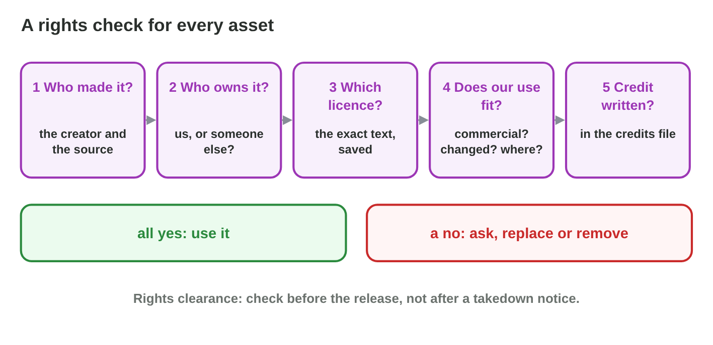

No new ideas today: two short problems on Lecture 12, about the assets of
one game. Do each one alone, then open "Check your result". Every question
on this page has its answer: try first, then check. This seminar explains
the basics; it is not legal advice.

## Recall

- The studio owns its employees' work; a **freelancer** keeps the
  copyright without a written contract; a **library** keeps it and gives a
  licence.
- Without a licence, a work is **all rights reserved**. Read every part of
  a Creative Commons licence: BY, SA, NC, ND.
- Ideas are free; drawings, music and code are protected. React fast to a
  **takedown notice**.

::: {.callout-tip title="Try it 1 · Recall"}
Choose the right answer.

::: {.match extra="the store|the players"}
Who owns a drawing by an employee of the studio?
:   the studio

    Why: Work for hire belongs to the studio.

May a game that is sold use a drawing under CC BY-NC?
:   no: ask for permission or replace it

    Why: NC means non-commercial only.

A store sends a takedown notice for a photo. What do you do first?
:   remove or replace the photo

    Why: Ignoring it can remove the whole game.
:::
:::

## Activity 1 · A rights check for every asset

Before the release of *Rooftop Rescue*, Salma checks every asset with five
questions: **1** Who made it? **2** Who owns it? **3** Which licence?
**4** Does our use fit the licence? **5** Is the credit written? A "no"
means: **ask, replace or remove**.

{width=94%}



::: {.callout-note title="Activity 1 · Six assets · 15 min"}
1. In **Rights Check**, check all six assets of *Rooftop Rescue*.
2. For each asset, write where the check stops (or "passes") and the fix.

*Your product:* six lines: asset, question, fix.

::: {.check}
The theme music (paid, no contract) stops at question 2: get a written
contract. The menu font ("free for personal use") stops at question 4: buy
a commercial licence. The rain sound (CC BY, no credit line) stops at
question 5: write the credit. The poster photo (found by image search)
stops at question 1: remove it or replace it. The assets with a clear
owner, licence and credit pass.
:::
:::

::: {.callout-tip title="Try it 2 · The check"}
Use Rights Check. Where does the check stop?

::: {.match extra="question 0|question 6"}
The theme music, paid, but with no contract.
:   question 2

    Why: The owner is not clear: the freelancer still owns it.

The menu font, "free for personal use".
:   question 4

    Why: A game for sale is not personal use.

The rain sound under CC BY, with no credit line.
:   question 5

    Why: CC BY needs a credit.

The poster photo, found by an image search.
:   question 1

    Why: Nobody knows who made it.
:::
:::

## Activity 2 · The IP desk before the release

Six problems reach Salma's desk: a **theme without a contract**, a
**lookalike logo**, a **traced sprite**, a **takedown notice**, a fan who
wants to sell **comics** of Pasha, and a poster made with an **AI image
tool**. A **rights register** keeps one line per asset: asset, creator,
owner, licence, credit, status.

{width=94%}



::: {.callout-note title="Activity 2 · Six problems and a register · 18 min"}
1. In **IP Desk**, choose the best action for each problem.
2. Write a rights register of four lines for *Rooftop Rescue*: asset,
   creator, owner, licence, credit, status.

*Your product:* your score and a register of four lines.

::: {.check}
IP Desk: the theme → a written contract; the logo → a new design; the
traced sprite → a new drawing; the takedown → remove the photo and check
the register; the fan comics → the studio decides (a fan content policy);
the AI poster → check the tool's terms and record the tool and the prompt.
A good register line: "rain sound | R. Haddad | R. Haddad | CC BY | 'Rain'
by R. Haddad, CC BY | OK".
:::
:::

::: {.callout-tip title="Try it 3 · The desk"}
Choose the best action.

::: {.match extra="add a © sign|change two notes"}
Theme music, paid, but with no contract.
:   get a written contract

    Why: Payment alone does not move the copyright.

A logo like a big drink brand.
:   redesign the logo

    Why: A lookalike logo is a trademark problem.

A traced sprite with new colours.
:   draw a new sprite

    Why: Tracing copies the expression.

A poster made with an AI image tool.
:   check the terms and record the tool

    Why: The tool's terms and the law decide the use.
:::
:::

## Wrap-up {.summary}

- You can check the rights of every asset with five questions and find the
  fix.
- You can solve the IP problems of a game before its release and keep a
  rights register.
