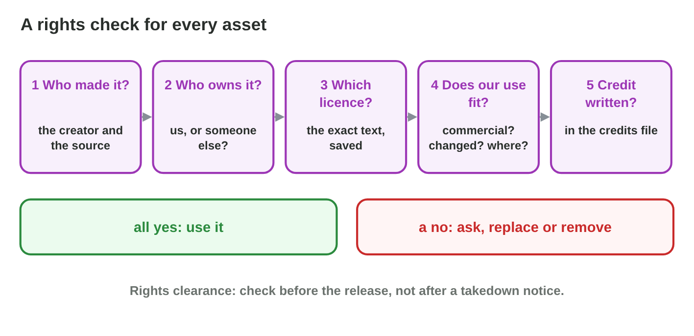
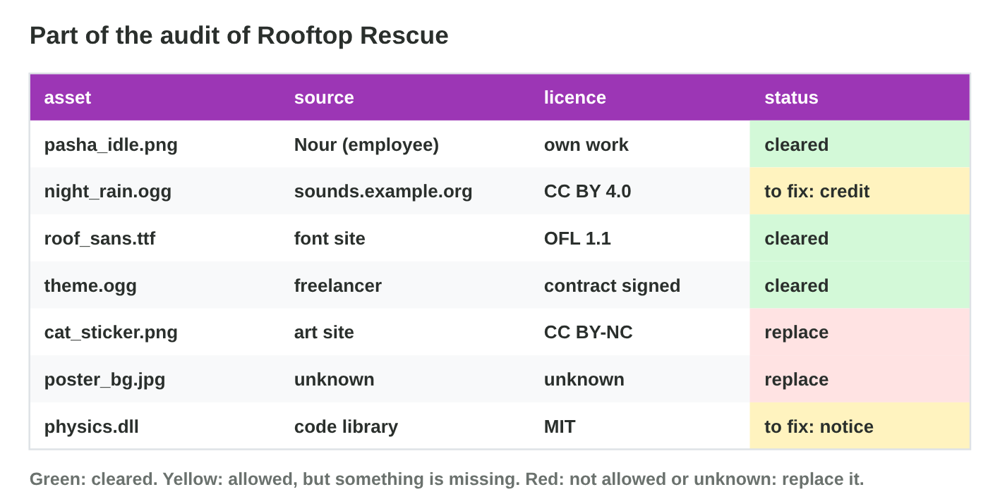

No new ideas today: two short problems on Lecture 12. Do each one alone.
Tap, sort or type your answer at every step: the page checks it at once and
tells you why.

## Recall

- The studio owns the work of its employees. A **freelancer** keeps the
  copyright when there is no written contract. A **library** keeps it and
  gives a licence.
- Without a licence, a work is **all rights reserved**. Read every part of
  a Creative Commons licence: BY, SA, NC, ND.
- Ideas are free. Drawings, music and code are protected. React fast to a
  **takedown notice** (a request to remove content).
- Every asset needs a saved licence and a TASL credit (title, author,
  source, licence).

::: {.callout-tip title="Try it 1 · Recall"}
Choose the right answer.

::: {.match extra="the store|the players"}
Who owns a drawing by an employee of the studio?
:   the studio

    Why: Work for hire belongs to the studio.

May a game that is sold use a drawing under CC BY-NC?
:   no: ask for permission or replace it

    Why: NC means non-commercial only.

A store sends a takedown notice for a photo. What do you do first?
:   remove or replace the photo

    Why: Ignoring it can remove the whole game.
:::
:::

## Activity 1 · A rights check for every asset

Before the release of *Rooftop Rescue*, Salma checks every asset with five
questions. The check stops at the first "no". A "no" means: **ask, replace
or remove**.

| Question | Ask |
|:------:|------------------------------------|
| 1 | Who made it? |
| 2 | Who owns it? |
| 3 | Which licence does it have? |
| 4 | Does our use fit the licence? |
| 5 | Is the credit written? |

: The five questions of the rights check.

{width=94%}



::: {.callout-note title="Activity 1 · Six assets · 15 min"}
1. In **Rights Check**, check all six assets of *Rooftop Rescue*.
2. For each asset, write where the check stops (or "passes") and the fix.

*Your product:* six lines: asset, question, fix.

::: {.sort}
At which question does the check of each asset stop? Sort them.

Question 1 · Who made it?
:   the poster photo, found by image search

    Why: Nobody knows who made it: remove it or replace it.

Question 2 · Who owns it?
:   the theme music, paid, but with no contract

    Why: Payment alone does not move the copyright: get a written contract.

Question 4 · Does our use fit the licence?
:   the menu font, "free for personal use"

    Why: A game for sale is not personal use: buy a commercial licence.

Question 5 · Is the credit written?
:   the rain sound, CC BY, with no credit line

    Why: CC BY asks for a credit: write it.
:::

::: {.choice}
The theme music was paid for, but there is no contract. What is the fix?

- [x] Get a written contract.

  Why: The contract decides who owns the music.

- [ ] Nothing: it was paid.

  Why: Payment alone does not move the copyright.

- [ ] Write a credit line.

  Why: A credit does not give the right to use the music.
:::
:::

::: {.callout-tip title="Try it 2 · The check"}
Use Rights Check. Where does the check stop?

::: {.match extra="question 0|question 6"}
The theme music, paid, but with no contract.
:   question 2

    Why: The owner is not clear: the freelancer still owns it.

The menu font, "free for personal use".
:   question 4

    Why: A game for sale is not personal use.

The rain sound under CC BY, with no credit line.
:   question 5

    Why: CC BY needs a credit.

The poster photo, found by an image search.
:   question 1

    Why: Nobody knows who made it.
:::
:::

## Activity 2 · Audit the assets

Before the release of *Rooftop Rescue*, Salma runs a **licence audit**: one
row for each asset, with its source, its exact licence and its proof, and
then a status:

| Status | It means |
|-----------|----------------------------------------------------------|
| cleared | allowed and credited |
| to fix | allowed, but a credit or a contract is missing |
| replace | not allowed, or the source is unknown |

{width=94%}



::: {.callout-note title="Activity 2 · Eight assets · 18 min"}
1. In **Audit Board**, give each of the eight assets a status and press
   check.
2. For each asset that is not cleared, write its fix.

*Your product:* eight statuses and four fixes.

::: {.sort}
Which status does each asset get? Sort them.

Cleared
:   pasha_idle.png (work for hire)

    Why: The studio owns it.

:   roof_sans.ttf (OFL, credit written)

    Why: The font licence allows a game for sale.

:   theme.ogg (contract signed)

    Why: The contract gives the studio the right.

:   roof_tiles.png (CC BY-SA, credit written)

    Why: Allowed and credited.

To fix
:   night_rain.ogg (CC BY, no credit)

    Why: Allowed, but the TASL credit is missing.

:   thunder.ogg (CC BY, no credit)

    Why: Write its TASL credit too.

Replace
:   cat_sticker.png (CC BY-NC)

    Why: NC is not allowed in a game for sale.

:   poster_bg.jpg (source unknown)

    Why: An asset with an unknown source is replaced.
:::
:::

::: {.callout-tip title="Try it 3 · Statuses"}
Use Audit Board. Choose the status.

::: {.match extra="ignore it|delete the game"}
A CC BY sound with no credit line yet.
:   to fix

    Why: The licence allows it; only the credit is missing.

A CC BY-NC sticker in a game for sale.
:   replace

    Why: NC does not allow commercial use.

A font under the OFL, with its credit written.
:   cleared

    Why: The OFL allows the font in a game, and the credit is there.

Recoloured CC BY-SA tiles, with the credit written.
:   cleared

    Why: The credit is written, and the tiles are shared as CC BY-SA.
:::
:::

## At home · Task with AI

::: {.callout-note .ai-task title="Task with AI · A credits table coloured by licence"}
An extra for the curious: let an AI assistant make the table. Copy the
prompt into an AI assistant that the university allows (for example
Microsoft Copilot with your university account), and look at the result.

::: {.prompt}
Make a credits table for a mobile game that will be sold. Columns: title,
author, source, licence, can we use it. Write yes or replace, and colour
yes green and replace red. Assets: 1. the sound "Wave Crash" by Lina
Haddad, from a sound website, licence CC BY 4.0. 2. the music "Night Sea"
by Omar Saleh, from a music website, licence CC BY-NC 4.0. 3. the font
"Harbor Sans" by Sami Rami, from a font website, licence SIL Open Font
License. 4. the picture "Old Boat", author unknown, found in a web search,
no licence. 5. the icon "Lamp" by Rana Odeh, from an icon website, licence
CC0.
:::

::: {.choice}
Which rows should be green? The AI can be wrong: compare.

- [x] 1, 3 and 5 green; 2 and 4 red

  Why: CC BY with a credit, the font licence and CC0 allow a game for sale; NC and an unknown source do not.

- [ ] All five green: every asset is on a website.

  Why: A website gives no right by itself; the licence decides.
:::

::: {.try-change}
**Change:** say that the game is free, with no ads and no purchases, and ask
again.

::: {.choice}
What changes?

- [x] The NC music can now be used, with a credit; the picture without a source is still red.

  Why: The game earns no money, but an unknown source is still a problem.

- [ ] Every row turns green.

  Why: The picture still has no source and no licence.
:::
:::

::: {.try-change}
**Change:** add: 6. the song "Sea Song" by a famous band, from a video website,
no licence. Ask again.

::: {.choice}
What does the new row show?

- [x] red: replace it

  Why: The song is protected by copyright, and a video website gives no right to use it.

- [ ] green: it is on a public website

  Why: Public to watch is not free to use in a game.
:::
:::

**Your own idea:** change one more number or word, and look again. The AI
can be wrong: compare its result with the answers.
:::

## Wrap-up {.summary}

- You can check an asset with the five rights questions and decide who
  owns it.
- You can audit the licences of a game's assets and give each one a status:
  cleared, to fix or replace.
