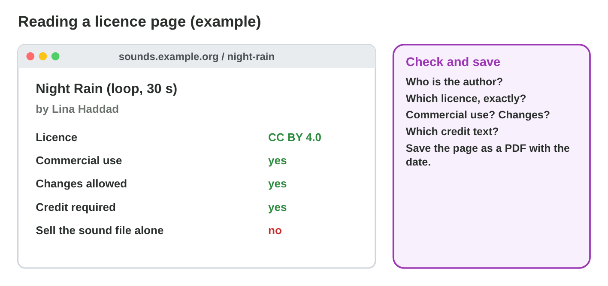
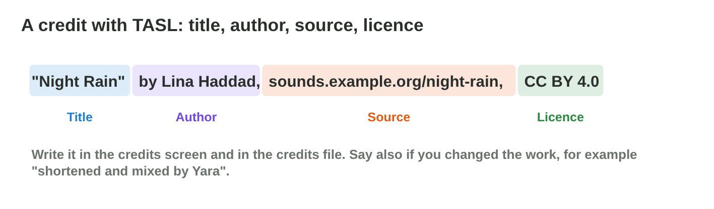

::: {.lead}
*Rooftop Rescue* needs more sounds, a pack of roof tiles and a pixel font,
and the release is in three weeks. Nour cannot draw
everything, and Yara cannot record every sound. Open and licensed assets
save weeks of work, but only if the team chooses them well and gives
correct credit. In Lecture 12 you learned copyright and licences. In this
lesson you learn to **use** licensed and open assets: where to find them,
how to read and keep their licences, how to write credits with **TASL**,
and how to check every asset before the release. Every section ends with a short task, and you start your own
**credits file**.
:::

## Key terms



## 13.1 Where can assets come from?

A game's assets come from five kinds of sources, and each needs a different
proof (@fig-sources).

::: {.callout-important title="Definition 13.1 — Sources of assets"}
- **Own work:** made by the team (employees: work for hire).
- **Open asset sites:** **open assets** under CC0, CC BY, CC BY-SA or the
  OFL.
- **Paid asset libraries** and stores: usually a **royalty-free** licence;
  keep the receipt and the licence text.
- **Public domain** archives: old works whose copyright has ended, and CC0.
- **Freelancers:** work made on order, with a signed contract.

"Found with an image search" is not a source: it does not tell you who owns
the work or under which licence.
:::

{#fig-sources width=94%}

::: {.callout-note title="Example 13.1 — Four new assets"}
1. A thunder sound from an open sound site, CC BY 4.0.
2. A roof-tile pack from an art site, CC BY-SA 4.0.
3. A pixel font from a font site, SIL Open Font License.
4. Theme music from a freelancer, with a signed contract.

For each, Salma saves the licence page in the project folder `licences/`.
:::

::: {.callout-warning title="Common mistake"}
Trusting a re-upload. An asset that someone copied to another site under a
"free" label may not be theirs to share. Download from the creator's own
page or a known library.
:::

::: {.callout-note title="Do it · Find two assets"}
Find two assets for a small game on open asset sites (for example a sound
and an image) that you may use in a game for sale. Write the site and the
licence of each.

*Your result:* two assets with their licences.

::: {.check}
A good answer looks like: "A rain sound on an open sound site, CC BY 4.0,
by its author's page. A tree image on an art site, CC0." Both allow a game
for sale; the page of each is saved.
:::
:::

## 13.2 Read and save the licence

Before you download, read the licence page (@fig-page).

::: {.callout-important title="Definition 13.2 — Reading a licence page"}
Check five things:

1. **The author** (a person or a studio, not the website).
2. **The exact licence** and its version, for example CC BY 4.0.
3. **Commercial use** and **changes**: allowed or not?
4. **The credit** the author asks for.
5. Other limits, such as "do not sell the file alone".

Then **save** the page (as a PDF with the date) or the licence file in the
project. Licences on a website can change later; your saved copy shows what
you agreed to.
:::

{#fig-page width=94%}

::: {.callout-note title="Example 13.2 — Night Rain"}
1. Author: Lina Haddad. Licence: CC BY 4.0.
2. Commercial use: yes. Changes: yes. Credit: yes.
3. Yara shortens the loop to 20 s and saves the page as
   `licences/night_rain.pdf`.
:::

::: {.callout-warning title="Common mistake"}
Reading only the word "free". "Free" can mean free of cost but not free to
use in a game for sale. The licence decides.
:::

::: {.callout-note title="Do it · Read a licence page"}
For one of your two assets, answer the five questions of Definition 13.2
and save the licence page.

*Your result:* five answers and a saved file.

::: {.check}
A good answer gives the author (a person), the exact licence with its
version (CC BY 4.0), commercial use and changes (allowed or not), the
credit asked for, and other limits; the page is saved as a PDF with the
date.
:::
:::

## 13.3 Credits with TASL

A correct credit has four parts: **TASL** (@fig-tasl).

::: {.callout-important title="Definition 13.3 — TASL credits"}
- **T**itle: the name of the work.
- **A**uthor: the creator.
- **S**ource: where it can be found (a link).
- **L**icence: the licence, with a link if possible.

Add the **changes** you made, for example "shortened by Yara". Write each
credit in the **credits screen** of the game and in the **credits file** of
the project (@fig-credits).
:::

{#fig-tasl width=94%}

{#fig-credits width=94%}

::: {.callout-note title="Example 13.3 — Three credits"}
1. "Night Rain" by Lina Haddad, sounds.example.org/night-rain, CC BY 4.0,
   shortened to 20 s.
2. "Roof Tiles Pack" by Karim Art, art.example.net/roof-tiles, CC BY-SA
   4.0, recoloured by Nour (the recoloured tiles are also CC BY-SA 4.0).
3. "Roof Sans" by Omar Studio, fonts.example.com/roof-sans, SIL OFL 1.1.
:::



::: {.callout-warning title="Common mistake"}
"Sounds from the Internet" as a credit. It names no title, no author and no
licence. Every asset gets its own TASL line.
:::

::: {.callout-note title="Do it · Your credits file"}
1. In **Credit Builder**, build the three credits.
2. Start a credits file for your two assets: asset file, title, author,
   source, licence, changes, saved licence file.

*Your result:* a credits file with two entries.

::: {.check}
Credit Builder: "Night Rain" by Lina Haddad, sounds.example.org, CC BY 4.0,
shortened to 20 s; "Roof Tiles Pack" by Karim Art, CC BY-SA 4.0,
recoloured by Nour; "Roof Sans" by Omar Studio, SIL OFL 1.1. Your file has
one TASL line for each of your two assets.
:::
:::

## 13.4 Check every asset before the release

Before a game goes to the store, the team checks **every** asset, also the
store page and the trailer (@fig-check).

::: {.callout-important title="Definition 13.4 — The rights check"}
Ask five questions for each asset: **1** Who made it? **2** Who owns it?
**3** Which licence? **4** Does our use fit the licence? **5** Is the
credit written? Then give the asset a **status**:

- **cleared:** all five answers are "yes";
- **to fix:** one thing is missing, such as a credit or a contract;
- **replace:** the source is unknown, or the licence does not allow our
  use.
:::

{#fig-check width=94%}

::: {.callout-note title="Example 13.4 — Four assets of Rooftop Rescue"}
1. The thunder sound: CC BY, the credit is written: **cleared**.
2. The theme music: a freelancer, paid, but no contract: **to fix** (sign
   a contract).
3. A cloud photo from an image search, page unknown: **replace**.
4. A pixel font under the SIL Open Font License, no credit yet: **to fix**
   (write the credit).
:::

::: {.callout-warning title="Common mistake"}
Checking only the game files. The store page, the trailer and the
marketing images are public too: check them as well.
:::

::: {.callout-note title="Do it · Give a status"}
Give a status (cleared, to fix or replace) to four assets of your credits
file or of a game you imagine, with a reason for each.

*Your result:* four statuses with reasons.

::: {.check}
A good answer: "a sound under CC BY with its credit: cleared; music from a
freelancer without a contract: to fix (sign a contract); a photo from an
image search: replace; a font under OFL without a credit: to fix (write
the credit)." Each status has a reason.
:::
:::

## Case study: Asset Shopping

Yara and Nour found six assets for *Rooftop Rescue*: a thunder sound under
CC BY, cloud sprites under CC0, a cat sprite "free for non-commercial
projects", roof tiles under CC BY-SA that Nour wants to recolour, a pixel
font under the OFL, and theme music from a freelancer with a signed
contract. The Game challenge of
the interactive lesson uses these assets. In the mini-game below you choose
what Night Owl Games must do with each one.



## Further reading

Creative Commons, "Recommended practices for attribution"
(wiki.creativecommons.org). SIL International, "SIL Open Font License"
(openfontlicense.org).

## Exercises

1. Name the five kinds of sources of game assets.
2. Why is "found with an image search" not a source?
3. Name the five things to check on a licence page.
4. Why should you save the licence page?
5. What do the letters TASL stand for?
6. Write a TASL credit for a photo "Old Roofs" by Sara Nader,
   photos.example.org/old-roofs, CC BY 4.0.
7. Where do the credits of a game go?
8. Name the five questions of the rights check.
9. A sound has an unknown source. Which status does it get?
10. What may you do with an OFL font, and what not?

## Answers to the exercises

::: {.answers}
1. Own work, open asset sites, paid libraries, public domain, freelancers.
2. It does not say who owns the work or under which licence.
3. The author, the exact licence, commercial use and changes, the credit,
   other limits.
4. Licences on websites can change; the saved copy shows what you agreed
   to.
5. Title, author, source, licence.
6. "Old Roofs" by Sara Nader, photos.example.org/old-roofs, CC BY 4.0.
7. In the credits screen of the game and in the credits file of the
   project.
8. Who made it? Who owns it? Which licence? Does our use fit? Is the
   credit written?
9. Replace.
10. Embed and use it in the game for free; not sell the font file by
    itself.
:::
